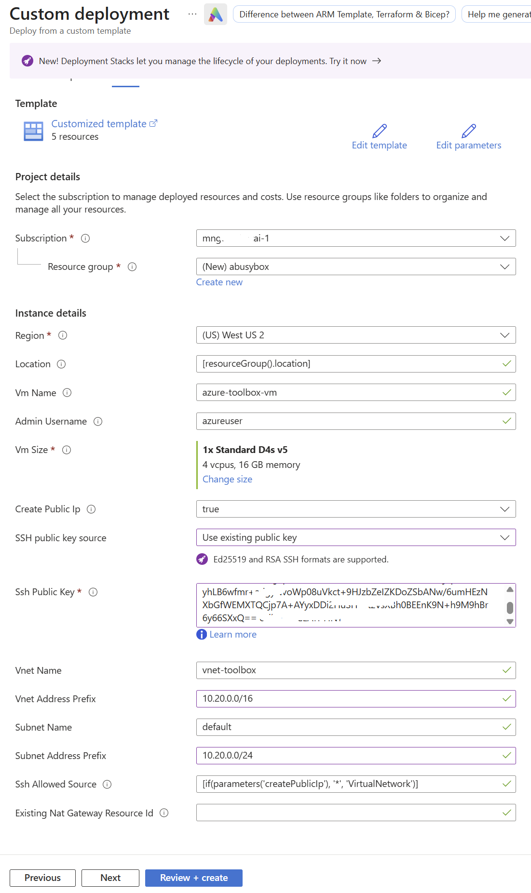

# Azure Linux toolbox VM

[中文版](./README_CN.md)

[](https://portal.azure.com/#view/Microsoft_Azure_CreateUIDef/CustomDeploymentBlade/uri/https%3A%2F%2Fraw.githubusercontent.com%2Foxcp%2Fainotes%2Fmain%2Fagenthost%2Faz-toolbox-vm%2Fmain.json/uiFormDefinitionUri/https%3A%2F%2Fraw.githubusercontent.com%2Foxcp%2Fainotes%2Fmain%2Fagenthost%2Faz-toolbox-vm%2FuiFormDefinition.json)

Deploy an Ubuntu 24.04 LTS engineering workstation using Bicep or Azure Portal Custom Deployment. `main.bicep` is the infrastructure source of truth; `main.json` is generated and includes cloud-init and the verification script. The button loads both `main.json` and `uiFormDefinition.json` from GitHub to show the custom deployment form; no separately hosted installation scripts are needed.

## Architecture

```text
Resource group
  New VNet / subnet / NSG, or existing VNet / subnet
    NIC -- optional Standard static public IPv4
      Ubuntu 24.04 VM / system-assigned managed identity
        cloud-init -> system tools + admin-user extensions -> verification
```

The image is `Canonical:ubuntu-24_04-lts:server:latest` (x64, generation 2). The template creates only the administration VM for this workshop; it does not create AKS clusters, Container Apps environments, or resources covered by the other workshop modules.

Installed tools:

| Component | Installation |
| --- | --- |
| Azure CLI | Current stable Microsoft release, checked against minimum 2.80.0 |
| Git, curl, jq | Ubuntu packages |
| Azure Developer CLI (`azd`) | Current stable Microsoft release |
| Microsoft Foundry extension | `microsoft.foundry`, installed for the configured admin user |
| kubectl | `az aks install-cli`, installed in `/usr/local/bin` (also installs its kubelogin companion) |
| Container Apps extension | Installed for the admin user with `--upgrade --allow-preview true` |

## Prerequisites

- An Azure subscription and permission to deploy compute/network resources into the target resource group, including a system-assigned identity.
- Regional quota and capacity for the selected x64 generation 2 VM size; the default is `Standard_D4s_v5`.
- When using an existing subnet, permission to read its VNet/subnet and perform `Microsoft.Network/virtualNetworks/subnets/join/action`, including when the network is in another resource group.
- Choose an authentication method: **SSH public key** (default, recommended) or **username/password**. Password authentication requires no key generation or existing Linux environment. For key authentication, supply only the public key and keep the private key on your client; use a 4096-bit RSA key for compatibility with Azure Linux VM provisioning.
- A trusted source public IP/CIDR for public SSH. The default `*` is intended only for short-lived labs; replace it before deployment.
- Outbound DNS and HTTPS access to Ubuntu repositories, Microsoft package/install endpoints, the azd extension registry, and GitHub/Kubernetes download endpoints during first boot.

### Choosing an authentication method

The template supports the following two methods. SSH public key authentication remains the default to preserve existing behavior. Both methods connect to the Linux VM over SSH; neither requires Linux or WSL on your client.

Use the [custom deployment form](#azure-portal-deployment) below for the recommended experience: only the selected method's credential fields are shown, and the unused credential is automatically passed as an empty string. The instructions to leave fields empty in the table apply only to CLI deployment or the standard parameter page that loads `main.json` alone.

| Method | When to choose it | Template parameters |
| --- | --- | --- |
| SSH public key (default, recommended) | You prioritize security or plan to use the VM long term | `authenticationType=sshPublicKey`, supply `sshPublicKey`, and leave `adminPassword` empty |
| Username/password (optional) | You want to start the workshop quickly without generating or managing keys | `authenticationType=password`, supply `adminPassword`, and leave `sshPublicKey` empty |

Password authentication uses `adminUsername` and `adminPassword`. It still requires an SSH client, but not `ssh-keygen`. Windows users can use the Windows **OpenSSH Client**. If PowerShell cannot find `ssh` or `ssh-keygen`, install **OpenSSH Client** from Windows Optional Features; you do not need OpenSSH Server.

### Using a username and password

Set `authenticationType=password` and enter `adminPassword`; the custom form automatically hides the public key field and passes an empty `sshPublicKey`. With the CLI or standard parameter page, leave `sshPublicKey` empty yourself. Use a unique password of 12–72 characters containing at least three of these categories: uppercase letters, lowercase letters, digits, and special characters. Azure validates the supplied credentials during deployment; do not leave the selected method's credential empty.

The password is passed as an ARM secure string parameter and is not embedded in cloud-init or deployment outputs. Password authentication is enabled only when you explicitly select `password`, and cloud-init configures SSH password login accordingly. For new networks, restrict `sshAllowedSource` to your own public IP/CIDR (use `/32` for a single IPv4 address); for existing networks, enforce that restriction in their existing NSG rules. Do not expose password login to `*`.

### Using an SSH public key without an existing Linux environment

Choose any one of these ways to prepare a key:

**Option A: Generate a key in Azure Portal.** Use the **SSH keys** service to generate an RSA key pair, download and securely store the private key, then copy the resource's public key into the template's `sshPublicKey`. This requires no local `ssh-keygen`, but connecting to the VM still requires an SSH client and the downloaded private key.

**Option B: Generate a key in Windows PowerShell.** Windows OpenSSH Client includes both `ssh` and `ssh-keygen`. Run the following in PowerShell; the private key is stored in your user profile, not in the repository:

```powershell
New-Item -ItemType Directory -Force -Path "$env:USERPROFILE\.ssh" | Out-Null
ssh-keygen -t rsa -b 4096 -f "$env:USERPROFILE\.ssh\toolbox_rsa"
Get-Content "$env:USERPROFILE\.ssh\toolbox_rsa.pub"
```

Set a private-key passphrase when prompted, and copy the complete public key displayed by the last command into `sshPublicKey`. Do not upload the private key. If that filename already exists, choose a different name rather than overwriting an existing key.

**Option C: Generate a key in Linux, WSL, or Azure Cloud Shell.** Run the following in your chosen environment:

```bash
ssh-keygen -t rsa -b 4096 -f ~/.ssh/toolbox_rsa
```

Supply the complete contents of the generated `~/.ssh/toolbox_rsa.pub` as `sshPublicKey`, and keep the private key on the client you will use to connect. When using Cloud Shell, ensure the private key is securely saved before ending the session.

## Parameters

| Parameter | Default | Purpose |
| --- | --- | --- |
| `location` | Resource group location | Resource region |
| `vmName` | `azure-toolbox-vm` | VM and derived resource names |
| `adminUsername` | `azureuser` | SSH user and owner of user-scoped extensions |
| `vmSize` | `Standard_D4s_v5` | x64 generation 2 compatible VM size |
| `authenticationType` | `sshPublicKey` | `sshPublicKey` or `password` |
| `sshPublicKey` | Empty | Full public key text; required for `sshPublicKey` authentication |
| `adminPassword` | Empty | Secure string; required for `password` authentication, otherwise leave empty |
| `createPublicIp` | `true` | Attach a public IPv4 address |
| `networkMode` | `new` | `new` creates a VNet/subnet; `existing` attaches to an existing subnet |
| `existingSubnetResourceId` | Empty | Full subnet resource ID; required for `networkMode=existing` |
| `sshAllowedSource` | `*` with public IP; otherwise `VirtualNetwork` | New networks only: SSH source IP/CIDR or service tag |
| `vnetName` | `vnet-toolbox` | New networks only: VNet name |
| `vnetAddressPrefix` | `10.10.0.0/16` | New networks only: VNet address space |
| `subnetName` | `default` | New networks only: subnet name |
| `subnetAddressPrefix` | `10.10.0.0/24` | New networks only: subnet range within the VNet |
| `existingNatGatewayResourceId` | Empty | New networks only: optional existing NAT gateway for explicit egress |

Use valid Azure resource names and a valid Linux admin username/hostname. For new networks, choose nonoverlapping address ranges and unique VNet names: this mode creates and manages the VNet/subnet and must not target a shared VNet. For multiple deployments in one resource group, choose unique `vmName` values and, when creating a network, unique `vnetName` values.

### Choosing a new or existing network

- **New VNet and subnet** (`networkMode=new`, default): creates the VNet, subnet, and NSG. Under **Network mode**, choose **Create a new VNet and subnet**, then enter the VNet/subnet names and CIDRs in the dedicated text fields. **New subnet name** defaults to `default` and is editable. An existing NAT gateway can optionally be attached.
- **Existing VNet and existing subnet** (`networkMode=existing`): under **Network mode**, choose **Use an existing VNet and subnet**. The **Existing VNet** selector lists existing networks; the **Existing subnet** dropdown is populated from that VNet's subnet API and contains only existing subnets, with no creation option. All new-network input fields are hidden. The form passes the selected subnet's full resource ID as `existingSubnetResourceId`, including its resource group, which may differ from the VM's. The NIC joins that subnet; the template creates no VNet, subnet, or NSG and does not change the existing subnet's NSG, routes, NAT, or default outbound access. It also adds no NSG to the NIC.

The existing VNet must be in the same subscription and region as the VM. Choose an IPv4 subnet compatible with VM NICs, with at least one free address; do not use a reserved service subnet or an incompatible delegated subnet. You must ensure that existing network security rules permit TCP/22 only from trusted sources, and that DNS/HTTPS outbound access allows first-boot downloads. Selecting a public IP does not override existing subnet security or routing rules. New-network-only parameters such as `sshAllowedSource` and `existingNatGatewayResourceId` are ignored in existing mode; they do not configure access or egress.

For CLI deployment or the standard parameter page, set `networkMode=existing` and supply a full subnet resource ID of the form `/subscriptions/<subscription-id>/resourceGroups/<network-resource-group>/providers/Microsoft.Network/virtualNetworks/<vnet-name>/subnets/<subnet-name>`. Do not leave it empty. Creating a new subnet inside an existing VNet is not supported.

### Private-only networking and inbound access

With `createPublicIp=false`, no public IP resource or NIC public-IP association is deployed, and the public-IP output is an empty string. SSH requires an existing private route, such as peering/VPN or Bastion connectivity established separately. Setting an SSH source does not create that route.

For new networks, the NSG permits inbound TCP/22 traffic only from `sshAllowedSource`, including traffic within the VNet that would otherwise be allowed by default, and explicitly denies all other inbound traffic. Default outbound NSG rules remain enabled. Existing networks retain their current security and outbound configuration, which you must verify separately.

## Azure Portal deployment

### Recommended: GitHub deployment button with the custom form

`main.json` deploys the resources; the companion [uiFormDefinition.json](./uiFormDefinition.json) controls the interface. The standard **Deploy a custom template** page cannot dynamically hide parameters when you import `main.json` alone. Load the custom form as well.

1. Select **Deploy to Azure** at the top of this README and sign in to Azure.
2. Azure Portal loads the resource template and custom form directly from the public GitHub repository. No local downloads, CLI, sandbox editing, or Template Spec publication is required.
3. Complete **Basics**, **Administrator login**, and **Networking** as described below. Review the configuration, then select **Create** to deploy real resources.

The button references both files on the repository's `main` branch. Commit and push the generated `main.json` and matching `uiFormDefinition.json` before sharing the button; local or unpushed edits are not loaded. If the portal reports that a file cannot be loaded, check that both GitHub Raw URLs are accessible and point to the intended version. For a fixed workshop release, replace `main` in both URLs with the same Git tag or commit ID, then URL-encode the complete Raw URLs. Do not put credentials in the link or in GitHub.

### Alternative: preview local changes in Form view sandbox

Use this workflow to try files that have not yet been pushed to GitHub. You can load local files in Azure Portal without installing a CLI first:

1. Save this directory's `main.json` and `uiFormDefinition.json` locally.
2. Open the [Azure Portal Form view sandbox](https://aka.ms/form/sandbox), sign in to Azure, and set **Package Type** to **CustomTemplate**.
3. Load `main.json` under **Deployment template (optional)**. If prompted to overwrite changes, select **Yes**; this generates a standard form.
4. Replace the entire form JSON in the code editor with the complete contents of this directory's `uiFormDefinition.json`, then select **Preview**.
5. Under **Basics**, select the subscription, resource group, region, VM name, and size.
6. Under **Administrator login**, enter the username and choose an authentication method:
   - **SSH public key (recommended)** shows only the SSH public key field, not password fields.
   - **Username and password** shows only password and confirmation fields, not the SSH public key field.
   - Even if you enter one credential and then switch methods, the unused credential is automatically passed as an empty string.
7. Under **Networking**, choose a **new** or **existing** VNet:
   - Choose **Create a new VNet and subnet** to display the new VNet name/CIDR and subnet name/CIDR fields. Enter the desired name in **New subnet name**. Enter a trusted SSH source and optionally an existing NAT gateway. The SSH source is required and cannot be `*`; for private connections, enter a private source CIDR or `VirtualNetwork`.
   - Choose **Use an existing VNet and subnet**, select **Existing VNet**, then select **Existing subnet** from the dropdown. This mode uses separate existing-resource controls, not a combined create/select control. It hides all new-network inputs and offers no new-subnet action. If the subnet list is empty or fails to load, check the selected VNet's subnets and your network read permissions. Verify its security rules, routing, and outbound access yourself.
   - Choose whether to attach a public IP. Creating a subnet within an existing VNet is not offered.
8. Review the configuration and select **Review + create** / **Create** to deploy. The sandbox's **Preview** is not a simulated deployment: selecting **Create** creates real Azure resources and incurs charges.

For a reusable team entry point, an administrator can publish the template and form together as a Template Spec using Azure CLI. Open that Template Spec in the portal and select **Deploy**. The following command publishes the specification only, not a VM; replace the resource group, location, and version:

```bash
az ts create \
  --name toolbox-vm \
  --version 1.0 \
  --resource-group YOUR_TEMPLATE_SPEC_RESOURCE_GROUP \
  --location YOUR_AZURE_REGION \
  --template-file main.json \
  --ui-form-definition uiFormDefinition.json
```

Run this command from this directory with permission to publish Template Specs. Deployment users need read access to the Template Spec and permission to deploy the VM resources. Keep `uiFormDefinition.json` in sync when changing parameters in `main.json`. The form's `outputs.parameters` is a deployment parameter mapping, not deployment result outputs; the password still goes to the template's `secureString` parameter.

### Alternative: import only the resource template (both credential parameters remain visible)

If you continue with the standard import workflow below, both public key and password parameters remain visible, and you must leave the unused credential empty yourself. Use the custom form above for automatic field visibility.

1. Open Azure Portal and search for **Deploy a custom template**.
2. Select **Build your own template in the editor**.
3. Select **Load file** and load this directory's generated `main.json`.
4. Select **Save**.
5. Choose your subscription and resource group, then review the deployment parameters. Keep `networkMode=new` to create a network, or set `networkMode=existing` and supply `existingSubnetResourceId` to use an existing subnet. In existing mode, the new-network settings have no effect.
6. Choose `authenticationType`: for `sshPublicKey`, paste the complete SSH **public** key into `sshPublicKey` and leave `adminPassword` empty; for `password`, enter `adminPassword` and leave `sshPublicKey` empty. For a new network, set `sshAllowedSource` to your trusted public IP/CIDR, not `*`, especially when using a password; for an existing subnet, ensure its existing NSG rules enforce that restriction. Change the admin username or other parameters as needed. The screenshot illustrates key authentication; the updated template also includes authentication and network-selection parameters:


7. Select **Review + create**, then **Create** after validation succeeds.
8. Use the deployment outputs for the VM name, resource ID, private/public address, and admin username.

Azure deployment success means the VM was provisioned, **not** that cloud-init has finished installing the tools. Wait and verify as described below.

## Validation

SSH using the deployment output address and configured username (replace `azureuser` if you changed it). Windows users can run these commands in PowerShell with the Windows OpenSSH Client; WSL is not required. If `ssh` is unavailable, install **OpenSSH Client** from Windows Optional Features.

For password authentication, run the following and enter the password at the prompt (do not put it in the command):

```bash
ssh azureuser@VM_IP_ADDRESS
```

For SSH key authentication, use your downloaded or locally generated private key:

```bash
ssh -i ~/.ssh/toolbox_rsa azureuser@VM_IP_ADDRESS
```

In Windows PowerShell, use this path syntax (replace it with the actual download path if you downloaded the private key from the portal):

```powershell
ssh -i "$env:USERPROFILE\.ssh\toolbox_rsa" azureuser@VM_IP_ADDRESS
```

On the first connection, verify the target VM's host key fingerprint before accepting the prompt. If you set a private-key passphrase, key authentication prompts for that passphrase, not the VM user's password. After connecting, run the following Linux commands on the remote VM, not in your local PowerShell session.

On the VM, wait for initialization, then verify as **azureuser** (or your configured admin user), without sudo:

```bash
cloud-init status --wait
/usr/local/bin/verify-tools.sh
test -f /var/lib/toolbox-install-complete && echo "READY" || echo "NOT READY"
```

## Troubleshooting

> [!TIP]
> This section is only a troubleshooting reference for problems installing the toolbox VM. If the toolbox VM was installed successfully, skip this section.

Run on the VM:

```bash
cloud-init status --long
sudo less /var/log/cloud-init-output.log
sudo less /var/log/toolbox-install.log
sudo cat /var/log/toolbox-versions.log
test -f /var/lib/toolbox-install-complete && echo "READY" || echo "NOT READY"
```

`/var/log/cloud-init-output.log` includes package-stage failures that can happen before the toolbox installer starts. `/var/log/toolbox-install.log` records installation progress and errors. A missing report/marker means validation has not completed successfully. Use managed boot diagnostics from the VM's Portal page if SSH is unavailable.

If SSH fails, check the username, the password or matching private key for the selected authentication method, public/private address, NSG source CIDR, and private routing. If installation fails, check DNS/HTTPS egress, Azure Policy, upstream package/extension availability, and the first error in the logs.

After correcting an installation problem, rerun **only after cloud-init has finished**:

```bash
sudo bash /usr/local/sbin/install-toolbox.sh
/usr/local/bin/verify-tools.sh
```

The installer refreshes base packages, installs current stable CLIs, installs or upgrades Foundry, upgrades Container Apps with preview releases allowed, reinstalls kubectl, and revalidates. It does not duplicate profile entries. Do not run concurrent installers. Retrying the installer does not clear an earlier cloud-init error status; inspect the new logs and marker independently. Avoid `cloud-init clean` on a deployed VM unless you intend to repeat all first-boot processing.

## Security and lifecycle

- SSH password login is disabled by default and enabled only when `authenticationType=password`. The password is passed as an ARM `secureString` parameter, never embedded in cloud-init or deployment outputs. Do not commit private keys, passwords, tokens, or parameter files containing credentials.
- Restrict public SSH to a trusted CIDR. A private-only VM plus existing private routing and explicit NAT egress is preferred for longer-lived environments.
- Tool binaries are installed system-wide. Azure CLI and azd extensions are configured in the chosen admin user's home, not just `/root`; additional users must configure their own extensions.
- Installers download official Microsoft scripts over HTTPS and execute them as root. Review upstream installers and network requirements for your environment; tool versions intentionally follow current stable releases, so rebuilds are not bit-for-bit reproducible.
- No unattended full OS upgrade is performed. Maintain OS security patches and tool updates according to your operational policy.
- Changing source files or redeploying does not rerun cloud-init on an existing VM. Redeploying is not a tool-upgrade mechanism; retry the installer or recreate the VM as appropriate.
- VM compute, disk, and optional public IP incur charges.
