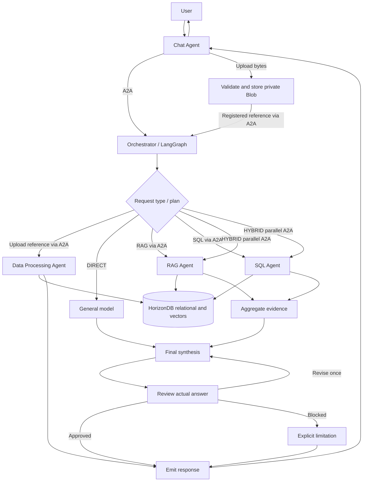
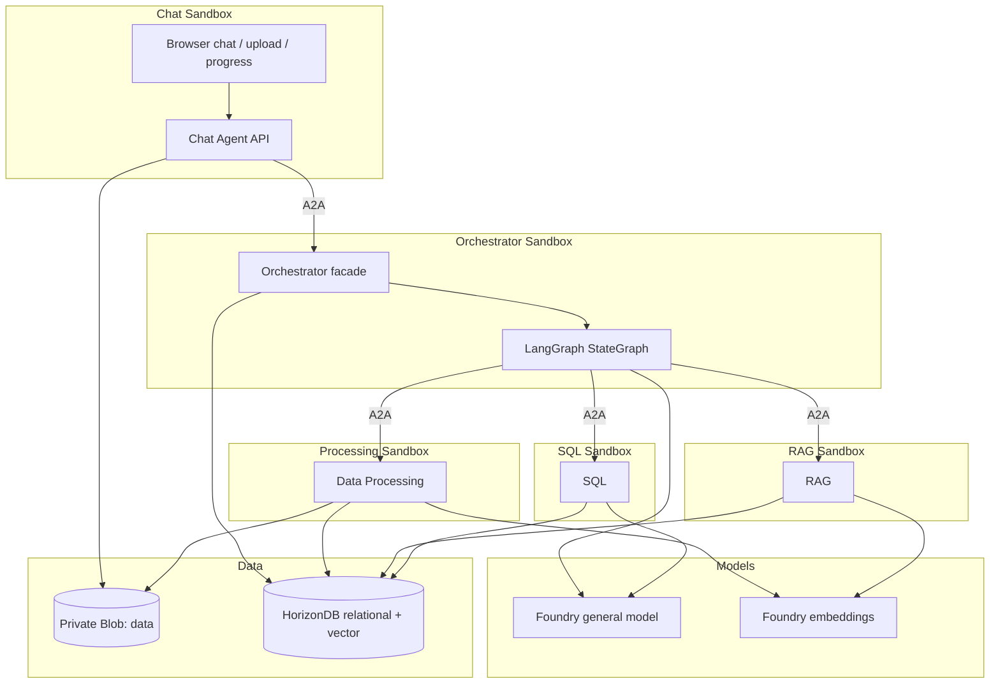

# Module 06: Multi-Agent Business Scenarios

[中文版](readme_CN.md)

> Start with the [Module 6: Multi-Agent Business Scenarios walkthrough](../readme.md) for prerequisites, deployment,
> uploads and Chat scenarios. This source-level README remains the developer/API reference.

Explore multi-agent business scenarios using Product Launch Studio as an example: bring consumer reports, reviews and sales data, then ask grounded product-launch questions.
This module demonstrates **agent runtime boundaries, orchestration, identity, networking and durable data**.
It is a workshop application, not a production multi-tenant service.

**Validation status:** 80 Python tests pass with live local PostgreSQL/vector enabled; five independent
process flows and prior browser checks pass. Image building now uses ACR Tasks (`az acr build`) in an
existing registry, not local Docker. Actual ACR image builds, Agent-container execution and real Azure
sandbox/data/model acceptance remain pending.
See the [implementation report](docs/implementation-report.md) for the exact boundary.

The primary Bash deployment creates/reuses private `data` in Module-01's existing storage account,
without redeploying the account/blob service or changing networking/versioning/RBAC, and mounts it read-only at `/kb-data`
in Chat and Data Processing only, using a shared group `AzureBlobByo` volume and an already assigned managed identity. Orchestrator, RAG and SQL do not mount it.
The root entry derives `KB_STORAGE_CONTAINER_ID` automatically; standalone `deploy-aca.sh` still requires it. See the
[mount prerequisites](../readme.md#existing-private-blob-mount-required-for-bash-deployment).
Every mount must pass a real mountpoint/UID 10001 read check before any Agent activates.
The Blob SDK application adapter is unchanged. This mount automation belongs to the Bash path;
the optional Python provisioner and AKS renderer do not implement it.
Local CLI/schema and mocked deployment checks do not constitute a live Azure mount test.

## Prerequisites and discovered repository patterns

- Python 3.11+ (developed with Python 3.13), PostgreSQL with `vector` or Azure HorizonDB.
- Docker is optional for the local database.
- Image builds require Azure CLI login and permission to run ACR Tasks in the existing workshop ACR.
  Builds publish images remotely; no local Docker daemon is required.
- Existing Microsoft Foundry general model; the primary cloud path deploys embeddings and uses the UAMI,
  while local alternatives require their own model deployments and supported credentials.
- Azure Blob container `data`, or the local filesystem adapter.
- Module-01's Foundry account/project and general-model/APIM configuration are reused.
  The root `models` stage adds embeddings without redeploying the parents or changing Module-01's existing UAMI authorization.
- Module-03 uses a plain HTML/CSS/JavaScript portal, a stdlib Python HTTP server, persisted chat state
  and Responses API calls through APIM with Entra identity. This module adapts the portal's visual style,
  message alignment and input behavior; FastAPI replaces its server and all model calls move to orchestration.
  Original files in Modules 01 and 03 remain unchanged.

## Directory structure and Agent responsibilities

```text
agent-src/
  chat_agent/             FastAPI routes and static UI; no direct model/worker/database calls
  orchestrator_agent/     LangGraph planning, routing, parallel workers, synthesis, review, run tracking
  data_processing_agent/  PDF/DOCX/TXT/MD/CSV/XLSX/JSON extraction and storage strategy
  rag_agent/              Source/topic-scoped cosine retrieval and bounded evidence merging
  sql_agent/              Schema-aware SQL generation, AST validation, exact read-only queries
  shared/                Configuration, Pydantic contracts, Blob, DB, Foundry, SQL safety, logging
  migrations/            Initial relational/vector schema
  tests/                 Unit, API integration, explicit test doubles and optional PostgreSQL tests
  sample-data/           Legacy synthetic fixtures; not used in the workshop or packaged in images
  docs/                  Architecture, orchestration, processing, security and workshop guide
  deploy/                Optional PowerShell builds/Python SDK and AKS renderer
  .env.example           Full configuration reference
  compose.yaml           Local PostgreSQL + pgvector
  compose.agents.yaml    Five independent Agent containers pulled from ACR; no local builds
```

Workshop inputs are the actual prepared PDF/CSV parts in [../sample-data](../sample-data/);
its `manifest.json` records coverage and `raw/` retains originals. Upload the selected parts through Chat;
deployment does not seed data. Do not mix originals and their parts in the same workspace.

Python package names use underscores for importability. Each worker exposes an explicit input/output contract;
workers never call one another. Chat calls a remote Orchestrator facade using A2A; the Orchestrator uses A2A
clients for all three workers. Shared adapters are not duplicated. Each Agent has its own startup entrypoint,
Dockerfile and runtime process; no production in-process worker fallback exists.

Deprecated Bash forwards, the duplicate root Chat Dockerfile and generated artifacts have moved to
[../notmust](../notmust/). Use the module-root Bash scripts and the five per-Agent Dockerfiles.
See the [archive map](../notmust/archive-map.json) for original paths and checksums.

Implementation walkthroughs: [Chat](chat_agent/README.md), [Orchestrator](orchestrator_agent/README.md),
[Data Processing](data_processing_agent/README.md), [RAG](rag_agent/README.md), [SQL](sql_agent/README.md).

## Collaboration and file-upload workflow



Upload bytes are validated and stored privately, then a registered reference is passed to the processing graph.
Processing extracts and classifies data, embeds only useful text, commits relational/vector data atomically, and
returns counts, skipped records and warnings. Questions take a separately planned route. HYBRID waits for independent
workers before synthesis. Review inspects the actual answer; a maximum of one revision is permitted.

## Architecture and trust boundaries



Only the server holds service credentials. Uploaded text is untrusted evidence, not executable instructions.
The browser API is keyless for individually provisioned workshops. Anyone with the Chat URL can access its
workspaces and data. The Orchestrator verifies that the workspace exists, and repositories enforce workspace scope.
There is no workspace key or secret-derived owner. All workspaces in the configured database are shared;
A2A peer authentication remains mandatory and rotating its key does not change workspace visibility.
SQL is validated and rewritten independently of model instructions. Runtime and data are separate: restarting the
server does not delete the knowledge base, but interrupted workflows are not automatically resumed.
Each sandbox publishes an Agent Card; callers resolve it from an operator-configured URL and verify name,
skill, version and exact endpoint before sending credentials/messages. A separate peer bearer key protects
discovery and A2A requests; do not put it in the browser. AKS uses Kata Sandbox CRDs; ACA uses actual Sandboxes.

## Question modes and evidence

| Mode | Rule | Example |
|---|---|---|
| DIRECT | No workspace-specific data needed | Write three taglines for a repairable speaker. |
| RAG | Uploaded text evidence required | According to the uploaded reports, what matters to consumers? |
| SQL | Exact structured calculations | Which country generated the highest total profit? |
| HYBRID | Both qualitative and quantitative evidence | Combine trends and sales performance to recommend a launch market. |

The model returns a schema-validated plan. Classification is based on data requirements, not on what the model
already knows. Final output separates retrieved evidence, calculated facts, interpretation, recommendations and
limitations. The expandable evidence panel includes sources, page/section, scores, executed SQL, result rows and plan.
Weak retrieval and failed workers are explicit. No calculation is presented as executed if its query failed.

## Local setup

Run all commands from this directory.

```powershell
python -m venv .venv
.\.venv\Scripts\Activate.ps1
python -m pip install -e ".[dev,sandbox]"
Copy-Item .env.example .env
```

On Linux/macOS use `source .venv/bin/activate` and `cp .env.example .env`.
Edit `.env` before continuing: replace the database password and A2A peer key, set model deployment names
and HTTPS OpenAI v1 endpoints. Do not commit `.env`.

```sh
az login
docker compose up -d db
python -m shared.database
```

Start **five** terminals with the virtual environment activated; set `A2A_PUBLIC_URL` in each terminal to the
matching URL and run the matching command. The peer URLs in `.env.example` match this topology:

| Agent | `A2A_PUBLIC_URL` | Command |
|---|---|---|
| Chat | `http://127.0.0.1:8080` | `uvicorn chat_agent.app:create_app --factory --host 127.0.0.1 --port 8080` |
| Orchestrator | `http://127.0.0.1:8081` | `uvicorn orchestrator_agent.app:create_app --factory --host 127.0.0.1 --port 8081` |
| Processing | `http://127.0.0.1:8082` | `uvicorn data_processing_agent.app:create_app --factory --host 127.0.0.1 --port 8082` |
| RAG | `http://127.0.0.1:8083` | `uvicorn rag_agent.app:create_app --factory --host 127.0.0.1 --port 8083` |
| SQL | `http://127.0.0.1:8084` | `uvicorn sql_agent.app:create_app --factory --host 127.0.0.1 --port 8084` |

PowerShell example: `$env:A2A_PUBLIC_URL = "http://127.0.0.1:8081"`.
All native processes share the same local originals directory during development only.
For containers, image building, AKS Sandbox or ACA Sandbox, follow [sandbox deployment](docs/sandbox-deployment.md).

Open `http://127.0.0.1:8080`. Sessions load automatically. Select a **Session** or create one with **New session**, click **Connect**,
then upload the actual workshop parts from [../sample-data](../sample-data/). Changing the selection disconnects and clears the on-screen history/retry queue;
click **Connect** again before uploading or chatting in the new Session. No browser key is required.
**Session** is the UI name for a persistent workspace, not a temporary browser login. Reconnecting retains
its structured data and vectors; Sessions do not share data. Internal `workspace_id`, API routes and saved history keys are unchanged.
`GET /health` is a process check, not a claim that cloud dependencies are ready. No model simulation is enabled
in the application. Local development removes Azure DB/Blob requirements but still uses real Foundry models.
The tokenizer's first use downloads the cl100k_base vocabulary; prepare its cache before an offline workshop.

## Azure setup

1. Select HorizonDB (`DB_PROVIDER=horizondb`, default) or Azure PostgreSQL Flexible Server
   (`DB_PROVIDER=postgresql`). Ensure the supported `vector` extension can be enabled.
2. Set its host, database, user/password and TLS mode. Run migrations using an authorized setup role.
3. Set `BLOB_BACKEND=azure` and `AZURE_STORAGE_ACCOUNT_URL` to the existing Module-01 account.
   The Module 06 Bash storage stage creates private `data`; it need not be precreated in Module 01.
4. Grant the runtime managed identity Storage Blob Data Contributor at the required scope.
5. Set `AGENT_APIM_ENDPOINT` for Module-01's general-model route, or set `FOUNDRY_OPENAI_BASE_URL` explicitly.
6. Run Module-06 `bash deploy.sh --stage models` to add the model and embeddings operation/backend to
   Module-01 APIM, without redeploying the service/API or changing Responses. Set `AGENT_APIM_ENDPOINT`
   to `https://<existing-apim-host>/foundry`; generated `FOUNDRY_EMBEDDING_BASE_URL` appends `/openai/v1`.
7. The embedding caller is the existing Agent UAMI; the operation validates its `oid` and the
   `https://ai.azure.com` audience before inherited auth. APIM authenticates to the account backend
   with its already-authorized **system-assigned** identity (no `client-id`), not the attached UAMI.
   `EMBEDDING_TOKEN_SCOPE=https://ai.azure.com/.default` follows the official
   [v1 embeddings SDK examples](https://learn.microsoft.com/azure/foundry/openai/how-to/embeddings).
   No IAM writes are required. Cloud ingestion/query never silently fall back to a direct endpoint;
   optional local flows can explicitly configure a direct endpoint/scope.
8. Configure network/DNS access to database, storage and models. Both workshop database templates use
   its public endpoint and allows **`0.0.0.0` - `255.255.255.255`** by default.
   This exposes database connectivity to every IPv4 source; TLS and strong credentials remain required.
   Restrict the firewall or use private networking outside this workshop.
9. Build one image per Agent and configure five independent sandboxes with reachable A2A URLs and secrets.
   Follow the [AKS/ACA runbook](docs/sandbox-deployment.md); a generated manifest is not a deployed sandbox.

This implementation makes Responses and Embeddings calls using the OpenAI v1 API and DefaultAzureCredential,
with tokens refreshed per request. It does not register new catalog Agents or redeploy Module-01 shared resources;
the Bash storage stage adds only the private `data` container in the existing account.
The models stage adds only the model and APIM embedding children; its versioned `.local/embedding-config.json`
must match the gateway/caller for config-only retries. Old direct metadata or failed APIM provisioning requires
rerunning `--stage models` and regenerating configuration.
Database password authentication is environment-configured; database Entra authentication is not implemented.

### Shell deployment defaults

The Bash scripts use **explicit command-line arguments > nonempty environment variables > defaults**.
They do not automatically source `.env`. Shared names follow Modules 01/04; `LOCATION` defaults to the
existing resource group's location (normally Module-01's `westus2`), and the suffix comes from
`DEPLOYMENT_SN` or the group's `deploymentSN` tag. The scripts do not create a new resource group.

| Environment variables | Defaults / behavior |
|---|---|
| `SUBSCRIPTION_ID`, `RESOURCE_GROUP`, `LOCATION` | Current Azure CLI account; `rg-agenthost-workshop`; existing RG location |
| `DEPLOYMENT_SN` | Existing RG `deploymentSN` tag; never generate a new suffix |
| `ACR_NAME`, `ACR_LOGIN_SERVER` | `acragenthost<SN>`; query that ACR's actual login server |
| `SANDBOX_GROUP_NAME` | `sandbox-group-agenthost-<SN>` from Module-04 |
| `IDENTITY_NAME`, `REGISTRY_IDENTITY` | `id-agenthost-<SN>`; query its ARM resource ID for ACR pull |
| `STORAGE_ACCOUNT_NAME`, `STORAGE_SUBSCRIPTION_ID`, `STORAGE_RESOURCE_GROUP` | Optional existing account/scope overrides; otherwise Blob URL, then `stcagenthost<SN>`; subscription/RG as above |
| `KB_STORAGE_CONTAINER_ID`, `KB_VOLUME_NAME`, `KB_VOLUME_IDENTITY` | Root entry derives the ID; standalone ACA requires it; `studio-kb-data`; registry identity by default |
| `IMAGE_TAG`, `AUTO_SUSPEND_MINS` | `latest`, `0` (disabled for persistent Agents; positive minutes opt in); override the tag for existing `workshop` images |
| `SANDBOX_CPU`, `SANDBOX_MEMORY` | `1000m`, `2048Mi` per Agent |
| `DB_PROVIDER` | `horizondb` (default) or `postgresql`; deployment and all Agents must agree |
| `DB_RESOURCE_NAME`, `DB_USERNAME`, `DB_VCORES` | `hdb-agenthost-<SN>` or `pg-agenthost-<SN>`; `studioadmin`; HorizonDB: `2` vCores |
| `DB_SKU_NAME`, `DB_STORAGE_SIZE_GB` | PostgreSQL GeneralPurpose: `Standard_D2ds_v5`, `32` GiB |
| `DB_PASSWORD`, `DB_PASSWORD_FILE` | No default secret; environment password or `.local/database-password`; explicit `--password-file` wins |
| `DB_FIREWALL_RULES_FILE` | Optional custom JSON rules; otherwise all IPv4 addresses are allowed |
| `DB_OUTPUT`, `ACA_CONFIG`, `ACA_OUTPUT` | `.local/database-deployment.json`, `.local/aca-config.json`, `.local/aca-deployment.json` |
| `HEALTH_TIMEOUT_SECONDS`, `OPERATION_TIMEOUT_SECONDS` | `180`, `900` |
| `CUSTOMER_VNET_CONNECTION_NAME` | Unset; attach an existing group VNet connection only when configured |

The six deployment/build Bash entry points are in the module root (`..`), not `deploy/`.
Shared helpers [aca-config.jq](../common/aca-config.jq) and
[resolve-identity.sh](../common/resolve-identity.sh) are in [../common](../common/).
All five templates are in [../bicep](../bicep/): storage, combined embedding/APIM, database selection and
the two database providers. Common-setting discovery is a function in `deploy.sh`; HorizonDB configuration
and administrator verification are functions in `deploy-database.sh`.
Default protected artifacts are in module-root `.local`,
outside the `agent-src` image context; explicit relative paths are relative to the caller.
Follow the [module walkthrough](../readme.md); the root entry generates the default common JSON automatically.
For overrides, supply a separate protected `ACA_COMMON` file. From `agent-src`:

```bash
bash ../deploy.sh --migrate
```

The unified entry checks first (including read-only ARM account resolution), then runs storage → models → database → config → images → aca.
All five Agents inherit Module-01's UAMI from the SandboxGroup; the primary cloud path injects its client ID,
rejects service-principal secrets and checks token acquisition in each guest.
With a resolved UAMI, either database backend uses Entra token authentication and omits the administrator
password from Agent configuration. The workshop UAMI is a database Entra administrator (not a least-privilege
production role); guest bootstrap checks actual SQL read/write access in a rolled-back transaction before activation.
`--stage storage` incrementally creates private `data` in the reused account; it never deletes data.
Resolve from `ACA_COMMON.AZURE_STORAGE_ACCOUNT_URL`, optional `STORAGE_ACCOUNT_NAME` /
`STORAGE_SUBSCRIPTION_ID` / `STORAGE_RESOURCE_GROUP`, or `stcagenthost<SN>` / the RG tag.
Conflicting account URLs, supplied container IDs or missing accounts fail before provisioning.
`--stage` selects
one deliberate retry; it does not resume or overwrite existing inventories. No host Python,
PowerShell or Docker is needed. `deploy/` retains only deprecated Bash forwards and optional alternatives.
Agent model/Blob/database credentials still come from the protected five-role `ACA_CONFIG` file; the script
does not copy arbitrary shell environment variables into guests. Follow the
[CLI runbook](docs/cli-deployment.md) to prepare it and the database password.
The unified entry deploys billable resources directly; review the target and cost first.
`--migrate` remains an explicit flag, not an ambient environment switch.
All standalone Bash deployment/build scripts also run directly after automatic preflight guards.
Storage `--resolve` and ACA `--capabilities` remain read-only operations.

After preparing credentials and runtime configuration:

```bash
export RESOURCE_GROUP="${RESOURCE_GROUP:-rg-agenthost-workshop}"
export IMAGE_TAG="${IMAGE_TAG:-latest}"
export DB_PROVIDER="${DB_PROVIDER:-horizondb}"  # Set postgresql for Azure PostgreSQL Flexible Server
bash ../deploy.sh --stage storage
export KB_STORAGE_CONTAINER_ID="$(bash ../deploy-storage.sh --resolve)"
bash ../deploy-database.sh
bash ../build-images.sh              # Billable ACR Tasks builds; no local Docker
bash ../deploy-aca.sh --migrate
```

The ACA script prints each Agent's status and URL, fails on readiness timeout, and retains a nonsecret
resource inventory. It checks process health, authenticated A2A cards, database/schema connectivity and
a read-only Chat -> Orchestrator A2A request. It does not replace real model/Blob/business-flow acceptance.
The inventory path must not already exist. Re-running the ACA script creates another five-instance deployment;
preserve the previous inventory and select a different output path when intentionally creating a new one.

## Environment variables

The complete names, defaults and limits are in [.env.example](.env.example).

| Group | Variables |
|---|---|
| Database | `DB_PROVIDER`, `DB_ENDPOINT`, `DB_PORT`, `DB_DATABASE`, `DB_USERNAME`, `DB_PASSWORD`, `DB_SSL_MODE` |
| Blob | `BLOB_BACKEND`, `LOCAL_BLOB_PATH`, `AZURE_STORAGE_ACCOUNT_URL`, `AZURE_STORAGE_CONTAINER` |
| Foundry | `FOUNDRY_PROJECT_ENDPOINT`, `AGENT_APIM_ENDPOINT`, `FOUNDRY_OPENAI_BASE_URL`, `FOUNDRY_EMBEDDING_BASE_URL`, `LLM_MODEL`, `EMBEDDING_MODEL`, `EMBEDDING_DIMENSIONS`, `FOUNDRY_API_VERSION`, `LLM_TOKEN_SCOPE`, `EMBEDDING_TOKEN_SCOPE` |
| A2A | `A2A_API_KEY`, `A2A_PUBLIC_URL`, `ORCHESTRATOR_URL`, `DATA_PROCESSING_URL`, `RAG_URL`, `SQL_URL` |
| Access/limits | `MAX_UPLOAD_BYTES`, `MAX_ROWS`, `MAX_CHUNKS`, `CHUNK_TOKENS`, `CHUNK_OVERLAP`, `EMBEDDING_BATCH`, `TOP_K`, `RELEVANCE_THRESHOLD`, `SQL_ROW_LIMIT`, `SQL_TIMEOUT_MS`, `WORKER_TIMEOUT`, `REQUEST_TIMEOUT`, `MAX_MODEL_CONTEXT`, `MAX_RUNS`, `REQUESTS_PER_MINUTE` |

## HorizonDB schema and migration

Both providers share the psycopg pool, SQL and migrations in `shared.database.Repository`; no duplicate repository.
`DB_PROVIDER` selects the resource type, preserving business/A2A/model behavior. All settings use `DB_*`,
and the database defaults to `postgres`. Deploy with `deploy-database.sh --provider horizondb|postgresql`;
`deploy-horizondb.sh` is only a fixed-HorizonDB compatibility entry point. The PostgreSQL template provisions
PG17 Flexible Server, the vector allowlist and required TLS, with the same secret-free manifest as HorizonDB
for ACA configuration assembly. Errors never switch backend or region. Neither cloud provider has been deployed live.

For the Linux workshop deployment, follow [HorizonDB + ACA CLI](docs/cli-deployment.md).
The new Bash scripts reuse Module-01's RG/region and Module-04's existing SandboxGroup.
They deploy directly after automatic validation, import ACR-built images, safely wire five Agent configurations,
wait for health/cards and print per-Agent results. The Bicep template provisions HorizonDB and allows
the vector extension; `--migrate` applies the application schema in the guest. The initial template
uses the cluster's existing `postgres` database. Local Python provisioning SDK installation is not required.
Cloud execution remains unverified; offline CLI/schema validation is not live deployment acceptance.

`python -m shared.database` applies all packaged [SQL migrations](migrations/) in filename order.
Currently only [001_initial.sql](migrations/001_initial.sql) is included. It idempotently initializes
the current schema without workspace key or owner columns and does not delete existing data.
It does not alter existing tables; legacy databases with `owner_id` require a separate schema upgrade.
Entities: workspaces, documents, document_chunks, datasets, customer_reviews, agent_runs, insights.
Each structured upload gets a `ds_<document UUID>` table with normalized typed columns, workspace ID and row ID.
Vectors retain source-document/row linkage. `insights` is reserved for future curated outputs; automatic insight
promotion is not implemented. Exact cosine search is used for small workshops, not a DiskANN performance demo.
Keep the embedding model/dimension stable; changing either requires a planned re-embedding/schema migration.

## APIs and progress

Before routing a question, the Orchestrator reads a fresh, session-scoped file/catalog snapshot.
The planner sees bounded file-family summaries (originals and split files stay distinct), processing states, example filenames and structured
column names, never Blob URLs or file contents. A missing passage in the prompt is a reason to retrieve,
not to choose DIRECT. History resolves follow-ups but does not establish whether uploaded data exists.
Short analysis titles about available data also use that data. A proposed DIRECT route with available
sources, or a plan missing a required worker goal, receives one independent planning check; genuine general/creative questions and explicitly
user-supplied chart values may remain DIRECT. SQL result interpretation does not itself require RAG;
quoting retrieved text and source metadata does not itself require SQL. After this check, any remaining
empty required worker goals fall back to the current question.
Malformed model plans are logged and retried once per planning call with a compact JSON instruction.
Inventory lookup/model errors remain errors, never a successful-looking DIRECT fallback.
Inventory snapshots and SQL catalogs remain bounded; routing does not guarantee complete shard coverage
or sufficient retrieved evidence. Check actual worker results and their limitations.

Semantic RAG uses a bounded source/topic plan (at most six searches, three concurrent database queries).
It includes English search translations, enforces exact source filenames alongside user filters, and
merges results round-robin with record-ID deduplication (at most 12 records and 14,000 serialized
evidence characters). Per-search `TOP_K` and the relevance threshold are unchanged.
Coverage warnings expose missing or truncated searches; the answer preserves verified findings while
disclosing missing sources/themes, rather than inventing a completed comparison.
Upgrade RAG and Orchestrator together because the shared result contract now permits more than five
records. The separate review-overview scan is unchanged. See [RAG details](rag_agent/README.md).
Answer citation lists also allow 12 records. Inline UUID citations are checked against retrieved
record IDs; document IDs or invented IDs trigger revision, not acceptance as valid references.

All `/api` routes allow keyless workshop access; no browser Authorization header is required.

```text
POST /api/workspaces
GET  /api/workspaces
GET  /api/workspaces/{id}
POST /api/workspaces/{id}/files          multipart: file, conversation_id
GET  /api/workspaces/{id}/files
GET  /api/workspaces/{id}/files/{file}/status
POST /api/workspaces/{id}/chat           JSON: message, conversation_id, recent_context, filters
GET  /api/workspaces/{id}/runs/{run}
GET  /api/workspaces/{id}/sources
GET  /api/workspaces/{id}/datasets
```

Chat/upload returns HTTP 202 with a run ID. Poll its status once per second. Events originate in real graph nodes,
not simulated timers. Completed runs persist in the database. Browser conversation display uses sessionStorage
scoped to the selected workspace and supports local clearing. No token streaming existed in the source portal;
this module streams progress through polling rather than model-token streaming.
The browser polls Chat; Chat polls the Orchestrator through A2A. Processing progress crosses the A2A SSE stream
as task status updates. Results/errors use A2A artifacts. Studio data parts use a `json` string envelope to
preserve exact integers (protobuf's native Value numbers use doubles).
Transient A2A task history is bounded by `MAX_RUNS` and lost on restart; completed business runs remain in the selected database.

### Grounded inline charts

Ask “Show total profit by country as a bar chart and data table.” The model can select bar, line, pie or
numeric comparison tables automatically, or follow an explicit request. `ChartSelection` in
[shared/contracts.py](shared/contracts.py) contains only source/column/row references; the resolver in
[shared/charts.py](shared/charts.py) supplies actual values and validates `ChartSpec`. SQL/HYBRID uses
returned query rows. RAG supports numeric record metadata and, on explicit request, numbers quoted
from retrieved document passages. You do not need to repeat these values in the question.
Upload charts describe ingestion counts only; ask a follow-up SQL/HYBRID question for business metrics.
If an explicit chart request has no suitable numeric data or selection, `CHART_DATA_UNAVAILABLE`
explains the limitation while preserving the answer; ordinary text requests do not receive chart warnings.
The planner records `chart_intent` (`requested`, `none`, or `auto`). Qualitative summaries and explicit
text-only requests skip chart generation. Retrieved numeric metadata (such as review ratings) is charted
only on request; a lone SQL total does not trigger an automatic chart. Automatic SQL comparisons with
two or more rows and ingestion-count charts remain available. Earlier chart requests in conversation
history do not make a new text-only question request a chart.
Requested review-overview visualizations also run SQL even if the planner initially selects RAG alone;
retrieved passages cannot establish the positive/negative distribution of all reviews.
Sources explicitly list eligible numeric `value_columns`; `source_row_id` is not a review metric.
Even comparison tables require numeric series: sentiment/country/product text can label rows, but
cannot be used as numeric values. General text tables belong in the answer, not the chart specification.

For example, ask “From the uploaded report, draw one grouped bar chart comparing the before/after
Gen AI shopping, recommended purchases, chatbot queries and virtual try-on percentages.”
The Orchestrator selects a bounded table from retrieved passages; every cell references a retrieved
record ID, exact numeric token and its occurrence within that record. The server locates the token
and constructs the quotation itself, verifies the evidence belongs to the selected Session and resolves numeric values.
Evidence review checks metric/period mappings, units, scale,
population, conflicting figures and comparability. Missing values are never filled or inferred.
Document charts work even when SQL returns no rows. Expand **Chart sources** below the chart to see
filenames, pages (when available), record IDs and original quotations; these persist with the chart.
Document pies require a quoted exhaustive partition of one population (percentage slices must total
100%); independent usage rates or retrieved review-passage counts are not valid slices.
Line charts require explicitly stated ordered periods. All document charts still pass evidence review.
If PDF extraction loses a figure's layout and its numbers cannot be reliably matched to labels/periods,
those figures are not suitable chart input; use explicit report prose or a structured table instead.
Historical assistant text/citation IDs are excluded from evidence synthesis; planning retains context
for interpreting follow-up requests. More than 1,000 candidate numeric tokens requires narrowing the request.

For explicitly supplied percentage comparisons, ask for a grouped bar chart with one row per line,
for example `Gen AI shopping: 20% -> 24%` (numbered lists, `：`, `→`, `至`, `到` and `％` also work).
The server parses the current request into `Metric`, `Before (%)` and `After (%)` columns; a bar chart
with both series is grouped automatically. These values do not require SQL rows or numeric RAG metadata.
The source caption identifies them as user-provided, not independently verified report facts.
Only current-request values are parsed, not conversation history or numbers guessed from report prose.
This input supports bar/table comparisons, not pie or time-series inference, with at most 40 unique
labels of up to 200 characters and percentages from 0 to 100. Malformed comparisons produce an explicit
chart error without discarding the text answer.

Limits: four charts per run, four series and 40 rows per chart, 200 characters per label, finite numeric
values within ±10^15. Pie requires one nonnegative SQL series or a complete quoted document partition,
with a positive sum; evidence review checks
parts-of-whole meaning, titles and units. Source/subset captions prevent treating retrieved rows as totals.
Invalid selections produce an explicit `INVALID_CHART` partial-run error while preserving the answer;
other chart-generation failures are also explicit. Chart-free old runs remain valid.

Completed run JSON stores `charts` without a database migration. Empty optional citations are omitted
from new non-document chart responses for older-browser compatibility. The UI renders local SVG, hover labels
and accessible text-only tables, with no CDN or model-generated HTML/JavaScript. Browser history stores
the chart specs and chart errors with the last 30 messages in workspace-scoped `sessionStorage`.
Reload/reconnect in the same tab restores them; history is not reconstructed from server runs, and clearing
local history does not remove persisted runs. See the [Chat walkthrough](chat_agent/README.md).

## Tests and build

Provider/configuration tests cover both backends using the same repository. Compiled template assertions
require `bicep` on PATH or `BICEP_COMMAND` set to its executable path; otherwise those two tests are explicitly skipped.
The Bash regression mocks Azure/ACA, covers both provider paths, manifest mapping and failures, and creates no Azure resources.

```sh
python -m ruff check .
python -m ruff format --check .
python -m mypy shared data_processing_agent rag_agent sql_agent orchestrator_agent chat_agent deploy
python -m pytest -q
python -m compileall -q shared data_processing_agent rag_agent sql_agent orchestrator_agent chat_agent
python -m build --no-isolation
node --test tests/ui.test.cjs
bash tests/deploy-shell.test.sh
```

Unit/API tests explicitly use fake models, local files and test repositories. The five-process integration test
uses real A2A HTTP/SSE with a shared SQLite fixture, uploads data, exercises all four routes, then stops the SQL
process to verify partial failure. None of these fixtures are selectable by production configuration. They do not prove Azure
connectivity or HorizonDB compatibility. Optional database tests use `STUDIO_TEST_POSTGRES=1` with `.env` pointing to
a dedicated disposable database. Never run that test against production data.
The Node UI unit tests exercise safe rendering, workflow progress and failure display without third-party packages;
they are not a substitute for a live-browser end-to-end test.

## Workshop, troubleshooting, cleanup and limitations

All eight guides in `docs` have English/Chinese language switches at the top.

- [Demo script and troubleshooting](docs/workshop-guide.md)
- [Architecture and source adaptations](docs/architecture.md)
- [Graph, retries, review and persistence](docs/orchestration.md)
- [File formats and storage policy](docs/data-processing.md)
- [Security, retention and cleanup](docs/security.md)
- [Independent images and AKS/ACA Sandboxes](docs/sandbox-deployment.md)
- [HorizonDB Bicep and five ACA Sandboxes using Bash/CLI](docs/cli-deployment.md)
- [Actual workshop inputs](../sample-data/)

Important limits: one Orchestrator replica schedules workflows; no durable in-flight checkpoint recovery; no OCR; one populated XLSX
worksheet; basic Markdown rendering rather than full GFM; no automatic retention/delete API; single-operator key
authentication; no production RLS configuration; no cloud deployment performed automatically.
Large production documents should be processed in isolated durable workers.
