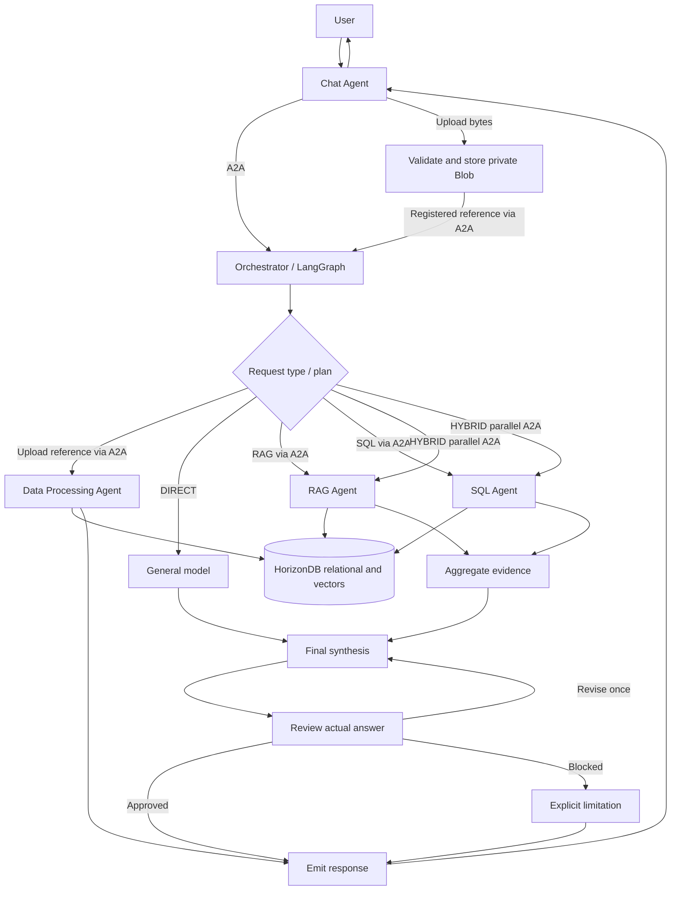
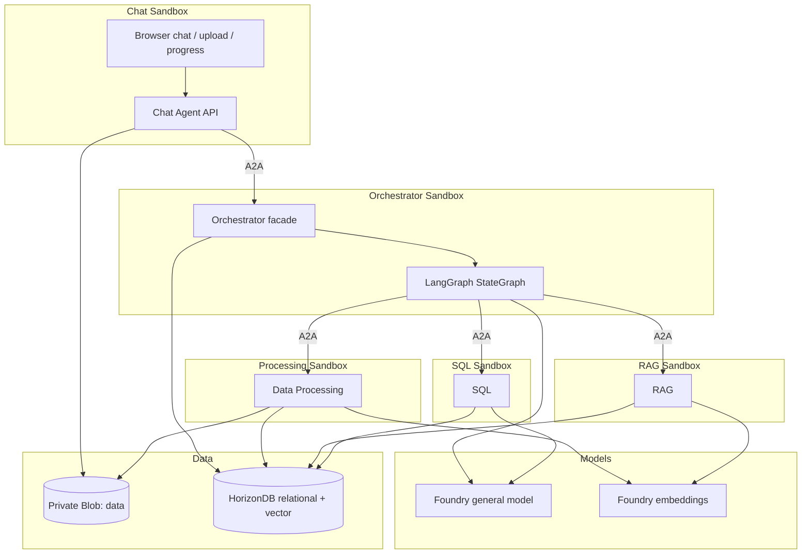

# 模块 06：多智能体业务场景

[English](README.md)

> 前提条件、部署、上传和 Chat 场景请从[模块 6：多智能体业务场景操作指南](../readme_CN.md)开始。
> 本源码级 README 保留为开发/API 参考。

以 Product Launch Studio（产品发布工作室）为示例，实践多智能体业务场景：导入消费者报告、评论和销售数据，然后提出有据可依的产品发布问题。
本模块演示 **Agent 运行时边界、编排、身份、网络和持久化数据**。
这是研讨会应用，而不是生产级多租户服务。

**验证状态：** 启用真实本地 PostgreSQL/vector 后，80 项 Python 测试通过；五个独立进程的流程测试及此前的浏览器检查通过。
镜像现在通过现有注册表中的 ACR Tasks（`az acr build`）构建，不使用本地 Docker 构建。
实际 ACR 镜像构建、Agent 容器运行以及真实 Azure 沙箱、数据和模型验收仍待完成。
准确的验证边界见[实现报告](docs/implementation-report_CN.md)。

Bash 主部署路径在 Module-01 已有存储账户中创建/复用私有 `data`，
不重新部署账户/Blob 服务，也不修改网络/版本控制/RBAC；然后使用组级共享 `AzureBlobByo` 卷和已分配的托管身份，
将它只读挂载到 Chat 和 Data Processing 的 `/kb-data`；Orchestrator、RAG 和 SQL 不挂载。
根入口自动推导 `KB_STORAGE_CONTAINER_ID`；独立 `deploy-aca.sh` 仍要求显式提供它。详见
[挂载前提](../readme_CN.md#挂载已有私有-blobbash-部署必需)。
所有挂载必须通过真实挂载点及 UID 10001 读取检查，之后才会激活任何 Agent。
应用的 Blob SDK 适配器保持不变。此自动挂载仅属于 Bash 路径；
可选 Python 预配工具和 AKS 渲染器尚未实现它。
本地 CLI/架构和模拟部署检查不等同于真实 Azure 挂载测试。

## 前置条件与沿用的仓库模式

- Python 3.11+（开发时使用 Python 3.13），带 `vector` 的 PostgreSQL 或 Azure HorizonDB。
- 本地数据库可选用 Docker。
- 镜像构建需要登录 Azure CLI，并具备在现有研讨会 ACR 中运行 ACR Tasks 的权限。
  镜像在云端构建并发布，不需要本地 Docker 守护进程。
- 已有 Microsoft Foundry 通用模型；云端主路径部署 embedding 并使用 UAMI，
  本地替代路径则需自行准备模型部署和受支持的凭据。
- Azure Blob 容器 `data`，或本地文件系统适配器。
- 复用 Module-01 的 Foundry 账户/项目和通用模型/APIM 配置。
  根目录 `models` 阶段添加 embedding，不重新部署父资源，也不修改 Module-01 已有的 UAMI 授权。
- Module-03 使用纯 HTML/CSS/JavaScript 门户、Python 标准库 HTTP 服务器、持久化聊天状态，
  并通过 APIM 和 Entra 身份调用 Responses API。本模块沿用门户的视觉风格、消息对齐和输入行为；
  FastAPI 替代原服务器，模型调用移至编排侧。Modules 01 和 03 的原始文件保持不变。

## 目录结构与 Agent 职责

```text
agent-src/
  chat_agent/             FastAPI 路由与静态 UI；不直接调用模型、工作 Agent 或数据库
  orchestrator_agent/     LangGraph 规划、路由、并行工作 Agent、综合、审核和运行跟踪
  data_processing_agent/  PDF/DOCX/TXT/MD/CSV/XLSX/JSON 提取与存储策略
  rag_agent/              按来源/主题限定的余弦检索与有上限的证据合并
  sql_agent/              感知数据库结构的 SQL 生成、AST 验证和精确只读查询
  shared/                配置、Pydantic 契约、Blob、数据库、Foundry、SQL 安全与日志
  migrations/            初始关系型/向量数据库结构
  tests/                 单元/API 集成测试、显式测试替身和可选 PostgreSQL 测试
  sample-data/           旧合成数据；workshop 不使用，也不打包到镜像
  docs/                  架构、编排、处理、安全与研讨会指南
  deploy/                可选 PowerShell 构建/Python SDK 和 AKS 渲染器
  .env.example           完整配置参考
  compose.yaml           本地 PostgreSQL + pgvector
  compose.agents.yaml    从 ACR 拉取的五个独立 Agent 容器；不在本地构建
```

Workshop 输入为 [../sample-data](../sample-data/) 中已准备的实际 PDF/CSV 分片；
其中 `manifest.json` 记录覆盖范围，`raw/` 保留原件。通过 Chat 上传所选分片，部署不预置数据。
不要在同一工作区混合上传原件及其分片。

Python 包名使用下划线以便导入。每个工作 Agent 暴露明确的输入/输出契约，工作 Agent 之间互不调用。
Chat 通过 A2A 调用远程 Orchestrator 门面；Orchestrator 通过 A2A 客户端调用三个工作 Agent。
公共适配器集中复用。每个 Agent 都有自己的启动入口、Dockerfile 和运行进程；生产路径不存在进程内工作 Agent 回退。

已弃用的 Bash 转发、重复的根 Chat Dockerfile 和生成产物已移到 [../notmust](../notmust/)。
请使用模块根目录的 Bash 脚本和各 Agent 自己的 Dockerfile。
原路径及校验值见[归档清单](../notmust/archive-map.json)。

实现详解：[Chat](chat_agent/README_CN.md)、[Orchestrator](orchestrator_agent/README_CN.md)、
[Data Processing](data_processing_agent/README_CN.md)、[RAG](rag_agent/README_CN.md)、[SQL](sql_agent/README_CN.md)。

## 协作与文件上传流程



上传字节先经过验证并私有存储，然后以已登记引用传入处理图。
处理流程提取并分类数据，仅对有用文本生成嵌入，以原子事务提交关系型/向量数据，
并返回数量、跳过记录和警告。问题走单独规划的路由。HYBRID 等待独立工作 Agent 完成后再综合。
审核检查实际答案，最多允许修订一次。

## 架构与信任边界



服务凭据只保留在服务端。上传文本是不可信证据，不是可执行指令。
浏览器 API 为学员独立部署的 workshop 提供免密访问。任何持有 Chat URL 的人均可访问其工作区和数据。
Orchestrator 验证工作区是否存在，数据仓储层强制限定工作区作用域。
不再使用工作区密钥或由密钥派生的所有者；所配置数据库中的所有工作区均为共享。
A2A 对等认证仍是必需的，轮换对等密钥不会改变工作区可见性。
SQL 验证与重写独立于模型指令。运行时与数据分离：重启服务器不会删除知识库，但中断的工作流不会自动恢复。
每个沙箱发布 Agent Card；调用者从操作人员配置的 URL 获取卡片，在发送凭据/消息前验证名称、技能、版本和精确端点。
独立的对等 bearer 密钥保护发现与 A2A 请求，不要将其放入浏览器。AKS 使用 Kata Sandbox CRD，ACA 使用真正的 Sandbox。

## 问题模式与证据

| 模式 | 规则 | 示例 |
|---|---|---|
| DIRECT | 不需要工作区专属数据 | 为可维修音箱写三条宣传语。 |
| RAG | 需要上传文本中的证据 | 根据上传的报告，消费者重视哪些方面？ |
| SQL | 精确的结构化计算 | 哪个国家产生的总利润最高？ |
| HYBRID | 同时需要定性和定量证据 | 结合趋势和销售表现推荐产品发布市场。 |

模型返回经过结构验证的计划。分类依据是数据需求，而不是模型已经知道什么。
最终输出区分检索证据、计算事实、解读、建议和局限。可展开的证据面板包含来源、页码/章节、分数、执行的 SQL、结果行和计划。
检索证据不足和工作 Agent 失败会明确显示；查询失败时，不会将计算表述为已经执行。

## 本地设置

在当前目录运行所有命令。

```powershell
python -m venv .venv
.\.venv\Scripts\Activate.ps1
python -m pip install -e ".[dev,sandbox]"
Copy-Item .env.example .env
```

Linux/macOS 使用 `source .venv/bin/activate` 和 `cp .env.example .env`。
继续之前请编辑 `.env`：替换数据库密码和 A2A 对等密钥，设置模型部署名称及 HTTPS OpenAI v1 端点。
不要提交 `.env`。

```sh
az login
docker compose up -d db
python -m shared.database
```

打开 **五个** 已激活虚拟环境的终端，在每个终端设置匹配的 `A2A_PUBLIC_URL` 并运行对应命令。
`.env.example` 中的对等 URL 与此拓扑一致：

| Agent | `A2A_PUBLIC_URL` | 命令 |
|---|---|---|
| Chat | `http://127.0.0.1:8080` | `uvicorn chat_agent.app:create_app --factory --host 127.0.0.1 --port 8080` |
| Orchestrator | `http://127.0.0.1:8081` | `uvicorn orchestrator_agent.app:create_app --factory --host 127.0.0.1 --port 8081` |
| Processing | `http://127.0.0.1:8082` | `uvicorn data_processing_agent.app:create_app --factory --host 127.0.0.1 --port 8082` |
| RAG | `http://127.0.0.1:8083` | `uvicorn rag_agent.app:create_app --factory --host 127.0.0.1 --port 8083` |
| SQL | `http://127.0.0.1:8084` | `uvicorn sql_agent.app:create_app --factory --host 127.0.0.1 --port 8084` |

PowerShell 示例：`$env:A2A_PUBLIC_URL = "http://127.0.0.1:8081"`。
仅在开发时，所有原生进程共享同一个本地原始文件目录。
容器、镜像构建、AKS Sandbox 和 ACA Sandbox 的操作见[沙箱部署](docs/sandbox-deployment_CN.md)。

打开 `http://127.0.0.1:8080`，Session 列表会自动加载。选择 **Session** 或通过 **New session** 创建，点击 **Connect**，
再上传 [../sample-data](../sample-data/) 中的实际 workshop 分片。改选 Session 会断开连接并清空屏幕上的历史记录/重试队列；
再次点击 **Connect** 后才能在新 Session 上传或聊天，无需浏览器密钥。
**Session（会话）** 是持久化工作区在界面中的名称，而非临时浏览器登录。重新连接会保留其结构化数据和向量；
不同 Session 不共享数据。内部 `workspace_id`、API 路径和已保存历史的键均保持不变。
`GET /health` 只检查进程，不表示云依赖已经就绪。应用未启用模型模拟。
本地开发不要求 Azure DB/Blob，但仍使用真实 Foundry 模型。
分词器首次使用时会下载 cl100k_base 词表；离线研讨会前请预先准备缓存。

## Azure 设置

1. 选择 HorizonDB（`DB_PROVIDER=horizondb`，默认）或 Azure PostgreSQL Flexible Server
   （`DB_PROVIDER=postgresql`），确保能够启用受支持的 `vector` 扩展。
2. 设置其主机、数据库、用户名/密码和 TLS 模式，使用具备授权的设置角色运行迁移。
3. 设置 `BLOB_BACKEND=azure`，将 `AZURE_STORAGE_ACCOUNT_URL` 指向 Module-01 已有账户。
   Module 06 的 Bash storage 阶段创建私有 `data`，无需在 Module 01 中预建。
4. 在所需作用域为运行时托管身份授予 Storage Blob Data Contributor。
5. 设置 `AGENT_APIM_ENDPOINT` 以使用 Module-01 的通用模型路由，或显式设置 `FOUNDRY_OPENAI_BASE_URL`。
6. 在 Module-06 运行 `bash deploy.sh --stage models`，部署模型并为 Module-01 APIM 增加
   embeddings 操作/后端，不重新部署服务/API，也不修改 Responses。设置 `AGENT_APIM_ENDPOINT`
   为 `https://<existing-apim-host>/foundry`；生成的 `FOUNDRY_EMBEDDING_BASE_URL` 追加 `/openai/v1`。
7. embedding 调用者是已有 Agent UAMI；操作在继承认证之前验证其 `oid` 和
   `https://ai.azure.com` 受众。APIM 使用已获授权的**系统分配身份**（无 `client-id`）认证到账户后端，
   不会自动选择已附加 UAMI。`EMBEDDING_TOKEN_SCOPE=https://ai.azure.com/.default` 遵循官方
   [v1 embeddings SDK 示例](https://learn.microsoft.com/azure/foundry/openai/how-to/embeddings)。
   无需 IAM 写入。云端摄取/查询不会静默回退直连端点；可选本地流程可显式配置直连端点和 scope。
8. 配置数据库、存储和模型的网络/DNS 访问。两种研讨会数据库模板使用公网端点，
   默认允许 **`0.0.0.0` - `255.255.255.255`**。
   这会向所有 IPv4 来源开放数据库连接；仍必须使用 TLS 和强凭据。
   在研讨会之外应限制防火墙范围或使用私有网络。
9. 为每个 Agent 构建一个镜像，配置五个独立沙箱、可达的 A2A URL 和密钥。
   参考 [AKS/ACA 操作指南](docs/sandbox-deployment_CN.md)；生成清单不等于沙箱已部署。

实现通过 OpenAI v1 API 和 DefaultAzureCredential 调用 Responses 与 Embeddings，每次请求刷新令牌。
它不注册新的目录 Agent，也不重新部署 Module-01 共享资源；
Bash storage 阶段只在已有账户中新增私有 `data` 容器。
models 阶段只新增模型和 APIM embedding 子资源；单独重跑 config 时，带版本的
`.local/embedding-config.json` 必须与网关/调用者匹配。旧直连元数据或 APIM 部署失败需要
重跑 `--stage models` 并重新生成配置。
数据库密码认证通过环境变量配置；尚未实现数据库 Entra 认证。

### Shell 部署默认值

Bash 脚本采用 **显式命令行参数 > 非空环境变量 > 默认值** 的优先级，不会自动加载 `.env`。
共享名称沿用 Modules 01/04；`LOCATION` 默认取现有资源组的区域（通常为 Module-01 的 `eastus2`），
后缀来自 `DEPLOYMENT_SN` 或资源组的 `deploymentSN` 标签。脚本不会创建新的资源组。

| 环境变量 | 默认值 / 行为 |
|---|---|
| `SUBSCRIPTION_ID`, `RESOURCE_GROUP`, `LOCATION` | 当前 Azure CLI 账户；`rg-agenthost-workshop`；现有资源组区域 |
| `DEPLOYMENT_SN` | 现有资源组的 `deploymentSN` 标签；绝不生成新后缀 |
| `ACR_NAME`, `ACR_LOGIN_SERVER` | `acragenthost<SN>`；查询该 ACR 的实际登录服务器 |
| `SANDBOX_GROUP_NAME` | Module-04 的 `sandbox-group-agenthost-<SN>` |
| `IDENTITY_NAME`, `REGISTRY_IDENTITY` | `id-agenthost-<SN>`；查询其 ARM 资源 ID，用于从 ACR 拉取镜像 |
| `STORAGE_ACCOUNT_NAME`, `STORAGE_SUBSCRIPTION_ID`, `STORAGE_RESOURCE_GROUP` | 可选的已有账户/作用域覆盖；否则从 Blob URL 解析，再回退到 `stcagenthost<SN>`；订阅/资源组同上 |
| `KB_STORAGE_CONTAINER_ID`, `KB_VOLUME_NAME`, `KB_VOLUME_IDENTITY` | 根入口推导 ID；独立 ACA 脚本仍必填；`studio-kb-data`；默认镜像拉取身份 |
| `IMAGE_TAG`, `AUTO_SUSPEND_MINS` | `latest`、`0`（持续运行的 Agent 禁用自动挂起；正数分钟可主动启用）；使用已有 `workshop` 镜像时请覆盖标签 |
| `SANDBOX_CPU`, `SANDBOX_MEMORY` | 每个 Agent 为 `1000m`、`2048Mi` |
| `DB_PROVIDER` | `horizondb`（默认）或 `postgresql`；所有 Agent 与部署保持一致 |
| `DB_RESOURCE_NAME`, `DB_USERNAME`, `DB_VCORES` | `hdb-agenthost-<SN>` 或 `pg-agenthost-<SN>`；`studioadmin`；HorizonDB 为 `2` vCore |
| `DB_SKU_NAME`, `DB_STORAGE_SIZE_GB` | PostgreSQL GeneralPurpose：`Standard_D2ds_v5`、`32` GiB |
| `DB_PASSWORD`, `DB_PASSWORD_FILE` | 无默认密钥；使用环境变量密码或 `.local/database-password`；显式 `--password-file` 优先 |
| `DB_FIREWALL_RULES_FILE` | 可选的自定义 JSON 规则；否则允许所有 IPv4 地址 |
| `DB_OUTPUT`, `ACA_CONFIG`, `ACA_OUTPUT` | `.local/database-deployment.json`、`.local/aca-config.json`、`.local/aca-deployment.json` |
| `HEALTH_TIMEOUT_SECONDS`, `OPERATION_TIMEOUT_SECONDS` | `180`、`900` |
| `CUSTOMER_VNET_CONNECTION_NAME` | 未设置；仅在配置后关联组中已有的 VNet 连接 |

六个部署/构建 Bash 入口位于模块根目录（`..`），而不是 `deploy/`。
共享辅助文件 [aca-config.jq](../common/aca-config.jq) 和
[resolve-identity.sh](../common/resolve-identity.sh) 位于 [../common](../common/)。
五个模板全部位于 [../bicep](../bicep/)，分别负责存储、合并后的 embedding/APIM、数据库选择及两个数据库提供程序。
通用配置发现是 `deploy.sh` 内的函数，HorizonDB 配置和管理员验证是 `deploy-database.sh` 内的函数。
受保护文件默认位于模块根目录 `.local`，在 `agent-src` 镜像上下文之外；
显式相对路径以调用者当前目录为基准。按[模块操作指南](../readme_CN.md)执行，
根入口会自动生成默认通用 JSON；自定义时提供另一份受保护的 `ACA_COMMON` 文件。从 `agent-src` 运行：

```bash
bash ../deploy.sh --migrate
```

统一入口先检查（包括只读 ARM 账户解析），再执行 storage → models → database → config → images → aca。
五个 Agent 从 SandboxGroup 继承 Module-01 UAMI；云端主路径注入其 client ID，
拒绝服务主体密钥，并在每个来宾中检查获取令牌。
解析 UAMI 后，两个数据库后端都使用 Entra 令牌认证，Agent 配置不包含管理员密码。
研讨会 UAMI 是数据库 Entra 管理员（不是生产最小权限角色）；
来宾引导程序在激活前通过回滚事务验证真实 SQL 读写权限。
`--stage storage` 在复用的账户中增量创建私有 `data`，绝不删除数据。
账户从 `ACA_COMMON.AZURE_STORAGE_ACCOUNT_URL`、可选的 `STORAGE_ACCOUNT_NAME` /
`STORAGE_SUBSCRIPTION_ID` / `STORAGE_RESOURCE_GROUP` 或 `stcagenthost<SN>` / 资源组标签解析。
账户 URL、显式容器 ID 冲突或账户不存在时，在预配前失败。
`--stage` 可显式选择单阶段重试，
不会自动恢复或覆盖已有资源清单。宿主机不需要 Python、PowerShell 或 Docker。
`deploy/` 只保留已弃用的 Bash 转发和可选替代工具。
Agent 的模型/Blob/数据库凭据仍来自受保护的五角色 `ACA_CONFIG` 文件；脚本不会将任意 shell 环境变量复制到来宾。
按照 [CLI 操作指南](docs/cli-deployment_CN.md)准备该文件及数据库密码。
统一入口直接部署计费资源，请先确认目标和费用。
`--migrate` 仍须显式传入，不能通过环境开关隐式启用。
所有独立 Bash 部署/构建脚本也会自动执行前置检查后直接运行。
存储 `--resolve` 和 ACA `--capabilities` 仍是只读操作。

准备好凭据和运行时配置后：

```bash
export RESOURCE_GROUP="${RESOURCE_GROUP:-rg-agenthost-workshop}"
export IMAGE_TAG="${IMAGE_TAG:-latest}"
export DB_PROVIDER="${DB_PROVIDER:-horizondb}"  # Set postgresql for Azure PostgreSQL Flexible Server
bash ../deploy.sh --stage storage
export KB_STORAGE_CONTAINER_ID="$(bash ../deploy-storage.sh --resolve)"
bash ../deploy-database.sh
bash ../build-images.sh              # Billable ACR Tasks builds; no local Docker
bash ../deploy-aca.sh --migrate
```

ACA 脚本打印每个 Agent 的状态和 URL，就绪等待超时则失败，并保留不含密钥的资源清单。
它检查进程健康、经过认证的 A2A 卡片、数据库/结构连通性，以及只读 Chat -> Orchestrator A2A 请求。
这不能替代真实模型/Blob/业务流程验收。
资源清单路径必须尚不存在。重新运行 ACA 脚本会创建另一组五实例部署；
有意创建新部署时，请保留旧清单并选择不同的输出路径。

## 环境变量

完整名称、默认值和限制见 [.env.example](.env.example)。

| 分组 | 变量 |
|---|---|
| 数据库 | `DB_PROVIDER`, `DB_ENDPOINT`, `DB_PORT`, `DB_DATABASE`, `DB_USERNAME`, `DB_PASSWORD`, `DB_SSL_MODE` |
| Blob | `BLOB_BACKEND`, `LOCAL_BLOB_PATH`, `AZURE_STORAGE_ACCOUNT_URL`, `AZURE_STORAGE_CONTAINER` |
| Foundry | `FOUNDRY_PROJECT_ENDPOINT`, `AGENT_APIM_ENDPOINT`, `FOUNDRY_OPENAI_BASE_URL`, `FOUNDRY_EMBEDDING_BASE_URL`, `LLM_MODEL`, `EMBEDDING_MODEL`, `EMBEDDING_DIMENSIONS`, `FOUNDRY_API_VERSION`, `LLM_TOKEN_SCOPE`, `EMBEDDING_TOKEN_SCOPE` |
| A2A | `A2A_API_KEY`, `A2A_PUBLIC_URL`, `ORCHESTRATOR_URL`, `DATA_PROCESSING_URL`, `RAG_URL`, `SQL_URL` |
| 访问/限制 | `MAX_UPLOAD_BYTES`, `MAX_ROWS`, `MAX_CHUNKS`, `CHUNK_TOKENS`, `CHUNK_OVERLAP`, `EMBEDDING_BATCH`, `TOP_K`, `RELEVANCE_THRESHOLD`, `SQL_ROW_LIMIT`, `SQL_TIMEOUT_MS`, `WORKER_TIMEOUT`, `REQUEST_TIMEOUT`, `MAX_MODEL_CONTEXT`, `MAX_RUNS`, `REQUESTS_PER_MINUTE` |

## HorizonDB 结构与迁移

两种提供程序共用 `shared.database.Repository` 的 psycopg 连接池、SQL 和迁移，无重复仓储。
`DB_PROVIDER` 只选择资源类型，不改变业务/A2A/模型行为；所有配置均使用 `DB_*` 名称，
默认数据库为 `postgres`。部署入口为 `deploy-database.sh --provider horizondb|postgresql`；
`deploy-horizondb.sh` 仅为固定 HorizonDB 的兼容入口。PostgreSQL 模板创建 PG17 Flexible Server、
vector 允许列表和必需 TLS，输出与 HorizonDB 相同的无密钥清单，由 ACA 配置组装读取。
部署错误不会切换后端或区域。两种云端服务的真实部署都尚未验证。

Linux 研讨会部署请参考 [HorizonDB + ACA CLI](docs/cli-deployment_CN.md)。
新的 Bash 脚本复用 Module-01 的资源组/区域和 Module-04 现有 SandboxGroup。
它们在自动验证后直接部署，导入 ACR 构建的镜像，安全连接五个 Agent 的配置，
等待健康检查/卡片通过并打印逐 Agent 结果。Bicep 模板创建 HorizonDB 并允许 vector 扩展；
`--migrate` 在来宾中应用数据库结构。初始模板使用集群已有的 `postgres` 数据库，不需要在本机安装 Python 部署 SDK。
云端执行尚未验证；离线 CLI/结构验证不等于真实部署验收。

`python -m shared.database` 按文件名顺序应用打包的全部 [SQL 迁移](migrations/)。
目前仅包含 [001_initial.sql](migrations/001_initial.sql)，幂等地初始化当前结构，
不创建工作区密钥或所有者列，也不删除已有数据。
它不会修改已有表；仍包含 `owner_id` 的旧数据库须另行升级结构。
实体包括 workspaces、documents、document_chunks、datasets、customer_reviews、agent_runs、insights。
每次结构化上传生成一张 `ds_<document UUID>` 表，包含规范化的类型列、工作区 ID 和行 ID。
向量保留来源文档/行关联。`insights` 为未来精选输出预留，尚未实现自动提升为洞察。
小型研讨会使用精确余弦检索，不是 DiskANN 性能演示。
保持嵌入模型和维度稳定；变更任一项都需要规划重新嵌入/数据库结构迁移。

## API 与进度

Orchestrator 在规划问题前，读取当前 Session 的最新文件/数据目录快照。
规划器接收有上限的文件分组摘要（区分原始文件和分片）、处理状态、实际文件名示例和结构化列名，不接收 Blob URL 或文件正文。
提示词中没有原文意味着需要检索，不能因此选择 DIRECT。历史用于理解追问，不能证明上传数据是否存在。
与现有数据相关的简短分析标题也会使用数据。存在数据源时的初步 DIRECT 决策，以及缺少必需 worker 目标的计划，会再经过一次独立规划检查；
真正的通用/创意问题和明确只使用用户提供数值的绘图仍可保持 DIRECT。解释 SQL 结果本身不需要 RAG；
引用检索原文和来源元数据本身不需要 SQL。检查后，必需 worker 仍为空的目标回退为当前问题。
模型计划格式无效时会记录日志，每次规划调用仅追加一次要求精简 JSON 的重试。
目录读取或模型错误会明确失败，不会伪装成成功的 DIRECT 回答。
目录快照和 SQL catalog 仍有条目上限；正确路由不保证覆盖全部分片或检索证据一定充分，应核对 worker 结果和限制。

语义 RAG 使用有上限的来源/主题计划（最多六次检索，数据库查询并发最多三个）。
查询包含英文译词，并在用户过滤条件之外强制限定实际来源文件名；各子查询轮流取证、
按 record ID 去重合并，最多保留 12 条及 14,000 个序列化证据字符。
每次子查询的 `TOP_K` 和相关性阈值不变。覆盖警告暴露缺失或截断的检索；
答案保留已验证发现并披露缺失来源/主题，不虚构完整比较。
共享结果契约现在允许超过五条证据，需同步升级 RAG 与 Orchestrator。
独立的评论概览扫描保持不变，参见 [RAG 说明](rag_agent/README_CN.md)。
答案引用列表也允许 12 条记录。正文 UUID 引用会与检索到的 record ID 对照；
误用 document ID 或虚构 ID 会触发修订，不能作为有效引用通过。

所有 `/api` 路由均允许 workshop 免密访问，无需浏览器 Authorization 请求头。

```text
POST /api/workspaces
GET  /api/workspaces
GET  /api/workspaces/{id}
POST /api/workspaces/{id}/files          multipart: file, conversation_id
GET  /api/workspaces/{id}/files
GET  /api/workspaces/{id}/files/{file}/status
POST /api/workspaces/{id}/chat           JSON: message, conversation_id, recent_context, filters
GET  /api/workspaces/{id}/runs/{run}
GET  /api/workspaces/{id}/sources
GET  /api/workspaces/{id}/datasets
```

聊天/上传返回 HTTP 202 和运行 ID，每秒轮询一次状态。事件来自真实图节点，不使用模拟计时器。
已完成运行持久化到数据库。浏览器按选定工作区使用 sessionStorage 展示对话，并支持本地清除。
源门户没有令牌流式输出；本模块通过轮询传递进度，而不是流式输出模型令牌。
浏览器轮询 Chat，Chat 通过 A2A 轮询 Orchestrator。处理进度以任务状态更新通过 A2A SSE 流传递。
结果/错误使用 A2A artifacts。Studio 数据部分使用 `json` 字符串信封，
以保留整数精度（protobuf 原生 Value 数字采用双精度浮点数）。
临时 A2A 任务历史受 `MAX_RUNS` 限制，重启后丢失；已完成的业务运行保留在所选数据库。

### 基于真实数据的聊天内图表

例如提问：“按国家汇总总利润，并用柱状图和数据表展示。”模型可自动选择柱状图、折线图、
饼图或数值对比表，也可遵循显式请求。[shared/contracts.py](shared/contracts.py) 中的
`ChartSelection` 只包含来源、列和行索引；[shared/charts.py](shared/charts.py) 的解析器填入
实际数值并验证 `ChartSpec`。SQL/HYBRID 使用查询返回行；RAG 支持记录的数值元数据，
也支持在明确要求时提取检索原文中引用的数值，无需用户在问题中重复这些数字。
上传图表只描述摄取计数，业务指标请在上传后通过 SQL/HYBRID 问题分析。
明确要求画图但没有合适的数值数据或图表选择时，`CHART_DATA_UNAVAILABLE` 会说明限制并保留文字答案；
普通文字请求不会因此收到图表警告。
规划器记录 `chart_intent`（`requested`、`none` 或 `auto`）。定性总结及明确的纯文字请求跳过
图表生成。检索结果的数值元数据（如评论评分）仅在要求画图时使用；单个 SQL 总计不会自动触发图表。
仍可自动生成两行及以上 SQL 结果的对比图，以及上传摄取计数图。历史中的画图请求不会让新的纯文字
问题也要求画图。
当用户要求评论概览可视化时，即使规划器最初只选择 RAG，也会同时执行 SQL；
检索到的片段不能确定全部评论的正负反馈分布。
数据源明确列出可用数值列 `value_columns`；`source_row_id` 不作为评论指标。
即使是数值对比表，系列也必须是数值：情感、国家和产品等文本可作为行标签，但不能作为数值。
普通文字表格应放在答案中，而不是图表规格中。

例如：“根据上传报告，用一张分组柱状图对比 Gen AI 购物、购买推荐产品、聊天机器人查询和虚拟试穿的前后比例。”
Orchestrator 从检索片段选择有上限的数值表；每个单元格引用记录 ID、精确数字文本及其在记录中的出现序号。
服务端定位数字并自行生成原文引句，验证证据属于所选 Session 并读取真实数值；证据审核核对指标/时期映射、单位、量级、
人群、冲突数值与可比性，不补全或推断缺失值。即使 SQL 返回空行，也能生成文档图表。
展开图表下方的 **Chart sources** 可查看文件名、页码（若有）、记录 ID 和原文引句，这些信息与图表一起保存。
文档饼图必须引用同一总体的完整互斥分组（百分比之和必须为 100%）；
独立使用率或检索评论片段数量不能作为饼图分组。折线图要求原文明确的有序时期。
所有文档图表仍需通过证据审核。
如果 PDF 提取丢失了图形布局，无法可靠对应数字与标签/时期，这些数字就不能作为合适的绘图数据；
应改用报告中明确叙述的数值或结构化表格，而不是猜测对应关系。
证据综合不使用历史助手文字及引用 ID；规划阶段仍保留上下文来理解追问。
候选数字超过 1,000 个时，需要缩小检索问题范围。

对于明确提供的百分比对比，可要求分组柱状图并每行写一项，例如
`Gen AI shopping: 20% -> 24%`（也支持编号列表、`：`、`→`、`至`、`到` 和 `％`）。
服务端将当前请求解析为 `Metric`、`Before (%)` 和 `After (%)` 三列；包含两组系列的柱状图会自动分组。
这些数值不依赖 SQL 返回行或 RAG 数值元数据。来源说明明确标注为用户提供，不能冒充已独立验证的报告事实。
只解析当前请求，不读取历史中的数值，也不从报告正文猜测数字。
这种输入支持柱状图/数值对比表，不推断饼图或时间序列；最多 40 个不重复标签，每个标签最多 200 字符，
百分比必须在 0 到 100 之间。格式不合法时明确报告图表错误，同时保留文字答案。

限制：每次运行最多四张图，每图四个系列、40 行，每个标签最多 200 字符，数值必须有限且在
±10^15 以内。饼图要求单个非负 SQL 系列或原文引用的完整分组，且总和为正；证据审核还检查组成部分/整体语义、
标题和单位。来源/子集说明避免把检索行当成总体。无效选择产生明确的 `INVALID_CHART`
部分失败错误并保留答案；其他图表生成错误也会明确显示。旧的无图表运行保持兼容。

完成的运行 JSON 保存 `charts`，无需数据库迁移。新的非文档图表响应省略空的可选引用字段，以兼容旧页面。
UI 使用本地 SVG、悬停提示和无障碍纯文本表格，
不依赖 CDN，也不执行模型生成的 HTML/JavaScript。工作区级 `sessionStorage` 保存最近 30 条消息，
同时保存图表规格和图表错误。同一标签页刷新并重新连接后可恢复；历史不是从服务端运行记录重建，
清除本地历史也不删除持久化运行。详见 [Chat 实现详解](chat_agent/README_CN.md)。

## 测试与构建

提供程序/配置测试通过同一仓储覆盖两个后端。编译模板断言需要 PATH 中的 `bicep`，
或将 `BICEP_COMMAND` 设置为其可执行文件路径；否则明确跳过这两项测试。
Bash 回归使用 Azure/ACA 替身，覆盖两个提供程序路径、清单映射和失败，不创建 Azure 资源。

```sh
python -m ruff check .
python -m ruff format --check .
python -m mypy shared data_processing_agent rag_agent sql_agent orchestrator_agent chat_agent deploy
python -m pytest -q
python -m compileall -q shared data_processing_agent rag_agent sql_agent orchestrator_agent chat_agent
python -m build --no-isolation
node --test tests/ui.test.cjs
bash tests/deploy-shell.test.sh
```

单元/API 测试显式使用假模型、本地文件和测试仓储。五进程集成测试使用真实 A2A HTTP/SSE 和共享 SQLite 测试夹具，
上传数据、执行四种路由，然后停止 SQL 进程以验证部分失败。
生产配置无法选择这些测试夹具，它们也不能证明 Azure 连通性或 HorizonDB 兼容性。
可选数据库测试使用 `STUDIO_TEST_POSTGRES=1`，并要求 `.env` 指向专用、可丢弃的数据库。绝不要对生产数据运行该测试。
Node UI 单元测试不依赖第三方包，覆盖安全渲染、工作流进度和失败显示；它们不能替代真实浏览器端到端测试。

## 研讨会、故障排除、清理与局限

`docs` 中的八份指南均在顶部提供中英文切换。

- [演示脚本与故障排除](docs/workshop-guide_CN.md)
- [架构与源码改编](docs/architecture_CN.md)
- [图、重试、审核与持久化](docs/orchestration_CN.md)
- [文件格式与存储策略](docs/data-processing_CN.md)
- [安全、保留与清理](docs/security_CN.md)
- [独立镜像与 AKS/ACA Sandbox](docs/sandbox-deployment_CN.md)
- [通过 Bash/CLI 部署 HorizonDB Bicep 和五个 ACA Sandbox](docs/cli-deployment_CN.md)
- [实际 workshop 输入](../sample-data/)

重要限制：单个 Orchestrator 副本调度工作流；没有持久化的运行中检查点恢复；不支持 OCR；
XLSX 只支持一个有数据的工作表；Markdown 渲染是基础实现而非完整 GFM；
没有自动保留/删除 API；使用单操作人员密钥认证；没有生产级 RLS 配置；不会自动执行云部署。
生产中的大型文档应由隔离且持久化的工作进程处理。
