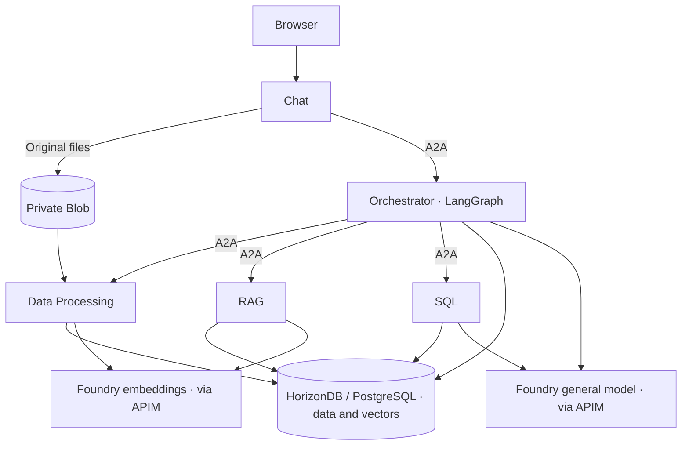

# Module 6 — Multi-Agent Business Scenarios

> 🌐 语言 / Language: **English** | [中文](readme_CN.md)

[⬆ Back to Workshop Home](../readme.md)

> **Suggested duration: 60 minutes**, following the 145-minute core workshop.
> Cloud provisioning, image builds and data ingestion may require additional waiting time.

## Overview

Upload consumer reports, customer reviews and sales data, then ask five collaborating Agents
for grounded business analysis. Each Agent runs in its own ACA Sandbox. **A2A** connects the Agents,
**LangGraph** coordinates tasks inside Orchestrator, and the **OpenAI SDK** calls Microsoft Foundry
through the existing APIM gateway. **Azure HorizonDB / PostgreSQL Flexible Server** stores structured
data and vectors.

| Agent | Responsibility |
|---|---|
| Chat | Browser UI, Session management and file uploads |
| Orchestrator | Plan tasks, coordinate workers, synthesize and review answers |
| Data Processing | Extract files, load structured data and generate embeddings |
| RAG | Retrieve relevant passages with source citations |
| SQL | Generate, validate and execute bounded read-only queries |



## Prerequisites

- Complete [Module-01](../module-01/README.md) and [Module-04](../module-04/README.md).
  Reuse their resource group, region, storage account, ACR, Foundry/APIM, managed identity (UAMI)
  and existing SandboxGroup. Keep the resource group's `deploymentSN` tag.
- Use Linux Bash (including WSL), Azure CLI with Bicep, the independent
  [`aca` CLI](https://aka.ms/aca-cli-install), `jq`, `curl`, `openssl`, GNU `timeout` and `realpath`.
  The deployment path was checked with ACA CLI `1.0.0-preview.5` and Bicep `0.48.1`.
  Local Python and Docker are not required.
- The operator needs database/model/APIM child-resource deployment permissions, storage ARM read/container
  deployment permissions, permission to attach the UAMI and run ACR Tasks, and
  **Container Apps SandboxGroup Data Owner** on the existing group.
- The UAMI needs model access, ACR pull permissions and **Storage Blob Data Contributor**.
  The selected database requires provider registration and regional capacity; HorizonDB also requires preview access.

### Existing private Blob mount (required for Bash deployment)

Deployment creates the private `data` container in the existing storage account and mounts it
**read-only at `/kb-data` in Chat and Data Processing**. The application still uses the Blob SDK
for uploads. The volume identity defaults to the existing registry identity; it must already be
assigned to the SandboxGroup and have **Storage Blob Data Reader** or stronger data permissions.

For private storage, complete Module-04's VNet/Private DNS setup first. Deployment selects the group's
sole existing VNet connection and applies it to all five sandboxes. If there are multiple connections,
set `CUSTOMER_VNET_CONNECTION_NAME` to the intended ready connection.

> [!CAUTION]
> This is a workshop deployment, not a production multi-user service:
> - Anyone who can reach the Chat URL can access all Sessions and their data; no browser key is required.
>   A2A peer authentication remains mandatory.
> - The default database firewall allows **all IPv4 sources** (`0.0.0.0`–`255.255.255.255`).
>   Use restricted rules/private networking outside the workshop. Adding narrower rules does not remove existing broad rules.
> - The shared UAMI receives database administrator privileges for workshop setup; production needs least-privilege SQL roles.
> - Do not upload confidential data without authorization. Extracted text is sent to Foundry;
>   the default embedding SKU, `GlobalStandard`, may process requests across Azure regions.

## Step 1 — Check the existing environment

From the repository root, enter this module. Run the remaining commands here in the **same Bash session**.
Do not enable `set -x` or HTTP debug logging.

```bash
cd agenthost/module-06
az account show -o none 2>/dev/null || az login
aca auth status >/dev/null 2>&1 || aca auth login
aca --version
az bicep version

export SUBSCRIPTION_ID="$(az account show --query id -o tsv | tr -d '\r\n')"
export RESOURCE_GROUP="${RESOURCE_GROUP:-rg-agenthost-workshop}"
export LOCATION="$(az group show --subscription "$SUBSCRIPTION_ID" -n "$RESOURCE_GROUP" --query location -o tsv | tr -d '\r\n')"
export DEPLOYMENT_SN="$(az group show --subscription "$SUBSCRIPTION_ID" -n "$RESOURCE_GROUP" --query tags.deploymentSN -o tsv | tr -d '\r\n')"
: "${DEPLOYMENT_SN:?Restore the resource group deploymentSN tag}"
export SANDBOX_GROUP_NAME="${SANDBOX_GROUP_NAME:-sandbox-group-agenthost-$DEPLOYMENT_SN}"
export ACA_OUTPUT="${ACA_OUTPUT:-$PWD/.local/aca-deployment.json}"

aca doctor --subscription "$SUBSCRIPTION_ID" --resource-group "$RESOURCE_GROUP" \
  --sandbox-group "$SANDBOX_GROUP_NAME" --region "$LOCATION"
```

Confirm the intended subscription, resource group, region and SandboxGroup, and resolve any failed checks.
Select the intended subscription with `az account set` before this block if necessary.
**Do not create another SandboxGroup.**

## Step 2 — Deploy once

The default database is **HorizonDB**. If using Azure PostgreSQL Flexible Server instead,
set `DB_PROVIDER=postgresql` before deployment. Both use PostgreSQL 17, the `postgres` database and `vector`.

Only set overrides when your existing resources differ from the workshop defaults:

| Variable | When needed |
|---|---|
| `DB_PROVIDER` | `horizondb` (default) or `postgresql` |
| `DB_LOCATION` | Database-only region override; otherwise uses the shared region |
| `ACR_NAME`, `STORAGE_ACCOUNT_NAME`, `APIM_NAME` | Custom existing Module-01 resource names |
| `IMAGE_TAG` | Image tag shared by builds and ACA imports; defaults to `latest` |
| `FOUNDRY_RESOURCE_NAME`, `FOUNDRY_PROJECT_NAME` | Custom existing Foundry account/project; project defaults to `maf-agent-prj` |
| `LLM_MODEL` | Deployed general-model name when Module-01 deployment outputs cannot be used |
| `CUSTOMER_VNET_CONNECTION_NAME` | Select among multiple existing VNet connections |
| `DB_FIREWALL_RULES_FILE` | Custom database firewall rules |
| `ACA_COMMON` | Separate custom runtime JSON; normally omit and use automatic discovery |

```bash
bash deploy.sh --migrate
```

**This command creates billable resources.** It runs the following stages in order; do not run them
again individually after the full deployment:

| Stage | Action |
|---|---|
| `storage` | Create/reuse private `data` in the existing storage account |
| `models` | Deploy `text-embedding-3-small` and add its route to the existing APIM |
| `database` | Deploy the selected database and configure UAMI Entra authentication |
| `config` | Discover model/storage settings and generate protected Agent configuration |
| `images` | Build and publish five images remotely using ACR Tasks |
| `aca` | Create five sandboxes, mount storage, apply the schema, start Agents and check connectivity |

`--migrate` initializes the dedicated workshop database inside a guest; do not target a production database.
Agent database connections use Entra authentication, not the provisioning administrator password.
The existing general model and shared infrastructure are reused.

Generated settings, passwords, peer keys and resource inventories are saved under `.local`.
Keep them private, Git-ignored and available for cleanup. Do not edit the generated configuration;
custom settings belong in a separate `ACA_COMMON` JSON with string values.
Scripts do not automatically load `.env`. On WSL, store credentials on a Linux filesystem or restrict Windows ACLs.

The command must finish with all five Agents marked `ready`. It checks health endpoints, authenticated
Agent Cards and a Chat → Orchestrator → database request. Uploads and model answers still need the checks below.

**If deployment fails:** stop and retain the error, password and inventories. There is no automatic rollback
or resume. Existing database/ACA inventories and Agent configuration cannot be overwritten.
Use [the CLI deployment reference](agent-src/docs/cli-deployment.md) and `bash deploy.sh --help`
for deliberate stage retries; a new ACA output path creates a **new deployment**, not a restart.

## Step 3 — Connect to a Session

```bash
jq -r '.agents.chat.url' "$ACA_OUTPUT"
```

1. Open the printed URL.
2. Select an existing **Session**, or enter `Summer launch` under **New session** and click **Create**.
3. Click **Connect** before uploading or asking questions.

A Session is a persistent workspace for uploaded data, not a login. All Sessions in the configured
database are visible to workshop users, but queries and sources are scoped to the selected Session.
Switching Sessions requires reconnecting. **Clear local conversation** clears browser history only,
not stored data. Enter sends a question; Shift+Enter inserts a newline.

## Step 4 — Upload and process sample data

Use the prepared PDF/CSV parts in [sample-data](sample-data/), not the legacy synthetic fixtures under
`agent-src/sample-data`. Deployment does not import data automatically.
The [manifest](sample-data/manifest.json) records source files and coverage.

Select one or more files, then click **Upload and process**. The browser uploads and processes them
**one at a time**. Start small:

| Order | Upload | Expected result |
|---|---|---|
| 1 | [First Capgemini PDF part](sample-data/01_capgemini_consumer_trends_2025-pages-000001-000020.pdf) and [first Ryder PDF part](sample-data/02_ryder_ecommerce_consumer_study_2025-pages-000001-000020.pdf) | Extract text and store searchable vectors |
| 2 | [First customer-review CSV part](sample-data/03_customer_reviews-rows-000001-002000.csv) | Store typed rows and embed useful review text |
| 3 | [Financial CSV: all 700 rows](sample-data/04_financial_sample-rows-000001-000700.csv) | Store typed rows; numeric financial data produces no embeddings |

Wait for each processing report and inspect counts, warnings and **Show sources**.
Embedding runs automatically; there is no separate vectorization command.
Keep the page open while the queue runs. On error, the queue pauses; **Retry last request** continues
the current file/run without repeating completed files. Refreshing loses the local queue.
Failed ingestion has no durable embedding checkpoint, so retrying may incur embedding charges again.

- Add remaining parts only as needed. The complete review source has **41,711 rows in 21 parts**.
  Each CSV part becomes a separate dataset/table; whole-dataset statistics must aggregate all relevant parts.
- Do not upload both an original and its parts into one Session. Deduplication is per file, not across parts.
  Accepted row counts and embedding counts are different measures.
- Default per-file limits are **20 MB**, **50,000 rows** and **100,000 embedding chunks**.
  Large ingestions may take up to the default **7,200-second** ingestion deadline; allow for model quota and cost.
- Use text PDFs; OCR is not supported. PDF citation pages are local to each part:
  `original page = manifest.start + cited page - 1`.
- Use only sources you are authorized to upload. Conclusions cover the processed parts, not necessarily
  the entire source or a representative market sample.

## Step 5 — Ask questions and verify evidence

Ask the following in the same Session after its relevant uploads finish. The model selects the route;
there is no manual mode selector.

| Mode | Question | Verify |
|---|---|---|
| DIRECT | Write three taglines for a repairable speaker. | General-model response, without retrieval or SQL |
| RAG | According to the uploaded reports, what matters to consumers? | Relevant passages, filenames, pages and citations |
| SQL | Which country generated the highest total profit? Show a bar chart and data table. | Read-only SQL and totals consistent with the financial CSV |
| HYBRID | Combine consumer trends and sales performance and recommend the best launch market. | Both qualitative and quantitative evidence, with recommendations distinguished from facts |

Expand the evidence panel to inspect sources and SQL. Charts must use verified data; passage counts
are not review-row counts. A broad review overview may use only five passages and is **not a full-dataset summary**.
Use SQL for sentiment distributions and other dataset-wide counts.

Also ask about a topic absent from the uploads: the answer should acknowledge insufficient evidence.
Select a second Session and check **Show sources**: the first Session's files should not appear there.
Health checks alone do not validate the workshop; confirm uploads and all four query modes.

## Step 6 — Clean up

Auto-suspend is **disabled by default** because HTTP/A2A requests do not wake manually activated,
suspended workers. All five running Agents incur compute charges even when idle.
If you suspend them between exercises, explicitly resume all workers before use.
Suspended sandboxes still incur storage charges; the database and other Azure services are billed separately.

When finished, preview cleanup, review the targets, then execute:

```bash
bash cleanup.sh
bash cleanup.sh --execute
```

Type **`delete module-06`** when prompted.

> [!WARNING]
> Cleanup destroys Module-06 database/Blob/Sandbox data, including attributable snapshots.
> Back up valuable state **outside the deletion scope** first.

The script uses saved `.local` inventories for **all deployment attempts**. It removes Module-06 sandboxes,
imported disks, attributable snapshots, the recorded Blob volume and `data` container, tagged databases/
parameter groups, and baseline-tracked embedding/APIM additions.
It preserves the shared resource group, SandboxGroup, Module-04 sandboxes, UAMI/RBAC, VNet, ACR/images,
Foundry account/project, general model, base APIM and storage account.

Missing ownership records or failed deletions stop complete cleanup and retain recovery files.
Review external/custom inventories separately. Retained images/snapshots and Azure retention policies
may continue to incur storage charges. Do not delete the shared resource group to clean up only this module.

## References

- [Developer README](agent-src/README.md): local development, APIs and tests.
- [Runtime settings](agent-src/.env.example) and [CLI deployment](agent-src/docs/cli-deployment.md):
  advanced configuration and stage operations.
- [Architecture](agent-src/docs/architecture.md), [orchestration](agent-src/docs/orchestration.md)
  and [data processing](agent-src/docs/data-processing.md): implementation details.
- [Security and cleanup](agent-src/docs/security.md) and
  [implementation report](agent-src/docs/implementation-report.md): limitations and recorded validation evidence.

This workshop has no production multi-user authentication/RLS, OCR, durable recovery of interrupted workflows
or automatic data retention cleanup. Recorded local/mock tests do not establish live Azure acceptance;
verify your deployment with Steps 4–5.

[⬆ Back to Workshop Home](../readme.md)
