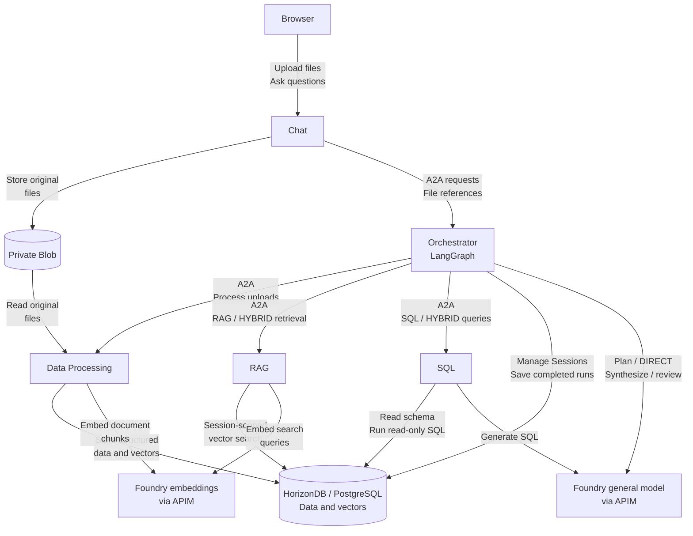

# Module 6 — Multi-Agent Business Scenarios

> 🌐 语言 / Language: **English** | [中文](readme_CN.md)

[⬆ Back to Workshop Home](../readme.md)

> **Suggested duration: 60 minutes**, following the 145-minute core workshop.
> Cloud provisioning, image builds and data ingestion may require additional waiting time.

## Overview

Upload consumer reports, customer reviews and sales data, then ask five collaborating Agents
for grounded business analysis. Each Agent runs in its own ACA Sandbox. **A2A** connects the Agents,
**LangGraph** coordinates tasks inside Orchestrator, and the **OpenAI SDK** calls Microsoft Foundry
through the existing APIM gateway. **Azure HorizonDB / PostgreSQL Flexible Server** stores structured
data and vectors.

| Agent | Responsibility |
|---|---|
| Chat | Browser UI, Session management and file uploads |
| Orchestrator | Plan tasks, coordinate workers, synthesize and review answers |
| Data Processing | Extract files, load structured data and generate embeddings |
| RAG | Retrieve relevant passages with source citations |
| SQL | Generate, validate and execute bounded read-only queries |



## Prerequisites

- Complete [Module-01](../module-01/README.md) and [Module-04](../module-04/README.md).
  Reuse their resource group, region, storage account, ACR, Foundry/APIM, managed identity (UAMI)
  and existing SandboxGroup. Keep the resource group's `deploymentSN` tag.
- Use Linux Bash (including WSL), Azure CLI with Bicep, the independent
  [`aca` CLI](https://aka.ms/aca-cli-install), `jq`, `curl`, `openssl`, GNU `timeout` and `realpath`.
  The deployment path was checked with ACA CLI `1.0.0-preview.5` and Bicep `0.48.1`.
  Local Python and Docker are not required.
- The operator needs database/model/APIM child-resource deployment permissions, storage ARM read/container
  deployment permissions, permission to attach the UAMI and run ACR Tasks, and
  **Container Apps SandboxGroup Data Owner** on the existing group.
- The UAMI needs model access, ACR pull permissions and **Storage Blob Data Contributor**.
  The selected database requires provider registration and regional capacity; HorizonDB also requires preview access.

### Existing private Blob mount (required for Bash deployment)

Deployment creates the private `data` container in the existing storage account and mounts it
**read-only at `/kb-data` in Chat and Data Processing**. The application still uses the Blob SDK
for uploads. The volume identity defaults to the existing registry identity; it must already be
assigned to the SandboxGroup and have **Storage Blob Data Reader** or stronger data permissions.

For private storage, complete Module-04's VNet/Private DNS setup first. Deployment selects the group's
sole existing VNet connection and applies it to all five sandboxes. If there are multiple connections,
set `CUSTOMER_VNET_CONNECTION_NAME` to the intended ready connection.

> [!CAUTION]
> This is a workshop deployment, not a production multi-user service:
> - Anyone who can reach the Chat URL can access all Sessions and their data; no browser key is required.
>   A2A peer authentication remains mandatory.
> - The default database firewall allows **all IPv4 sources** (`0.0.0.0`–`255.255.255.255`).
>   Use restricted rules/private networking outside the workshop. Adding narrower rules does not remove existing broad rules.
> - The shared UAMI receives database administrator privileges for workshop setup; production needs least-privilege SQL roles.
> - Do not upload confidential data without authorization. Extracted text is sent to Foundry;
>   the default embedding SKU, `GlobalStandard`, may process requests across Azure regions.

## Step 1 — Check the existing environment

From the repository root, enter this module. Run the remaining commands here in the **same Bash session**.
Do not enable `set -x` or HTTP debug logging.

```bash
cd agenthost/module-06
az account show -o none 2>/dev/null || az login
aca auth status >/dev/null 2>&1 || aca auth login

export SUBSCRIPTION_ID="$(az account show --query id -o tsv | tr -d '\r\n')"
export RESOURCE_GROUP="${RESOURCE_GROUP:-rg-agenthost-workshop}"
export LOCATION="$(az group show --subscription "$SUBSCRIPTION_ID" -n "$RESOURCE_GROUP" --query location -o tsv | tr -d '\r\n')"
export DEPLOYMENT_SN="$(az group show --subscription "$SUBSCRIPTION_ID" -n "$RESOURCE_GROUP" --query tags.deploymentSN -o tsv | tr -d '\r\n')"
: "${DEPLOYMENT_SN:?Restore the resource group deploymentSN tag}"
export SANDBOX_GROUP_NAME="${SANDBOX_GROUP_NAME:-sandbox-group-agenthost-$DEPLOYMENT_SN}"
export ACA_OUTPUT="${ACA_OUTPUT:-$PWD/.local/aca-deployment.json}"

aca doctor --subscription "$SUBSCRIPTION_ID" --resource-group "$RESOURCE_GROUP" \
  --sandbox-group "$SANDBOX_GROUP_NAME" --region "$LOCATION"
```

Confirm the intended subscription, resource group, region and SandboxGroup, and resolve any failed checks.
Select the intended subscription with `az account set` before this block if necessary.
**Do not create another SandboxGroup.**

## Step 2 — Deploy once

`DB_PROVIDER` defaults to **HorizonDB**. The available services are **HorizonDB | PostgreSQL**
(Azure PostgreSQL Flexible Server). Command values must be lowercase: `horizondb` (default) or `postgresql`.
Both use PostgreSQL 17, the `postgres` database and `vector`.

Before deployment, set the database provider and region in the current Bash shell:

```bash
export DB_PROVIDER="horizondb"  # Change to "postgresql" if needed
export DB_LOCATION="eastus2"   # Example: replace with a region supporting your chosen database service
```

> [!IMPORTANT]
> - **`DB_LOCATION` controls only the database deployment region; it can differ from the resource group's
>   and ACA SandboxGroup's regions.** If the previously selected region does not offer your chosen database
>   service, specify a supported region here.
> - Do not change the shared `LOCATION` or rebuild the SandboxGroup for this purpose.
> - `eastus2` above is only an example: verify database service/SKU availability and subscription quota in the target region.
> - When `DB_LOCATION` is unset, `LOCATION` takes precedence; otherwise the resource group's region is used.
> - Cross-region connections must still meet network access requirements and can increase latency and data transfer costs.

Only set overrides when your existing resources differ from the workshop defaults:

| Variable | When needed |
|---|---|
| `DB_PROVIDER` | `horizondb` (default) or `postgresql` |
| `DB_LOCATION` | Database-only region override, independent of the resource group/SandboxGroup; select a supported region if the original region lacks the chosen database service |
| `ACR_NAME`, `STORAGE_ACCOUNT_NAME`, `APIM_NAME` | Custom existing Module-01 resource names |
| `IMAGE_TAG` | Image tag shared by builds and ACA imports; defaults to `latest` |
| `FOUNDRY_RESOURCE_NAME`, `FOUNDRY_PROJECT_NAME` | Custom existing Foundry account/project; project defaults to `maf-agent-prj` |
| `LLM_MODEL` | Deployed general-model name when Module-01 deployment outputs cannot be used |
| `EMBEDDING_CAPACITY` | Defaults to `200` (200K TPM for `text-embedding-3-small`); requires sufficient regional model/SKU quota |
| `CUSTOMER_VNET_CONNECTION_NAME` | Select among multiple existing VNet connections |
| `DB_FIREWALL_RULES_FILE` | Custom database firewall rules |
| `ACA_COMMON` | Separate custom runtime JSON; normally omit and use automatic discovery |

```bash
bash deploy.sh --migrate
```

**This command creates billable resources.** It runs the following stages in order; do not run them
again individually after the full deployment:

| Stage | Action |
|---|---|
| `storage` | Create/reuse private `data` in the existing storage account |
| `models` | Deploy `text-embedding-3-small` with 200K TPM by default and add its route to the existing APIM |
| `database` | Deploy the selected database and configure UAMI Entra authentication |
| `config` | Discover model/storage settings and generate protected Agent configuration |
| `images` | Build and publish five images remotely using ACR Tasks |
| `aca` | Create five sandboxes, mount storage, apply the schema, start Agents and check connectivity |

The command must finish with all five Agents marked `ready`. It checks health endpoints, authenticated
Agent Cards and a Chat → Orchestrator → database request.

Data uploads, processing and model answers still need validation through the following steps.

> [!important]
> - Auto-suspend is **disabled by default** because HTTP/A2A requests do not wake suspended Agents.
>   All five Agents therefore incur compute charges even when idle.
> - If you suspend them between exercises, explicitly resume all workers before using them again.

Generated settings, passwords, peer keys and resource inventories are saved under `.local`.
Custom settings belong in a separate `ACA_COMMON` JSON with string values.

## Step 3 — Connect to a Session

```bash
jq -r '.agents.chat.url' "$ACA_OUTPUT"
```

1. Open the printed URL.
2. Select an existing **Session**, or enter `Summer launch` under **New session** and click **Create**.
3. Click **Connect** before uploading or asking questions.

A Session is a persistent workspace for uploaded data. Data is available only within the Session
to which it was uploaded. When switching Sessions, reconnect and upload data to the selected Session.

**Clear local conversation** clears browser history only, not stored data.

Enter sends a question; Shift+Enter inserts a newline.

## Step 4 — Upload and process sample data

Deployment does not import data automatically. Use the prepared PDF/CSV files in [sample-data](sample-data/).

Select one or more files, then click **Upload and process**. The browser uploads and processes them
**one at a time**.

| Order | Upload | File contents and processing result | Data source and link |
|---|---|---|---|
| 1 | [Capgemini (PDF: 20 pages)](sample-data/01_capgemini_consumer_trends_2025-pages-000001-000020.pdf) | Consumer trends report (pages 1–20); extract text and store searchable vectors | Capgemini Research Institute report: [what-matters-to-todays-consumer-2025](https://www.capgemini.com/us-en/insights/research-library/what-matters-to-todays-consumer-2025/). First 20 pages |
| 2 | [Ryder (PDF: 20 pages)](sample-data/02_ryder_ecommerce_consumer_study_2025-pages-000001-000020.pdf) | E-commerce consumer study (pages 1–20); extract text and store searchable vectors | Ryder insights report: [2025-ryder-ecommerce-consumer-study](https://www.ryder.com/globalassets/media/documents/insights/white-papers/2025-ryder-ecommerce-consumer-study_ada.pdf). First 20 pages |
| 3 | [Customer reviews (CSV: 2,000 rows)](sample-data/03_customer_reviews-rows-000001-002000.csv) | Customer reviews (rows 1–2,000); store typed rows and embed useful review text | Workshop-provided sample from a public source |
| 4 | [Financial report (CSV: 700 rows)](sample-data/04_financial_sample-rows-000001-000700.csv) | Financial sample data (700 rows); store typed rows; numeric financial data produces no embeddings | [Microsoft Power BI Financial Sample](https://learn.microsoft.com/en-us/power-bi/create-reports/sample-financial-download) |

- *The workshop sample data comes from publicly accessible sites.*
- *It is used only for technical testing in this workshop and is not guaranteed to be representative of the market.*

<!--
> - The complete review source has **41,711 rows in 21 parts**. Each CSV part becomes a separate
>   dataset/table; whole-dataset statistics must aggregate all relevant parts.
> - Default per-file limits are **20 MB**, **50,000 rows** and **100,000 embedding chunks**.
> - Do not upload both an original and its parts into one Session. Deduplication is per file, not across parts;
-->

After uploading, click **Show sources** to view the files uploaded to the current Session.
Embedding runs automatically; there is no separate vectorization command.

**Keep the page open while the queue runs.**

> [!tip]
> - On an upload error, the queue pauses. Click **Retry last request** to continue the current file/run
>   without repeating completed files. Errors commonly occur when embedding generation hits capacity limits.
> - To raise the existing embedding deployment's TPM to address such errors, open model deployments in
>   the Microsoft Foundry project, find the deployed "text-embedding-3-small" model, select "Edit",
>   and increase "Tokens per Minute Rate Limit".
> - Large ingestions may take up to the default **7,200-second** ingestion deadline; allow for model quota and cost.
> - Use text PDFs; OCR is not supported.

## Step 5 — Ask questions and verify evidence

Ask the following in the same Session after its relevant uploads finish. The model selects the route;
there is no manual mode selector.

| Mode | Example question | Data retrieval |
|---|---|---|
| DIRECT | Write three taglines for a repairable speaker. | General-model response, without retrieval or SQL |
| RAG | According to the uploaded reports, what matters to consumers? | Vector retrieval of relevant passages, filenames, pages and citations |
| SQL | Which country generated the highest total profit? Show a bar chart and data table. | SQL queries, with totals consistent with the financial CSV |
| HYBRID | Combine consumer trends and sales performance and recommend the best launch market. | Both vector retrieval and SQL queries, with combined results |

### More example questions

**The following questions are examples for reference and can be copied one at a time.**

| No. | Expected mode | Chat question |
|---|---|---|
| 1 | DIRECT (direct response) | Explain the difference between sales, profit and profit margin in plain language, with a simple example. Do not use uploaded data. |
| 2 | RAG (vector retrieval) | Find contrasting experiences of high expectations followed by disappointment and exceeded expectations in the reviews. Quote the original text, state any missing evidence and do not compute counts. |
| 3 | RAG (vector retrieval) | Quote passages about price, convenience and sustainable consumption from the reports, then compare similarities and differences. Do not judge themes lacking source text. |
| 4 | RAG (vector retrieval) | Extract comparison percentages for purchasing Gen AI-recommended products from the reports. Quote the source and show a bar chart, preserving its time periods and populations; state if comparable values are unavailable. |
| 5 | SQL (structured queries) | Summarize total profit by country and show a bar chart and data table. |
| 6 | SQL (structured queries) | Aggregate sales and profit by year and month from the uploaded financial data and show a line chart. List profit margin (total profit / total sales) separately in a table; identify months when sales rose but profit did not versus the previous month. |
| 7 | SQL (structured queries) | Count the uploaded reviews and their percentages by sentiment category. Show a pie chart, total sample size and data coverage. |
| 8 | HYBRID (combined retrieval and multi-Agent collaboration) | Compare negative-review rates across platforms (such as apps or websites), using sentiment categories. Show a bar chart of rates and ground suggestions in review quotations; state if none are available. |
| 9 | HYBRID (combined retrieval and multi-Agent collaboration) | Calculate total sales and total profit from the financial data, and use reviews and reports to summarize customer experience and market risks. Do not chart. |
| 10 | HYBRID (combined retrieval and multi-Agent collaboration) | Calculate total sales and total profit from the financial data, and use customer needs in the reviews and consumer trends in the reports to recommend priority business improvements for the future. Do not chart. |

*"Expected mode" is the data retrieval and aggregation approach the model is expected to select, not a manual routing setting.*

> [!tip]
> - The DIRECT example requires no uploads. For the other questions, finish uploading and processing
>   the relevant files in the same Session first.
> - Uploading every part is not required; retrieval and synthesis use only the uploaded data.
> - If a retrieval finds no relevant passage for a report or theme, the answer will identify the evidence gap.
>   Upload additional parts as needed to expand the analysis.

### Reviewing answers

- Expand the evidence panel to inspect sources and SQL.
- Charts must use verified data; passage counts are not review-row counts.
- A broad review overview may use only five passages and is **not a full-dataset summary**.
- Use SQL for sentiment distributions and other dataset-wide counts.

### In-chat analytical charts

- Chat messages support bar, line and pie charts and numeric comparison tables; the AI can select a suitable visualization.
- SQL/HYBRID charts use actual query results. When explicitly requested, RAG can also use retrieved numeric
  metadata or values anchored to quotations from retrieved documents.
- Each answer supports up to four charts, with up to four series and 40 rows per chart.
- Chart errors are explicit and preserve the text answer. Charts persist with completed runs and are also
  saved in the browser's latest 30 local messages.
- Refreshing the same tab and reconnecting to the same Session restores local history.
  Clearing local history does not delete server-side runs.
- Also ask about a topic absent from the uploads: the answer should acknowledge insufficient evidence.
- Each Session should have its own uploaded files. Select a second Session and check **Show sources**:
  the first Session's files should not appear there. In a new Session, you can try uploading other data
  files from outside this workshop for testing.

## Step 6 — Clean up

When finished, preview cleanup, review the targets, then execute:

```bash
bash cleanup.sh
source ./cleanup.sh --execute
```

Type **`delete module-06`** when prompted.

> [!WARNING]
> - Cleanup destroys Module-06 database/Blob/Sandbox data, including attributable snapshots.
> - After cloud cleanup is verified, it also empties this module's entire `.local`, including hidden files,
>   custom files and subdirectories.

<!--
The script uses saved `.local` inventories for **all deployment attempts**. It removes Module-06 sandboxes,
imported disks, attributable snapshots, the recorded Blob volume and `data` container, tagged databases/
parameter groups, and baseline-tracked embedding/APIM additions.
It preserves the shared resource group, SandboxGroup, Module-04 sandboxes, UAMI/RBAC, VNet, ACR/images,
Foundry account/project, general model, base APIM and storage account.

Missing ownership records or failed deletions stop complete cleanup and retain recovery files.
Review external/custom inventories separately. Dry runs, cancellation and failures do not reset environment
variables; changes to local files during cleanup also stop local deletion. Do not deploy concurrently
with cleanup or empty `.local` beforehand: the script needs its inventories to verify cloud ownership.

When invoked with `source`, cloud deletion still runs in a separate Bash process. Only after complete success does it
`unset` known Module-06 deployment variables in the current Bash shell, including `ACA_COMMON`, `ACA_CONFIG`,
`ACA_OUTPUT`, database settings/passwords, image tags, model/storage/identity settings, and subscription,
resource-group and region selections. It does not clear unrelated variables, edit shell startup files,
delete external custom configurations, or clear Azure CLI login/defaults. Readonly variables or namerefs
are rejected before deletion; use a clean Bash shell in that case.
`bash cleanup.sh --execute` still cleans cloud resources and local files, but a child process cannot unset
its caller's environment variables, so the `source` invocation above is recommended.
-->
> [!important]
> - To redeploy Module-06, **start again from Step 1 (environment setup, subscription, resource group,
>   database options, and so on)**, then run `bash deploy.sh --migrate`.
> - Do not delete the shared resource group to clean up only this module.

## References

- [Developer README](agent-src/README.md): local development, APIs and tests.
- [Runtime settings](agent-src/.env.example) and [CLI deployment](agent-src/docs/cli-deployment.md):
  advanced configuration and stage operations.
- [Architecture](agent-src/docs/architecture.md), [orchestration](agent-src/docs/orchestration.md)
  and [data processing](agent-src/docs/data-processing.md): implementation details.
- [Security and cleanup](agent-src/docs/security.md) and
  [implementation report](agent-src/docs/implementation-report.md): limitations and recorded validation evidence.

This workshop has no production multi-user authentication/RLS, OCR, durable recovery of interrupted workflows
or automatic data retention cleanup. Recorded local/mock tests do not establish live Azure acceptance;
verify your deployment with Steps 4–5.

[⬆ Back to Workshop Home](../readme.md)
