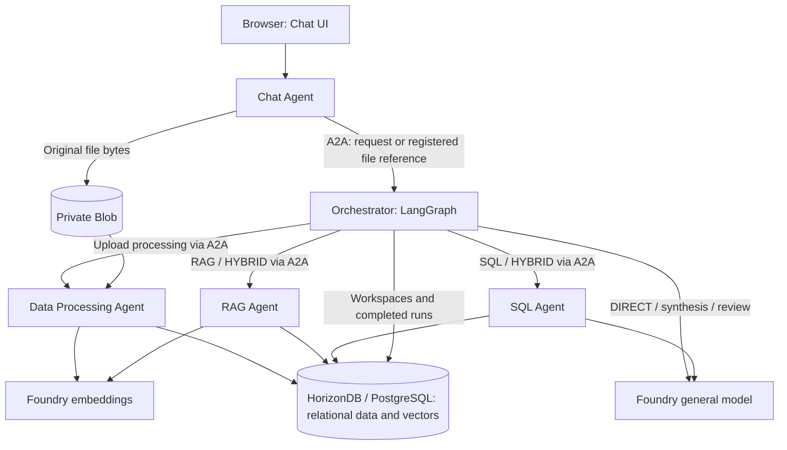

# Module 6 — Multi-Agent Business Scenarios

> 🌐 语言 / Language: **English** | [中文](readme_CN.md)

[⬆ Back to Workshop Home](../readme.md)

> **Suggested duration: 60 minutes.** This extension follows the 145-minute core workshop;
> allow 205 minutes (3 hours 25 minutes) for both. Complete the earlier modules' prerequisites first;
> cloud provisioning, image builds and full-data ingestion may require additional waiting time.

## Overview

Practice multi-agent business scenarios by turning uploaded consumer reports, reviews and sales data
into grounded business analysis and recommendations.
- Five Agents run independently in their own sandboxes and collaborate through **A2A**;
- **LangGraph** plans and coordinates tasks inside the Orchestrator;
- The **OpenAI SDK** calls Microsoft Foundry Responses and Embeddings endpoints.
- **Azure HorizonDB or Azure PostgreSQL Flexible Server** stores and efficiently retrieves structured data and vectors.

**Primary workshop path:**
- Deploy the selected database (HorizonDB by default) with Bash/Bicep and build five images remotely with ACR Tasks;
- Deploy and start five ACA Sandboxes with Bash and the independent `aca` CLI;
- Reuse the earlier modules' resource group, region, storage account, ACR, model gateway and image-pull identity, and Module-04's existing SandboxGroup. Module 06 creates only the private `data` container in the reused storage account.

## Learning Objectives

1. Learn from a reference implementation of collaboration between multiple agents hosted and running on Azure.
2. Understand typical uses of Azure HorizonDB / PostgreSQL Flexible Server in AI scenarios, including storage and efficient retrieval of structured data and vectors.

### Architecture and Agent responsibilities

| Agent | Responsibility | Calls |
|---|---|---|
| Chat | FastAPI UI/API, workspace operations, upload validation and private Blob originals | Orchestrator through A2A; Blob adapter |
| Orchestrator | Workspace existence checks, LangGraph planning, parallel workers, synthesis, review and run persistence | Processing/RAG/SQL through A2A; general model; shared database |
| Data Processing | Extract files, infer table types, chunk useful text, embed and commit data | Blob, embeddings, shared database |
| RAG | Workspace-filtered cosine retrieval with sources, scores and up to five matches | Embeddings, shared database |
| SQL | Schema-aware SQL generation, AST validation and bounded read-only execution | General model, shared database |



Chat never directly calls workers, models or database repositories. Workers do not call one another.
Each service publishes an authenticated Agent Card and runs in its own image/process/sandbox.
Callers verify the configured peer's role, skills, protocol and exact endpoint before sending messages.
Uploaded text is untrusted evidence, not instructions. Shared adapters avoid duplicate model/storage code.
The UI's styling and interaction pattern are adapted from Module-03; its original implementation is unchanged.

---

## Prerequisites

> [!CAUTION]
> Run all commands below from **`agenthost/module-06/`**, unless a command explicitly uses a subshell
> to enter another directory. Keep the same Bash session for Steps 1–4. Do not run with shell tracing
> (`set -x`) or Azure/ACA HTTP debug logging because configuration contains credentials.

1. Complete [Module-01](../module-01/README.md) and [Module-04](../module-04/README.md).
   The resource group must retain its `deploymentSN` tag unless you explicitly supply resource names.
2. Use Linux Bash, Azure CLI with Bicep, the independent `aca` CLI, `jq`, `curl`, `openssl` and GNU `timeout`.
   The deployment path was checked with ACA CLI `1.0.0-preview.5` and Bicep `0.48.1`.
   Older Bicep catalogs may warn about missing HorizonDB preview types.
3. Your operator identity needs deployment permissions for the selected database, Foundry models and APIM child resources, permission to attach the UAMI and run ACR Tasks,
   and **Container Apps SandboxGroup Data Owner** on the existing group. The image-pull identity needs
   ACR pull permissions. The selected database requires provider registration and capacity in the chosen region;
   HorizonDB additionally needs preview access.
4. Reuse Module-01's general model/APIM route. The `models` stage deploys `text-embedding-3-small`
   into the existing Foundry account and adds an embeddings operation/backend to the existing APIM.
   Agents call APIM for both Responses and embeddings; only APIM calls the account embedding endpoint.
   The existing `workshop-ai-gateway` API is reused: Module 06 adds `POST /openai/v1/embeddings`
   with a separate `module06-embeddings-backend` for the account-level endpoint. The existing
   `foundry-backend` includes `/api/projects/<project>` and remains unchanged for Responses.
   Backend validation uses the account's returned `properties.endpoint` (which can use
   `cognitiveservices.azure.com`) and also accepts the same account/project's `services.ai.azure.com` URL;
   a different account or project is still rejected.
5. Provide the **existing Module-01 storage account** endpoint and ARM read/container deployment permissions;
   Module 06 creates private `data` through incremental management-plane Bicep (no Blob data-plane provisioning).
   Provide a guest runtime identity with appropriate
   model access and Storage Blob Data Contributor. If storage is private-only, finish the VNet/Private DNS
   setup from Module-04. The ACA stage automatically selects the group's sole existing VNet connection
   and requires `Succeeded`; use `CUSTOMER_VNET_CONNECTION_NAME` to select explicitly when there are multiple connections.
6. All five Agents use Module-01's UAMI. The ACA stage adds it to the existing SandboxGroup if missing;
   guests inherit it and receive `AZURE_CLIENT_ID`/`AZURE_TENANT_ID`. Token acquisition is checked in every guest.
   Do not supply `AZURE_CLIENT_SECRET`: the primary cloud path rejects service-principal secrets.
7. Use the actual workshop upload parts in [sample-data](sample-data/). Local Python and Docker are optional
   for the cloud path; Python 3.11+ and PostgreSQL/vector are needed only for the local development alternative.

### Install and check the CLI

Install missing prerequisites using their official installers. Review the ACA installer before running it:

```bash
curl -fsSL https://aka.ms/aca-cli-install | sh
aca --version
az bicep version
az account show -o none 2>/dev/null || az login
aca auth status >/dev/null 2>&1 || aca auth login
```

This same install path is also used inside sandboxes and containers for agent-driven self-installs.
The CLI is **`aca`**, not `az containerapp sandbox`; it is also distinct from ACA Dynamic Sessions.
Run `aca doctor` with the existing group context in Step 1 and resolve failures before deployment.
No provisioning script installs tools or silently logs in for you.

### Configuration defaults

**Explicit arguments > nonempty environment variables > defaults.** Deployment scripts do not source
`.env` automatically. Resource names follow Modules 01/04; no new suffix is generated.

| Environment variables | Default / behavior |
|---|---|
| `SUBSCRIPTION_ID`, `RESOURCE_GROUP`, `LOCATION` | Current Azure CLI account; `rg-agenthost-workshop`; existing RG location, normally `eastus2` |
| `DB_LOCATION` | Database-only region override; falls back to `LOCATION`/RG region, without changing the SandboxGroup region |
| `DEPLOYMENT_SN` | RG `deploymentSN` tag |
| `ACR_NAME`, `ACR_LOGIN_SERVER` | `acragenthost<SN>`; query its actual login server |
| `SANDBOX_GROUP_NAME` | `sandbox-group-agenthost-<SN>` |
| `IDENTITY_NAME`, `REGISTRY_IDENTITY` | `id-agenthost-<SN>`; query its ARM ID for image pull |
| `AGENT_IDENTITY_RESOURCE_ID` | Existing Module-01 UAMI; otherwise resolve `IDENTITY_NAME` / `id-agenthost-<SN>`; independent of the image-import identity |
| `FOUNDRY_RESOURCE_NAME`, `FOUNDRY_PROJECT_NAME` | `foundry-agenthost-<SN>`, `maf-agent-prj`; both must already exist |
| `EMBEDDING_DEPLOYMENT_NAME`, `EMBEDDING_MODEL_NAME`, `EMBEDDING_MODEL_VERSION` | Deployment name from common `EMBEDDING_MODEL`, otherwise `text-embedding-3-small`; model `text-embedding-3-small`, version `1` |
| `EMBEDDING_SKU`, `EMBEDDING_CAPACITY` | `GlobalStandard` (Global Standard), `30`; Azure validates availability and quota during deployment |
| `APIM_NAME` | Existing Module-01 `apim-agenthost-<SN>`; only embedding children are added |
| `STORAGE_ACCOUNT_NAME`, `STORAGE_SUBSCRIPTION_ID`, `STORAGE_RESOURCE_GROUP` | Optional existing account/scope overrides; otherwise account from Blob URL, then `stcagenthost<SN>`; subscription/RG as above |
| `KB_STORAGE_CONTAINER_ID`, `KB_VOLUME_NAME`, `KB_VOLUME_IDENTITY` | Root entry derives the `data` ARM ID automatically; optional ID selects its account/scope and must match configuration; standalone `deploy-aca.sh` still requires it; `studio-kb-data`; existing registry identity (or `system` / a group UAMI ARM ID) |
| `IMAGE_TAG`, `AUTO_SUSPEND_MINS` | `latest`, `0` (auto-suspend disabled); set the same tag for builds and deployment |
| `SANDBOX_CPU`, `SANDBOX_MEMORY` | `1000m`, `2048Mi` per Agent |
| `DB_PROVIDER` | `horizondb` (default) or `postgresql`; deployment and all five Agents must agree |
| `DB_AUTH_MODE` | Root deployment generates `entra` with the UAMI name/client ID and no runtime password; password mode remains for local/compatibility use |
| `DB_RESOURCE_NAME`, `DB_USERNAME`, `DB_VCORES` | `hdb-agenthost-<SN>` or `pg-agenthost-<SN>`; `studioadmin`; HorizonDB: `2` vCores |
| `DB_SKU_NAME`, `DB_STORAGE_SIZE_GB` | PostgreSQL GeneralPurpose: `Standard_D2ds_v5`, `32` GiB |
| `DB_PASSWORD`, `DB_PASSWORD_FILE` | No default secret; environment password or `.local/database-password`; explicit `--password-file` wins |
| `DB_FIREWALL_RULES_FILE` | Optional JSON rules; otherwise `0.0.0.0`–`255.255.255.255` |
| `DB_OUTPUT`, `ACA_CONFIG`, `ACA_OUTPUT` | Files under module-root `.local`: `database-deployment.json`, `aca-config.json`, `aca-deployment.json` |
| `ACA_COMMON` | Optional existing custom JSON input; when unset, the entrypoint generates module-root `.local/aca-common.json` from current Module-01 resources |
| `LLM_MODEL`, `EMBEDDING_DIMENSIONS` | Auto-generation overrides: general-model deployment name (otherwise Module-01 `main-<SN>` output) and vector dimensions (`1536`) |
| `HEALTH_TIMEOUT_SECONDS`, `OPERATION_TIMEOUT_SECONDS` | `180`, `900` seconds |
| `CUSTOMER_VNET_CONNECTION_NAME` | Automatically discover the group's sole existing connection; explicit selection required for multiple connections; must be `Succeeded`; applied to all five Agents |

Default file paths inside the scripts are anchored to the module root, outside the image context; explicit relative paths are relative
to your current directory. Guest configuration comes from the protected five-role `ACA_CONFIG`, not arbitrary
host environment variables. All Module-06 Bash deployment/build scripts run directly after automatic
preflight guards; there is no validation-only deployment mode. Only `--migrate` must be explicit.
Storage `--resolve` and ACA `--capabilities` are read-only operations, not deployment modes.
The root image preflight never publishes images; the image stage builds each image once.

---

## Step 1 — Select the existing Azure environment

From the repository root, enter the module once:

```bash
cd agenthost/module-06
```

Select the intended subscription before continuing. These commands read shared resources, not create them:

When WSL calls Windows CLI tools, scalar output may retain `\r`. The Bash scripts normalize deployment
metadata with `tr -d '\r\n'`; multi-line TSV streams remove only `\r` to preserve records.
Passwords, protected file contents and application data are not normalized.

```bash
export SUBSCRIPTION_ID="${SUBSCRIPTION_ID:-$(az account show --query id -o tsv | tr -d '\r\n')}"
export RESOURCE_GROUP="${RESOURCE_GROUP:-rg-agenthost-workshop}"
export LOCATION="${LOCATION:-$(az group show --subscription "$SUBSCRIPTION_ID" -n "$RESOURCE_GROUP" --query location -o tsv | tr -d '\r\n')}"
export DEPLOYMENT_SN="${DEPLOYMENT_SN:-$(az group show --subscription "$SUBSCRIPTION_ID" -n "$RESOURCE_GROUP" --query tags.deploymentSN -o tsv | tr -d '\r\n')}"
: "${SUBSCRIPTION_ID:?Select an Azure subscription}"
: "${LOCATION:?Existing RG location is required}"
: "${DEPLOYMENT_SN:?Set DEPLOYMENT_SN or restore the RG deploymentSN tag}"
export SANDBOX_GROUP_NAME="${SANDBOX_GROUP_NAME:-sandbox-group-agenthost-$DEPLOYMENT_SN}"
identity_settings="$(bash common/resolve-identity.sh)" &&
  AGENT_IDENTITY_RESOURCE_ID="$(jq -er '.AGENT_IDENTITY_RESOURCE_ID' <<<"$identity_settings" | tr -d '\r\n')" &&
  export AGENT_IDENTITY_RESOURCE_ID
export IMAGE_TAG="${IMAGE_TAG:-latest}"

aca config set -s $SUBSCRIPTION_ID
aca config set -g $RESOURCE_GROUP
aca config sandbox set --group  $SANDBOX_GROUP_NAME
aca config sandbox set --region  $LOCATION

aca doctor --subscription "$SUBSCRIPTION_ID" --resource-group "$RESOURCE_GROUP" \
  --sandbox-group "$SANDBOX_GROUP_NAME" --region "$LOCATION"
umask 077
mkdir -p .local
chmod 700 .local
export DB_PASSWORD_FILE="${DB_PASSWORD_FILE:-.local/database-password}"
export DB_OUTPUT="${DB_OUTPUT:-.local/database-deployment.json}"
export ACA_CONFIG="${ACA_CONFIG:-.local/aca-config.json}"
export ACA_OUTPUT="${ACA_OUTPUT:-.local/aca-deployment.json}"
```

Confirm the subscription/RG/region/group reported by `aca doctor`. Do not create another SandboxGroup.
If overriding file locations, keep them outside Git and the image build context and create their parent directories.

Confirm that the checks pass with output similar to:
```text
General checks:
✓ Azure CLI found
✓ Azure CLI logged in
✓ Subscription configured (624e6382-...) [config]
✓ Resource group configured (rg-agenthost-workshop) [config]
✓ ARM authentication working

Sandbox checks:
✓ Sandbox group: sandbox-group-agenthost-7a5970
✓ Region: eastus2
✓ Sandbox group 'sandbox-group-agenthost-7a5970' exists in Azure
✓ Container Apps SandboxGroup Data Owner role assigned

9/9 passed

aca 1.0.0-preview.5 — all checks passed
```

### Existing private Blob mount (required for Bash deployment)

The root entry resolves the existing account from `ACA_COMMON.AZURE_STORAGE_ACCOUNT_URL`
(or `STORAGE_ACCOUNT_NAME`, then `stcagenthost<SN>` / the RG tag), verifies it through ARM,
and derives/exports `KB_STORAGE_CONTAINER_ID` for ACA automatically. Module 06's `storage` stage
creates/reuses private `data`; no manual precreation is needed. Account, runtime URLs and any
supplied container ID must agree or execution stops before provisioning.

```bash
# Optional account overrides (must match the Blob runtime configuration):
# export STORAGE_ACCOUNT_NAME="<existing-module01-account>"
# export STORAGE_SUBSCRIPTION_ID="<storage-subscription-id>"
# export STORAGE_RESOURCE_GROUP="<storage-rg>"
export KB_VOLUME_NAME="studio-kb-data"  # Group-scoped; reused only when container and identity match
# Optional: system, or a UAMI resource ID already assigned to the existing SandboxGroup.
# export KB_VOLUME_IDENTITY="<user-assigned-identity-resource-id>"
```

The storage account must match every role's `AZURE_STORAGE_ACCOUNT_URL`. By default the volume uses the
existing registry identity; override `KB_VOLUME_IDENTITY` when needed. That identity must already be on the
SandboxGroup and have **Storage Blob Data Reader** (or an existing stronger data role) on the container.
Arrange storage firewall/private networking access and allow RBAC propagation before applying.
The operator needs ARM read access to the storage account and group plus SandboxGroup Data Owner.
The operator also needs container deployment permission on the existing account.
`bicep/storage.bicep` declares the account/blob service as `existing` and only deploys `data` with
`publicAccess: None` in Incremental mode; it never replaces the account/blob service, changes
networking/versioning/RBAC, or deletes data. This works even when public storage networking is disabled.

For the individual-stage walkthrough, run storage before ACA and explicitly export the derived ID:

```bash
bash deploy.sh --stage storage
export KB_STORAGE_CONTAINER_ID="$(bash deploy-storage.sh --resolve)"
```

Standalone `deploy-aca.sh` still requires this explicit ID and does not create the container.

The script requires native `AzureBlobByo` support (checked with the installed `aca --help` surface),
not plain `AzureBlob`, which creates platform-owned storage. It creates/reuses one group volume, then
attaches it **read-only at `/kb-data` to the Chat and Data Processing sandboxes only** with `aca sandbox mount`. Orchestrator, RAG and SQL do not mount it.
Managed-identity authentication needs no account keys, SAS tokens or secrets in CLI arguments.
This additional filesystem view does **not** replace the Blob SDK adapter or its separate guest credentials;
uploads, database processing, A2A and model behavior are unchanged. Blob mount caching/POSIX limitations apply.

### Embeddings in the existing Foundry project

The `models` stage reuses `foundry-agenthost-<SN>` / `maf-agent-prj` by default; override
`FOUNDRY_RESOURCE_NAME` / `FOUNDRY_PROJECT_NAME` for an existing custom project.
Azure deploys the model under the project's parent account. Neither parent is recreated.
Module-06's [bicep/embedding.bicep](bicep/embedding.bicep) defines both the embedding deployment and its APIM extension:
it adds only `module06-embeddings-backend`, `POST /foundry/openai/v1/embeddings` and its operation policy
to Module-01's existing `apim-agenthost-<SN>` / `workshop-ai-gateway`. Use `APIM_NAME` for a custom name.
The APIM service, API, inherited policies, Responses operations, Foundry account/project and IAM remain unchanged.
The script reads the Agent UAMI and checks APIM's system identity, attached UAMI, tenant, API path and
Responses backend against the selected account/project. Conflicting common endpoints/identity fail explicitly.
No role assignments are queried, created or changed.

The operation validates caller issuer, audience **`https://ai.azure.com`** and **`oid` equal to the Agent UAMI
principal ID before `<base />`**; inherited backend authentication would otherwise replace the caller token.
It then overrides the backend and rewrites to the account's `/openai/v1/embeddings`, explicitly authenticating
with APIM's existing **system-assigned identity**, resource `https://ai.azure.com`.
The attached UAMI is the Agent caller, not the selected APIM backend identity: omitting `client-id`
[selects the system identity](https://learn.microsoft.com/azure/api-management/authentication-managed-identity-policy).
Module-01 already authorizes both identities at account scope, so no new IAM is required.
The official [v1 embeddings SDK examples](https://learn.microsoft.com/azure/foundry/openai/how-to/embeddings)
use `https://ai.azure.com/.default` with an **account OpenAI endpoint**; endpoint path and token audience
are distinct. The REST example also documents the cognitive-services audience, but this gateway uses `ai.azure.com`.
The script checks the existing project and deployment-name conflicts, preserving any larger matching capacity.
Azure validates model/version/SKU availability and quota during deployment; errors stop execution,
with no fallback to another account, region or model.

```bash
bash deploy.sh --stage models
```

For standalone deployment, run `bash deploy-models.sh`: it deploys immediately and prints runtime JSON.
The unified stage above also saves this JSON to
`.local/embedding-config.json` for the config stage, including APIM base URL, caller identity and
`EMBEDDING_TOKEN_SCOPE=https://ai.azure.com/.default`. Config-only retries reject old direct-endpoint or
mismatched caller/gateway metadata: rerun `--stage models`, then regenerate config before deploying ACA.
A failed model/APIM stage removes old metadata and emits no replacement; an already-created model may
remain after an APIM failure. Inspect the failed ARM deployment, fix it, then retry deliberately.
If APIM reports a literal `${tenantId}` in the OpenID URL, use the corrected
`bicep/embedding.bicep` and rerun `bash deploy.sh --stage models`; no rollback is needed.
Bicep multiline strings do not interpolate `${...}`: the policy explicitly replaces tenant,
caller principal ID and backend ID placeholders before deployment.
Cloud ingestion and query embeddings have no direct-endpoint fallback. Optional local flows can still
explicitly configure a direct account endpoint/scope.

Default model/version/SKU/capacity: `text-embedding-3-small` / `1` / `GlobalStandard` / `30`.
Use `EMBEDDING_DEPLOYMENT_NAME`, `EMBEDDING_MODEL_NAME`, `EMBEDDING_MODEL_VERSION`, `EMBEDDING_SKU`
and `EMBEDDING_CAPACITY` to override. Allow RBAC propagation; only a live inference call proves data-plane access.
Global Standard may process requests in any Azure region. Existing same-name `Standard` deployments
are not switched automatically: retain them with `EMBEDDING_SKU=Standard`, or choose a new deployment name
for Global Standard and regenerate the Agent configuration. Unsupported SKUs never fall back automatically.

Capacity `1` provides only 1,000 tokens/minute for this embedding deployment and is too small for typical
PDF batches (the 20-page consumer-trends part produces 24 chunks, about 5,847 tokens).
The default `30` targets 30,000 tokens/minute; check the deployed `properties.rateLimits` and regional quota.
For an existing undersized deployment, run `EMBEDDING_CAPACITY=30 bash deploy.sh --stage models`.
This preserves the model, dimensions and stored vectors; no re-embedding or Agent redeployment is needed
for a capacity-only change. Larger existing capacities are not reduced.
If throttling persists, the UI reports `EMBEDDING_RATE_LIMIT`: wait before retrying or raise capacity within quota.
Progress enters the embedding stage before the model request, so throttling is not confused with PDF extraction.
The SDK's bounded retry is not a durable checkpoint; retrying a failed file may repeat embedding charges.

### Unified entry (recommended)

No advance SN-specific JSON is needed. After Modules 1 and 4 are deployed, run from the module root:

```bash
bash deploy.sh --help
# Review provider, network access, identity and cost before applying:
bash deploy.sh --migrate
```

**Running the entrypoint deploys billable resources directly; review the target and cost first.**
Necessary dependency, common-setting and build-input checks run automatically before deployment,
including ARM reads of the existing storage account and UAMI; `data` need not already exist.
These checks do not prove Azure permissions, regional capacity, database connectivity or image availability.
With `ACA_COMMON` unset, preflight discovers the current Module-01 settings and generates the default common JSON.
It uses `DEPLOYMENT_SN` when set, otherwise the resource group's `deploymentSN` tag.
Every full run refreshes this generated file, so a new SN does not reuse the previous endpoints.
Discovery reads Azure only; generating the nonsecret JSON may precede a later preflight failure.
Foundry embedding checks and deployment still run in the `models` stage.
The entrypoint executes **storage → models → database → config → images → aca**:
prepares a password and two distinct keys once, merges the standard `DB_*` manifest, builds five images
using ACR Tasks, then deploys, configures and checks all five Agents. The host needs only Bash, Azure CLI,
`aca`, `jq`, `openssl`, `curl` and `timeout`, not Python, PowerShell or local Docker.
Explicitly use `--migrate` on the first deployment; migration runs only inside guests.
`DB_PASSWORD` is used only when first creating the password file; existing files are reused, so unset
that environment variable afterwards.

Retry private container provisioning idempotently with `bash deploy.sh --stage storage`.
Retry a single consumer stage with `bash deploy.sh --stage images` or
`bash deploy.sh --stage aca --migrate`. This is not automatic resume: database/ACA inventories
and configuration cannot be overwritten. Preserve failed stages and resource IDs; choosing another inventory
path may create new resources. There is no automatic deletion or rollback.
See each stage's `--help` for advanced flags; the unified entry uses the environment variables above
and does not forward unknown arguments. The following staged walkthrough remains available;
**do not rerun the same deployment commands after completing a full deployment**.

## Step 2 — Select and deploy the database

Both backends share one psycopg repository and migrations, preserving Agent business, A2A and model behavior.
`DB_PROVIDER=horizondb` is the default; select Azure PostgreSQL Flexible Server in the same session:

```bash
export DB_PROVIDER="${DB_PROVIDER:-horizondb}"  # Set postgresql for Azure PostgreSQL Flexible Server
```

Alternatively pass `--provider postgresql`. Only `horizondb` / `postgresql` are accepted;
region, provider-registration or capacity failures never silently switch backend. The selected database
requires deployment permissions; HorizonDB also needs preview access.
The archived [deploy-horizondb.sh](notmust/deploy/deploy-horizondb.sh) forces HorizonDB;
use `bash deploy-database.sh --provider horizondb` for the maintained entry point.

> [!WARNING]
> The workshop template opens the public endpoint to **`0.0.0.0`–`255.255.255.255`**.
> Every IPv4 source can attempt a database connection. TLS and strong authentication remain mandatory.
> Use restricted firewall ranges or private networking outside the workshop.
> Incremental ARM deployment does **not** delete existing firewall rules: adding narrow rules or `[]`
> will not remove a previously deployed `workshop-public` rule.

Prepare the password once. An existing file is reused; if `DB_PASSWORD` is set, save that chosen
value to the protected file so deployment and runtime configuration use the same credential:

```bash
if [[ -n "${DB_PASSWORD:-}" ]]; then
  printf '%s' "$DB_PASSWORD" > "$DB_PASSWORD_FILE"
elif [[ ! -f "$DB_PASSWORD_FILE" ]]; then
  openssl rand -base64 36 > "$DB_PASSWORD_FILE"
fi
chmod 600 "$DB_PASSWORD_FILE"
# Review network access and cost before deployment:
bash deploy-database.sh --password-file "$DB_PASSWORD_FILE"
```

The script automatically validates ARM before provisioning. With `horizondb`, Bicep creates a PostgreSQL 17 HorizonDB
cluster, a parameter group allowing `vector`, and pool firewall rules. The default is two vCores,
one replica and `BestEffort` zone placement, using the existing **`postgres` database**.
On retry, a matching existing cluster is referenced rather than created again. After ARM, the script
attaches the custom parameter group through PATCH and verifies the persisted association and authentication settings.
The pinned API is `2026-05-01-preview`; public access is controlled by pool firewall rules.
Passwords are passed as secure parameters through temporary protected files, not literal CLI arguments.

`bicep/database.bicep` selects exactly one backend. With `postgresql`, `bicep/postgresql.bicep` (API `2024-08-01`) creates PostgreSQL 17 Flexible Server:
GeneralPurpose `Standard_D2ds_v5`, 32 GiB auto-growing storage, `azure.extensions=vector` and
`require_secure_transport=on`. It also uses `postgres`, administrator password authentication and explicit public
firewall rules, without creating a separate `studio` database.

Expected result: the nonsecret inventory at `DB_OUTPUT` contains `resource_id`, `region`, `DB_PROVIDER`,
`DB_ENDPOINT`, `DB_PORT`, `DB_DATABASE`, `DB_USERNAME`, `DB_AUTH_MODE` and `DB_SSL_MODE`, never a password.
This is not yet a database connection test. Step 4 applies the application schema
inside a guest and checks it. Do not migrate a production database or change the password between these steps.

### Database UAMI authentication and read/write checks

The root entry resolves Module-01's UAMI before database deployment and passes `AGENT_IDENTITY_RESOURCE_ID`.
Both provider templates enable Entra authentication. PostgreSQL registers the UAMI administrator through ARM;
HorizonDB creates or verifies it through REST **after** the cluster ARM deployment succeeds.
Use the deployment script, not the HorizonDB Bicep template alone, to complete parameter-group association,
authentication verification and administrator setup.
Azure management-plane RBAC alone does not grant SQL access. **This workshop grants database administrator
privileges to the shared UAMI**, which is broader than a production application role; use a separate migration
identity and least-privilege SQL roles in production.

Generated Agent configuration uses `DB_AUTH_MODE=entra`, the UAMI name as `DB_USERNAME` and its client ID,
without `DB_PASSWORD`. The protected administrator password file is retained for resource provisioning,
not delivered as an Agent database credential. Local/password-mode compatibility remains available.
Each new physical connection obtains a fresh PostgreSQL-scoped token rather than persisting an expiring token.

With `--migrate`, the Orchestrator guest installs `vector`, applies the schema and table/sequence grants once.
Before activation, all four database-using guests check privileges and execute INSERT/UPDATE/SELECT/DELETE
against a temporary workspace inside a transaction that is rolled back. ARM deployment success is therefore
distinct from verified SQL read/write access. Failures stop activation with the failed stage/role retained.

### HorizonDB first deployment and retries

Replaying the cluster creation PUT against an existing preview cluster can fail with
`ImmutablePropertyOnUpdate` for `properties.createMode`, even when GET still reports `Create`.
Before ARM, the script discovers the target cluster. If absent, ARM creates it; if present, the script
requires matching ID, region, administrator login, PostgreSQL version and sizing, and a `Succeeded` state.
ARM then references that cluster without replaying its creation PUT. Discovery/read failures or mismatches
stop deployment rather than being treated as an absent cluster.

After ARM output validation, the `configure_horizon_cluster` function in [deploy-database.sh](deploy-database.sh) verifies the custom
`<cluster-name>-vector` parameter-group association and authentication settings. Creating the parameter group
alone does **not** prove attachment: a cluster may still use the service default `default_pg17`.
If needed, the helper PATCHes only the group association and authentication settings, never `createMode`,
the password or other creation fields. Up to 30 read-back checks, ten seconds apart, must confirm
`Succeeded`, the expected group ID, `InSync`, latest configuration and the requested authentication settings.
Matching settings are reused without PATCH; errors or timeout preserve a failed inventory at
`cluster-configuration`. SQL extension installation still occurs during guest migration.

The preview administrator PUT can return an empty response that ARM reports as
`The response for resource had empty or invalid content`. The normal deployment path now avoids this
ARM child resource: after ARM, output validation and cluster configuration verification,
it runs the `ensure_horizon_admin` function in [deploy-database.sh](deploy-database.sh).
The helper verifies the cluster ID, successful state, region and Entra tenant. A matching existing
administrator is reused; an absent administrator is created with REST PUT. A successful PUT (including
an empty response) is **not sufficient**: up to six read-back checks, five seconds apart, must confirm
the exact UAMI object ID, name, principal type and tenant before the success inventory is published.
Read/PUT errors, conflicts or verification timeout fail explicitly and preserve a failed inventory.
Other ARM failures are never converted into success. SQL permissions still require guest checks.

No recovery flag is needed for either first deployment or retry. `DB_REUSE_ENTRA_ADMIN=true` /
`--reuse-entra-admin` remains an optional stricter guard requiring the administrator to already exist.
An interrupted run that created the administrator will reuse it on retry rather than write it again.
Existing output files are still never overwritten: this change does not add whole-workflow auto-resume.

For a **fresh** environment with Modules 1 and 4 ready, select a supported database region without
changing the SandboxGroup region (the current HorizonDB parameter-group API does not support `eastus2`):

```bash
DB_LOCATION=eastus bash deploy.sh --migrate
```

For the earlier partial failure, do not delete the cluster or edit the failed inventory to claim success.
Preserve the original password, select a **new output file**, keep the same subscription/resource group/SN/resource name,
and chain stages with `&&`:

```bash
export DB_OUTPUT="$PWD/.local/database-recovered-v2.json"
DB_LOCATION=eastus bash deploy.sh --stage database &&
bash deploy.sh --stage config &&
bash deploy.sh --stage images &&
bash deploy.sh --stage aca --migrate
```

Use the existing cluster's actual region (`eastus` in this example), not a new region for the same cluster.
The new output file must not already exist. Keep `DB_OUTPUT` set for config retries.
Do not rerun already-successful stages; preserve existing generated Agent/ACA files and follow their
no-overwrite guards. Cross-region database access may increase latency and transfer charges.

## Step 3 — Build images and prepare Agent configuration

### Build remotely in the existing ACR

```bash
bash build-images.sh             # Billable remote builds
```

This submits five billable **`az acr build` ACR Tasks quick builds** and publishes `studio-chat`,
`studio-orchestrator`, `studio-data-processing`, `studio-rag` and `studio-sql` with `IMAGE_TAG`.
It does not use local Docker. Complete all builds before deployment; the ACA script imports existing images only.
Both Bash and PowerShell builders pass an absolute Dockerfile path: Azure CLI resolves `--file` from
the caller's working directory, not from the build context. The upload context remains `agent-src`.
To reuse older images tagged `workshop`, set `IMAGE_TAG=workshop` consistently.

### Rebuild images and replace the five sandboxes

When the database schema and protected ACA configuration already exist, reuse them; do not rerun
storage, models, database or config. From the Module-06 directory, choose a fresh image tag and inventory:

```bash
export IMAGE_TAG="module06-$(date -u +%Y%m%dT%H%M%SZ)"
export ACA_CONFIG="$PWD/.local/aca-config.json"
export ACA_OUTPUT="$PWD/.local/aca-deployment-$IMAGE_TAG.json"
bash deploy.sh --stage images &&
bash deploy.sh --stage aca
```

Both stages must use the same exported `IMAGE_TAG`. Use `--migrate` on the ACA stage only when schema
setup is still needed. The ACA stage imports five new disks, creates five new sandboxes and records
their new URLs; rebuilding ACR images does not update existing disks or sandboxes.
Old sandboxes are not automatically deleted. Keep them until the replacement passes if quota allows,
then inspect and snapshot valuable state before deleting only the old IDs from their saved inventory.
If quota requires removing the old five first, finish the image builds before that manual cleanup,
then run the ACA stage with the same tag. Preserve the SandboxGroup, VNet connection, shared volume,
Blob data, database and identities.

### Configure models, Blob and runtime identity

By default, `deploy.sh` generates **`.local/aca-common.json` during preflight**, before the storage/models stages.
Its internal `resolve_common` function reads the actual Blob endpoint and APIM gateway URL, and obtains
the general-model deployment name from the current Module-01 subscription deployment `main-<SN>`.
It verifies that the model is successfully deployed; it does not guess among available models.
If deployment history is unavailable, the deployment has a custom name, or you select another Foundry account,
set `LLM_MODEL` explicitly. Existing storage/APIM/Foundry resource overrides are respected.
`EMBEDDING_DEPLOYMENT_NAME` and `EMBEDDING_DIMENSIONS` control the generated embedding settings.
Config-only retries reuse the default common file if it exists, discovering settings only if it is missing.

Do not manually edit the generated default. For custom settings, create a **separate** protected JSON file
with the following shape and set `ACA_COMMON` to its path. Explicit inputs must already exist and are never overwritten.
Replace every placeholder with the actual deployed setting; never paste credentials into command arguments.
All environment values must be strings. To return to auto-generation, run `unset ACA_COMMON`.

```json
{
  "BLOB_BACKEND": "azure",
  "AZURE_STORAGE_ACCOUNT_URL": "https://<existing-storage-account>.blob.core.windows.net",
  "AZURE_STORAGE_CONTAINER": "data",
  "AGENT_APIM_ENDPOINT": "https://<existing-apim-host>/foundry",
  "LLM_MODEL": "<deployed-general-model-name>",
  "EMBEDDING_MODEL": "text-embedding-3-small",
  "EMBEDDING_DIMENSIONS": "1536"
}
```

`1536` must match the configured embedding deployment and database vector dimension.
Keep `AGENT_APIM_ENDPOINT` (including `/foundry`) for cloud embeddings even if an optional
`FOUNDRY_OPENAI_BASE_URL` overrides the general-model route. Both gateway scopes default to
`https://ai.azure.com/.default`; defaults and all runtime
limits are in [the configuration reference](agent-src/.env.example).
The root entry injects the resolved UAMI client/tenant IDs and the deployed embedding endpoint/token scope.
Do not add a service-principal secret or copy an administrator identity into the Agent runtime configuration.
Do not grant broad roles just to make an authentication error disappear.

The unified entry's config stage creates an A2A peer key once, then combines common settings,
database output and `.local/embedding-config.json`. Run the `models` stage first; config-only retries reuse
its saved metadata and do not redeploy models. With common settings already present, no model lookup is needed:

```bash
# Optional custom input; omit both lines to use automatic discovery:
# chmod 600 .local/aca-common.custom.json
# export ACA_COMMON="$PWD/.local/aca-common.custom.json"
bash deploy.sh --stage config
```

After changing SN, use a full run with `ACA_COMMON` unset rather than reusing a config-only retry.
Existing database/ACA inventories and generated Agent configuration retain their no-overwrite guards;
preserve them separately before starting a different deployment.

Keep these files private and ignored. The deployment script discovers all five URLs and overwrites the
corresponding A2A settings, so do not guess ingress addresses. It uploads configuration only after creating
a protected guest directory (`0700`, owned by UID/GID 10001). ACA file upload creates a root-owned
pending file; the non-root guest must not `chmod`/`chown` that file. Instead, it copies the contents into
a newly created guest-owned temporary file, verifies UID/GID `10001:10001` and mode `0600`, then atomically
renames it to the runtime configuration and removes the upload. A failed copy does not replace an existing
runtime configuration or release the startup gate. This requires neither root execution nor broader permissions.
The A2A key is for service-to-service traffic; never enter it into the browser.

The scripts use directory mode `0700` and credential/configuration mode `0600`.
On WSL Windows-mounted paths, Unix modes may not enforce Windows ACLs; use a Linux filesystem
or separately restrict the Windows ACLs before storing credentials.

## Step 4 — Deploy, start and check all five Agents

```bash
# First deployment into the dedicated workshop database:
bash deploy-aca.sh --migrate
```

Omit `--migrate` only when the schema already exists; run one deployment command, not both variants.
The script automatically validates configuration/manifests before creating billable resources:

1. Resolves and verifies the existing group, region, ACR, image-pull identity and VNet connection.
2. Verifies the storage account/assigned identity and creates or checks the shared `AzureBlobByo` volume
   **before importing** five disk images and generating manifests with only `role` and `deployment` labels.
3. Validates and applies the manifests, discovers each sandbox by role and the newly imported disk ID,
   verifies its ID and source disk, exposes port 8080, and captures HTTPS URLs.
4. Mounts `data` at `/kb-data` in the Chat and Data Processing guests only; proves it is a real mountpoint, lists it as UID 10001,
   and reads a byte from the first file found (an empty container is valid). Only then delivers configuration.
   All guests wait behind a startup gate until every mount and database check succeeds.
5. With `--migrate`, applies the idempotent [001_initial.sql](agent-src/migrations/001_initial.sql), including `vector` and the current application schema without workspace key or owner columns;
   checks `workspaces` and vector availability from all four database-using guests.
6. Starts each Agent's Uvicorn process as UID 10001. No separate terminal or manual Agent launch is needed.
7. Waits for all five `/health` endpoints and authenticated Agent Cards, then performs a read-only
   Chat → A2A → Orchestrator → database request.
8. Prints a status table and saves exact resource IDs/URLs, volume identity/container and per-role mount
   verification in `ACA_OUTPUT`; guest process restarts recheck the mount before launching the Agent.

The group-level VNet connection is **not automatically inherited** by sandboxes. Before any Azure writes,
the script discovers it with `aca sandboxgroup get`, verifies the selected connection is `Succeeded`,
and sets `customerVnetConnectionName` in **all five** sandbox manifests. This includes Chat, Data Processing
and Orchestrator: Orchestrator uploads through the Blob SDK even though it does not mount `/kb-data`.
The selected name is recorded as `vnet_connection` in `ACA_OUTPUT`. Multiple connections require explicit
selection; missing/unready selections and discovery errors fail before disk import. With no group connection,
deployment is allowed only after verifying storage has `publicNetworkAccess=Enabled` and firewall default
`Allow`; private/restricted or unknown settings fail rather than silently deploying without a VNet.
This does not create networking, change storage firewall rules or prove Private DNS/routing works.
Already-created sandboxes are not retroactively connected; a new deployment is required by this script.
Inspect `customerVnetConnectionName` / `vnetConnectionName` in `aca sandbox get` to check the selected VNet;
an empty generic `connections` array alone does not mean the sandbox has no customer VNet.

`aca sandbox apply` in the preview CLI can print `Created sandbox: ...` despite `-o json`.
The script does not parse that message: after successful apply, it queries `sandbox list --selector role=<role>`
as JSON and filters by the newly imported source disk ID. Older sandboxes with the same role but different
disks are ignored; exactly one matching sandbox with only the expected `role` and `deployment` labels is required. No match is
retried up to six times, five seconds apart, without repeating apply; read errors, ambiguous results,
invalid JSON or mismatched metadata stop the deployment.
Sandbox labels contain `role` and `deployment`, but not `module`. The compact deployment ID is
`YYYYMMDD-HHMMSS-xxxxxx`, for example `20261109-062125-a1b2c3` (22 characters). The timestamp is UTC
with second precision; six random hexadecimal characters help distinguish runs started in the same second.
All five sandboxes in one run share this ID, also used in the inventory, disk names and disk labels.
Source disk verification remains required rather than relying solely on labels. This change does not relabel existing sandboxes.
If an older script fails with a JSON parse error at `sandbox-create`, the sandbox may already exist.
Inspect it by the saved per-role `disk_id` and role label; a missing `sandbox_id` in the failed inventory
does not prove absence. Preserve that inventory. There is no automatic resume: retrying with a new
`ACA_OUTPUT` imports five new disks and creates a new set of sandboxes, without deleting the old resources.
Stopped sandboxes still incur storage costs; inspect and snapshot any valuable state before deliberate cleanup.
Database deployment, configuration and ACR builds do not need to be repeated:

```bash
# Choose an unused path; this starts a NEW ACA deployment, not a resume.
ACA_OUTPUT="$PWD/.local/aca-deployment-retry.json" bash deploy.sh --stage aca --migrate
```

Registry and Blob volume UAMI ARM IDs are validated case-insensitively, including Azure-returned
`resourcegroups` versus `resourceGroups`; the original ID is passed to Azure unchanged.
Use a full UAMI ARM ID (or `system`), not an identity name, client ID or principal ID.
If an older script rejects a valid ID with `--registry-identity must be system or a user-assigned identity ARM resource ID`
at `context`, use the corrected script and retry `bash deploy.sh --stage aca --migrate`.
This check occurs before creating the ACA inventory, volumes, imported disks or sandboxes; database deployment
and ACR image builds do not need to be repeated. Preserve any inventory from other attempts and use a new
`ACA_OUTPUT` path if one already exists.

For `failed_stage=volume`, check CLI BYO support, the container/account URL, assigned identity,
RBAC and storage reachability. Authentication/list errors are never interpreted as an absent volume.
A name collision with a different container or identity fails: use another `KB_VOLUME_NAME`, never delete
a shared volume to retry. For `failed_stage=mount`, inspect `failed_role` and that guest's native mount and
UID 10001 read permissions; do not substitute `mkdir /kb-data` or broaden permissions on stored data.
Mount failures block **all** activation/readiness. Preserve partial inventories; no automatic rollback.
`aca sandbox exec` streams guest stdout/stderr even with `-o json` and propagates the guest's exit code.
The deployment checks that process status, not an `exitCode` JSON field: a successful mount probe normally
prints nothing. The same check covers configuration, identity, migration, database checks and activation;
nonzero status (including timeout/transport failure) still stops deployment and reports the exit code.
If an older script reports a guest failure despite a successful probe, do not broaden mount permissions
or rebuild images to work around it. Inspect the existing guest and use the corrected script.
The group volume/container outlive individual sandboxes; runtime mounts are attached per sandbox, not
baked into imported disks. Resume retains sandbox state; replacement sandboxes must attach again.

The manifest pattern is recommended for CI/CD and reproducibility. For manual experiments the sequence is
`aca sandbox init` → `aca sandbox validate --file sandbox.yaml` → `aca sandbox apply --file sandbox.yaml`;
this script already generates the manifests, so no separate initialization is needed.
The host does not need Python or the Sandbox SDK; migrations use Python already inside the Agent image.

```text
AGENT             STATUS       URL
chat              ready        https://<chat-ingress>
orchestrator      ready        https://<orchestrator-ingress>
data-processing   ready        https://<processing-ingress>
rag               ready        https://<rag-ingress>
sql               ready        https://<sql-ingress>
Inventory: .../.local/aca-deployment.json
```

> [!IMPORTANT]
> Ports use `--anonymous`: anyone with the Chat URL can access this deployment's workspaces and data without a key.
> A2A discovery and peer calls still require the peer bearer key. Outbound traffic is allowed for the workshop; use deny-default
> egress with an explicit allowlist in production.
> **Ready is not full acceptance:** continue with uploads and questions to verify Blob, embeddings and generation.

The manifests explicitly use `trafficInspection=Full` for Chat and `Partial` for Orchestrator,
Data Processing, RAG and SQL. The platform's default `Full` mode blocks non-HTTP traffic even with
`defaultAction=Allow`, so PostgreSQL TCP 5432 cannot connect. `Partial` supports that database traffic;
it is not `None`, which disables egress rules entirely. Restrict non-HTTP destinations with appropriate
network controls in production; an HTTP allowlist alone is not a PostgreSQL firewall.
See [sandbox traffic inspection](https://learn.microsoft.com/en-us/azure/container-apps/sandboxes-egress-policies#traffic-inspection).
An existing sandbox's policy can be updated without recreating it; this does not automatically resume a
failed deployment's remaining stages.

The application depends on `azure-core[aio]` for the asynchronous Azure identity/Blob transport (`aiohttp`).
After updating dependencies, rebuild the ACR images before a new deployment; changing source files alone
does not update already-built images. A successful database migration does not prove the Agent application
can start: verify both health and authenticated Agent Cards.

Health checks share a 180-second deadline by default; each ACA operation allows 900 seconds.
The guest configuration gate is bounded by 3600 seconds. Any failure returns a nonzero exit code and keeps
known IDs/stages; no automatic rollback occurs. Existing inventories are refused.
**Rerunning the ACA script with another output path creates another deployment, not an in-place restart.**

## Step 5 — Open Chat UI and create a workspace

```bash
jq -r '.agents.chat.url' "$ACA_OUTPUT"
```

The UI calls each workspace a **Session**: a persistent, isolated collection of uploaded data, not a temporary
browser login. Reconnecting to the same Session retains its processed structured data and vectors;
different Sessions do not share data. Internal `workspace_id`, API routes and stored records are unchanged.

1. Open the printed Chat URL. The **Session** dropdown loads automatically; no key is required.
2. Select an existing Session, or enter `Summer launch` in **New session** and click **Create**.
3. Click **Connect** to activate the selected Session and restore its local conversation.
4. Upload files and ask questions. Selecting a different Session disconnects the current one and clears its
   on-screen history/upload retry queue; click **Connect** again to activate the new selection.

This keyless experience is for individually provisioned workshops, not shared production hosting.
Anyone who can reach the Chat URL can list/create workspaces, upload data, and query this deployment's data.
The browser receives no database/model credentials or peer key. Workspaces are shared data groupings,
not key-derived identities; all workspaces in the configured database are visible to workshop users.
No workspace key is generated or required. A2A peer authentication remains mandatory.
[001_initial.sql](agent-src/migrations/001_initial.sql) initializes the current schema without workspace key or owner columns.
`CREATE TABLE IF NOT EXISTS` does not alter existing tables: legacy databases that still contain `owner_id`
require a separate schema upgrade before running the current Agents; initialization does not remove that column.
When upgrading an older deployment, update all five Agents together.
First stop the old Chat entrypoint, let in-flight work finish, and stop the old Agents;
the deployment scripts do not shut down an earlier fleet automatically.
Old Agent versions require the owner column and the old A2A request shape,
so do not mix old and new Agents or roll back only the images after a schema upgrade.
**Clear local conversation** clears browser display history; it does not delete stored data or completed runs.
In the message box, **Up/Down** recalls previous/next questions from the current Session's retained
browser-session history (up to 30 messages, including answers). Agent replies and upload results are skipped.
Down past the newest question restores the unsent draft. Editing a recalled question starts a new draft.
For multiline text, history navigation only applies on the first/last logical line with no selection or
modifier keys; other arrow presses keep normal cursor movement. Enter sends, Shift+Enter adds a line,
and IME composition does not submit a question. Switching Sessions or clearing the conversation resets
history navigation; this does not fetch older questions from the server.
New messages, changed progress and errors scroll to the latest content after layout, including the sticky
composer's space. Deploy the rebuilt Chat image and hard-refresh the browser (Ctrl+F5) if old JavaScript is cached.

## Step 6 — Upload, process and vectorize sample data

Use the actual workshop files in **[module-level sample-data](sample-data/)**, not the legacy synthetic
files under `agent-src/sample-data`. The directory already contains prepared PDF/CSV upload parts;
[manifest.json](sample-data/manifest.json) records their original sources and coverage, and
[raw](sample-data/raw/) retains the unsplit originals.
Upload only the selected PDF/CSV parts, not the manifest, and do not upload both originals and their parts
into the same Session. Deployment does not import any sample data automatically.
Select one or multiple files and click **Upload and process**. The browser uploads and processes them
**sequentially**, displaying each filename and queue status; each file keeps its own processing report and run ID.
The existing Chat → Orchestrator → Data Processing flow is reused per file, with the same workspace and
conversation. No bulk endpoint or increased Orchestrator concurrency is required; upload limits still apply per file.
On an error the queue pauses before later files. **Retry last request** skips completed files, resumes
polling a known run after a connection/polling failure, or resubmits the current file after a confirmed
workflow failure. Already registered content is deduplicated by workspace/checksum on the server.
Keep this page open: pending files and queue progress are not saved across refresh/closure, and refreshing
does not cancel a server run already started. Switching workspace or clearing the conversation discards
the local retry queue. To start a different queue, select files and click **Upload and process** again.
Processing and vectorization start automatically; there is no separate embedding command or UI button.

| Order | File | Expected behavior |
|---|---|---|
| 1 | Capgemini [first PDF part](sample-data/01_capgemini_consumer_trends_2025-pages-000001-000020.pdf) and Ryder [first PDF part](sample-data/02_ryder_ecommerce_consumer_study_2025-pages-000001-000020.pdf); then remaining report parts as needed | Extract text, chunk, embed and store document vectors; answers cover only uploaded parts |
| 2 | [First customer-review part](sample-data/03_customer_reviews-rows-000001-002000.csv); then remaining `03_customer_reviews-rows-*.csv` parts as needed | Store typed relational rows and embed useful review text linked to its source rows |
| 3 | [Financial sample, all 700 source rows](sample-data/04_financial_sample-rows-000001-000700.csv) | Store typed relational rows; **zero embeddings** for numeric financial data |

Observe the progress panel, counts, skipped records and warnings; click **Show sources** to inspect stored
sources. Chat stores private originals and passes a registered reference through A2A.
Data Processing revalidates the reference/checksum, extracts content and commits relational/vector data atomically.
Failed ingestion rolls back rows/vectors and marks the document failed; original Blob objects may remain.

If an older image reports `Invalid peer request.` immediately after `Extracting document content...`,
the Blob download may be missing `offset=0` when specifying a bounded `length`. Azure Storage rejects
that combination before downloading; it does not mean the sample CSV is invalid.
The corrected reader sets both values and retains size/checksum validation. Internal `ValueError`
failures are no longer classified as malformed peer requests. Rebuild images for fresh deployments;
after the corrected code is running, retry the same file in the same workspace without recreating the database.

The actual review source contains **41,711 rows**, prepared as **21 upload parts**.
Start with one part for a trial; whole-dataset questions require all relevant parts to finish processing.
Source row counts, accepted database rows and embedding counts are different measures:
verify processing reports and SQL results rather than assuming they are identical.
Large CSVs no longer stop at the old 5,000-chunk default. The defaults are **20 MB**, **50,000 rows**
and **100,000 embedding chunks** (`MAX_CHUNKS`, maximum 200,000). These are independent limits:
multiple review fields and long text can produce more chunks than rows. All accepted rows are loaded;
all qualifying text is embedded using the existing empty/short/duplicate rules, without sampling or truncation.

The processor counts and stages chunks before paid embedding calls, then embeds **32 chunks per batch**
(`EMBEDDING_BATCH`). Vectors are written to private temporary files, not accumulated in RAM.
`MAX_INGESTION_SPOOL_BYTES` defaults to **4 GiB per active upload**, with a conservative preflight
size estimate and free-space check before embedding calls. Temporary files are removed
on success, failure and cancellation. Database rows and vectors are streamed in batches of at most
**128**, within one transaction. A late failure rolls back the dataset table and vectors; a retry of an
already committed upload does not duplicate them. Cancellation waits for the database thread to stop
before closing its files; a commit that already won the race remains completed.

`INGESTION_TIMEOUT` defaults to **7,200 seconds** and must match across Agents. Upload workflows and UI
polling allow this longer deadline plus cleanup/post-processing time; normal questions retain their
`REQUEST_TIMEOUT` deadline. Progress reports `Embedded N/total chunks`. Embedding SDK retries remain
bounded; after a terminal failure, retry the same file in the same workspace. There is **no durable
embedding checkpoint**: a failed/restarted ingestion recomputes embeddings and may incur charges again.

To activate this change, rebuild **all five images** and deploy them using the [rebuild procedure](#rebuild-images-and-replace-the-five-sandboxes).
No schema migration or database deletion is required. Existing explicit `MAX_CHUNKS=5000` overrides
still apply: remove them or update the protected runtime config. For custom limits, set string values
in the custom `ACA_COMMON` JSON before regenerating `ACA_CONFIG` with `--stage config`; do not assume
shell exports override an existing runtime JSON. Merge these entries into the existing object, keeping other settings:

```json
{
  "MAX_CHUNKS": "100000",
  "MAX_INGESTION_SPOOL_BYTES": "4294967296",
  "INGESTION_TIMEOUT": "7200"
}
```

Local regression tests import **41,711 synthetic rows and 41,711 1,536-dimensional vectors** into disposable
PostgreSQL/pgvector and check rollback/idempotency. A separate 5,001-vector test keeps the traced Python
heap below 32 MiB. These use synthetic embeddings, not paid Foundry calls; they do not prove that the real
large CSV has already been processed in HorizonDB. Allow for Foundry quota and cost before retrying it.

Text defaults to 400-token chunks with 60-token overlap. Empty, short and duplicate text is skipped and counted.
Review vectors retain row linkage. Ingest and query must use the same embedding deployment/dimension.
Supported formats are PDF, DOCX, TXT, MD, CSV, XLSX and JSON. Scanned/encrypted PDFs fail explicitly; there is
no OCR. XLSX supports one populated sheet, with cached formula values. JSON object arrays become tables;
other JSON becomes searchable text. Do not change embedding dimensions mid-workshop without a migration plan.

> [!NOTE]
> This workshop uses the actual report/review/financial collection, not the legacy synthetic fixtures.
> Verify permission to use each source and use text PDFs. Conclusions must stay within the uploaded evidence;
> neither these inputs nor model output alone establish representative market research.
> Do not commit downloaded reports or upload confidential customer data without authorization.
> Extracted text is sent to the configured Foundry embedding deployment.

### Prepared upload parts and optional re-splitting

Data Processing automatically chunks text and batches embeddings; it does **not** create separate upload files.
The updated large-file pipeline does not require manual splitting within its budgets. Smaller files are useful
for trials, lower per-upload cost and narrower analysis; old images still retain their old limits/timeouts.

The prepared parts in [sample-data](sample-data/) can be uploaded directly; no local Python or re-splitting is
required. If different part sizes are needed, [split_samples.py](sample-data/split_samples.py) prepares files
without model/network calls. It lives alongside the actual samples, outside the Agent image build context.
It still reuses extraction/chunking code and dependencies from `agent-src`, so use Python 3.11+ with that
project installed; moving the script does not make it a standalone stdlib-only utility.
For first-time local preparation, run from the **module-06 root** in Linux Bash:

```bash
python3 -m venv agent-src/.venv
source agent-src/.venv/bin/activate
python -m pip install -e ./agent-src
```

If an existing environment already has the project installed, just activate it. Then, from the module root:

```bash
python sample-data/split_samples.py --csv-rows 2000 --pdf-pages 20
```

Defaults are `sample-data/raw` for originals and `sample-data/upload-parts` for new output, resolved relative
to the script's location, not the current working directory. Existing parts beside the script are not inputs.
Override `--source` and/or `--output` to use other directories; explicit relative paths use the caller's
working directory, and changing `--source` alone does not change the default output.
The output includes a `manifest.json` recording source SHA256, original row/page
ranges, part sizes and conservative embedding-chunk bounds. Existing output directories are never overwritten;
use `--output` with a different directory to rerun. Oversized parts are split further, never truncated.
Part names follow `<original stem>-<pages|rows>-<start>-<end><extension>`, with six-digit inclusive ranges,
for example `03_customer_reviews-rows-000001-002000.csv`.
Defaults are at most **2,000 CSV rows**, **20 PDF pages**, **5,000,000 bytes** and **4,500 chunks** per part
at the standard 400-token / 60-token-overlap settings. The chunk bound includes short and duplicate text,
so actual embedding counts can be lower; model quota still affects processing time.

The existing [manifest](sample-data/manifest.json) records these prepared parts:

| Input | Upload files | Coverage |
|---|---:|---|
| Capgemini PDF | 5 | 100 pages, 20 per part |
| Ryder PDF | 5 | 93 pages, last part 13 pages |
| Customer reviews CSV | 21 | 41,711 rows, last part 1,711 rows |
| Financial CSV | 1 | All 700 rows; already small enough |

Originals remain unchanged. CSV headers, quoted/newline-containing cells and row order are preserved;
PDF page content streams and dimensions are checked after writing. This is not OCR or a repair of existing
PDF font/cross-reference warnings: inspect extracted text before relying on analysis. PDF citations use
part-local page numbers; map them back with `original page = manifest.start + cited page - 1`.
Keep third-party originals and derivatives local; ensure they are excluded from Git before committing
unless you have redistribution rights.

Start with one PDF part and the first reviews part in a **new workspace**, then upload additional parts
sequentially. Each CSV part becomes a separate dataset/table. For full-data totals, explicitly aggregate
across all review-part tables; vector counts are not review-row counts. Do not mix the original and its
parts in the same workspace, or the data will overlap. Deduplication is per file, not across parts.
Validate answers against the uploaded part set and actual SQL/source evidence, not fixed synthetic totals.

## Step 7 — Run Chat query scenarios and inspect evidence

If an older image fails at `Understanding your request and selecting data sources...`, or reports
`CHART_FAILED` after ingestion, inspect the model call rather than recreating the database.
Responses JSON mode (`text.format.type=json_object`) requires an explicit JSON instruction in `input`;
putting it only in `instructions` can produce HTTP 400 with `param=input`.
The shared model adapter includes that directive before the unchanged input data and still validates
the returned object against the requested schema. Rebuild images for new deployments; existing
services must load the corrected adapter before retrying the question in the same workspace.

Type each question into the message box and click **Send** (or press Enter). Wait for completion and expand
the answer's evidence panel. The UI does not provide a manual route selector: the model chooses a
schema-validated plan based on the question's data requirements.

| Mode | Question | What to verify |
|---|---|---|
| DIRECT | Write three taglines for a repairable speaker. | General-model answer; no workspace retrieval or SQL |
| RAG | According to the uploaded reports, what matters to consumers? | Query embedding and up to five workspace-filtered cosine matches; filenames, sections/pages where available, scores and citations |
| SQL | Which country generated the highest total profit? | Generated/validated read-only SQL over the uploaded financial dataset; group by country, sum profit and compare descending totals with the actual CSV |
| HYBRID | Combine consumer trends and sales performance and recommend the best launch market. | Parallel RAG and SQL work, combined qualitative/quantitative evidence and a clearly labeled recommendation |

For broad requests such as **“summarize the customer reviews”**, the planner can select
`rag_strategy=review_overview`. This reads stored review passages from completed uploads in the current
workspace, retaining the same filename/document/metadata filters, without embedding the question or
applying a similarity threshold. Ordinary topic/document searches retain semantic retrieval and the
default `0.4` threshold. An empty semantic result does not mean the uploaded reviews are missing.
The overview returns at most five passages, with `similarity_score=null` (not a fabricated score).
If more passages match, it reports `status=weak`, `truncated=true`, and a warning that this deterministic
subset is **not representative of the whole dataset**. It is not a full-corpus summarizer.
Use SQL for review-row totals: passages can be split/deduplicated, and ingestion `skipped_records`
can include blank rows or short/duplicate text, not necessarily additional customer reviews.
Conversation history and planner goals are not verified evidence. A revision receives the previous
draft and reviewer feedback; evidence and citation review remain mandatory.
Supporting passages' `record_id` values must appear in `citation_ids`; missing overview citations
trigger revision and block the answer if still absent. Qualitative overviews normally omit charts
unless numeric visualization is explicitly requested; review ratings are not sentiment-distribution counts.
Existing services need the matching RAG/Orchestrator contracts and transport changes loaded together;
rebuild images for reproducible future deployments. No re-upload or re-embedding is needed for already
stored review passages.

Orchestrator aggregates worker results, generates the answer, then reviews the **actual draft** for evidence,
calculations and citations. One revision is allowed; a second failed review blocks an unsupported answer.
SQL permits approved SELECT queries only, with workspace predicates, row limits, a read-only transaction and timeout.
Final answers distinguish evidence, calculated facts, interpretation, recommendations and limitations.

Progress originates in real graph/ingestion nodes. Chat/upload APIs return HTTP 202 plus a run ID;
the browser polls once per second. This is progress polling, not model-token streaming.
Completed runs persist in HorizonDB; transient A2A task state is bounded in memory.

### Recommended chat questions (10)

The following are the previously discussed short prompts, ready to copy individually.
Complete the relevant uploads and processing in the same workspace before asking; statistics must
disclose the actual coverage of queryable review parts.

| No. | Expected mode | Chat question |
|---|---|---|
| 1 | RAG (vector retrieval) | From the uploaded review parts, find reviews describing “high expectations but disappointment,” then find opposite experiences for comparison. Quote the original text. |
| 2 | RAG (vector retrieval) | Compare the uploaded Capgemini and Ryder reports: what common concerns and differences do consumers have regarding price, convenience, and sustainable consumption? Cite the sources. |
| 3 | RAG (vector retrieval) | From the uploaded Capgemini report, find the before-and-after percentages of consumers buying products recommended by Gen AI. Draw a bar chart and explain the change. |
| 4 | SQL (structured queries) | Count the sentiment labels and their proportions across the uploaded review parts. Draw a pie chart and state the coverage. |
| 5 | SQL (structured queries) | Are ratings consistent with sentiment labels in the uploaded review parts? Draw a grouped bar chart and identify high-rating negative reviews and low-rating positive reviews. |
| 6 | SQL (structured queries) | Analyze monthly sales, profit, and profit margin in Financial Sample. Draw trend charts and identify months when sales increased without an increase in profit. |
| 7 | HYBRID (hybrid retrieval and multi-Agent collaboration) | Calculate and chart the sentiment distribution across the uploaded review parts, then quote “value for money” and “not worth the price” reviews to explain differences in experience. |
| 8 | HYBRID (hybrid retrieval and multi-Agent collaboration) | Which clientType groups have higher negative-review proportions in the uploaded review parts? Draw a chart, list sample sizes, and use relevant reviews to suggest improvements. |
| 9 | HYBRID (hybrid retrieval and multi-Agent collaboration) | What supporting examples or counterexamples for the “value and convenience” emphasized in the two uploaded reports appear in the review parts? Analyze ratings, sentiment statistics, and original review text together. |
| 10 | HYBRID (hybrid retrieval and multi-Agent collaboration) | Using the uploaded reviews, the two reports, and Financial Sample, separately summarize consumer experience, market trends, and business performance. Include three charts and three action recommendations, without directly linking the different datasets. |

*These categories indicate expected execution modes, not manual route settings or a claim that all ten
short prompts have passed end-to-end testing.*

### Inline analysis charts

Ask, for example, **“Show total profit by country as a bar chart and data table.”**
Bar, line, pie and numeric comparison tables appear inside the chat; the AI can also choose a useful chart.
Values come only from actual SQL rows, numeric retrieved-record metadata, or ingestion counts—not invented
metrics or numbers extracted from unstructured prose. For business analysis after upload, ask a SQL/HYBRID
question; an upload chart describes processing counts only. Missing data and unsupported chart types are
explained rather than fabricated.

Each answer supports up to four charts, four series and 40 rows per chart. Pie requires one nonnegative,
positive-sum SQL series with meaningful parts-of-whole semantics. Charts show their source/subset scope,
include accessible data tables and hover labels, and use local SVG without CDN or executable model HTML/JS.
Chart errors are explicit and preserve the text answer. Specs persist with completed runs and with the last
30 browser-local messages; reconnect to the same workspace after refresh to restore them in the same tab.
Old chart-free history still works. Clearing local history does not delete server runs.

### Additional acceptance checks

1. Ask about an absent topic and explicitly request evidence from uploaded reports. Expect insufficient
   evidence rather than invented sources.
2. Create and select a second workspace, then use **Show sources**. The first workspace's files must not appear there.
3. In a disposable test deployment, stop/suspend the SQL worker and repeat HYBRID. Expect an explicit
   partial/error result, never fabricated SQL results. Resume it before the next scenario.
4. Restart an Agent process in a controlled test. Sources, datasets and completed runs should remain;
   interrupted workflows do not automatically resume. Do not treat process restart as workflow recovery.

All four modes and the upload checks must pass before calling the real cloud workshop validated.

## Step 8 — Operate and clean up safely

Idle auto-suspend defaults to **disabled** (`AUTO_SUSPEND_MINS=0`); the optional Python SDK deployer
also explicitly disables it. These are persistent cooperating services: preview ports configured with
`activationMode=Manual` do not wake a suspended worker on HTTP/A2A requests. A stopped SQL worker can
return HTTP 403, surfaced as `PEER_UNAVAILABLE`; without SQL counts, no verified dataset-wide pie chart
can be produced. Do not substitute counts of retrieved vector passages for review-row totals.
Keeping all five Agents running incurs compute charges even when idle. Stop them deliberately when
not in use. Opt into idle suspension with a positive `--auto-suspend-mins` value only if you will explicitly
resume workers before use; avoid suspension during active workflows.
Existing deployments do not inherit new script defaults. For each recorded sandbox, use
`aca sandbox lifecycle set --id ... --auto-suspend disable` with its inventory context, then resume it
if stopped. Changing the policy alone does not resume a stopped sandbox.
For targeted operations, use the exact inventory rather than similarly named shared resources:

```bash
SQL_SANDBOX_ID="$(jq -er '.agents.sql.sandbox_id' "$ACA_OUTPUT")"
aca_context=(
  --subscription "$(jq -er '.subscription' "$ACA_OUTPUT")"
  --resource-group "$(jq -er '.resource_group' "$ACA_OUTPUT")"
  --group "$(jq -er '.sandbox_group' "$ACA_OUTPUT")"
  --region "$(jq -er '.region' "$ACA_OUTPUT")"
)
aca sandbox get --id "$SQL_SANDBOX_ID" "${aca_context[@]}"
# Only for the deliberate failure test in a disposable deployment:
aca sandbox stop --id "$SQL_SANDBOX_ID" "${aca_context[@]}"
# Repeat HYBRID in Chat and inspect the result before running resume:
aca sandbox resume --id "$SQL_SANDBOX_ID" "${aca_context[@]}"
```

Suspended Sandboxes retain storage charges but not compute charges; HorizonDB and other services have
separate costs. For diagnostics, use `aca sandbox exec --id ... -c "..."` for one command or
`aca sandbox shell --id ...` for an interactive session, with the recorded context. SSH is not available.
Do not print credential files into logs.

| Symptom | Check |
|---|---|
| ARM validation/deployment failure | HorizonDB preview access, provider, region capacity, permissions and Bicep type support |
| Database/schema failure | DNS, egress, firewall, TLS, password, vector allowlist and migration; `/health` alone is insufficient |
| Blob upload failure | Guest identity, Blob RBAC, private endpoint/DNS and selected VNet connection |
| APIM 404 / embedding failure | Exact OpenAI v1 routes, deployment names, token scopes and dimensions |
| A2A 401 / invalid card | Matching separate peer key, expected role/skills/protocol and exact advertised URL; do not disable checks |
| PEER_UNAVAILABLE | Check for idle suspension plus Manual port activation; resume the worker and disable auto-suspend to prevent recurrence, then check exposure/network |
| Failed/weak ingestion or retrieval | Text PDF, sheet count, upload/chunk limits and evidence quality; do not lower thresholds just to force an answer |
| ACR build failure | ACR Tasks permissions/capacity and cloud-builder dependency access; never disable TLS verification |

Preserve inventories after failures and locate resources by recorded sandbox IDs, source disk IDs and disk names before retrying.
Snapshot any state worth keeping **before deletion**. Remove only this deployment's five Sandboxes,
then its imported disks; do not delete the shared Module-04 SandboxGroup or Module-01 resource group.
Review HorizonDB, Blob, snapshot and disk retention separately. There is no automatic data-retention/delete API.
For database/Blob cleanup, follow [security and cleanup](agent-src/docs/security.md); do not use model-generated
deletion queries or delete a shared container. See [CLI failure handling](agent-src/docs/cli-deployment.md#failure-retry-and-cleanup).

---

## Optional — Run the five Agents locally

Use this for development instead of Steps 2–4. It still requires real Foundry model deployments.
Python 3.11+ and a local PostgreSQL/vector database are required; Docker is only used for the optional local DB,
not for image builds. From the module root:

```bash
python -m venv agent-src/.venv
source agent-src/.venv/bin/activate
python -m pip install -e "./agent-src[dev]"
cp -n agent-src/.env.example agent-src/.env
```

Edit `agent-src/.env`: replace database/peer secrets, configure model endpoints/deployments,
use local Blob storage and the local database settings. Never commit this file.

```bash
(cd agent-src && docker compose up -d db)
(cd agent-src && python -m shared.database)
```

Open five terminals at the module root; activate the same environment in each. Run one command per terminal:

| Agent | Command |
|---|---|
| Chat | `(cd agent-src && A2A_PUBLIC_URL=http://127.0.0.1:8080 uvicorn chat_agent.app:create_app --factory --host 127.0.0.1 --port 8080)` |
| Orchestrator | `(cd agent-src && A2A_PUBLIC_URL=http://127.0.0.1:8081 uvicorn orchestrator_agent.app:create_app --factory --host 127.0.0.1 --port 8081)` |
| Data Processing | `(cd agent-src && A2A_PUBLIC_URL=http://127.0.0.1:8082 uvicorn data_processing_agent.app:create_app --factory --host 127.0.0.1 --port 8082)` |
| RAG | `(cd agent-src && A2A_PUBLIC_URL=http://127.0.0.1:8083 uvicorn rag_agent.app:create_app --factory --host 127.0.0.1 --port 8083)` |
| SQL | `(cd agent-src && A2A_PUBLIC_URL=http://127.0.0.1:8084 uvicorn sql_agent.app:create_app --factory --host 127.0.0.1 --port 8084)` |

Use `.env.example`'s matching peer URLs. Open `http://127.0.0.1:8080` and follow Steps 5–7 using the workshop
key from your local `.env`. Only local development shares a filesystem originals directory.
The tokenizer downloads cl100k_base on first use; prepare the cache before an offline session.
Windows PowerShell setup and the optional AKS/SDK/container paths remain in the
[source README](agent-src/README.md) and [deployment reference](agent-src/docs/sandbox-deployment.md).

## Files in this module

| File / directory | Purpose |
|---|---|
| [readme.md](readme.md), [readme_CN.md](readme_CN.md) | Consolidated English/Chinese workshop entrypoints |
| [agent-src/README.md](agent-src/README.md) | Developer setup, full API/configuration reference and test commands |
| [chat_agent](agent-src/chat_agent/README.md) | Chat API/UI implementation, entrypoint and Dockerfile |
| [orchestrator_agent](agent-src/orchestrator_agent/README.md) | A2A facade, LangGraph workflow, synthesis/review |
| [data_processing_agent](agent-src/data_processing_agent/README.md) | Extraction, classification, relational storage and vectorization |
| [rag_agent](agent-src/rag_agent/README.md), [sql_agent](agent-src/sql_agent/README.md) | Evidence retrieval and exact structured queries |
| [shared](agent-src/shared/) | Configuration, contracts, A2A transport, database/Blob/model adapters, SQL safety |
| [001_initial.sql](agent-src/migrations/001_initial.sql) | Workspaces, documents, chunks, datasets, reviews, runs and reserved insights; uploads add `ds_<document UUID>` tables |
| [deploy.sh](deploy.sh) | Deploy directly with automatic preflight checks; storage → models → database → config → images → aca; deliberate single-stage retry |
| [resolve-identity.sh](common/resolve-identity.sh) | Read-only Module-01 UAMI resolution shared across stages |
| [deploy-models.sh](deploy-models.sh), [embedding.bicep](bicep/embedding.bicep) | Combined existing-account embedding and existing-APIM operation/backend deployment; Module-01 authorization unchanged |
| [deploy-storage.sh](deploy-storage.sh), [storage.bicep](bicep/storage.bicep) | Incremental private `data` provisioning in the existing account; no account/blob-service redeployment |
| [deploy-database.sh](deploy-database.sh), [database.bicep](bicep/database.bicep), [horizondb.bicep](bicep/horizondb.bicep), [postgresql.bicep](bicep/postgresql.bicep) | Selected database validation/deployment, with internal HorizonDB configuration and administrator verification functions |
| [build-images.sh](build-images.sh), [build-images.ps1](agent-src/deploy/build-images.ps1) | Five remote ACR image builds; Bash publishes directly after preflight |
| [deploy-aca.sh](deploy-aca.sh), [aca-config.jq](common/aca-config.jq) | Five-Sandbox orchestration and configuration validation |
| [aca_sandboxes.py](agent-src/deploy/aca_sandboxes.py), [render_sandboxes.py](agent-src/deploy/render_sandboxes.py) | Optional Python SDK deployment / AKS Sandbox renderer; not the primary Bash path |
| [.env.example](agent-src/.env.example), [compose.yaml](agent-src/compose.yaml), [compose.agents.yaml](agent-src/compose.agents.yaml) | Runtime configuration, local DB, optional five-container topology using ACR images |
| [tests](agent-src/tests/) | Regression tests with explicit synthetic test fixtures, not workshop uploads |
| [module-level sample-data](sample-data/) | Actual workshop PDF/CSV upload parts, source manifest and `raw` originals; manually uploaded, not seeded during deployment |
| [split_samples.py](sample-data/split_samples.py) | Optional local splitter; defaults to `raw` originals and a new `upload-parts` directory beside the script; reuses installed Agent extraction dependencies |
| [archived prompts](notmust/prompt/) | Original workshop requirements/design inputs, not executable deployment instructions |
| [architecture](agent-src/docs/architecture.md), [orchestration](agent-src/docs/orchestration.md), [data processing](agent-src/docs/data-processing.md) | Detailed implementation references |
| [CLI deployment](agent-src/docs/cli-deployment.md), [sandbox deployment](agent-src/docs/sandbox-deployment.md), [workshop guide](agent-src/docs/workshop-guide.md), [security](agent-src/docs/security.md) | Specialized runbooks retained for reference |
| [implementation report](agent-src/docs/implementation-report.md) | Recorded validation evidence and remaining cloud acceptance boundaries |

The module root keeps six deployment/build Shell entry points.
Shared configuration validation and identity resolution live in [common](common/);
all five deployment templates live in [bicep](bicep/).
Common-setting discovery is inside `deploy.sh`; HorizonDB PATCH/admin helpers are inside `deploy-database.sh`.
They run in isolated subshell functions so helper exits, variables and traps do not disturb the outer workflow.
The deployment commands, stages, protected outputs and business resource names are unchanged.
APIM resources now appear directly in the models template instead of a nested gateway deployment.

## Archived nonessential files

[notmust](notmust/) separates redundant entry points, historical inputs and generated artifacts from
the maintained deployment/runtime tree. [archive-map.json](notmust/archive-map.json) records each
original/destination path, reason, byte count and SHA-256; files were moved, not deleted.

- `agent-src/deploy/*.sh` → `notmust/deploy/`: four deprecated forwards. Their relative depth is preserved
  so they still forward to the root scripts; use the root scripts for new commands. Regression tests
  primarily exercise the maintained root scripts and also check the archived forwards.
- `agent-src/Dockerfile` → `notmust/agent-src/Dockerfile`: byte-identical duplicate of
  [chat_agent/Dockerfile](agent-src/chat_agent/Dockerfile), which remains the Chat build input.
  Do not use the archive as a Docker build context.
- `prompt/` → `notmust/prompt/`; `agent-src/docs/batch-report.yaml` and old `agent-src/dist/` outputs
  retain their module-relative paths under `notmust/`. Historical reports are snapshots, not current
  deployment status. The linked bilingual implementation reports remain in the active docs.
- Python bytecode and mypy/pytest/Ruff caches retain their relative paths under `notmust/`; tools may
  regenerate them. Ignored prompts, reports, packages and caches remain ignored after relocation.

The maintained root Shell entry points, helpers in [common/](common/), templates in [bicep/](bicep/), five Agent implementations, tests,
sample data, optional SDK/AKS/PowerShell/Compose paths, `.venv`, package metadata and `.local`
configuration/rollback inventories are not part of this archive. No cloud resources were changed.
To restore an item, use the map and first ensure
its original path is absent; never overwrite newer files or regenerated caches.

## Validation status and limitations

Recorded prior acceptance includes 80 Python tests with local PostgreSQL/vector, independent-process A2A flows
and browser checks. Bash/PowerShell deployment tests use cloud stubs; Bicep/CLI manifest validation is offline.
**Actual ACR builds, both Azure database deployments and live five-Sandbox model/Blob/business acceptance remain unverified.**
This guide does not imply those resources have been deployed.

There is one Orchestrator scheduler, no durable in-flight workflow recovery, no OCR, no production RLS or
multi-user identity, no automatic retention cleanup, and only basic Markdown rendering.
Use isolated durable workers for large/untrusted production documents.

[⬆ Back to Workshop Home](../readme.md)
