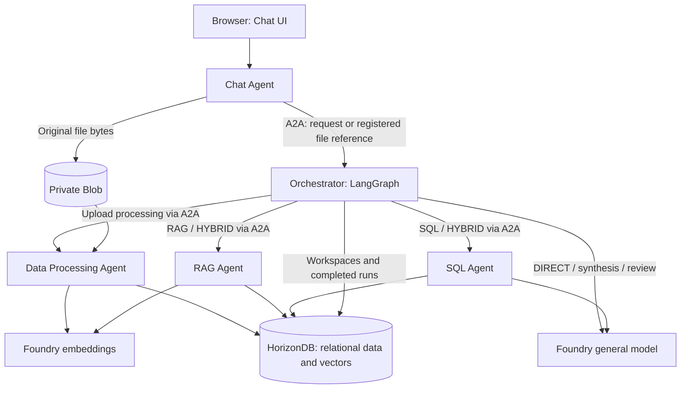

# Module 6 — Multi-Agent Business Scenarios

> 🌐 语言 / Language: **English** | [中文](readme_CN.md)

[⬆ Back to Workshop Home](../readme.md)

## Overview

Explore multi-agent business scenarios using **Product Launch Studio** as an example that turns uploaded consumer reports, reviews and sales data into
grounded product-launch recommendations. Five independent Agents collaborate through **A2A**.
**LangGraph** plans and coordinates work inside the Orchestrator; the **OpenAI SDK** calls Microsoft
Foundry Responses and Embeddings endpoints. This module does not use LangChain or Microsoft Agent Framework.

> [!IMPORTANT]
> **Primary workshop path:** deploy HorizonDB with Bash/Bicep, build five images remotely with ACR Tasks,
> then deploy and start five ACA Sandboxes with Bash and the independent `aca` CLI.
> Reuse Module-01's resource group, region, ACR, model gateway and image-pull identity, and Module-04's
> existing SandboxGroup. Do not recreate these shared resources.

This is the consolidated module walkthrough, combining architecture, deployment, data processing and
demo instructions. The source-level READMEs and specialized runbooks remain available as detailed references.
All eight Markdown guides in `agent-src/docs` have Chinese counterparts and language links at the top.
The application is a single-operator workshop, not a production multi-tenant service.

## Learning Objectives

- Observe Agent boundaries, authenticated discovery, routing and parallel collaboration.
- Deploy and start five isolated runtimes without a local Docker image build or Python provisioning SDK.
- Upload documents and tables; observe extraction, relational storage and selective vectorization.
- Run DIRECT, RAG, SQL and HYBRID questions from the Chat UI and inspect the evidence.
- Distinguish process readiness, cloud dependency access and successful business-flow execution.

### Architecture and Agent responsibilities

| Agent | Responsibility | Calls |
|---|---|---|
| Chat | FastAPI UI/API, workspace operations, upload validation and private Blob originals | Orchestrator through A2A; Blob adapter |
| Orchestrator | Workspace authorization, LangGraph planning, parallel workers, synthesis, review and run persistence | Processing/RAG/SQL through A2A; general model; HorizonDB |
| Data Processing | Extract files, infer table types, chunk useful text, embed and commit data | Blob, embeddings, HorizonDB |
| RAG | Workspace-filtered cosine retrieval with sources, scores and up to five matches | Embeddings, HorizonDB |
| SQL | Schema-aware SQL generation, AST validation and bounded read-only execution | General model, HorizonDB |



Chat never directly calls workers, models or database repositories. Workers do not call one another.
Each service publishes an authenticated Agent Card and runs in its own image/process/sandbox.
Callers verify the configured peer's role, skills, protocol and exact endpoint before sending messages.
Uploaded text is untrusted evidence, not instructions. Shared adapters avoid duplicate model/storage code.
The UI's styling and interaction pattern are adapted from Module-03; its original implementation is unchanged.

---

## Prerequisites

> [!CAUTION]
> Run all commands below from **`agenthost/module-06/`**, unless a command explicitly uses a subshell
> to enter another directory. Keep the same Bash session for Steps 1–4. Do not run with shell tracing
> (`set -x`) or Azure/ACA HTTP debug logging because configuration contains credentials.

1. Complete [Module-01](../module-01/README.md) and [Module-04](../module-04/README.md).
   The resource group must retain its `deploymentSN` tag unless you explicitly supply resource names.
2. Use Linux Bash, Azure CLI with Bicep, the independent `aca` CLI, `jq`, `curl`, `openssl` and GNU `timeout`.
   The deployment path was checked with ACA CLI `1.0.0-preview.5` and Bicep `0.48.1`.
   Older Bicep catalogs may warn about missing HorizonDB preview types.
3. Your operator identity needs HorizonDB deployment permissions, permission to run ACR Tasks,
   and **Container Apps SandboxGroup Data Owner** on the existing group. The image-pull identity needs
   ACR pull permissions. HorizonDB preview access, provider registration and capacity must exist in the chosen region.
4. Provide actual Foundry general-model and embedding deployment names. Reuse Module-01's APIM route
   for the general model; configure embeddings separately. Do not assume APIM already exposes embeddings.
5. Provide a **private Blob container `data`**, the endpoint, and a guest runtime identity with appropriate
   model access and Storage Blob Data Contributor. If storage is private-only, finish the VNet/Private DNS
   setup from Module-04 and select its existing connection with `CUSTOMER_VNET_CONNECTION_NAME`.
6. Verify guest identity separately: a host `az login` or the ACR pull UAMI does **not** authenticate guest
   application calls. This walkthrough shows a narrowly scoped service principal through protected
   `AZURE_TENANT_ID`, `AZURE_CLIENT_ID` and `AZURE_CLIENT_SECRET`; an approved, verified guest managed
   identity is an alternative.
7. Use the included synthetic files for repeatable demonstrations. Local Python and Docker are optional
   for the cloud path; Python 3.11+ and PostgreSQL/vector are needed only for the local development alternative.

### Install and check the CLI

Install missing prerequisites using their official installers. Review the ACA installer before running it:

```bash
curl -fsSL https://aka.ms/aca-cli-install | sh
aca --version
az bicep version
az account show -o none 2>/dev/null || az login
aca auth status >/dev/null 2>&1 || aca auth login
```

This same install path is also used inside sandboxes and containers for agent-driven self-installs.
The CLI is **`aca`**, not `az containerapp sandbox`; it is also distinct from ACA Dynamic Sessions.
Run `aca doctor` with the existing group context in Step 1 and resolve failures before deployment.
No provisioning script installs tools or silently logs in for you.

### Configuration defaults

**Explicit arguments > nonempty environment variables > defaults.** Deployment scripts do not source
`.env` automatically. Resource names follow Modules 01/04; no new suffix is generated.

| Environment variables | Default / behavior |
|---|---|
| `SUBSCRIPTION_ID`, `RESOURCE_GROUP`, `LOCATION` | Current Azure CLI account; `rg-agenthost-workshop`; existing RG location, normally `eastus2` |
| `DEPLOYMENT_SN` | RG `deploymentSN` tag |
| `ACR_NAME`, `ACR_LOGIN_SERVER` | `acragenthost<SN>`; query its actual login server |
| `SANDBOX_GROUP_NAME` | `sandbox-group-agenthost-<SN>` |
| `IDENTITY_NAME`, `REGISTRY_IDENTITY` | `id-agenthost-<SN>`; query its ARM ID for image pull |
| `IMAGE_TAG`, `AUTO_SUSPEND_MINS` | `latest`, `15`; set the same tag for builds and deployment |
| `SANDBOX_CPU`, `SANDBOX_MEMORY` | `1000m`, `2048Mi` per Agent |
| `HORIZONDB_CLUSTER_NAME`, `HORIZONDB_USERNAME`, `HORIZONDB_VCORES` | `hdb-agenthost-<SN>`, `studioadmin`, `2` |
| `HORIZONDB_PASSWORD`, `HORIZONDB_PASSWORD_FILE` | No default secret; environment password or `agent-src/.local/horizondb-password`; explicit `--password-file` wins |
| `HORIZONDB_FIREWALL_RULES_FILE` | Optional JSON rules; otherwise `0.0.0.0`–`255.255.255.255` |
| `HORIZONDB_OUTPUT`, `ACA_CONFIG`, `ACA_OUTPUT` | Files under `agent-src/.local`: `horizondb-deployment.json`, `aca-config.json`, `aca-deployment.json` |
| `HEALTH_TIMEOUT_SECONDS`, `OPERATION_TIMEOUT_SECONDS` | `180`, `900` seconds |
| `CUSTOMER_VNET_CONNECTION_NAME` | Unset; use only an existing group VNet connection |

Default file paths inside the scripts are anchored to `agent-src`; explicit relative paths are relative
to your current directory. Guest configuration comes from the protected five-role `ACA_CONFIG`, not arbitrary
host environment variables. `--apply` and `--migrate` must be explicit flags.

---

## Step 1 — Select the existing Azure environment

From the repository root, enter the module once:

```bash
cd agenthost/module-06
```

Select the intended subscription before continuing. These commands read shared resources, not create them:

```bash
export SUBSCRIPTION_ID="${SUBSCRIPTION_ID:-$(az account show --query id -o tsv)}"
export RESOURCE_GROUP="${RESOURCE_GROUP:-rg-agenthost-workshop}"
export LOCATION="${LOCATION:-$(az group show --subscription "$SUBSCRIPTION_ID" -n "$RESOURCE_GROUP" --query location -o tsv)}"
export DEPLOYMENT_SN="${DEPLOYMENT_SN:-$(az group show --subscription "$SUBSCRIPTION_ID" -n "$RESOURCE_GROUP" --query tags.deploymentSN -o tsv)}"
: "${SUBSCRIPTION_ID:?Select an Azure subscription}"
: "${LOCATION:?Existing RG location is required}"
: "${DEPLOYMENT_SN:?Set DEPLOYMENT_SN or restore the RG deploymentSN tag}"
export SANDBOX_GROUP_NAME="${SANDBOX_GROUP_NAME:-sandbox-group-agenthost-$DEPLOYMENT_SN}"
export IMAGE_TAG="${IMAGE_TAG:-latest}"
aca doctor --subscription "$SUBSCRIPTION_ID" --resource-group "$RESOURCE_GROUP" \
  --group "$SANDBOX_GROUP_NAME" --region "$LOCATION"
umask 077
mkdir -p agent-src/.local
export HORIZONDB_PASSWORD_FILE="${HORIZONDB_PASSWORD_FILE:-agent-src/.local/horizondb-password}"
export HORIZONDB_OUTPUT="${HORIZONDB_OUTPUT:-agent-src/.local/horizondb-deployment.json}"
export ACA_CONFIG="${ACA_CONFIG:-agent-src/.local/aca-config.json}"
export ACA_OUTPUT="${ACA_OUTPUT:-agent-src/.local/aca-deployment.json}"
```

Confirm the subscription/RG/region/group reported by `aca doctor`. Do not create another SandboxGroup.
If overriding file locations, keep them outside Git and the image build context and create their parent directories.

## Step 2 — Provision HorizonDB

> [!WARNING]
> The workshop template opens the public endpoint to **`0.0.0.0`–`255.255.255.255`**.
> Every IPv4 source can attempt a database connection. TLS and strong authentication remain mandatory.
> Use restricted firewall ranges or private networking outside the workshop.
> Incremental ARM deployment does **not** delete existing firewall rules: adding narrow rules or `[]`
> will not remove a previously deployed `workshop-public` rule.

Prepare the password once. An existing file is reused; if `HORIZONDB_PASSWORD` is set, save that chosen
value to the protected file so deployment and runtime configuration use the same credential:

```bash
if [[ -n "${HORIZONDB_PASSWORD:-}" ]]; then
  printf '%s' "$HORIZONDB_PASSWORD" > "$HORIZONDB_PASSWORD_FILE"
elif [[ ! -f "$HORIZONDB_PASSWORD_FILE" ]]; then
  openssl rand -base64 36 > "$HORIZONDB_PASSWORD_FILE"
fi
chmod 600 "$HORIZONDB_PASSWORD_FILE"
bash agent-src/deploy/deploy-horizondb.sh --password-file "$HORIZONDB_PASSWORD_FILE"
# After reviewing validation, network access and cost:
bash agent-src/deploy/deploy-horizondb.sh --password-file "$HORIZONDB_PASSWORD_FILE" --apply
```

Without `--apply`, this performs ARM validation only. With it, Bicep creates a PostgreSQL 17 HorizonDB
cluster, a parameter group allowing `vector`, and pool firewall rules. The default is two vCores,
one replica and `BestEffort` zone placement, using the existing **`postgres` database**.
The pinned API is `2026-05-01-preview`; public access is controlled by pool firewall rules.
Passwords are passed as secure parameters through temporary protected files, not literal CLI arguments.

Expected result: the nonsecret inventory at `HORIZONDB_OUTPUT` contains the endpoint, port, database,
username and TLS mode. This is not yet a database connection test. Step 4 applies the application schema
inside a guest and checks it. Do not migrate a production database or change the password between these steps.

## Step 3 — Build images and prepare Agent configuration

### Build remotely in the existing ACR

```bash
bash agent-src/deploy/build-images.sh
```

This submits five billable **`az acr build` ACR Tasks quick builds** and publishes `studio-chat`,
`studio-orchestrator`, `studio-data-processing`, `studio-rag` and `studio-sql` with `IMAGE_TAG`.
It does not use local Docker. Complete all builds before deployment; the ACA script imports existing images only.
To reuse older images tagged `workshop`, set `IMAGE_TAG=workshop` consistently.

### Configure models, Blob and runtime identity

Using a secure editor, create **`agent-src/.local/aca-common.json`** with the following shape.
Replace every placeholder with the actual deployed setting; never paste credentials into command arguments.
All environment values must be strings.

```json
{
  "BLOB_BACKEND": "azure",
  "AZURE_STORAGE_ACCOUNT_URL": "https://<existing-storage-account>.blob.core.windows.net",
  "AZURE_STORAGE_CONTAINER": "data",
  "AGENT_APIM_ENDPOINT": "https://<existing-apim-host>",
  "FOUNDRY_EMBEDDING_BASE_URL": "https://<embedding-resource>.openai.azure.com/openai/v1/",
  "LLM_MODEL": "<deployed-general-model-name>",
  "EMBEDDING_MODEL": "<deployed-embedding-model-name>",
  "EMBEDDING_DIMENSIONS": "1536",
  "AZURE_TENANT_ID": "<tenant-id>",
  "AZURE_CLIENT_ID": "<runtime-application-client-id>",
  "AZURE_CLIENT_SECRET": "<runtime-application-secret>"
}
```

`1536` must match the configured embedding deployment and database vector dimension.
For a direct general-model route, use `FOUNDRY_OPENAI_BASE_URL` instead of `AGENT_APIM_ENDPOINT`.
Check `LLM_TOKEN_SCOPE` and `EMBEDDING_TOKEN_SCOPE` against the actual endpoints; defaults and all runtime
limits are in [the configuration reference](agent-src/.env.example).
For managed identity, omit all three service-principal fields and verify that the guest can obtain tokens.
Do not grant broad roles just to make an authentication error disappear.

Create distinct browser and peer keys once, then combine the common settings and database output:

```bash
chmod 600 agent-src/.local/aca-common.json
[[ -f agent-src/.local/studio-key ]] || openssl rand -hex 32 > agent-src/.local/studio-key
[[ -f agent-src/.local/a2a-key ]] || openssl rand -hex 32 > agent-src/.local/a2a-key
jq -n \
  --slurpfile common agent-src/.local/aca-common.json \
  --slurpfile db "$HORIZONDB_OUTPUT" \
  --rawfile password "$HORIZONDB_PASSWORD_FILE" \
  --rawfile browser agent-src/.local/studio-key \
  --rawfile peer agent-src/.local/a2a-key '
  ($common[0] +
   ($db[0] | with_entries(select(.key | startswith("HORIZONDB_")))) +
   {HORIZONDB_PASSWORD:($password|sub("\r?\n$";"")),
    STUDIO_API_KEY:($browser|sub("\r?\n$";"")),
    A2A_API_KEY:($peer|sub("\r?\n$";""))}) as $env |
  ["chat","orchestrator","data-processing","rag","sql"] |
  map({key:.,value:$env}) | from_entries
' > "$ACA_CONFIG"
chmod 600 "$ACA_CONFIG" agent-src/.local/studio-key agent-src/.local/a2a-key
```

Keep these files private and ignored. The deployment script discovers all five URLs and overwrites the
corresponding A2A settings, so do not guess ingress addresses. It uploads configuration only after creating
a protected guest directory, then applies mode `0600`, ownership and an atomic rename.
The A2A key is for service-to-service traffic; never enter it into the browser.

## Step 4 — Deploy, start and check all five Agents

```bash
bash agent-src/deploy/deploy-aca.sh
# First deployment into the dedicated workshop database:
bash agent-src/deploy/deploy-aca.sh --migrate --apply
```

Without `--apply`, only local configuration/manifest validation runs. With it, the script:

1. Resolves and verifies the existing group, region, ACR and image-pull identity.
2. Imports five disk images and generates five manifests with unique deployment/role labels.
3. Validates and applies the manifests, exposes port 8080, and captures HTTPS URLs.
4. Delivers five-role configuration while each guest waits behind a startup gate.
5. With `--migrate`, applies [001_initial.sql](agent-src/migrations/001_initial.sql) once, including `vector`;
   checks `workspaces` and vector availability from all four database-using guests.
6. Starts each Agent's Uvicorn process as UID 10001. No separate terminal or manual Agent launch is needed.
7. Waits for all five `/health` endpoints and authenticated Agent Cards, then performs a read-only
   Chat → A2A → Orchestrator → database request.
8. Prints a status table and saves exact resource IDs/URLs in `ACA_OUTPUT`.

The manifest pattern is recommended for CI/CD and reproducibility. For manual experiments the sequence is
`aca sandbox init` → `aca sandbox validate --file sandbox.yaml` → `aca sandbox apply --file sandbox.yaml`;
this script already generates the manifests, so no separate initialization is needed.
The host does not need Python or the Sandbox SDK; migrations use Python already inside the Agent image.

```text
AGENT             STATUS       URL
chat              ready        https://<chat-ingress>
orchestrator      ready        https://<orchestrator-ingress>
data-processing   ready        https://<processing-ingress>
rag               ready        https://<rag-ingress>
sql               ready        https://<sql-ingress>
Inventory: .../.local/aca-deployment.json
```

> [!IMPORTANT]
> Ports use `--anonymous`: anyone with the URL can reach the HTTPS endpoint, but application browser/peer
> bearer authentication remains required. Outbound traffic is allowed for the workshop; use deny-default
> egress with an explicit allowlist in production.
> **Ready is not full acceptance:** continue with uploads and questions to verify Blob, embeddings and generation.

Health checks share a 180-second deadline by default; each ACA operation allows 900 seconds.
The guest configuration gate is bounded by 3600 seconds. Any failure returns a nonzero exit code and keeps
known IDs/stages; no automatic rollback occurs. Existing inventories are refused.
**Rerunning `--apply` with another output path creates another deployment, not an in-place restart.**

## Step 5 — Open Chat UI and create a workspace

```bash
jq -r '.agents.chat.url' "$ACA_OUTPUT"
```

1. Open the printed Chat URL.
2. Retrieve the value from the protected `agent-src/.local/studio-key` file through your secure workflow.
   Enter it in **Workshop key** and click **Connect**.
3. In **New workspace**, enter `Summer launch`, click **Create**, and select it in **Workspace**.
4. Keep this workspace selected for every upload and question below.

The browser only needs the workshop key, not database/model credentials or the peer key.
**Clear local conversation** clears browser display history; it does not delete stored data or completed runs.

## Step 6 — Upload, process and vectorize sample data

Use files in **[agent-src/sample-data](agent-src/sample-data/README.md)**, not the separate module-level
sample collection, so the expected answers below stay reproducible.
For each file, select it and click **Upload and process**. Wait for completion before uploading the next file.
Processing and vectorization start automatically; there is no separate embedding command or UI button.

| Order | File | Expected behavior |
|---|---|---|
| 1 | [consumer-trends.md](agent-src/sample-data/consumer-trends.md) | Extract text, chunk, embed and store document vectors |
| 2 | [03_customer_reviews.csv](agent-src/sample-data/03_customer_reviews.csv) | Store typed relational rows and embed useful review text linked to its source rows |
| 3 | [04_financial_sample.csv](agent-src/sample-data/04_financial_sample.csv) | Store typed relational rows; **zero embeddings** for numeric financial data |

Observe the progress panel, counts, skipped records and warnings; click **Show sources** to inspect stored
sources. Chat stores private originals and passes a registered reference through A2A.
Data Processing revalidates the reference/checksum, extracts content and commits relational/vector data atomically.
Failed ingestion rolls back rows/vectors and marks the document failed; original Blob objects may remain.

Text defaults to 400-token chunks with 60-token overlap. Empty, short and duplicate text is skipped and counted.
Review vectors retain row linkage. Ingest and query must use the same embedding deployment/dimension.
Supported formats are PDF, DOCX, TXT, MD, CSV, XLSX and JSON. Scanned/encrypted PDFs fail explicitly; there is
no OCR. XLSX supports one populated sheet, with cached formula values. JSON object arrays become tables;
other JSON becomes searchable text. Do not change embedding dimensions mid-workshop without a migration plan.

> [!NOTE]
> The included fixtures are fictional, not market research. For optional publisher PDFs, follow
> [sample-data guidance](agent-src/sample-data/README.md), verify usage rights, and use text PDFs.
> Do not commit downloaded reports or upload confidential customer data without authorization.
> Extracted text is sent to the configured Foundry embedding deployment.

## Step 7 — Run Chat query scenarios and inspect evidence

Type each question into the message box and click **Send** (or press Enter). Wait for completion and expand
the answer's evidence panel. The UI does not provide a manual route selector: the model chooses a
schema-validated plan based on the question's data requirements.

| Mode | Question | What to verify |
|---|---|---|
| DIRECT | Write three taglines for a repairable speaker. | General-model answer; no workspace retrieval or SQL |
| RAG | According to the uploaded reports, what matters to consumers? | Query embedding and up to five workspace-filtered cosine matches; filenames, sections/pages where available, scores and citations |
| SQL | Which country generated the highest total profit? | Generated/validated read-only SQL and actual result rows; synthetic fixtures: **France 4000, Germany 3300** |
| HYBRID | Combine consumer trends and sales performance and recommend the best launch market. | Parallel RAG and SQL work, combined qualitative/quantitative evidence and a clearly labeled recommendation |

Orchestrator aggregates worker results, generates the answer, then reviews the **actual draft** for evidence,
calculations and citations. One revision is allowed; a second failed review blocks an unsupported answer.
SQL permits approved SELECT queries only, with workspace predicates, row limits, a read-only transaction and timeout.
Final answers distinguish evidence, calculated facts, interpretation, recommendations and limitations.

Progress originates in real graph/ingestion nodes. Chat/upload APIs return HTTP 202 plus a run ID;
the browser polls once per second. This is progress polling, not model-token streaming.
Completed runs persist in HorizonDB; transient A2A task state is bounded in memory.

### Additional acceptance checks

1. Ask about an absent topic and explicitly request evidence from uploaded reports. Expect insufficient
   evidence rather than invented sources.
2. Create and select a second workspace, then use **Show sources**. The first workspace's files must not appear there.
3. In a disposable test deployment, stop/suspend the SQL worker and repeat HYBRID. Expect an explicit
   partial/error result, never fabricated SQL results. Resume it before the next scenario.
4. Restart an Agent process in a controlled test. Sources, datasets and completed runs should remain;
   interrupted workflows do not automatically resume. Do not treat process restart as workflow recovery.

All four modes and the upload checks must pass before calling the real cloud workshop validated.

## Step 8 — Operate and clean up safely

Idle auto-suspend defaults to 15 minutes. The application does not automatically wake workers:
resume suspended Agents before use, and avoid suspension during active workflows.
For targeted operations, use the exact inventory rather than similarly named shared resources:

```bash
SQL_SANDBOX_ID="$(jq -er '.agents.sql.sandbox_id' "$ACA_OUTPUT")"
aca_context=(
  --subscription "$(jq -er '.subscription' "$ACA_OUTPUT")"
  --resource-group "$(jq -er '.resource_group' "$ACA_OUTPUT")"
  --group "$(jq -er '.sandbox_group' "$ACA_OUTPUT")"
  --region "$(jq -er '.region' "$ACA_OUTPUT")"
)
aca sandbox get --id "$SQL_SANDBOX_ID" "${aca_context[@]}"
# Only for the deliberate failure test in a disposable deployment:
aca sandbox stop --id "$SQL_SANDBOX_ID" "${aca_context[@]}"
# Repeat HYBRID in Chat and inspect the result before running resume:
aca sandbox resume --id "$SQL_SANDBOX_ID" "${aca_context[@]}"
```

Suspended Sandboxes retain storage charges but not compute charges; HorizonDB and other services have
separate costs. For diagnostics, use `aca sandbox exec --id ... -c "..."` for one command or
`aca sandbox shell --id ...` for an interactive session, with the recorded context. SSH is not available.
Do not print credential files into logs.

| Symptom | Check |
|---|---|
| ARM validation/deployment failure | HorizonDB preview access, provider, region capacity, permissions and Bicep type support |
| Database/schema failure | DNS, egress, firewall, TLS, password, vector allowlist and migration; `/health` alone is insufficient |
| Blob upload failure | Guest identity, Blob RBAC, private endpoint/DNS and selected VNet connection |
| APIM 404 / embedding failure | Exact OpenAI v1 routes, deployment names, token scopes and dimensions |
| A2A 401 / invalid card | Matching separate peer key, expected role/skills/protocol and exact advertised URL; do not disable checks |
| PEER_UNAVAILABLE | Sandbox state, port exposure and network reachability; explicitly resume suspended workers |
| Failed/weak ingestion or retrieval | Text PDF, sheet count, upload/chunk limits and evidence quality; do not lower thresholds just to force an answer |
| ACR build failure | ACR Tasks permissions/capacity and cloud-builder dependency access; never disable TLS verification |

Preserve inventories after failures and locate resources by recorded IDs/names/deployment labels before retrying.
Snapshot any state worth keeping **before deletion**. Remove only this deployment's five Sandboxes,
then its imported disks; do not delete the shared Module-04 SandboxGroup or Module-01 resource group.
Review HorizonDB, Blob, snapshot and disk retention separately. There is no automatic data-retention/delete API.
For database/Blob cleanup, follow [security and cleanup](agent-src/docs/security.md); do not use model-generated
deletion queries or delete a shared container. See [CLI failure handling](agent-src/docs/cli-deployment.md#failure-retry-and-cleanup).

---

## Optional — Run the five Agents locally

Use this for development instead of Steps 2–4. It still requires real Foundry model deployments.
Python 3.11+ and a local PostgreSQL/vector database are required; Docker is only used for the optional local DB,
not for image builds. From the module root:

```bash
python -m venv agent-src/.venv
source agent-src/.venv/bin/activate
python -m pip install -e "./agent-src[dev]"
cp -n agent-src/.env.example agent-src/.env
```

Edit `agent-src/.env`: replace database/browser/peer secrets, configure model endpoints/deployments,
use local Blob storage and the local database settings. Never commit this file.

```bash
(cd agent-src && docker compose up -d db)
(cd agent-src && python -m shared.database)
```

Open five terminals at the module root; activate the same environment in each. Run one command per terminal:

| Agent | Command |
|---|---|
| Chat | `(cd agent-src && A2A_PUBLIC_URL=http://127.0.0.1:8080 uvicorn chat_agent.app:create_app --factory --host 127.0.0.1 --port 8080)` |
| Orchestrator | `(cd agent-src && A2A_PUBLIC_URL=http://127.0.0.1:8081 uvicorn orchestrator_agent.app:create_app --factory --host 127.0.0.1 --port 8081)` |
| Data Processing | `(cd agent-src && A2A_PUBLIC_URL=http://127.0.0.1:8082 uvicorn data_processing_agent.app:create_app --factory --host 127.0.0.1 --port 8082)` |
| RAG | `(cd agent-src && A2A_PUBLIC_URL=http://127.0.0.1:8083 uvicorn rag_agent.app:create_app --factory --host 127.0.0.1 --port 8083)` |
| SQL | `(cd agent-src && A2A_PUBLIC_URL=http://127.0.0.1:8084 uvicorn sql_agent.app:create_app --factory --host 127.0.0.1 --port 8084)` |

Use `.env.example`'s matching peer URLs. Open `http://127.0.0.1:8080` and follow Steps 5–7 using the workshop
key from your local `.env`. Only local development shares a filesystem originals directory.
The tokenizer downloads cl100k_base on first use; prepare the cache before an offline session.
Windows PowerShell setup and the optional AKS/SDK/container paths remain in the
[source README](agent-src/README.md) and [deployment reference](agent-src/docs/sandbox-deployment.md).

## Files in this module

| File / directory | Purpose |
|---|---|
| [readme.md](readme.md), [readme_CN.md](readme_CN.md) | Consolidated English/Chinese workshop entrypoints |
| [agent-src/README.md](agent-src/README.md) | Developer setup, full API/configuration reference and test commands |
| [chat_agent](agent-src/chat_agent/README.md) | Chat API/UI implementation, entrypoint and Dockerfile |
| [orchestrator_agent](agent-src/orchestrator_agent/README.md) | A2A facade, LangGraph workflow, synthesis/review |
| [data_processing_agent](agent-src/data_processing_agent/README.md) | Extraction, classification, relational storage and vectorization |
| [rag_agent](agent-src/rag_agent/README.md), [sql_agent](agent-src/sql_agent/README.md) | Evidence retrieval and exact structured queries |
| [shared](agent-src/shared/) | Configuration, contracts, A2A transport, database/Blob/model adapters, SQL safety |
| [001_initial.sql](agent-src/migrations/001_initial.sql) | Workspaces, documents, chunks, datasets, reviews, runs and reserved insights; uploads add `ds_<document UUID>` tables |
| [deploy-horizondb.sh](agent-src/deploy/deploy-horizondb.sh), [horizondb.bicep](agent-src/deploy/horizondb.bicep) | HorizonDB validation/deployment |
| [build-images.sh](agent-src/deploy/build-images.sh), [build-images.ps1](agent-src/deploy/build-images.ps1) | Five remote ACR image builds |
| [deploy-aca.sh](agent-src/deploy/deploy-aca.sh), [aca-config.jq](agent-src/deploy/aca-config.jq) | Five-Sandbox orchestration and configuration validation |
| [aca_sandboxes.py](agent-src/deploy/aca_sandboxes.py), [render_sandboxes.py](agent-src/deploy/render_sandboxes.py) | Optional Python SDK deployment / AKS Sandbox renderer; not the primary Bash path |
| [.env.example](agent-src/.env.example), [compose.yaml](agent-src/compose.yaml), [compose.agents.yaml](agent-src/compose.agents.yaml) | Runtime configuration, local DB, optional five-container topology using ACR images |
| [tests](agent-src/tests/), [sample-data](agent-src/sample-data/README.md) | Regression tests and original synthetic demonstration inputs |
| [module-level sample-data](sample-data/) | Separate existing source collection; not the synthetic acceptance dataset |
| [prompt](prompt/) | Original workshop requirements/design inputs, not executable deployment instructions |
| [architecture](agent-src/docs/architecture.md), [orchestration](agent-src/docs/orchestration.md), [data processing](agent-src/docs/data-processing.md) | Detailed implementation references |
| [CLI deployment](agent-src/docs/cli-deployment.md), [sandbox deployment](agent-src/docs/sandbox-deployment.md), [workshop guide](agent-src/docs/workshop-guide.md), [security](agent-src/docs/security.md) | Specialized runbooks retained for reference |
| [implementation report](agent-src/docs/implementation-report.md) | Recorded validation evidence and remaining cloud acceptance boundaries |

## Validation status and limitations

Recorded prior acceptance includes 80 Python tests with local PostgreSQL/vector, independent-process A2A flows
and browser checks. Bash/PowerShell deployment tests use cloud stubs; Bicep/CLI manifest validation is offline.
**Actual ACR builds, HorizonDB deployment and live five-Sandbox model/Blob/business acceptance remain unverified.**
This guide does not imply those resources have been deployed.

There is one Orchestrator scheduler, no durable in-flight workflow recovery, no OCR, no production RLS or
multi-user identity, no automatic retention cleanup, and only basic Markdown rendering.
Use isolated durable workers for large/untrusted production documents.

[⬆ Back to Workshop Home](../readme.md)
