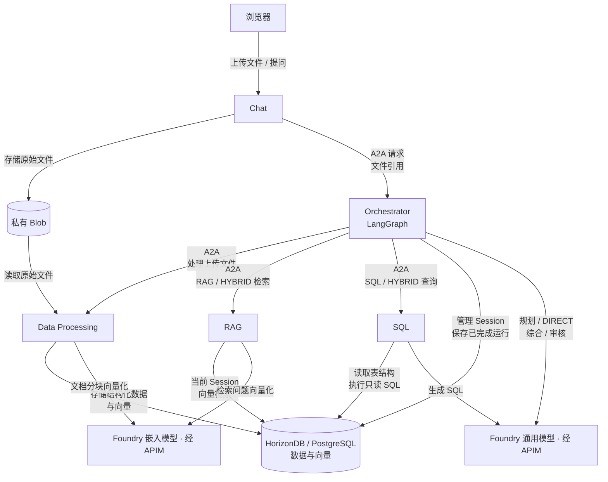
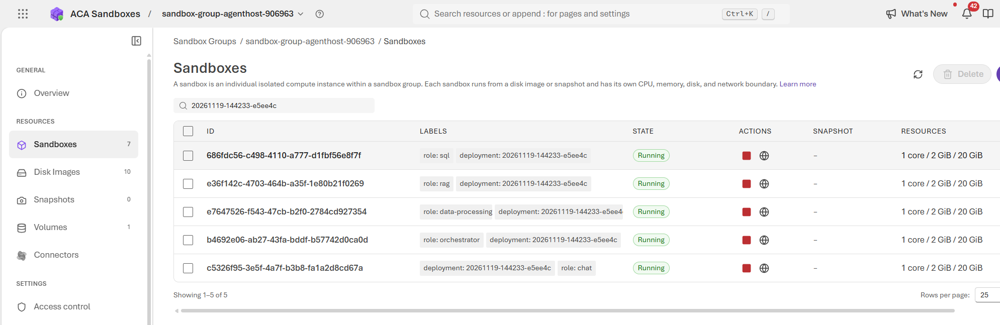
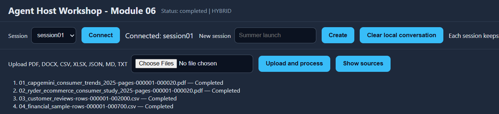
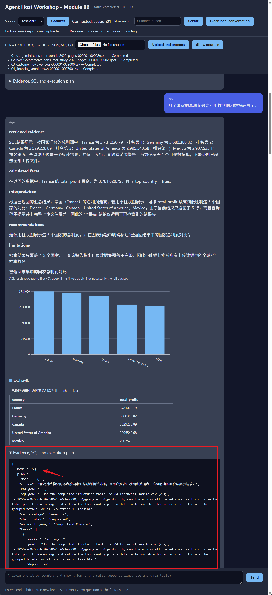
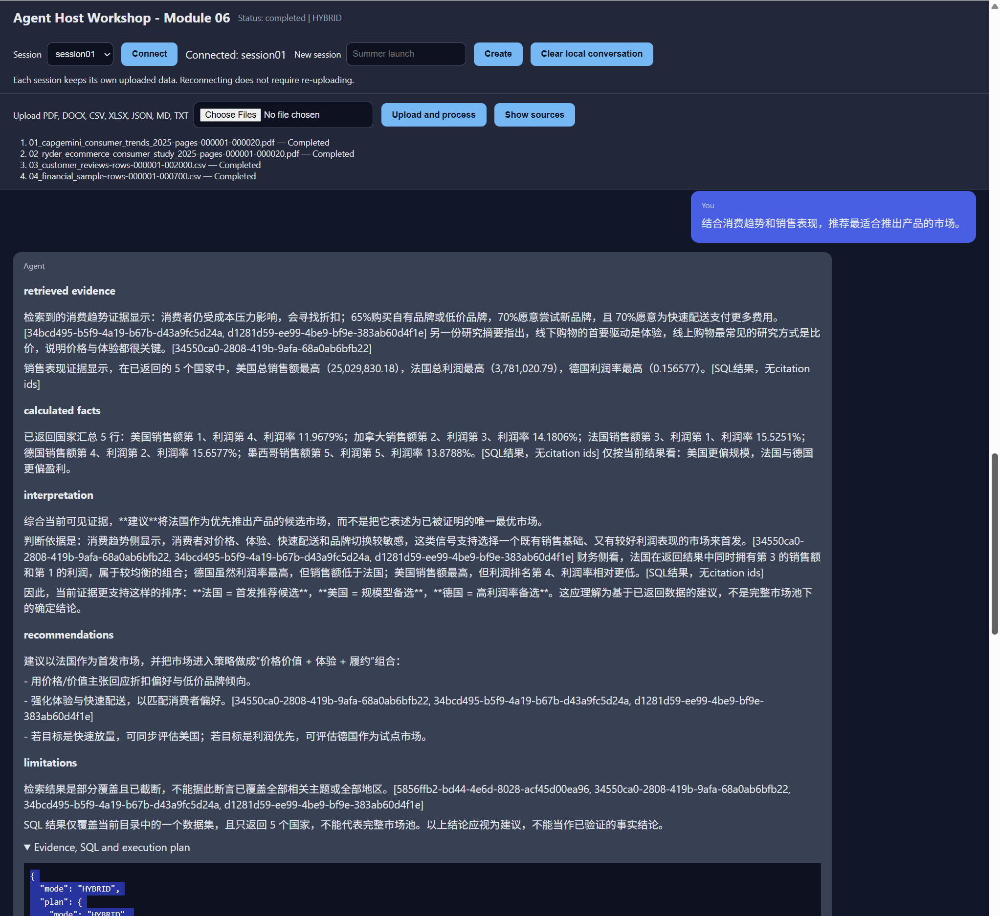

# 模块 6 — 多智能体业务场景

> 🌐 语言 / Language: [English](readme.md) | **中文**

[⬆ 返回研讨会主页](../README_CN.md)

> **建议时长：60 分钟**，接续 145 分钟的核心研讨会。

## 概述

- 业务场景：上传消费者报告、客户评论和销售数据，由五个协作的 Agent 提供有据可依的业务分析。
- 实现概要：
  - 每个 Agent 在独立的 ACA Sandbox 中运行，通过 **A2A** 通信；
  - **LangGraph** 在 Orchestrator 内协调任务，**OpenAI SDK** 通过已有 APIM 网关调用 Microsoft Foundry；
  - **Azure HorizonDB / PostgreSQL Flexible Server** 存储结构化数据和向量。
- Agent 角色定义：
| Agent | 职责 |
|---|---|
| Chat | 浏览器界面、Session 管理和文件上传 |
| Orchestrator | 规划任务、协调工作 Agent、综合并审核答案 |
| Data Processing | 提取文件、写入结构化数据并生成嵌入 |
| RAG | 检索相关片段并提供来源引用 |
| SQL | 生成、验证并执行受限的只读查询 |

## 架构


## 前提条件

- 完成 [Module-01](../module-01/README_CN.md) 和 [Module-04](../module-04/README_CN.md)。
  复用其资源组、区域、存储账户、ACR、Foundry/APIM、托管身份（UAMI）及已有 SandboxGroup，
  保留资源组的 `deploymentSN` 标签。
- 使用 Linux Bash（含 WSL）、带 Bicep 的 Azure CLI、独立的
  [`aca` CLI](https://aka.ms/aca-cli-install)、`jq`、`curl`、`openssl`、GNU `timeout` 和 `realpath`。
  部署路径已使用 ACA CLI `1.0.0-preview.5` 和 Bicep `0.48.1` 检查。
- 操作人员需具备数据库/模型/APIM 子资源部署权限、存储 ARM 读取及容器部署权限、
  挂载 UAMI 和运行 ACR Tasks 的权限，以及已有 SandboxGroup 上的 **Container Apps SandboxGroup Data Owner**。
- UAMI 需具备模型访问、ACR 拉取和 **Storage Blob Data Contributor** 权限。
  所选数据库需完成提供程序注册且区域容量可用；HorizonDB 还需预览访问权限。

### 挂载已有私有 Blob（Bash 部署必需）

部署会在已有存储账户中创建私有 `data` 容器，
并**只读挂载到 Chat 和 Data Processing 的 `/kb-data`**；应用仍通过 Blob SDK 上传文件。

私有存储访问需通过Private Link实现，因此需先完成 Module-04 的 VNet/Private DNS 配置。

> [!CAUTION]
> 本模块用于研讨会，不是生产级多用户服务：
> - 任何能访问 Chat URL 的人都能访问所有 Session 及其数据，浏览器无需密钥。
> - 数据库默认防火墙允许**所有 IPv4 来源**（`0.0.0.0`–`255.255.255.255`）。
>   研讨会之外应限制规则或使用私有网络；新增窄范围规则不会删除已有宽范围规则。
> - 共享 UAMI 获得数据库管理员权限以完成研讨会设置；生产环境应使用最小权限 SQL 角色。

## 步骤 1 — 检查已有环境

从仓库根目录进入本模块，后续命令均在此目录的**同一个 Bash 会话**中运行。

```bash
cd agenthost/module-06
az account show -o none 2>/dev/null || az login
aca auth status >/dev/null 2>&1 || aca auth login

export SUBSCRIPTION_ID="$(az account show --query id -o tsv | tr -d '\r\n')"
export RESOURCE_GROUP="${RESOURCE_GROUP:-rg-agenthost-workshop}"
export LOCATION="$(az group show --subscription "$SUBSCRIPTION_ID" -n "$RESOURCE_GROUP" --query location -o tsv | tr -d '\r\n')"
export DEPLOYMENT_SN="$(az group show --subscription "$SUBSCRIPTION_ID" -n "$RESOURCE_GROUP" --query tags.deploymentSN -o tsv | tr -d '\r\n')"
: "${DEPLOYMENT_SN:?Restore the resource group deploymentSN tag}"
export SANDBOX_GROUP_NAME="${SANDBOX_GROUP_NAME:-sandbox-group-agenthost-$DEPLOYMENT_SN}"
export ACA_OUTPUT="${ACA_OUTPUT:-$PWD/.local/aca-deployment.json}"

aca doctor --subscription "$SUBSCRIPTION_ID" --resource-group "$RESOURCE_GROUP" \
  --sandbox-group "$SANDBOX_GROUP_NAME" --region "$LOCATION"
```

确认订阅、资源组、区域和 SandboxGroup 均为预期值，并解决未通过的检查。
如需切换订阅，先通过 `az account set` 选择目标，再运行上面的命令块。
**不要再创建一个 SandboxGroup。**

确认检查通过，看到以下相似的结果：
```text
General checks:
✓ Azure CLI found
✓ Azure CLI logged in
✓ Subscription configured (624e6382-...) [config]
✓ Resource group configured (rg-agenthost-workshop) [config]
✓ ARM authentication working

Sandbox checks:
✓ Sandbox group: sandbox-group-agenthost-7a5970
✓ Region: westus3
✓ Sandbox group 'sandbox-group-agenthost-7a5970' exists in Azure
✓ Container Apps SandboxGroup Data Owner role assigned

9/9 passed

aca 1.0.0-preview.5 — all checks passed
```

## 步骤 2 — 一键式部署

`DB_PROVIDER` 默认选择 **HorizonDB**，可选服务为 **HorizonDB | PostgreSQL**（Azure PostgreSQL Flexible Server）。
命令中的取值必须使用小写：`horizondb`（默认）或 `postgresql`。
两者均使用 PostgreSQL 17、`postgres` 数据库和 `vector`。

部署前可在当前 Bash 终端设置数据库类型及区域：

```bash
export DB_PROVIDER="horizondb"  # 可改为 "postgresql"
export DB_LOCATION="eastus2"   # 示例：请替换为所选数据库服务实际可用的区域
```

> [!IMPORTANT]
> - **`DB_LOCATION` 只决定数据库的部署区域，可以与资源组、ACA SandboxGroup 的区域不同。**
> 如果此前使用的区域不提供所选数据库服务，应在这里指定该数据库可用的区域，
> - 不要为此修改共享的 `LOCATION` 或重建 SandboxGroup。
> - 上面的 `eastus2` 仅为示例，部署前仍需确认所选数据库服务、SKU 和订阅配额在目标区域可用。
> - 未设置 `DB_LOCATION` 时，优先使用 `LOCATION`，否则使用资源组区域。
> - 跨区域连接还需满足网络访问要求，并可能增加延迟及数据传输费用。

仅在已有资源与研讨会默认值不同时设置覆盖项：

| 变量 | 使用场景 |
|---|---|
| `DB_PROVIDER` | `horizondb`（默认）或 `postgresql` |
| `DB_LOCATION` | 仅覆盖数据库区域，可与资源组/SandboxGroup 不同；原区域不支持所选数据库时需指定可用区域 |
| `ACR_NAME`、`STORAGE_ACCOUNT_NAME`、`APIM_NAME` | Module-01 已有资源使用了自定义名称 |
| `IMAGE_TAG` | 镜像构建与 ACA 导入共同使用的标签，默认为 `latest` |
| `FOUNDRY_RESOURCE_NAME`、`FOUNDRY_PROJECT_NAME` | 已有 Foundry 账户/项目使用了自定义名称；项目默认为 `maf-agent-prj` |
| `LLM_MODEL` | 无法使用 Module-01 部署输出时，指定已部署的通用模型名称 |
| `EMBEDDING_CAPACITY` | 默认为 `200`（`text-embedding-3-small` 的 200K TPM）；需要区域内对应模型/SKU 的足够配额 |
| `CUSTOMER_VNET_CONNECTION_NAME` | 从多个已有 VNet 连接中选择 |
| `DB_FIREWALL_RULES_FILE` | 自定义数据库防火墙规则 |
| `ACA_COMMON` | 独立的自定义运行时 JSON；通常不设置，使用自动发现 |

运行以下命令，一键式完成本模块所需的部署：

```bash
bash deploy.sh --migrate
```

**该命令会创建计费资源。** 它依次完成以下阶段，完整部署后不要再逐项重复执行：

| 阶段 | 操作 |
|---|---|
| `storage` | 在已有存储账户中创建/复用私有 `data` |
| `models` | 默认以 200K TPM 部署 `text-embedding-3-small`，并为已有 APIM 增加对应路由 |
| `database` | 部署所选数据库并配置 UAMI Entra 认证 |
| `config` | 发现模型/存储设置并生成受保护的 Agent 配置 |
| `images` | 通过 ACR Tasks 远程构建并发布五个镜像 |
| `aca` | 创建五个沙箱、挂载存储、应用数据库结构、启动 Agent 并检查连通性 |

命令应以五个 Agent 全部显示 `ready` 结束：
```text
AGENT             STATUS       URL
chat              ready        https://<chat-ingress>
orchestrator      ready        https://<orchestrator-ingress>
data-processing   ready        https://<processing-ingress>
rag               ready        https://<rag-ingress>
sql               ready        https://<sql-ingress>
Inventory: .../.local/aca-deployment.json
```

- 命令还会检查健康端点、经过认证的 Agent Card，以及 Chat → Orchestrator → 数据库请求。
- 生成的配置、密码、对等密钥和资源清单保存在 `.local` 下。
- 自定义设置应写入另一份 `ACA_COMMON` JSON，值使用字符串。

在 ACA Sandbox 门户，进入 **SandboxGroup → Sandboxes**，能够看到新创建的 5 个 agent 处于运行状态：


> [!important]
> - 自动挂起**默认禁用**，因为 HTTP/A2A 请求不会唤醒已挂起的 Agent。因此五个 Agent 即使空闲也会产生计算费用。
> - 练习间隙如需挂起，再次使用前应显式恢复所有工作 Agent。

## 步骤 3 — 连接 Session

```bash
jq -r '.agents.chat.url' "$ACA_OUTPUT"
```
或者点击 `chat` agent，进入 `chat` agent的控制台，在控制台上方，点击 `chat` agent 的服务访问 URL。

1. 打开打印的 URL。
2. 选择已有 **Session**，或在 **New session** 输入 `Summer launch` 并点击 **Create**。
3. 点击 **Connect** 后再上传文件或提问。

Session 是持久化的上传数据工作区，数据可用性仅限定在它所上传的 Session。切换 Session 后需重新连接，和重新上传数据。

**Clear local conversation** 只清除浏览器历史，不删除已存数据。

Enter 发送问题，Shift+Enter 换行。

## 步骤 4 — 上传并处理示例数据

部署不会自动导入数据。请使用 [sample-data](sample-data/) 中已准备好的 PDF/CSV。选择一个或多个文件，点击 **Upload and process**，浏览器会**逐个上传并处理**。

| 顺序 | 上传文件 | 文件内容及处理结果 | 数据来源与链接 |
|---|---|---|---|
| 1 | [Capgemini (PDF：20页)](sample-data/01_capgemini_consumer_trends_2025-pages-000001-000020.pdf) | 消费者趋势报告（第 1–20 页）；提取文本并存储可检索向量 | Capgemini Research Institute 的研究报告：[what-matters-to-todays-consumer-2025](https://www.capgemini.com/us-en/insights/research-library/what-matters-to-todays-consumer-2025/ )。前20页 |
| 2 | [Ryder (PDF：20页)](sample-data/02_ryder_ecommerce_consumer_study_2025-pages-000001-000020.pdf) | 电商消费者研究报告（第 1–20 页）；提取文本并存储可检索向量 | Ryder insights 研究报告：[2025-ryder-ecommerce-consumer-study](https://www.ryder.com/globalassets/media/documents/insights/white-papers/2025-ryder-ecommerce-consumer-study_ada.pdf) 。前20页 |
| 3 | [客户评论 (CSV：2000行)](sample-data/03_customer_reviews-rows-000001-002000.csv) | 客户评论（第 1–2,000 行）；存储有类型的行，并为有用评论文本生成嵌入 | 研讨会提供的公开来源样例 |
| 4 | [财务报告 (CSV：700 行)](sample-data/04_financial_sample-rows-000001-000700.csv) | 财务样例数据（700 行）；存储有类型的行，数值财务数据不生成嵌入 | [Microsoft Power BI 的 Financial Sample](https://learn.microsoft.com/en-us/power-bi/create-reports/sample-financial-download) |

- *本研讨会提供的示例数据来源于公开访问站点*
- *只用于研讨会的技术测试，数据本身不保证具有市场代表性。*

<!--
> - 完整评论源包含 **41,711 行、21 个分片**；每个 CSV 分片是独立数据集/表，全量统计需汇总所有相关分片。
> - 每文件默认限制为 **20 MB**、**50,000 行**和 **100,000 个嵌入分块**。
> - 不要在同一 Session 同时上传原件和分片。去重仅在单个文件内进行，不跨分片；
-->

**上传操作步骤：**
1. 确认已选择目标 **Session** 并点击 **Connect**。
2. 在文件选择区域选择本地的示例 PDF/CSV 文件，可一次选择多个文件。
3. 点击 **Upload and process**，开始上传并处理所选文件。
4. 保持页面打开，等待队列逐个完成所有文件的上传和处理；若出错暂停，点击 **Retry last request** 重试。

上传文件完成后，在状态显示区看到所选文件的上传状态都是“Completed”:

点击 **Show sources**，可以查看当前 Session 已经上传的文件数据。向量转换会自动触发，无需单独执行向量化命令。

**队列运行时请不要关闭页面。**

> [!tip]
> - 上传文件出错时队列会暂停，点击 **Retry last request** 可继续当前文件/运行，不重复已完成文件。出错通常是因上传文件进行嵌入向量生成时，触发容量上限限制问题。
> - 如想提升已有 embedding 部署的 TPM 解决出错，可到 Microsoft Foundry project 中的模型部署入口，找到部署的"text-embedding-3-small"模型的 "Edit" 进入，把 "Tokens per Minute Rate Limit" 的值到更大。
> - 大文件摄取可能用到默认 **7,200 秒**的摄取期限，需预留模型配额和费用。
> - 使用文本 PDF，不支持 OCR。

## 步骤 5 — 提问并核对智能体行为

在同一 Session 的相关文件处理完成后，逐个提问。模型自动选择路由，无需手动选择模式。

| 模式 | 示例问题 | 数据检索 |
|---|---|---|
| DIRECT | 为一款可维修的音箱写三条宣传语。 | 通用模型回答，不检索或执行 SQL |
| RAG | 根据已上传的报告，消费者最关注哪些方面？ | 通过向量检索相关片段、文件名、页码和引用 |
| SQL | 哪个国家的总利润最高？用柱状图和数据表展示。 | SQL查询，汇总结果与财务 CSV 一致 |
| HYBRID | 结合消费趋势和销售表现，推荐最适合推出产品的市场。 | 同时使用向量检索和SQL查询，汇总结果 |

每次提问的结果会显示在历史面板中，展开回答的"Evidence, SQL and execution plan"区域，可以看到：
- 模型选择的路由模式
- Orchestraotr agent规划的任务流程（包括哪些agent需要参与，各自的目标，rag查询方式，是否画图，回答语言等等）
- 多个agent协作过程和每个agent的输入和响应结果
- 最后由Orchestrator agent完成结果的汇总和审核


<details>
<summary>这是一个采用 HYBRID 模式的完整响应过程示例，展开查看</summary>



```text
{
  "mode": "HYBRID",
  "plan": {
    "mode": "HYBRID",
    "reason": "需要同时用销售/利润的结构化汇总和消费趋势的报告原文来推荐市场：SQL 计算各市场销售表现，RAG 提取报告中的消费趋势与市场背景作为解释依据。",
    "rag_goal": "结合 01_capgemini_consumer_trends_2025.pdf 和 02_ryder_ecommerce_consumer_study_2025.pdf，检索与市场选择相关的消费趋势、购买偏好、价格敏感性、地区/市场差异及适合推出产品的线索。",
    "sql_goal": "基于 04_financial_sample.csv 按 country 汇总销售表现与利润表现，重点取各国家的 sales、profit 总和及必要的对比排序，用于推荐最适合推出产品的市场。",
    "rag_strategy": "semantic",
    "chart_intent": "none",
    "answer_language": "Simplified Chinese",
    "tasks": [
      {
        "worker": "rag_agent",
        "goal": "结合 01_capgemini_consumer_trends_2025.pdf 和 02_ryder_ecommerce_consumer_study_2025.pdf，检索与市场选择相关的消费趋势、购买偏好、价格敏感性、地区/市场差异及适合推出产品的线索。",
        "depends_on": []
      },
      {
        "worker": "sql_agent",
        "goal": "基于 04_financial_sample.csv 按 country 汇总销售表现与利润表现，重点取各国家的 sales、profit 总和及必要的对比排序，用于推荐最适合推出产品的市场。",
        "depends_on": []
      }
    ]
  },
  "documents": {
    "status": "weak",
    "results": [
      {
        "record_id": "5856ffb2-bd44-4e6d-8028-acf45d00ea96",
        "workspace_id": "3316b200-58be-4bb4-aa26-8cb472ba91ef",
        "document_id": "eec4d614-566c-48be-9fda-f00e18d9488d",
        "filename": "01_capgemini_consumer_trends_2025-pages-000001-000020.pdf",
        "content": "We identified five distinct behavior clusters based on the \nsub-themes on which questions were asked in the consumer \nsurvey:\nSource: Capgemini Research Institute, Consumer Demand survey, October–November 2024, N = 12,000 consumers; Educated \nRationalists cluster = 2,462 consumers; Convenience-Led Urbanites cluster = 3,556 consumers; Grounded Suburbanites cluster = \n1,912 consumers; Digital-First Trailblazers cluster = 2,660 consumers; Traditionalists cluster = 1,410 consumers.\nFigure 1.\nConsumer trends clusters \n12%\n16%\n21%\n22%\n30%\nTraditionalists  \nGrounded Suburbanites \nEducated Rationalists Digital-First Trailblazers \nConvenience-Led Urbanites  \nUsage of Gen AI\nSocial media influence\nSustainability impact\nOnline advertisements\nCost of living \n(Last-mile) convenience\nLoyalty\n9\nCapgemini Research Institute 2025\nWhat matter to today’s consumer? 2025 consumer behavior tracker for the consumer product and retail industries",
        "similarity_score": 0.516250412399397,
        "page_number": 9,
        "section": null,
        "metadata": {
          "language": "en"
        }
      },
      {
        "record_id": "34550ca0-2808-419b-9afa-68a0ab6bfb22",
        "workspace_id": "3316b200-58be-4bb4-aa26-8cb472ba91ef",
        "document_id": "70bf51ee-7e42-4ad5-bf99-667622a252a8",
        "filename": "02_ryder_ecommerce_consumer_study_2025-pages-000001-000020.pdf",
        "content": "PURCHASE BEHAVIOR | 12\nPURCHASE BEHAVIOR | 13\nPURCHASE BEHAVIOR: \nKEY TAKEAWAYS\n• Experience is the leading driver of physical \nshopping.\n• Price comparison is the most commonly used \nresearch method among online shoppers.\n• Cleaning products, toys, and vitamins/\nsupplements exhibited the most annual \ngrowth. \n• Holiday purchasing patterns signal key \nomnichannel and consumer loyalty \nopportunities.",
        "similarity_score": 0.5390977324415074,
        "page_number": 13,
        "section": null,
        "metadata": {
          "language": "en"
        }
      },
      {
        "record_id": "34bcd495-b5f9-4a19-b67b-d43a9fc5d24a",
        "workspace_id": "3316b200-58be-4bb4-aa26-8cb472ba91ef",
        "document_id": "eec4d614-566c-48be-9fda-f00e18d9488d",
        "filename": "01_capgemini_consumer_trends_2025-pages-000001-000020.pdf",
        "content": "Executive \nsummary \nSeeing the light: The beginning of the end of the cost-\nof-living crisis?\nAlthough the cost-of-living crisis continues to impact \nconsumer sentiment, things are slowly improving. \nHowever, consumers still seek discounts, both online and \nin-store. Private-label sales are on the rise as consumers \nlook for more affordable options.   \n• 64% of shoppers visit multiple physical stores looking \nfor deals, up from 56% last year.\n• Currently, 65% of consumers buy private-label or low-\ncost brands, up from 63% last year.\n• 73% of millennials expect retailers to provide alerts \nwhen brands reduce the weight of a product without \nreducing the price (‘shrinkflation’).\n \nThe grass is greener: Why consumers are \nswitching brands\n \n• 70% of consumers globally switch to try new brands. Another \nmajor reason for switching brands, as stated by 65% of \nconsumers, was that membership programs and shared \npreference data failed to result in a better experience.\n• Two-thirds of consumers will switch food brands for higher \nnutrition scores. \nTo remain competitive, brands and retailers must augment Gen AI \ntools to become more consumer-centric, use technology to boost \nresilience and sustainability and lower prices, leverage social and \nretail media networks as a keyway to engage and influence early in \nthe consumer journey, and bridge the gap in consumer education \nand trust with transparent collaboration across all partners.\n6\nCapgemini Research Institute 2025\nWhat matter to today’s consumer? 2025 consumer behavior tracker for the consumer product and retail industries",
        "similarity_score": 0.5088272243476892,
        "page_number": 6,
        "section": null,
        "metadata": {
          "language": "en"
        }
      },
      {
        "record_id": "e333d479-fb07-4b6a-81de-d61b38f1520b",
        "workspace_id": "3316b200-58be-4bb4-aa26-8cb472ba91ef",
        "document_id": "70bf51ee-7e42-4ad5-bf99-667622a252a8",
        "filename": "02_ryder_ecommerce_consumer_study_2025-pages-000001-000020.pdf",
        "content": "PURCHASE BEHAVIOR",
        "similarity_score": 0.4901920565175468,
        "page_number": 12,
        "section": null,
        "metadata": {
          "language": "en"
        }
      },
      {
        "record_id": "d1281d59-ee99-4be9-bf9e-383ab60d4f1e",
        "workspace_id": "3316b200-58be-4bb4-aa26-8cb472ba91ef",
        "document_id": "b3002d48-de4a-42f5-97ce-b25511b16f73",
        "filename": "01_capgemini_consumer_trends_2025-pages-000041-000060.pdf",
        "content": "trend highlights \na growing impatience and desire for immediate \ngratification among consumers.\n70\n%\nof consumers are willing to pay more  \nfor quick delivery\n52\nCapgemini Research Institute 2025\nWhat matter to today’s consumer? 2025 consumer behavior tracker for the consumer product and retail industries",
        "similarity_score": 0.5057642285570623,
        "page_number": 12,
        "section": null,
        "metadata": {
          "language": "en"
        }
      }
    ],
    "top_k": 5,
    "retrieval_method": "semantic",
    "truncated": true,
    "warnings": [
      "Search 01_capgemini_consumer_trends_2025.pdf / market selection consumer trends purchase preferences price sensitivity regional differences market attractiveness: 5 candidates above threshold, 3 retained.",
      "Search 02_ryder_ecommerce_consumer_study_2025.pdf / market selection consumer trends purchase preferences price sensitivity regional differences market attractiveness: 5 candidates above threshold, 2 retained.",
      "Search coverage is bounded by the current file inventory and similarity threshold. A matching passage is not proof of every requested theme; verify its text. Missing evidence is not evidence that a report lacks a theme.",
      "Evidence was capped by the merged record/context budget; coverage is partial."
    ]
  },
  "query": {
    "sql": "WITH country_summary AS (SELECT country, SUM(sales) AS total_sales, SUM(profit) AS total_profit, COUNT(*) AS row_count FROM (SELECT * FROM ds_10552e69c5c04c309340a4390cb97890 WHERE workspace_id = '3316b200-58be-4bb4-aa26-8cb472ba91ef') AS ds_10552e69c5c04c309340a4390cb97890 GROUP BY country), ranked AS (SELECT country, total_sales, total_profit, row_count, ROUND(total_profit / NULLIF(total_sales, 0), 6) AS profit_margin, RANK() OVER (ORDER BY total_sales DESC, total_profit DESC) AS sales_rank, RANK() OVER (ORDER BY total_profit DESC, total_sales DESC) AS profit_rank FROM country_summary) SELECT country, total_sales, total_profit, profit_margin, sales_rank, profit_rank, CASE WHEN sales_rank = 1 AND profit_rank = 1 THEN TRUE ELSE FALSE END AS recommended_market_flag FROM ranked ORDER BY total_sales DESC, total_profit DESC, country LIMIT 100",
    "columns": [
      "country",
      "total_sales",
      "total_profit",
      "profit_margin",
      "sales_rank",
      "profit_rank",
      "recommended_market_flag"
    ],
    "rows": [
      {
        "country": "United States of America",
        "total_sales": "25029830.18",
        "total_profit": "2995540.68",
        "profit_margin": "0.119679",
        "sales_rank": 1,
        "profit_rank": 4,
        "recommended_market_flag": false
      },
      {
        "country": "Canada",
        "total_sales": "24887654.89",
        "total_profit": "3529228.89",
        "profit_margin": "0.141806",
        "sales_rank": 2,
        "profit_rank": 3,
        "recommended_market_flag": false
      },
      {
        "country": "France",
        "total_sales": "24354172.29",
        "total_profit": "3781020.79",
        "profit_margin": "0.155251",
        "sales_rank": 3,
        "profit_rank": 1,
        "recommended_market_flag": false
      },
      {
        "country": "Germany",
        "total_sales": "23505340.82",
        "total_profit": "3680388.82",
        "profit_margin": "0.156577",
        "sales_rank": 4,
        "profit_rank": 2,
        "recommended_market_flag": false
      },
      {
        "country": "Mexico",
        "total_sales": "20949352.11",
        "total_profit": "2907523.11",
        "profit_margin": "0.138788",
        "sales_rank": 5,
        "profit_rank": 5,
        "recommended_market_flag": false
      }
    ],
    "row_count": 5,
    "summary": "Executed read-only query; returned 5 rows.",
    "warnings": [
      "Query scope: 1 catalog dataset(s): 04_financial_sample-rows-000001-000700.csv. The bounded catalog is not proof of complete uploaded-file coverage."
    ]
  },
  "review": {
    "status": "approved",
    "unsupported_claims": [],
    "conflicts": [],
    "required_changes": [],
    "notes": [
      "结论已明确标注为“建议”，并披露了检索与SQL结果的部分覆盖限制。",
      "财务对比仅基于返回的5个国家；未声称代表完整市场池。",
      "检索到的消费趋势与购买偏好表述与所引证据一致。"
    ],
    "chart_issues": []
  },
  "errors": []
}
```

</details>

### 更多示例问题

**以下问题供参考使用，可逐条复制。**

| 序号 | 预期模式 | 聊天问题 |
|---|---|---|
| 1 | DIRECT（直接回答） | 用通俗语言解释销售额、利润和利润率的区别，并举一个简单例子，不使用上传的数据。 |
| 2 | RAG（向量检索） | 从评论中，找出“期待很高却失望”与“超出预期”的体验作对照，引用原文；未找到的请说明，不做数量统计。 |
| 3 | RAG（向量检索） | 引用报告中关于价格、便利性和可持续消费的原文，再比较异同；缺少原文的主题不作判断。 |
| 4 | RAG（向量检索） | 提取报告中购买 Gen AI 推荐产品的对比比例，引用原文并画柱状图；保留原文的时间和人群口径，无可比数值则说明。 |
| 5 | SQL（结构化查询） | 按国家汇总总利润，并用柱状图和数据表展示。 |
| 6 | SQL（结构化查询） | 按年月汇总已上传财务数据的销售额和利润并画折线图，利润率（总利润÷总销售额）另列表；指出较上月增收不增利的月份。 |
| 7 | SQL（结构化查询） | 按情感分类统计已上传评论的数量和占比，画饼图，列出总样本量和数据范围。 |
| 8 | HYBRID（混合检索与多 Agent 协作） | 按使用平台（如 App、网页）比较评论的负评占比（按情感分类），画占比柱状图；结合原文提出建议，无原文则说明。 |
| 9 | HYBRID（混合检索与多 Agent 协作） | 汇总财务数据的总销售额和总利润，结合评论和报告概括客户体验与市场风险，不画图。 |
| 10 | HYBRID（混合检索与多 Agent 协作） | 汇总财务数据的总销售额和总利润，结合评论中的客户需求和报告中的消费趋势，提出未来优先推进的业务改进建议，不画图。 |

*"预期模式"是预期将由模型判断给出的数据检索和汇总方式，不是手动路由设置*

> [!tip]
> - DIRECT 示例无需上传文件；其他问题请先在同一 Session 完成相关文件的上传和处理；
> - 仅根据已上传数据完成检索和信息汇总；
> - 若本次未检索到某份报告或某个主题的相关原文，会说明证据缺口。


### 查看问题回答
- 展开证据面板查看来源和 SQL。
- 图表必须基于经过验证的数据；片段数量不能替代评论行数。
- 整体评论概览可能仅使用五个片段，**不是全数据集摘要**；
- 情感分布等全量计数应使用 SQL。

### 聊天内分析图表

- 聊天消息支持柱状图、折线图、饼图和数值对比表；AI 可根据分析选择合适的图表
- SQL/HYBRID 图表使用实际查询结果；明确要求时，RAG 也可使用检索记录的数值元数据，或绑定检索原文引句的数值
- 每个答案最多四张图，每图最多四个系列、40 行
- 图表错误明确显示且保留文字答案。图表随完成的运行持久化，也保存在浏览器本地最近 30 条消息中
- 在同一标签页刷新后重新连接同一 Session 可恢复本地历史。清空本地历史不会删除服务端运行记录
- 再询问一个上传资料未涉及的话题，答案应说明证据不足。
- 每个 Session 应有自己对应的上传文件。选择第二个 Session 并检查 **Show sources**，不应出现第一个 Session 的文件
- 在新的 Session 中，可以尝试上传本研讨会之外的，您自己的其他数据文件，配以相应的问题做测试


## 步骤 6 — 清理资源

完成后先预览清理计划，核对目标，再执行：

```bash
bash cleanup.sh
source ./cleanup.sh --execute
```

提示时输入 **`delete module-06`**。

> [!WARNING]
> - 清理会销毁 Module-06 数据库、Blob 和 Sandbox 数据，包括可归属的快照。
> - 云端清理验证成功后，还会清空本模块 `.local` 中的全部内容，包括隐藏文件、自定义文件和子目录。

<!--
脚本根据 `.local` 保存的**所有部署尝试**的清单，删除 Module-06 沙箱、导入磁盘、可归属快照、
已记录的 Blob 卷和 `data` 容器、带标签的数据库/参数组，以及有基线记录的 embedding/APIM 新增项。
共享资源组、SandboxGroup、Module-04 沙箱、UAMI/RBAC、VNet、ACR/镜像、
Foundry 账户/项目、通用模型、基础 APIM 和存储账户均保留。

所有权记录缺失或删除失败会阻止完整清理，并保留恢复文件。外部/自定义清单需单独检查。
预览、取消或失败时不重置环境变量；检测到本地文件在清理期间变化时，也会停止本地清理。
请勿在清理时并行部署。不要提前手动清空 `.local`，否则脚本无法据此确认云端资源归属。

使用 `source` 时，云端删除仍在独立 Bash 进程中执行；全部成功后，才在当前 Bash 终端
`unset` 本模块已知的部署变量，包括 `ACA_COMMON`、`ACA_CONFIG`、`ACA_OUTPUT`、
数据库设置/密码、镜像标签、模型/存储/身份配置，以及订阅、资源组和区域选择。
不会清空无关变量、修改 Shell 启动文件、删除外部自定义配置，或清除 Azure CLI 登录/默认设置。
只读变量或变量引用会在删除前报错，请改用干净的 Bash 终端。
`bash cleanup.sh --execute` 仍可清理云端和本地文件，但子进程无法清除调用终端的环境变量，
因此推荐上面的 `source` 调用方式。
-->
> [!important]
> - 重新部署module-06，**需从步骤 1 开始（环境设置，确认订阅、资源组及数据库选项等）**，再执行 `bash deploy.sh --migrate`。
> - 不要为仅清理本模块而删除共享资源组。

## 参考资料

- [开发者 README](agent-src/readme_CN.md)：本地开发、API 和测试。
- [运行时配置](agent-src/.env.example)和 [CLI 部署](agent-src/docs/cli-deployment_CN.md)：高级配置及分阶段操作。
- [架构](agent-src/docs/architecture_CN.md)、[编排](agent-src/docs/orchestration_CN.md)
  和[数据处理](agent-src/docs/data-processing_CN.md)：实现细节。
- [安全与清理](agent-src/docs/security_CN.md)和[实现报告](agent-src/docs/implementation-report_CN.md)：
  限制及已记录的验证证据。

本研讨会不提供生产级多用户认证/RLS、OCR、中断工作流的持久化恢复或自动数据保留清理。
已记录的本地/模拟测试不能代表真实 Azure 验收，请通过步骤 4–5 验证自己的部署。

[⬆ 返回研讨会主页](../README_CN.md)
