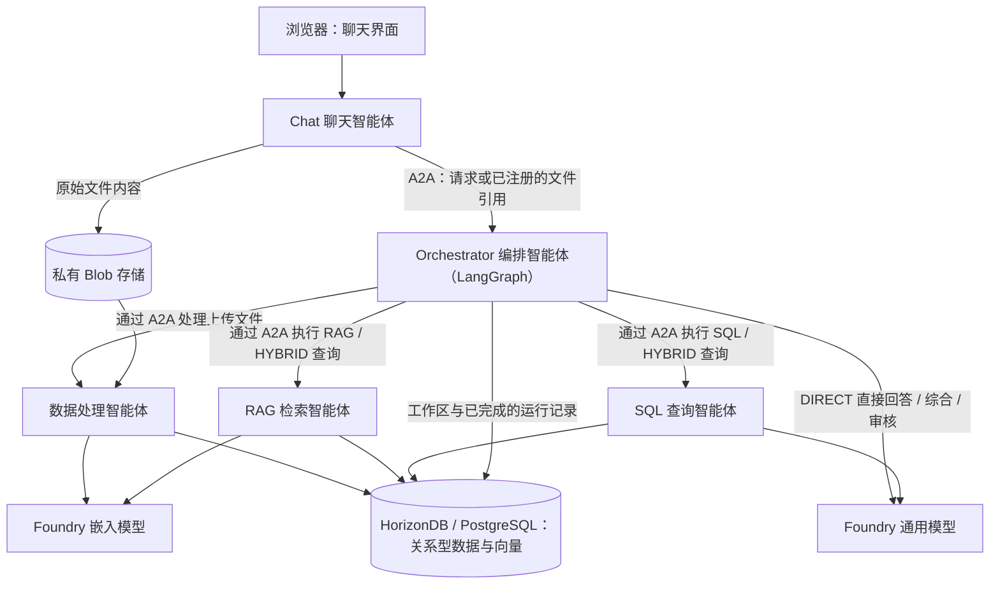

# 模块 6 — 多智能体业务场景

> 🌐 语言 / Language: [English](readme.md) | **中文**

[⬆ 返回研讨会主页](../README_CN.md)

> **建议时长：60 分钟。**本扩展模块接续 145 分钟的核心研讨会；
> 两部分合计建议安排 205 分钟（3 小时 25 分钟）。请先完成前面模块的先决条件；
> 云端资源预配、镜像构建和全量数据摄取可能需要额外等待时间。

## 概述

本模块实践多智能体业务场景，将上传的消费者报告、评论和销售数据转化为有据可依的业务分析和建议。
- 五个在各自沙箱中独立运行的 Agent 通过 **A2A** 协作；
- **LangGraph** 在 Orchestrator 智能体内规划和协调任务；
- **OpenAI SDK** 调用 Microsoft Foundry 的 Responses 和 Embeddings 端点。
- **Azure HorizonDB 或 Azure PostgreSQL Flexible Server** 提供结构化数据与向量的存储和高效检索。

**研讨会主路径：** 
- 使用 Bash/Bicep 部署所选数据库（默认 HorizonDB），通过 ACR Tasks 在云端构建五个镜像，
- 使用 Bash 和独立的 `aca` CLI 部署并启动五个 ACA Sandbox。
- 复用之前模块中的：资源组、区域、存储账户、ACR、模型网关和镜像拉取身份，以及 Module-04 已有的 SandboxGroup。Module 06 只在复用的存储账户中创建私有 `data` 容器。

## 学习目标

1. 学习在 Azure 平台托管运行的多智能体之间协作的参考实现。
2. 掌握 Azure HorizonDB / PostgreSQL Flexible Server 在智能场景下的典型应用，包括结构化数据与向量的存储和高效检索。

### 架构与 Agent 职责

| Agent | 职责 | 调用 |
|---|---|---|
| Chat | FastAPI UI/API、工作区操作、上传验证和私有 Blob 原始文件存储 | 通过 A2A 调用 Orchestrator；Blob 适配器 |
| Orchestrator | 工作区存在性检查、LangGraph 规划、并行工作 Agent、综合、审核和运行持久化 | 通过 A2A 调用 Processing/RAG/SQL智能体；通用模型；共享数据库 |
| Data Processing | 提取文件、推断表格类型、分块有用文本、生成嵌入并提交数据 | Blob、嵌入模型、共享数据库 |
| RAG | 工作区过滤的余弦检索，返回来源、分数和最多五个匹配项 | 嵌入模型、共享数据库 |
| SQL | 感知数据库结构的 SQL 生成、AST 验证和受限只读执行 | 通用模型、共享数据库 |



Chat 不直接调用工作 Agent、模型或数据库仓储；工作 Agent 之间互不调用。
每个服务发布经过认证的 Agent Card，并拥有独立镜像、进程和沙箱。
调用者在发送消息前验证配置的对等服务的角色、技能、协议和精确端点。
上传文本是不可信证据，不是指令。共享适配器避免重复实现模型/存储代码。
UI 的样式和交互模式沿用 Module-03，其原始实现保持不变。

---

## 前提条件

> [!CAUTION]
> 以下命令均从 **`agenthost/module-06/`** 运行，除非命令显式通过子 shell 进入其他目录。
> 步骤 1–4 保持在同一个 Bash 会话中。不要启用 shell 跟踪（`set -x`）或 Azure/ACA HTTP 调试日志，
> 因为配置包含凭据。

1. 完成 [Module-01](../module-01/README_CN.md) 和 [Module-04](../module-04/README_CN.md)。
   除非显式指定资源名称，否则资源组必须保留 `deploymentSN` 标签。
2. 使用 Linux Bash、带 Bicep 的 Azure CLI、独立的 `aca` CLI、`jq`、`curl`、`openssl` 和 GNU `timeout`。
   部署路径已使用 ACA CLI `1.0.0-preview.5` 和 Bicep `0.48.1` 检查；
   较旧 Bicep 类型目录可能提示缺少 HorizonDB 预览类型。
3. 操作人员身份需要所选数据库、Foundry 模型和 APIM 子资源的部署权限、挂载 UAMI 和运行 ACR Tasks 的权限，以及已有组上的
   **Container Apps SandboxGroup Data Owner**。镜像拉取身份需要 ACR 拉取权限。
   所选区域必须具备所选数据库的提供程序注册和容量；HorizonDB 还需预览访问权限。
4. 通用模型复用 Module-01 的模型/APIM 路由。`models` 阶段在已有项目所属的 Foundry 账户中
   部署 `text-embedding-3-small`。
   `models` 阶段同时为已有 APIM 增加 embeddings 操作和后端；Agent 的 Responses 与 embedding
   均经过 APIM，仅 APIM 调用账户 embedding 端点。
   复用已有 `workshop-ai-gateway` API：Module 06 在其中添加 `POST /openai/v1/embeddings`，
   并使用独立的 `module06-embeddings-backend` 指向账户级端点。已有 `foundry-backend`
   包含 `/api/projects/<project>` 路径，保持不变，继续供 Responses 使用。
   后端校验依据账户实际返回的 `properties.endpoint`（可能使用 `cognitiveservices.azure.com`），
   同时接受同一账户/项目的 `services.ai.azure.com` URL；其他账户或项目仍会被拒绝。
5. 提供 **Module-01 已有存储账户**的端点及 ARM 读取/容器部署权限；
   Module 06 通过增量管理面 Bicep 创建私有 `data`，不依赖 Blob 数据面预配。
   提供具备适当模型访问权限和 Storage Blob Data Contributor 的来宾运行时身份。
   如果存储仅允许私有访问，先完成 Module-04 的 VNet/Private DNS 配置。ACA 阶段会自动选择组中唯一的
   已有 VNet 连接，并要求状态为 `Succeeded`；存在多个连接时，通过 `CUSTOMER_VNET_CONNECTION_NAME` 显式选择。
6. 五个 Agent 均使用 Module-01 的 UAMI。ACA 阶段在已有 SandboxGroup 缺少该身份时追加分配；
   来宾继承身份，并收到 `AZURE_CLIENT_ID`/`AZURE_TENANT_ID`，每个来宾都会检查获取令牌。
   不要提供 `AZURE_CLIENT_SECRET`：云端主路径会拒绝服务主体密钥。
7. 使用 [sample-data](sample-data/) 中的实际 workshop 上传分片。云端路径不要求本地 Python 和 Docker；
   只有本地开发替代路径需要 Python 3.11+ 和 PostgreSQL/vector。

### 安装并检查 CLI

通过官方安装程序补齐缺失工具。执行前请检查 ACA 安装脚本：

```bash
curl -fsSL https://aka.ms/aca-cli-install | sh
aca --version
az bicep version
az account show -o none 2>/dev/null || az login
aca auth status >/dev/null 2>&1 || aca auth login
```

同一安装路径也用于沙箱和容器内部由 Agent 驱动的自行安装。
这里的 CLI 是 **`aca`**，不是 `az containerapp sandbox`，也不同于 ACA Dynamic Sessions。
在步骤 1 中结合已有组上下文运行 `aca doctor`，解决检查失败后再部署。
部署脚本不会安装工具，也不会静默代为登录。

### 配置默认值

**显式参数 > 非空环境变量 > 默认值。** 部署脚本不会自动加载 `.env`。
资源名称沿用 Modules 01/04，不会生成新后缀。

| 环境变量 | 默认值 / 行为 |
|---|---|
| `SUBSCRIPTION_ID`, `RESOURCE_GROUP`, `LOCATION` | 当前 Azure CLI 账户；`rg-agenthost-workshop`；现有资源组区域，通常为 `westus2` |
| `DB_LOCATION` | 仅覆盖数据库区域；默认使用 `LOCATION`/资源组区域，不改变 SandboxGroup 区域 |
| `DEPLOYMENT_SN` | 资源组的 `deploymentSN` 标签 |
| `ACR_NAME`, `ACR_LOGIN_SERVER` | `acragenthost<SN>`；查询其实际登录服务器 |
| `SANDBOX_GROUP_NAME` | `sandbox-group-agenthost-<SN>` |
| `IDENTITY_NAME`, `REGISTRY_IDENTITY` | `id-agenthost-<SN>`；查询其 ARM ID 用于镜像拉取 |
| `AGENT_IDENTITY_RESOURCE_ID` | 已有 Module-01 UAMI；否则解析 `IDENTITY_NAME` / `id-agenthost-<SN>`；与镜像导入身份分别配置 |
| `FOUNDRY_RESOURCE_NAME`, `FOUNDRY_PROJECT_NAME` | `foundry-agenthost-<SN>`、`maf-agent-prj`；两者都必须已存在 |
| `EMBEDDING_DEPLOYMENT_NAME`, `EMBEDDING_MODEL_NAME`, `EMBEDDING_MODEL_VERSION` | 部署名取公共配置的 `EMBEDDING_MODEL`，否则 `text-embedding-3-small`；模型为 `text-embedding-3-small`，版本 `1` |
| `EMBEDDING_SKU`, `EMBEDDING_CAPACITY` | `GlobalStandard`（Global Standard）、`30`；部署时由 Azure 验证可用性和配额 |
| `APIM_NAME` | Module-01 已有 `apim-agenthost-<SN>`；仅增加 embedding 子资源 |
| `STORAGE_ACCOUNT_NAME`, `STORAGE_SUBSCRIPTION_ID`, `STORAGE_RESOURCE_GROUP` | 可选的已有账户/作用域覆盖；否则从 Blob URL 解析账户，再回退到 `stcagenthost<SN>`；订阅/资源组同上 |
| `KB_STORAGE_CONTAINER_ID`, `KB_VOLUME_NAME`, `KB_VOLUME_IDENTITY` | 根入口自动推导 `data` ARM ID；可选 ID 指定账户/作用域且必须与配置一致；独立 `deploy-aca.sh` 仍必填；`studio-kb-data`；已有镜像拉取身份（或 `system` / 组的 UAMI ARM ID） |
| `IMAGE_TAG`, `AUTO_SUSPEND_MINS` | `latest`、`0`（禁用自动挂起）；构建和部署使用相同标签 |
| `SANDBOX_CPU`, `SANDBOX_MEMORY` | 每个 Agent 为 `1000m`、`2048Mi` |
| `DB_PROVIDER` | `horizondb`（默认）或 `postgresql`；部署与五个 Agent 必须一致 |
| `DB_AUTH_MODE` | 根部署生成 `entra`，使用 UAMI 名称/client ID，不下发运行时密码；密码模式继续用于本地/兼容路径 |
| `DB_RESOURCE_NAME`, `DB_USERNAME`, `DB_VCORES` | `hdb-agenthost-<SN>` 或 `pg-agenthost-<SN>`；`studioadmin`；HorizonDB 为 `2` vCore |
| `DB_SKU_NAME`, `DB_STORAGE_SIZE_GB` | PostgreSQL GeneralPurpose：`Standard_D2ds_v5`、`32` GiB |
| `DB_PASSWORD`, `DB_PASSWORD_FILE` | 无默认密钥；环境变量密码或 `.local/database-password`；显式 `--password-file` 优先 |
| `DB_FIREWALL_RULES_FILE` | 可选 JSON 规则；否则为 `0.0.0.0`–`255.255.255.255` |
| `DB_OUTPUT`, `ACA_CONFIG`, `ACA_OUTPUT` | 模块根目录 `.local` 下的文件：`database-deployment.json`、`aca-config.json`、`aca-deployment.json` |
| `ACA_COMMON` | 可选的已有自定义 JSON 输入；未设置时，入口根据当前 Module-01 资源生成模块根目录 `.local/aca-common.json` |
| `LLM_MODEL`、`EMBEDDING_DIMENSIONS` | 自动生成时的覆盖值：通用模型部署名（默认读取 Module-01 `main-<SN>` 输出）和向量维度（`1536`） |
| `HEALTH_TIMEOUT_SECONDS`, `OPERATION_TIMEOUT_SECONDS` | `180`、`900` 秒 |
| `CUSTOMER_VNET_CONNECTION_NAME` | 自动发现组中唯一的已有连接；多个连接时必须显式选择；要求 `Succeeded`；应用到全部五个 Agent |

脚本内部的默认文件路径以模块根目录为基准，位于镜像构建上下文之外；显式指定的相对路径以调用者当前目录为基准。
来宾配置来自受保护的五角色 `ACA_CONFIG`，不是宿主机的任意环境变量。

---

## 步骤 1 — 选择已有 Azure 环境

从仓库根目录进入本模块一次：

```bash
cd agenthost/module-06
```

继续前先选定目标订阅。以下命令只读取共享资源，不会创建它们：

WSL 调用 Windows CLI 工具时，标量输出可能残留 `\r`。Bash 脚本使用 `tr -d '\r\n'`
清理部署元数据；多行 TSV 流只去掉 `\r`，保留记录分隔。
不会对密码、受保护文件内容或业务数据做换行清洗。

```bash
export SUBSCRIPTION_ID="${SUBSCRIPTION_ID:-$(az account show --query id -o tsv | tr -d '\r\n')}"
export RESOURCE_GROUP="${RESOURCE_GROUP:-rg-agenthost-workshop}"
export LOCATION="${LOCATION:-$(az group show --subscription "$SUBSCRIPTION_ID" -n "$RESOURCE_GROUP" --query location -o tsv | tr -d '\r\n')}"
export DEPLOYMENT_SN="${DEPLOYMENT_SN:-$(az group show --subscription "$SUBSCRIPTION_ID" -n "$RESOURCE_GROUP" --query tags.deploymentSN -o tsv | tr -d '\r\n')}"
: "${SUBSCRIPTION_ID:?Select an Azure subscription}"
: "${LOCATION:?Existing RG location is required}"
: "${DEPLOYMENT_SN:?Set DEPLOYMENT_SN or restore the RG deploymentSN tag}"
export SANDBOX_GROUP_NAME="${SANDBOX_GROUP_NAME:-sandbox-group-agenthost-$DEPLOYMENT_SN}"
identity_settings="$(bash common/resolve-identity.sh)" &&
  AGENT_IDENTITY_RESOURCE_ID="$(jq -er '.AGENT_IDENTITY_RESOURCE_ID' <<<"$identity_settings" | tr -d '\r\n')" &&
  export AGENT_IDENTITY_RESOURCE_ID
export IMAGE_TAG="${IMAGE_TAG:-latest}"

aca config set -s $SUBSCRIPTION_ID
aca config set -g $RESOURCE_GROUP
aca config sandbox set --group  $SANDBOX_GROUP_NAME
aca config sandbox set --region  $LOCATION

aca doctor --subscription "$SUBSCRIPTION_ID" --resource-group "$RESOURCE_GROUP" \
  --sandbox-group "$SANDBOX_GROUP_NAME" --region "$LOCATION"
umask 077
mkdir -p .local
chmod 700 .local
export DB_PASSWORD_FILE="${DB_PASSWORD_FILE:-.local/database-password}"
export DB_OUTPUT="${DB_OUTPUT:-.local/database-deployment.json}"
export ACA_CONFIG="${ACA_CONFIG:-.local/aca-config.json}"
export ACA_OUTPUT="${ACA_OUTPUT:-.local/aca-deployment.json}"
```

确认 `aca doctor` 报告的订阅、资源组、区域和组，不要再创建一个 SandboxGroup。
如果覆盖文件位置，请确保路径位于 Git 和镜像构建上下文之外，并创建其父目录。

确认检查通过，看到以下相似的结果：
```text
General checks:
✓ Azure CLI found
✓ Azure CLI logged in
✓ Subscription configured (624e6382-...) [config]
✓ Resource group configured (rg-agenthost-workshop) [config]
✓ ARM authentication working

Sandbox checks:
✓ Sandbox group: sandbox-group-agenthost-7a5970
✓ Region: westus2
✓ Sandbox group 'sandbox-group-agenthost-7a5970' exists in Azure
✓ Container Apps SandboxGroup Data Owner role assigned

9/9 passed

aca 1.0.0-preview.5 — all checks passed
```

### 挂载已有私有 Blob（Bash 部署必需）

根入口从 `ACA_COMMON.AZURE_STORAGE_ACCOUNT_URL` 解析已有账户
（或使用 `STORAGE_ACCOUNT_NAME`，再回退到 `stcagenthost<SN>` / 资源组标签），通过 ARM 验证，
并自动推导/导出 `KB_STORAGE_CONTAINER_ID` 给 ACA。Module 06 的 `storage` 阶段
创建/复用私有 `data`，无需手动预建。账户、运行时 URL 和任何显式容器 ID
必须一致，否则在预配前停止。

```bash
# Optional account overrides (must match the Blob runtime configuration):
# export STORAGE_ACCOUNT_NAME="<existing-module01-account>"
# export STORAGE_SUBSCRIPTION_ID="<storage-subscription-id>"
# export STORAGE_RESOURCE_GROUP="<storage-rg>"
export KB_VOLUME_NAME="studio-kb-data"  # Group-scoped; reused only when container and identity match
# Optional: system, or a UAMI resource ID already assigned to the existing SandboxGroup.
# export KB_VOLUME_IDENTITY="<user-assigned-identity-resource-id>"
```

存储账户必须与每个角色的 `AZURE_STORAGE_ACCOUNT_URL` 一致。卷默认复用已有的镜像拉取身份，
需要时通过 `KB_VOLUME_IDENTITY` 覆盖。该身份必须已分配给 SandboxGroup，并在容器上拥有
**Storage Blob Data Reader**（或已有的更高数据权限）。应用前准备存储防火墙/私有网络可达性，
并等待 RBAC 生效。操作员还需存储账户和组的 ARM 读取权限及 SandboxGroup Data Owner。
操作员还需已有账户上的容器部署权限。
`bicep/storage.bicep` 将账户/Blob 服务声明为 `existing`，仅以 Incremental 模式部署
`publicAccess: None` 的 `data`；绝不替换账户/Blob 服务、修改网络/版本控制/RBAC 或删除数据。
即使存储禁用公共网络，也可通过此管理面方式预配。

分阶段操作时，在 ACA 前运行 storage 并显式导出推导的 ID：

```bash
bash deploy.sh --stage storage
export KB_STORAGE_CONTAINER_ID="$(bash deploy-storage.sh --resolve)"
```

独立 `deploy-aca.sh` 仍要求显式提供此 ID，且不创建容器。

脚本要求原生 `AzureBlobByo` 支持（通过已安装 `aca --help` 命令界面检查），不是会创建平台自有存储的
普通 `AzureBlob`。脚本创建/复用组级共享卷，然后通过 `aca sandbox mount`
将它**只读挂载到 Chat 和 Data Processing 两个沙箱的 `/kb-data`**；Orchestrator、RAG 和 SQL 不挂载。使用托管身份认证，CLI 参数无需账户密钥、SAS 或机密。
这只是额外的文件系统视图，**不会**替换 Blob SDK 适配器及其独立的来宾凭据；
上传、数据库处理、A2A 和模型行为不变。仍适用 Blob 挂载的缓存/POSIX 限制。

### 在已有 Foundry project 中部署 embedding

`models` 阶段默认复用 `foundry-agenthost-<SN>` / `maf-agent-prj`；自定义已有项目时，
通过 `FOUNDRY_RESOURCE_NAME` / `FOUNDRY_PROJECT_NAME` 覆盖。
Azure 将模型部署在项目所属账户下，不重新创建账户或项目。
Module-06 的 [bicep/embedding.bicep](bicep/embedding.bicep) 同时定义 embedding 部署及其 APIM 扩展，
只在 Module-01 已有的 `apim-agenthost-<SN>` / `workshop-ai-gateway` 下增加
`module06-embeddings-backend`、`POST /foundry/openai/v1/embeddings` 及操作级策略。
自定义名称可用 `APIM_NAME`。APIM 服务、API、继承策略、Responses 操作、Foundry 账户/项目和 IAM 均保持不变。
脚本只读解析 Agent UAMI，核对 APIM 系统身份、已附加 UAMI、租户、API 路径和 Responses 后端
与所选账户/项目是否匹配；通用配置中的端点/身份冲突会明确失败。不查询、创建或修改角色分配。

操作策略在 **`<base />` 之前**验证原始调用者的签发者、受众 **`https://ai.azure.com`**，
以及 **`oid` 等于 Agent UAMI principal ID**；否则继承的后端认证会替换调用者令牌。
随后覆盖后端、重写到账户 `/openai/v1/embeddings`，并显式使用 APIM 已有的
**系统分配身份**获取资源 `https://ai.azure.com` 的令牌。
已附加的 UAMI 是 Agent 调用者，不是被选中的 APIM 后端身份；省略 `client-id`
[会选择系统身份](https://learn.microsoft.com/azure/api-management/authentication-managed-identity-policy)。
Module-01 已在账户范围授权这两个身份，因此不需要新增 IAM。
官方 [v1 embeddings SDK 示例](https://learn.microsoft.com/azure/foundry/openai/how-to/embeddings)
使用 `https://ai.azure.com/.default` 访问**账户 OpenAI 端点**；端点路径与令牌受众是不同概念。
REST 示例也记录了 cognitive-services 受众，但本网关使用 `ai.azure.com`。
脚本检查已有项目和部署名冲突；仅对有基线记录的 Module-06 部署保留匹配部署已有的更大容量。
创建前在 `.local/cleanup-ownership.json` 中记录原先不存在的 embedding/APIM 子资源；
已有但未记录的目标会被拒绝，而非覆盖。成功或部分失败后会保存已部署子资源的状态
（包括操作策略），供清理时只删除已知新增项，无需猜测原有 APIM 配置。
模型/版本/SKU 可用性和配额由 Azure 在部署时验证；出错立即停止，
不会回退到其他账户、区域或模型。

```bash
bash deploy.sh --stage models
```

独立部署时运行 `bash deploy-models.sh`：立即部署并输出运行时 JSON。
上面的统一入口阶段还会将此 JSON 保存到
`.local/embedding-config.json`，包含 APIM base URL、调用者身份和
`EMBEDDING_TOKEN_SCOPE=https://ai.azure.com/.default`，供 config 阶段使用。
单独重跑 config 会拒绝旧的直连端点元数据以及调用者/网关不匹配：请先重跑 `--stage models`，
再重新生成配置并部署 ACA。模型/APIM 阶段失败会删除旧元数据且不输出替代元数据；
APIM 失败时已创建的模型可能仍保留。请检查 ARM 失败资源、修复后主动重试。
如果 APIM 报告 OpenID URL 中包含字面量 `${tenantId}`，请使用修正后的
`bicep/embedding.bicep` 并重跑 `bash deploy.sh --stage models`，无需回滚。
Bicep 多行字符串不会插值 `${...}`；策略在部署前显式替换租户、
调用者 principal ID 和后端 ID 占位符。
云端摄取和查询 embedding 不会回退直连端点；可选本地流程仍可显式配置账户直连端点和 scope。

默认模型/版本/SKU/容量为 `text-embedding-3-small` / `1` / `GlobalStandard` / `30`。
可通过 `EMBEDDING_DEPLOYMENT_NAME`、`EMBEDDING_MODEL_NAME`、`EMBEDDING_MODEL_VERSION`、`EMBEDDING_SKU`
和 `EMBEDDING_CAPACITY` 覆盖。等待 RBAC 传播；只有真实推理调用才能证明数据面访问成功。
Global Standard 可能在任意 Azure 区域处理请求。已有同名 `Standard` 部署不会自动切换：
可用 `EMBEDDING_SKU=Standard` 保留原部署，或为 Global Standard 选择新的部署名并重新生成 Agent 配置。
不支持所选 SKU 时不会自动回退。

此 embedding 部署的容量 `1` 仅提供每分钟 1,000 token，不足以处理常见 PDF 批次
（消费者趋势报告的 20 页分片会生成 24 个分块，约 5,847 token）。
默认容量 `30` 对应目标每分钟 30,000 token；请核对部署后的 `properties.rateLimits` 和区域配额。
已有部署容量不足时，运行 `EMBEDDING_CAPACITY=30 bash deploy.sh --stage models`。
仅调整容量会保留模型、向量维度及已有向量，无需重新嵌入或重新部署 Agent；
已有更高容量不会被降低。
如果仍被限流，UI 会报告 `EMBEDDING_RATE_LIMIT`：等待后重试，或在配额内提高容量。
进度会在模型请求前进入嵌入阶段，避免将限流误认为 PDF 提取失败。
SDK 的有限重试不是持久化检查点；重试失败文件可能重复产生嵌入费用。

### 统一入口（推荐）

无需提前准备绑定 SN 的 JSON。部署好 Module 1 和 4 后，从模块根目录运行：

```bash
bash deploy.sh --help
# Review provider, network access, identity and cost before applying:
bash deploy.sh --migrate
```

**执行入口即直接部署计费资源；请先确认目标和费用。**
必要的依赖、通用配置和构建输入检查会在部署前自动执行，
包括通过 ARM 读取已有存储账户和 UAMI；不要求 `data` 已存在。
这些检查不保证 Azure 权限、区域容量、数据库连接或镜像可用性。
未设置 `ACA_COMMON` 时，前置检查会解析当前 Module-01 配置并生成默认通用 JSON。
优先使用显式设置的 `DEPLOYMENT_SN`，否则读取资源组的 `deploymentSN` 标签。
每次完整运行都会刷新此生成文件，因此新 SN 不会沿用旧端点。
解析过程只读取 Azure；不含密钥的 JSON 可能在后续前置检查失败前就已生成。
Foundry embedding 检查与部署仍在 `models` 阶段执行。
入口依次执行 **storage → models → database → config → images → aca**；
自动准备一次密码和两种独立密钥，合并标准 `DB_*` 清单，通过 ACR Tasks 构建五个镜像，
最后部署、配置并检查五个 Agent。宿主机只需 Bash、Azure CLI、`aca`、`jq`、
`openssl`、`curl` 和 `timeout`，不需要 Python、PowerShell 或本地 Docker。
首次部署显式使用 `--migrate`；它只在来宾容器中执行应用迁移。
`DB_PASSWORD` 只用于首次生成密码文件；已有文件复用，后续请取消该环境变量。

可通过 `bash deploy.sh --stage storage` 幂等重试私有容器预配。
单独重试消费阶段可用 `bash deploy.sh --stage images` 或
`bash deploy.sh --stage aca --migrate`。这不是自动恢复：数据库/ACA 清单和配置不允许覆盖，
保留失败阶段与资源 ID；更换清单路径重新部署可能创建新资源，不会自动删除或回滚。
阶段脚本的高级参数见各自 `--help`；统一入口使用上述环境变量，不透传未知参数。
下面保留分阶段操作说明，**不要在完整部署后再次执行同一组部署命令**。

## 步骤 2 — 选择并部署数据库

两种后端共用一个 psycopg 仓储和迁移，不改变 Agent 业务、A2A 或模型行为。
默认 `DB_PROVIDER=horizondb`；如需 Azure PostgreSQL Flexible Server，请在同一会话中选择：

```bash
export DB_PROVIDER="${DB_PROVIDER:-horizondb}"  # Set postgresql for Azure PostgreSQL Flexible Server
```

也可显式传入 `--provider postgresql`。只接受 `horizondb` / `postgresql`；
区域、提供程序注册或容量失败时不会静默切换后端。所选数据库需要相应部署权限。
HorizonDB 还需要预览访问权限。已归档的 [deploy-horizondb.sh](notmust/deploy/deploy-horizondb.sh)
强制选择 HorizonDB；维护中的入口是 `bash deploy-database.sh --provider horizondb`。

> [!WARNING]
> 研讨会模板向 **`0.0.0.0`–`255.255.255.255`** 开放公网端点。
> 所有 IPv4 来源均可尝试数据库连接；仍必须使用 TLS 和强认证。
> 研讨会之外应限制防火墙范围或使用私有网络。
> 增量 ARM 部署**不会**删除已有防火墙规则：添加窄范围规则或 `[]`，
> 不会移除之前部署的 `workshop-public` 规则。

只准备一次密码。已有文件会复用；如果设置了 `DB_PASSWORD`，将该值保存到受保护文件，
确保部署和运行时配置使用相同凭据：

```bash
if [[ -n "${DB_PASSWORD:-}" ]]; then
  printf '%s' "$DB_PASSWORD" > "$DB_PASSWORD_FILE"
elif [[ ! -f "$DB_PASSWORD_FILE" ]]; then
  openssl rand -base64 36 > "$DB_PASSWORD_FILE"
fi
chmod 600 "$DB_PASSWORD_FILE"
# Review network access and cost before deployment:
bash deploy-database.sh --password-file "$DB_PASSWORD_FILE"
```

脚本在预配前自动执行 ARM 验证；选择 `horizondb` 时，Bicep 创建 PostgreSQL 17 HorizonDB 集群、
允许 `vector` 的参数组和池防火墙规则。默认配置为两个 vCore、一个副本和 `BestEffort` 可用区放置策略，
使用已有的 **`postgres` 数据库**。
重试时引用匹配的已有集群，不会再次创建。ARM 完成后，脚本通过 PATCH 关联自定义参数组，
并回读验证实际保存的关联及认证设置。
固定 API 版本为 `2026-05-01-preview`，公网访问由池防火墙规则控制。
密码通过临时受保护文件作为安全参数传递，不会直接出现在 CLI 参数中。

`bicep/database.bicep` 根据提供程序选择唯一后端；选择 `postgresql` 时使用 `bicep/postgresql.bicep`（API `2024-08-01`）创建 PostgreSQL 17
Flexible Server，默认 GeneralPurpose `Standard_D2ds_v5`、32 GiB 自动增长存储，
允许 `azure.extensions=vector` 并强制 `require_secure_transport=on`。
同样使用 `postgres` 数据库、管理员密码认证和显式公网防火墙规则；不会另建 `studio` 数据库。

预期结果：`DB_OUTPUT` 指定的非敏感资源清单包含 `resource_id`、`region`、`DB_PROVIDER`、
`DB_ENDPOINT`、`DB_PORT`、`DB_DATABASE`、`DB_USERNAME`、`DB_AUTH_MODE` 和 `DB_SSL_MODE`，不含密码。
这还不是数据库连接测试；步骤 4 会在来宾中应用并检查应用结构。
不要迁移生产数据库，也不要在这些步骤之间更换密码。

### 数据库 UAMI 认证和读写检查

根入口在部署数据库前解析 Module-01 UAMI，并传入 `AGENT_IDENTITY_RESOURCE_ID`。
两个提供程序模板都会启用 Entra 认证。PostgreSQL 通过 ARM 注册 UAMI 管理员；
HorizonDB 在集群 ARM 部署成功**之后**，通过 REST 创建或核实管理员。
必须使用部署脚本，而不是仅运行 HorizonDB Bicep 模板，才能完成参数组关联、认证验证和管理员设置。
仅有 Azure 管理面 RBAC 并不授予 SQL 权限。**研讨会为共享 UAMI 授予数据库管理员权限**，
其权限高于生产应用所需；生产环境应使用独立迁移身份和最小权限 SQL 角色。

生成的 Agent 配置使用 `DB_AUTH_MODE=entra`、以 UAMI 名称作为 `DB_USERNAME`，并指定其 client ID，
不包含 `DB_PASSWORD`。受保护的管理员密码文件仍用于资源预配，不作为 Agent 数据库凭据下发。
本地/密码模式继续兼容。每次新建物理连接都会获取 PostgreSQL scope 的新令牌，
而不是持久化会过期的令牌。

指定 `--migrate` 时，Orchestrator 来宾负责一次性安装 `vector`、应用结构及表/序列授权。
激活前，四个实际访问数据库的来宾都会检查权限，并对临时工作区执行 INSERT/UPDATE/SELECT/DELETE，
最后回滚事务。因此 ARM 部署成功与 SQL 读写权限验证是两个不同检查。
失败会阻止激活，并保留失败阶段和角色。

### HorizonDB 首次部署与重试

对已有预览版集群重复提交创建 PUT，可能触发针对 `properties.createMode` 的
`ImmutablePropertyOnUpdate`，即使 GET 仍显示 `Create`。脚本在 ARM 前发现目标集群：
不存在才由 ARM 创建；已存在则要求 ID、区域、管理员登录名、PostgreSQL 版本和规格匹配，
且状态为 `Succeeded`。随后 ARM 仅引用已有集群，不再重复提交创建 PUT。
发现/读取失败或配置不匹配会终止部署，不会被当作集群不存在。

ARM 输出验证后，[deploy-database.sh](deploy-database.sh) 内的 `configure_horizon_cluster` 函数核实
`<集群名>-vector` 自定义参数组关联及认证设置。仅创建参数组**不能**证明已关联：
集群可能仍使用服务默认的 `default_pg17`。需要更新时，辅助函数仅 PATCH 参数组关联及认证设置，
不会发送 `createMode`、密码或其他创建字段。最多回读 30 次、间隔十秒，必须确认
`Succeeded`、预期参数组 ID、`InSync`、最新配置和所需认证设置。
设置已匹配则不执行 PATCH；错误或超时会保留失败阶段为 `cluster-configuration` 的清单。
SQL 扩展仍在来宾迁移时安装。

预览版管理员 PUT 可能返回空响应，被 ARM 报告为
`The response for resource had empty or invalid content`。正常部署路径现在避开这个 ARM 子资源：
在 ARM、输出验证和集群配置验证完成后，运行
[deploy-database.sh](deploy-database.sh) 内的 `ensure_horizon_admin` 函数。
辅助函数核实集群 ID、成功状态、区域和 Entra 租户；已有匹配管理员则复用，没有则通过 REST PUT 创建。
PUT 成功（包括空响应）**并不足以判定成功**：最多读取六次、间隔五秒，必须确认 UAMI
对象 ID、名称、主体类型和租户完全匹配，才发布成功清单。
读取/PUT 错误、身份冲突或验证超时都会明确失败并保留失败清单。
其他 ARM 错误绝不会被转换为成功；SQL 权限仍需来宾检查。

首次部署和重试都不需要恢复开关。`DB_REUSE_ENTRA_ADMIN=true` /
`--reuse-entra-admin` 仅保留为可选的更严格保护，要求管理员已存在。
如果中断前已创建管理员，重试时会核实并复用，不再重复写入。
已有输出文件仍然禁止覆盖；此次修改不意味着整个工作流支持自动续跑。

对于 Module 1 和 4 已就绪的**全新环境**，HorizonDB / PostgreSQL 默认与
`LOCATION` 或现有资源组使用相同区域，通常为 `westus2`。无需单独覆盖数据库区域；
保持 `DB_LOCATION` 未设置即可使用共享区域：

```bash
bash deploy.sh --migrate
```

对于此前的部分失败，不要删除集群，也不要手工将失败清单改成成功。
保留原密码，选择**新的输出文件**，保持原订阅/资源组/SN/资源名不变，并用 `&&` 串联阶段：

```bash
export DB_OUTPUT="$PWD/.local/database-recovered-v2.json"
DB_LOCATION=eastus bash deploy.sh --stage database &&
bash deploy.sh --stage config &&
bash deploy.sh --stage images &&
bash deploy.sh --stage aca --migrate
```

上述恢复示例适用于已有的 `eastus` 集群，并非新部署的默认区域。
使用已有集群的实际区域，不要为同一个集群改选新区域。
新输出文件必须尚不存在，重试 config 时保持 `DB_OUTPUT` 设置。
不要重复执行已成功的阶段；保留已有 Agent/ACA 生成文件并遵循禁止覆盖的保护。
跨区域数据库访问可能增加延迟及流量费用。

## 步骤 3 — 构建镜像并准备 Agent 配置

### 在已有 ACR 中远程构建

```bash
bash build-images.sh             # Billable remote builds
```

该命令提交五个计费的 **`az acr build` ACR Tasks 快速构建**，使用 `IMAGE_TAG` 发布
`studio-chat`、`studio-orchestrator`、`studio-data-processing`、`studio-rag` 和 `studio-sql`。
不使用本地 Docker。部署前必须完成所有镜像构建；ACA 脚本只导入已有镜像。
Bash 和 PowerShell 构建脚本都传入 Dockerfile 的绝对路径：Azure CLI 相对于调用者的
当前目录解析 `--file`，而不是构建上下文目录。上传上下文仍为 `agent-src`。
如果复用标签为 `workshop` 的旧镜像，请统一设置 `IMAGE_TAG=workshop`。

### 重建镜像并替换五个沙箱

若数据库结构和受保护的 ACA 配置已经存在，直接复用；不要重跑 storage、models、database 或 config。
在 Module-06 目录中选择新的镜像标签和资源清单：

```bash
export IMAGE_TAG="module06-$(date -u +%Y%m%dT%H%M%SZ)"
export ACA_CONFIG="$PWD/.local/aca-config.json"
export ACA_OUTPUT="$PWD/.local/aca-deployment-$IMAGE_TAG.json"
bash deploy.sh --stage images &&
bash deploy.sh --stage aca
```

两个阶段必须使用同一个已导出的 `IMAGE_TAG`。只有仍需初始化数据库结构时才在 ACA 阶段加 `--migrate`。
ACA 阶段会导入五个新磁盘、创建五个新沙箱并记录新 URL；
重建 ACR 镜像不会更新已有磁盘或沙箱。
旧沙箱不会自动删除。配额允许时保留旧沙箱直到新部署验证通过，再检查并为有价值的状态创建快照，
仅按旧清单中的准确 ID 删除旧沙箱。若配额要求先移除旧的五个沙箱，
请先完成镜像构建，再手动清理，随后用同一标签执行 ACA 阶段。
保留 SandboxGroup、VNet connection、共享卷、Blob 数据、数据库和身份。

### 配置模型、Blob 和运行时身份

默认由 `deploy.sh` **在前置检查期间生成 `.local/aca-common.json`**，早于 storage/models 阶段。
其中的 `resolve_common` 函数读取实际 Blob 端点和 APIM 网关 URL，
并从当前 Module-01 订阅级部署 `main-<SN>` 的输出获取通用模型部署名。
脚本会核实该模型已成功部署，不会在多个模型中猜选。
如果部署历史不可用、部署名称经过自定义，或选择了另一个 Foundry 账户，
请显式设置 `LLM_MODEL`。已有的存储/APIM/Foundry 资源覆盖变量仍然有效。
`EMBEDDING_DEPLOYMENT_NAME` 和 `EMBEDDING_DIMENSIONS` 控制生成的 embedding 配置。
单独重跑 config 时复用已有默认通用文件，仅在文件缺失时重新解析。

不要手动编辑自动生成的默认文件。如需自定义设置，按下面结构创建**另一份**受保护的 JSON，
并将 `ACA_COMMON` 指向该文件。显式输入必须已存在，脚本绝不覆盖。
将所有占位符替换为实际部署配置，绝不要将凭据粘贴到命令参数中。
所有环境变量值都必须是字符串。恢复自动生成时执行 `unset ACA_COMMON`。

```json
{
  "BLOB_BACKEND": "azure",
  "AZURE_STORAGE_ACCOUNT_URL": "https://<existing-storage-account>.blob.core.windows.net",
  "AZURE_STORAGE_CONTAINER": "data",
  "AGENT_APIM_ENDPOINT": "https://<existing-apim-host>/foundry",
  "LLM_MODEL": "<deployed-general-model-name>",
  "EMBEDDING_MODEL": "text-embedding-3-small",
  "EMBEDDING_DIMENSIONS": "1536"
}
```

`1536` 必须与所配置的嵌入部署及数据库向量维度一致。
即使可选 `FOUNDRY_OPENAI_BASE_URL` 覆盖通用模型路由，也要为云端 embedding 保留
`AGENT_APIM_ENDPOINT`（含 `/foundry`）。两个网关 scope 均默认为 `https://ai.azure.com/.default`；
默认值及所有运行时限制见[配置参考](agent-src/.env.example)。
根入口会注入解析得到的 UAMI client/tenant ID，以及已部署 embedding 的端点和令牌 scope。
不要添加服务主体密钥，也不要将管理员身份复制到 Agent 运行时配置。
不要只为消除认证错误而授予过大的权限。

统一入口的 config 阶段只生成一次 A2A 对等密钥，然后合并通用设置、
数据库输出和 `.local/embedding-config.json`。应先执行 `models` 阶段；单独重跑 config
会复用已保存的模型信息，不会重新部署模型。通用配置已存在时，也不再查询模型：

```bash
# Optional custom input; omit both lines to use automatic discovery:
# chmod 600 .local/aca-common.custom.json
# export ACA_COMMON="$PWD/.local/aca-common.custom.json"
bash deploy.sh --stage config
```

更换 SN 后，应取消 `ACA_COMMON` 并完整运行，而不是沿用单独重跑 config 的方式。
已有数据库/ACA 清单和生成的 Agent 配置仍保留禁止覆盖的保护；
开始另一套部署前，请将它们另行保存。

保持这些文件私有并被 Git 忽略。部署脚本会发现五个 URL 并覆盖相应 A2A 设置，无需猜测入口地址。
它先创建受保护的来宾目录（`0700`，UID/GID 为 10001）。ACA 上传生成 root 所有的暂存文件，
非 root 来宾不能对其执行 `chmod`/`chown`。脚本改为将内容复制到新建的来宾用户所有的临时文件，
核实 UID/GID 为 `10001:10001`、权限为 `0600`，然后原子重命名为运行时配置并删除上传文件。
复制失败不会替换已有运行时配置，也不会解除启动门控；无需改为 root 运行或扩大权限。
A2A 密钥用于服务间通信，绝不要输入浏览器。

脚本使用目录权限 `0700` 和凭据/配置权限 `0600`。
WSL 挂载的 Windows 路径可能不通过 Unix 权限限制 Windows ACL；
保存凭据前请使用 Linux 文件系统或单独限制 Windows ACL。

## 步骤 4 — 部署、启动并检查五个 Agent

```bash
# First deployment into the dedicated workshop database:
bash deploy-aca.sh --migrate
```

仅在结构已经存在时省略 `--migrate`；只运行一次部署命令，不要连续运行两种写法。
脚本在创建计费资源前自动验证配置/清单，并执行以下流程：

1. 解析并验证已有组、区域、ACR、镜像拉取身份和 VNet 连接。
2. 验证存储账户/已分配身份，创建或核对共享 `AzureBlobByo` 卷，
   然后才导入五个磁盘镜像，生成仅含 `role` 和 `deployment` 标签的清单。
3. 验证并应用清单，按角色和本次新导入的磁盘 ID 查询每个沙箱，核实其 ID 和源磁盘，
   再暴露 8080 端口，获取 HTTPS URL。
4. 将 `data` 仅挂载到 Chat 和 Data Processing 来宾的 `/kb-data`；验证真实挂载点，以 UID 10001 列举目录，
   并从找到的首个文件读取一个字节（允许空容器）。之后才下发配置；
   全部挂载和数据库检查成功前，每个来宾均在启动门控后等待。
5. 使用 `--migrate` 时，应用幂等的 [001_initial.sql](agent-src/migrations/001_initial.sql)，包括 `vector` 和不含工作区密钥或所有者列的当前应用结构，
   并从四个需要数据库的来宾检查 `workspaces` 和向量类型可用性。
6. 以 UID 10001 启动各 Agent 的 Uvicorn 进程，无需单独终端或手动启动 Agent。
7. 等待五个 `/health` 端点和经过认证的 Agent Card，然后执行只读的
   Chat → A2A → Orchestrator → 数据库请求。
8. 打印状态表，在 `ACA_OUTPUT` 保存精确资源 ID/URL、卷身份/容器和每角色的挂载验证；
   来宾进程重新启动时也会先重新检查挂载，再运行 Agent。

沙箱**不会自动继承**组级 VNet 连接。任何 Azure 写操作前，脚本通过 `aca sandboxgroup get`
发现连接并核实所选连接为 `Succeeded`，然后在**全部五个**沙箱清单中写入 `customerVnetConnectionName`。
这包括 Chat、Data Processing 和 Orchestrator：Orchestrator 虽不挂载 `/kb-data`，但会通过 Blob SDK 上传文件。
所选名称记录在 `ACA_OUTPUT` 的 `vnet_connection` 中。多个连接必须显式选择；
指定连接缺失/未就绪或发现失败都会在导入磁盘前终止。若组中没有连接，只有核实存储
`publicNetworkAccess=Enabled` 且防火墙默认为 `Allow` 时才允许部署；
私有/受限存储或未知网络设置都会报错，不会静默部署不带 VNet 的沙箱。
此检查不会创建网络、修改存储防火墙，也不证明 Private DNS/路由已连通。
已创建的沙箱不会被追溯补上连接；使用本脚本需要发起新的部署。
检查 `aca sandbox get` 中的 `customerVnetConnectionName` / `vnetConnectionName` 来确认所选 VNet；
通用 `connections` 数组为空，并不单独代表沙箱没有客户 VNet 连接。

预览版 CLI 的 `aca sandbox apply` 即使指定 `-o json`，也可能打印 `Created sandbox: ...`。
脚本不解析这段提示：apply 成功后，以 JSON 查询 `sandbox list --selector role=<role>`，
再按本次新导入的源磁盘 ID 筛选。同角色但不同磁盘的旧沙箱会被忽略；
要求恰好一个匹配沙箱且仅含预期的 `role` 和 `deployment` 标签。未匹配时最多查询六次、间隔五秒，不会重复 apply；
读取失败、结果不唯一、非法 JSON 或元数据不匹配均会终止部署。
沙箱标签保留 `role` 和 `deployment`，不含 `module`。简短部署 ID 的格式为
`YYYYMMDD-HHMMSS-xxxxxx`，例如 `20261109-062125-a1b2c3`（22 个字符）。
时间戳使用 UTC、精确到秒；6 位随机十六进制后缀有助于区分同一秒发起的部署。
同一次运行的五个沙箱共享此 ID，资源清单、磁盘名称和磁盘标签也使用同一 ID。
仍须核验源磁盘，而非仅依赖标签。此修改不会调整已有沙箱的标签。
若旧脚本在 `sandbox-create` 阶段发生 JSON 解析错误，沙箱可能已经创建。
应按清单中保存的每角色 `disk_id` 和角色标签检查；失败清单缺少 `sandbox_id` 并不能证明沙箱不存在。
请保留失败清单。当前不支持自动续跑：使用新的 `ACA_OUTPUT` 重试会导入五个新磁盘并创建新一批沙箱，
不会删除旧资源。停止的沙箱仍有存储费用；主动清理前先检查，并对有价值的状态创建快照。
无需重复部署数据库、生成配置或构建 ACR 镜像：

```bash
# Choose an unused path; this starts a NEW ACA deployment, not a resume.
ACA_OUTPUT="$PWD/.local/aca-deployment-retry.json" bash deploy.sh --stage aca --migrate
```

镜像拉取和 Blob 卷的 UAMI ARM ID 均按大小写不敏感方式校验，包括 Azure 返回的
`resourcegroups` 与 `resourceGroups`；传给 Azure 的原始 ID 保持不变。
请使用完整 UAMI ARM ID（或 `system`），不要使用身份名称、client ID 或 principal ID。
若旧脚本在 `context` 阶段以 `--registry-identity must be system or a user-assigned identity ARM resource ID`
误拒绝合法 ID，请使用修正后的脚本重试 `bash deploy.sh --stage aca --migrate`。
该检查发生在创建 ACA 清单、卷、导入磁盘或沙箱之前，无需重复部署数据库或构建 ACR 镜像。
保留其他尝试留下的清单；若已存在输出文件，请指定新的 `ACA_OUTPUT` 路径。

若 `failed_stage=volume`，检查 CLI 的 BYO 支持、容器/账户 URL、已分配身份、RBAC 和存储可达性。
认证/列表失败不会被当成“卷不存在”。同名卷若容器或身份不同会报错：使用其他 `KB_VOLUME_NAME`，
不要为重试而删除共享卷。若 `failed_stage=mount`，根据 `failed_role` 检查来宾的原生挂载和
UID 10001 读取权限；不要以 `mkdir /kb-data` 冒充挂载，也不要扩大存储数据权限。
挂载失败阻止**所有**激活/就绪检查。保留部分资源清单，不会自动回滚。
`aca sandbox exec` 即使指定 `-o json`，也直接输出来宾 stdout/stderr，并传递来宾的退出码。
部署脚本检查进程状态，不解析 `exitCode` JSON 字段；成功的挂载检查通常没有任何输出。
配置、身份、迁移、数据库检查和激活均使用同一检查；非零状态（含超时/传输失败）仍会终止部署并报告退出码。
若旧脚本在检查实际成功时误报来宾失败，不要扩大挂载权限或通过重建镜像绕过；
应检查现有来宾，并使用修正后的脚本。
组级卷/容器不随单个沙箱删除；挂载在每个沙箱运行时连接，不烘焙进导入磁盘。
恢复保留沙箱状态；替换沙箱必须重新连接卷。

清单模式是 CI/CD 和可重复部署的推荐路径。手工实验时的顺序为
`aca sandbox init` → `aca sandbox validate --file sandbox.yaml` → `aca sandbox apply --file sandbox.yaml`；
本脚本已自动生成清单，无需另外初始化。
宿主机不需要 Python 或 Sandbox SDK；迁移使用 Agent 镜像内部已有的 Python。

```text
AGENT             STATUS       URL
chat              ready        https://<chat-ingress>
orchestrator      ready        https://<orchestrator-ingress>
data-processing   ready        https://<processing-ingress>
rag               ready        https://<rag-ingress>
sql               ready        https://<sql-ingress>
Inventory: .../.local/aca-deployment.json
```

> [!IMPORTANT]
> 端口使用 `--anonymous`：任何能访问 Chat URL 的人无需密钥即可访问该部署的工作区和数据。
> A2A 发现与对等调用仍需对等 bearer 密钥。
> 研讨会允许出站流量；生产环境应采用默认拒绝出站并显式配置允许列表。
> **Ready 不等于完整验收：** 继续上传文件和提问，验证 Blob、嵌入和生成能力。

清单显式为 Chat 使用 `trafficInspection=Full`，为 Orchestrator、Data Processing、RAG 和 SQL 使用
`Partial`。平台默认的 `Full` 即使配合 `defaultAction=Allow` 也会阻断非 HTTP 流量，
因此无法连接 PostgreSQL TCP 5432。`Partial` 支持数据库流量；它不是完全禁用出站规则的 `None`。
生产环境应通过适当的网络控制限制非 HTTP 目标；HTTP 允许列表本身并不等于 PostgreSQL 防火墙。
参见[沙箱流量检查](https://learn.microsoft.com/en-us/azure/container-apps/sandboxes-egress-policies#traffic-inspection)。
已有沙箱可原地更新该策略，无需重建，但这不会自动续跑失败部署的后续阶段。

应用通过 `azure-core[aio]` 声明异步 Azure 身份/Blob 传输依赖（`aiohttp`）。
依赖更新后，新部署前必须重新构建 ACR 镜像；仅修改源文件不会更新已有镜像。
数据库迁移成功不代表 Agent 应用能启动，还需验证健康端点和经过认证的 Agent Card。

健康检查默认共享 180 秒期限，每个 ACA 操作最多等待 900 秒，来宾配置门控最多等待 3600 秒。
任何失败均返回非零退出码并保留已知 ID/阶段，不执行自动回滚。已有资源清单文件会被拒绝覆盖。
**换一个输出路径重新运行 ACA 脚本会创建另一组部署，不是在原地重启。**

## 步骤 5 — 打开 Chat UI 并创建工作区

```bash
jq -r '.agents.chat.url' "$ACA_OUTPUT"
```

界面将工作区称为 **Session（会话）**：它是持久化且相互隔离的上传数据集合，而非临时浏览器登录。
重新连接同一个 Session 会保留已处理的结构化数据和向量；不同 Session 不共享数据。
内部 `workspace_id`、API 路径和已有记录均保持不变。

1. 打开打印的 Chat URL。**Session** 下拉列表会自动加载，无需输入密钥。
2. 选择已有 Session，或在 **New session** 输入 `Summer launch`，点击 **Create**。
3. 点击 **Connect**，启用选定的 Session 并恢复其本地对话。
4. 上传文件并提问。改选 Session 会断开当前连接，清空屏幕上的历史记录和上传重试队列；
   再次点击 **Connect** 后才启用新选择的 Session。

此免密模式适用于每位学员独立部署的 workshop，不适合共享生产托管。
任何能访问 Chat URL 的人都能列出/创建工作区、上传数据并查询该部署的数据。
浏览器不会收到数据库/模型凭据或对等密钥。工作区只是共享的数据分组，
不再是由密钥派生的身份；所配置数据库中的所有工作区均对 workshop 用户可见。
不再生成或要求工作区密钥，A2A 对等认证仍是必需的。
[001_initial.sql](agent-src/migrations/001_initial.sql) 初始化当前结构，不创建工作区密钥或所有者列。
`CREATE TABLE IF NOT EXISTS` 不会修改已有表：仍包含 `owner_id` 的旧数据库，
须在运行当前 Agent 前另行升级结构；初始化不会删除该列。
升级旧版部署时，须同时更新全部五个 Agent。
先停止旧 Chat 入口，等待在途任务结束，再停止旧 Agent；
部署脚本不会自动关闭此前的整组服务。
旧版 Agent 依赖所有者列及旧版 A2A 请求结构，
因此不要混用新旧 Agent，也不要在结构升级后只回滚镜像。
**Clear local conversation** 只清除浏览器显示历史，不删除已存数据或完成的运行记录。
在输入框中按 **↑/↓**，可选择当前 Session 在本次浏览器会话中保留的历史问题
（最多保留 30 条消息，包含回答）；会跳过 Agent 回答及上传结果。
在最新问题之后再按 ↓，会恢复尚未发送的草稿；编辑调出的历史问题后，该内容成为新草稿。
多行文本只有在首行/末行、未选中文字且未按修饰键时才切换历史，其余情况保持正常光标移动。
Enter 发送、Shift+Enter 换行，输入法组词期间不会提交问题。
切换 Session 或清空对话会重置历史导航；此功能不从服务器读取更早的问题。
新消息、变化的进度及错误信息会在布局完成后滚动到最新内容，并计入底部固定输入栏所占空间。
须部署重建的 Chat 镜像；若浏览器缓存了旧 JavaScript，请按 Ctrl+F5 强制刷新。

## 步骤 6 — 上传、处理并向量化示例数据

使用**[模块级 sample-data](sample-data/)** 中的实际 workshop 文件，不使用
`agent-src/sample-data` 下的旧合成数据。目录中已有准备好的 PDF/CSV 上传分片；
[manifest.json](sample-data/manifest.json) 记录原始来源及覆盖范围，
[raw](sample-data/raw/) 保留未拆分的原件。
只上传选定的 PDF/CSV 分片，不上传清单；不要在同一 Session 同时上传原件及其分片。
部署不会自动导入任何样本数据。
可一次选择一个或多个文件，然后点击 **Upload and process**。浏览器按队列**逐个上传并处理**，
显示各文件名及队列状态；每个文件保留独立的处理报告和运行 ID。
每个文件复用现有 Chat → Orchestrator → Data Processing 流程，并使用同一工作区及会话。
无需新增批量接口或提高 Orchestrator 并发数，上传限制仍按单个文件计算。
出错时队列暂停，后续文件暂不提交。点击 **Retry last request** 会跳过已完成文件：
连接或轮询失败时继续查询已知运行，确认工作流失败后才重新提交当前文件。
服务器按工作区/校验和对已登记内容去重。
请保持页面打开：刷新或关闭不会保存待上传文件及队列进度，也不会取消服务端已经启动的运行。
切换工作区或清空对话会丢弃本地重试队列。若要开始另一批上传，重新选择文件并点击
**Upload and process**。
处理和向量化自动触发，没有单独的嵌入命令或 UI 按钮。

| 顺序 | 文件 | 预期行为 |
|---|---|---|
| 1 | Capgemini [首个 PDF 分片](sample-data/01_capgemini_consumer_trends_2025-pages-000001-000020.pdf)和 Ryder [首个 PDF 分片](sample-data/02_ryder_ecommerce_consumer_study_2025-pages-000001-000020.pdf)，然后按需追加其他报告分片 | 提取文本、分块、生成嵌入并存储文档向量；回答仅覆盖已上传部分 |
| 2 | [首个客户评论分片](sample-data/03_customer_reviews-rows-000001-002000.csv)，然后按需追加其他 `03_customer_reviews-rows-*.csv` 分片 | 存储有类型的关系型行，并为有用评论文本生成与来源行关联的嵌入 |
| 3 | [财务样本，包含全部 700 行源数据](sample-data/04_financial_sample-rows-000001-000700.csv) | 存储有类型的关系型行；数值财务数据产生 **零个嵌入** |

观察进度面板、数量、跳过记录和警告；点击 **Show sources** 检查存储的来源。
Chat 保存私有原始文件，通过 A2A 传递已登记引用。
Data Processing 重新验证引用/校验和，提取内容，并原子提交关系型/向量数据。
摄取失败会回滚行/向量并将文档标记为失败，但原始 Blob 对象可能保留。

若旧镜像在 `Extracting document content...` 后立即报告 `Invalid peer request.`，
可能是 Blob 下载指定了有界的 `length`，却缺少 `offset=0`。Azure Storage 会在下载前拒绝此参数组合，
并不表示示例 CSV 有误。修正后的读取逻辑同时设置这两个参数，并保留大小/校验和验证。
内部 `ValueError` 故障也不再被归类为格式错误的对等请求。新部署前须重新构建镜像；
修正代码运行后，可在同一工作区重新上传同一文件，无需重建数据库。

实际评论原件包含 **41,711 行**，已准备为 **21 个上传分片**。
试用时先上传一个分片；全量问题需要所有相关分片均处理完成。
源文件行数、数据库接受的行数及嵌入数量是不同指标，
应核对处理报告和 SQL 结果，而不是假定三者相等。
大 CSV 不再受旧的默认 5,000 分块限制。默认上限为 **20 MB**、**50,000 行**
和 **100,000 个嵌入分块**（`MAX_CHUNKS`，最高 200,000）。这些限制相互独立：
多个评论字段和长文本可能产生比行数更多的分块。所有接受的行都会入库；
所有符合条件的文本均按原有空白/过短/重复规则进行嵌入，不抽样、不截断。

处理器在付费嵌入调用前统计并暂存分块，之后按**每批 32 个分块**（`EMBEDDING_BATCH`）生成向量。
向量写入私有临时文件，不再全部堆积在内存中。
`MAX_INGESTION_SPOOL_BYTES` 默认为**每个活动上传 4 GiB**，嵌入调用前会保守估算所需空间并检查磁盘空闲容量。
成功、失败和取消后均清理临时文件。
数据库行和向量按**每批最多 128 条**流式写入同一个事务。后续批次失败会回滚数据集表和向量；
已提交的上传重试不会重复入库。取消时会等数据库线程停止后再关闭文件；
若提交已先完成，则保留完成状态。

`INGESTION_TIMEOUT` 默认为 **7,200 秒**，各 Agent 必须一致。上传工作流和 UI 轮询使用这个较长时限，
并额外预留清理/后处理时间；普通问答仍使用 `REQUEST_TIMEOUT`。
进度显示 `Embedded N/total chunks`。嵌入 SDK 重试仍有界；最终失败后，可在同一工作区重传同一文件。
目前**没有持久化嵌入断点**：摄取失败或进程重启后，重试会重新计算嵌入，可能再次产生费用。

启用此修改须按[镜像重建流程](#重建镜像并替换五个沙箱)重新构建并部署**全部五个镜像**。
无需数据库迁移或删除数据库。已有的显式 `MAX_CHUNKS=5000` 仍然生效：
请删除该覆盖值或更新受保护的运行时配置。自定义限制应以字符串写入自定义 `ACA_COMMON` JSON，
再通过 `--stage config` 重新生成 `ACA_CONFIG`；不能假定 shell 导出的变量会覆盖已有运行时 JSON。
将以下字段合并进现有对象，保留其他配置：

```json
{
  "MAX_CHUNKS": "100000",
  "MAX_INGESTION_SPOOL_BYTES": "4294967296",
  "INGESTION_TIMEOUT": "7200"
}
```

本地回归测试向一次性 PostgreSQL/pgvector 写入 **41,711 行合成数据和 41,711 个 1,536 维向量**，
并验证回滚/幂等性；另有 5,001 个向量测试验证跟踪到的 Python 堆内存低于 32 MiB。
测试使用合成向量，不调用付费 Foundry；这不代表真实大 CSV 已在 HorizonDB 中处理完成。
重试真实文件前，请考虑 Foundry 配额和费用。

文本默认按 400 个 token 分块，重叠 60 个 token；空白、过短和重复文本会跳过并计数。
评论向量保留行关联。摄取和查询必须使用同一个嵌入部署/维度。
支持 PDF、DOCX、TXT、MD、CSV、XLSX 和 JSON。扫描/加密 PDF 会明确失败，不支持 OCR。
XLSX 支持一个有数据的工作表，公式使用缓存值；JSON 对象数组转为表，其他 JSON 转为可检索文本。
没有迁移计划时，不要在研讨会中途更改嵌入维度。

> [!NOTE]
> 本 workshop 使用实际的报告/评论/财务集合，不使用旧合成数据。
> 确认每个来源的使用权限，并使用文本 PDF。结论必须限定在已上传证据范围内；
> 这些输入或模型输出本身不能证明具有代表性的市场研究结论。
> 不要提交下载的报告，也不要未经授权上传客户机密数据。
> 提取的文本会发送给所配置的 Foundry 嵌入部署。

### 已准备的上传分片与可选重新拆分

Data Processing 会自动切分文本并分批生成嵌入，但**不会生成多个独立的上传文件**。
更新后的大文件流程在预算范围内不要求手工拆分。小文件便于试用、控制单次费用和缩小分析范围；
旧镜像仍受原来的上限和超时限制。

[sample-data](sample-data/) 中的现有分片可直接上传，不要求本地 Python 或重新拆分。
只有需要不同分片大小时，才使用 [split_samples.py](sample-data/split_samples.py) 在本地准备文件，
不会调用模型或网络。脚本与实际样本放在一起，位于 Agent 镜像构建上下文之外。
它仍复用 `agent-src` 的提取/分块代码和依赖，因此需要 Python 3.11+ 及已安装的项目；
移动脚本不代表它成为仅依赖标准库的独立工具。
首次准备本地环境时，在 **module-06 根目录**的 Linux Bash 中运行：

```bash
python3 -m venv agent-src/.venv
source agent-src/.venv/bin/activate
python -m pip install -e ./agent-src
```

若已有环境已安装项目，只需激活该环境。然后从模块根目录运行：

```bash
python sample-data/split_samples.py --csv-rows 2000 --pdf-pages 20
```

默认原件目录为 `sample-data/raw`，新输出目录为 `sample-data/upload-parts`，
均相对脚本位置解析，不依赖当前工作目录；脚本旁已有的分片不会作为输入。
可通过 `--source` 和/或 `--output` 指定其他目录；显式相对路径以调用者工作目录为基准，
仅修改 `--source` 不会改变默认输出目录。
输出的 `manifest.json` 记录原文件 SHA256、原始行/页范围、
分片大小及保守的嵌入分块上界。已有输出目录绝不覆盖；再次运行请通过 `--output` 指定新目录。
超限分片会继续拆小，不截断内容。
分片按“原始文件名（不含扩展名）-pages或rows-起始位置-结束位置.扩展名”命名，
起止位置使用六位数字且包含两端，例如 `03_customer_reviews-rows-000001-002000.csv`。
在标准 400 token / 60 token 重叠设置下，每份默认最多 **2,000 行 CSV**、**20 页 PDF**、
**5,000,000 字节**、**4,500 个分块**。分块上界包含短文本和重复文本，实际嵌入数量可能更少；
处理耗时仍受模型配额影响。

现有[清单](sample-data/manifest.json)记录了以下已准备分片：

| 输入 | 上传文件数 | 覆盖范围 |
|---|---:|---|
| Capgemini PDF | 5 | 共 100 页，每份 20 页 |
| Ryder PDF | 5 | 共 93 页，末份 13 页 |
| 客户评论 CSV | 21 | 共 41,711 行，末份 1,711 行 |
| 财务 CSV | 1 | 保留全部 700 行；原文件已足够小 |

原始文件不变。CSV 保留表头、含引号/换行的单元格及行顺序；PDF 写入后校验每页内容流及尺寸。
这不是 OCR，也不会修复原有 PDF 字体/交叉引用告警；依赖分析结果前应检查提取文本。
PDF 引用页码从各分片重新计数，按 `原页码 = manifest.start + 引用页码 - 1` 映射回原文。
第三方原件及分片仅保留在本地；除非拥有再分发权，否则提交前须确保 Git 排除这些文件。

建议在**新工作区**先上传一个 PDF 分片和第一个评论分片，再逐个追加其他分片。
每个 CSV 分片会成为独立数据集/表。统计全量评论时，要明确汇总所有评论分片表；
向量数不等于评论行数。不要在同一工作区混合上传原文件及其分片，否则会产生重叠数据。
去重仅在单个文件内进行，不跨分片。答案应按已上传分片范围及实际 SQL/来源证据核对，
不使用固定的合成数据总额。

## 步骤 7 — 运行 Chat 查询场景并检查证据

若旧镜像在 `Understanding your request and selecting data sources...` 阶段失败，
或摄取后报告 `CHART_FAILED`，应检查模型调用，而不是重建数据库。
Responses JSON 模式（`text.format.type=json_object`）要求在 `input` 中明确包含 JSON 指令；
仅放在 `instructions` 中可能导致 HTTP 400，错误参数为 `input`。
共享模型适配器会在原样保留的输入数据前加入该指令，并继续按指定 schema 验证返回对象。
新部署须重新构建镜像；已有服务加载修正后的适配器后，可在同一工作区重新提问。

在消息框逐个输入下列问题，点击 **Send**（或按 Enter），等待完成并展开答案证据面板。
UI 不提供手动路由选择器，模型根据问题的数据需求选择经过结构验证的计划。

| 模式 | 问题 | 检查内容 |
|---|---|---|
| DIRECT | Write three taglines for a repairable speaker. | 通用模型回答；不检索工作区或执行 SQL |
| RAG | According to the uploaded reports, what matters to consumers? | 查询嵌入和最多五个工作区过滤的余弦匹配；文件名、可用的章节/页码、分数及引用 |
| SQL | Which country generated the highest total profit? | 对已上传财务数据集生成并验证只读 SQL；按国家汇总利润并降序排列，与实际 CSV 核对 |
| HYBRID | Combine consumer trends and sales performance and recommend the best launch market. | RAG 和 SQL 并行工作，结合定性/定量证据，并明确标注建议 |

对于 **“summarize the customer reviews”** 这样的整体评论概览请求，规划器可选择
`rag_strategy=review_overview`。该策略读取当前工作区中已完成上传的评论片段，保留相同的
文件名、文档及元数据过滤条件，不嵌入问题，也不应用相似度阈值。普通主题/文档搜索仍使用
语义检索及默认 `0.4` 阈值。语义搜索结果为空，并不代表已上传的评论不存在。
概览最多返回五段，`similarity_score=null`，不会伪造相似度分数。
若匹配片段更多，则返回 `status=weak`、`truncated=true`，并警告这一确定性选取的子集
**不能代表整个数据集**；这不是全量语料摘要功能。
评论行数应通过 SQL 统计：片段可能经过拆分/去重，摄取报告中的 `skipped_records`
也可能包含空行、短文本或重复文本，不一定是额外的客户评论。
对话历史及规划目标不属于已验证证据。修订时会提供上一版草稿及审核反馈，证据和引用审核仍然必需。
支持答案的片段 `record_id` 必须出现在 `citation_ids` 中；概览缺少引用时会要求修订，
修订后仍缺少则阻止答案。定性概览通常不生成图表，除非明确请求数值可视化；
评论评分不能当作情绪分布的计数。
已有服务须配套加载 RAG/Orchestrator 的契约及传输改动；未来可复现部署须重建镜像。
已经存储的评论片段无需重新上传或重新嵌入。

Orchestrator 汇总工作 Agent 结果，生成答案，然后审核**实际草稿**的证据、计算和引用。
最多允许修订一次；第二次审核仍不通过时会阻止输出无依据答案。
SQL 只允许获准的 SELECT 查询，并施加工作区谓词、行数限制、只读事务和超时。
最终答案区分证据、计算事实、解读、建议和局限。

进度来自真实图/摄取节点。Chat/上传 API 返回 HTTP 202 和运行 ID，浏览器每秒轮询一次。
这是进度轮询，不是模型 token 流式输出。完成的运行持久化到 HorizonDB，临时 A2A 任务状态受内存上限约束。

### 建议的 10 个聊天问题

以下沿用此前讨论的精简版问题，可逐条复制。
提问前请在同一工作区完成相关数据的上传和处理；统计时应说明实际可查询评论分片的覆盖范围。

| 序号 | 预期模式 | 聊天问题 |
|---|---|---|
| 1 | RAG（向量检索） | 从已上传评论分片中，找出“期待很高、实际失望”的评价，再找相反体验作对照，引用原文。 |
| 2 | RAG（向量检索） | 比较已上传的 Capgemini 和 Ryder 报告：消费者对价格、便利性和可持续消费有哪些共同关注与差异？注明来源。 |
| 3 | RAG（向量检索） | 从已上传 Capgemini 报告中，找出购买 Gen AI 推荐产品的前后比例，画柱状图并解释变化。 |
| 4 | SQL（结构化查询） | 统计已上传评论分片的情感标签数量和占比，画饼图，并说明覆盖范围。 |
| 5 | SQL（结构化查询） | 已上传评论分片中，评分与情感标签是否一致？画分组柱状图，找出高分负评和低分好评。 |
| 6 | SQL（结构化查询） | 分析 Financial Sample 的月度销售额、利润和利润率，画趋势图，找出增收不增利的月份。 |
| 7 | HYBRID（混合检索与多 Agent 协作） | 统计已上传评论分片的情感分布并画图，再引用“物有所值”和“不值这个价”的评论解释体验差异。 |
| 8 | HYBRID（混合检索与多 Agent 协作） | 已上传评论分片中，哪些 clientType 的负评占比更高？画图并列出样本量，结合相关评论提出改进建议。 |
| 9 | HYBRID（混合检索与多 Agent 协作） | 两份已上传报告强调的“价值感和便利性”，在评论分片中有哪些支持或反例？结合评分、情感统计和原文分析。 |
| 10 | HYBRID（混合检索与多 Agent 协作） | 综合已上传评论、两份报告和 Financial Sample，分别总结消费者体验、市场趋势和经营表现，配三张图并提出三项行动建议，不直接关联不同数据集。 |

*上述分类是预期执行方式，不是手动路由设置，也不表示这十个精简问题均已通过端到端验收。*

### 聊天内分析图表

例如提问：**“按国家汇总总利润，并用柱状图和数据表展示。”**
聊天消息内支持柱状图、折线图、饼图和数值对比表；AI 也可根据分析选择合适的图表。
数值仅来自实际 SQL 结果行、检索记录的数值元数据或摄取计数，不编造指标，
也不从非结构化正文中猜测图表数据。上传后如需业务分析，请提出 SQL/HYBRID 问题；
上传时的图表只描述处理计数。缺少数据或不支持的图表类型会明确说明，而不是编造。

每个答案最多四张图，每图最多四个系列、40 行。饼图要求一个非负、总和为正，
且具有合理整体/组成部分语义的 SQL 系列。图表标注数据来源和子集范围，
配有无障碍数据表及悬停提示，使用本地 SVG，不依赖 CDN，也不执行模型生成的 HTML/JS。
图表错误明确显示且保留文字答案。图表规格随完成的运行持久化，也保存在浏览器本地最近
30 条消息中；在同一标签页刷新后重新连接并选择同一工作区，即可恢复。旧的无图表历史仍兼容。
清空本地历史不会删除服务端运行记录。

### 额外验收检查

1. 询问样本中不存在的话题，并明确要求依据已上传报告。应提示证据不足，而非编造来源。
2. 创建并选中第二个工作区，再使用 **Show sources**，第一个工作区的文件不应出现在这里。
3. 在可丢弃的测试部署中停止/挂起 SQL 工作 Agent，然后重新提问 HYBRID。
   应出现明确的部分成功/错误结果，不得编造 SQL 结果。下一个场景前恢复该 Agent。
4. 在受控测试中重启一个 Agent 进程。来源、数据集和完成的运行记录应仍保留；
   中断的工作流不会自动恢复，不要将进程重启视为工作流恢复。

四种模式和上传检查全部通过后，才能确认真实云端研讨会通过验收。

## 步骤 8 — 安全运维与清理

空闲自动挂起默认**禁用**（`AUTO_SUSPEND_MINS=0`），可选的 Python SDK 部署器也会显式禁用。
这五个 Agent 是持续协作的服务：预览版端口若为 `activationMode=Manual`，
HTTP/A2A 请求不会唤醒已挂起的工作 Agent。SQL 工作 Agent 停止时可能返回 HTTP 403，
表现为 `PEER_UNAVAILABLE`；没有 SQL 计数就无法生成经过验证的全数据集饼图，
不能用检索出的向量片段数量代替评论行数。
五个 Agent 持续运行，即使闲置也会产生计算费用；不使用时应主动暂停。
只有准备在使用前显式恢复工作 Agent 时，才通过正数 `--auto-suspend-mins` 选择自动挂起，
并避免在活动工作流中挂起。
已有部署不会自动继承脚本的新默认值。针对清单中的每个沙箱，使用其资源上下文执行
`aca sandbox lifecycle set --id ... --auto-suspend disable`，若已经停止，还需执行恢复。
仅修改生命周期策略不会恢复已停止的沙箱。
针对性操作应使用精确资源清单，而不是名称相似的共享资源：

```bash
SQL_SANDBOX_ID="$(jq -er '.agents.sql.sandbox_id' "$ACA_OUTPUT")"
aca_context=(
  --subscription "$(jq -er '.subscription' "$ACA_OUTPUT")"
  --resource-group "$(jq -er '.resource_group' "$ACA_OUTPUT")"
  --group "$(jq -er '.sandbox_group' "$ACA_OUTPUT")"
  --region "$(jq -er '.region' "$ACA_OUTPUT")"
)
aca sandbox get --id "$SQL_SANDBOX_ID" "${aca_context[@]}"
# Only for the deliberate failure test in a disposable deployment:
aca sandbox stop --id "$SQL_SANDBOX_ID" "${aca_context[@]}"
# Repeat HYBRID in Chat and inspect the result before running resume:
aca sandbox resume --id "$SQL_SANDBOX_ID" "${aca_context[@]}"
```

挂起的 Sandbox 仍产生存储费用，但不产生计算费用；HorizonDB 和其他服务单独计费。
诊断时使用带资源清单上下文的 `aca sandbox exec --id ... -c "..."` 执行单条命令，
或 `aca sandbox shell --id ...` 打开交互会话。不能使用 SSH。不要将凭据文件打印到日志中。

| 现象 | 检查项 |
|---|---|
| ARM 验证/部署失败 | HorizonDB 预览权限、提供程序、区域容量、权限和 Bicep 类型支持 |
| 数据库/结构失败 | DNS、出站、防火墙、TLS、密码、vector 允许列表和迁移；仅 `/health` 不足以判断 |
| Blob 上传失败 | 来宾身份、Blob RBAC、私有端点/DNS 和所选 VNet 连接 |
| APIM 404 / 嵌入失败 | 精确 OpenAI v1 路由、部署名称、令牌作用域和维度 |
| A2A 401 / 卡片无效 | 匹配的独立对等密钥、预期角色/技能/协议和精确公布 URL；不要禁用检查 |
| PEER_UNAVAILABLE | 检查空闲挂起及 Manual 端口激活；恢复工作 Agent 并禁用自动挂起以防复发，再检查端口暴露/网络 |
| 摄取/检索失败或证据薄弱 | 文本 PDF、工作表数量、上传/分块限制和证据质量；不要只为强行生成答案而降低阈值 |
| ACR 构建失败 | ACR Tasks 权限/容量和云端构建器访问依赖的能力；绝不禁用 TLS 验证 |

失败后保留资源清单，重试前按记录的沙箱 ID、源磁盘 ID 和磁盘名称定位资源。
**删除前**为值得保留的状态创建快照。只删除该部署的五个 Sandbox，然后删除其导入磁盘；
不要删除共享的 Module-04 SandboxGroup 或 Module-01 资源组。
分别检查 HorizonDB、Blob、快照和磁盘保留策略。没有自动数据保留/删除 API。
数据库/Blob 清理请遵循[安全与清理指南](agent-src/docs/security_CN.md)，不要执行模型生成的删除查询或删除共享容器。
另见 [CLI 失败处理](agent-src/docs/cli-deployment_CN.md#失败重试与清理)。

---

### 清除 Module-06 资源与配置

[cleanup.sh](cleanup.sh) 清除 Module-06 资源/配置，同时保留 Modules 01–04。
需要 Bash、`jq`、`realpath`、GNU `timeout`、Azure CLI 和当前 `aca` CLI。
请先完成身份验证；脚本不会登录，也不会更改默认订阅。

```bash
bash cleanup.sh                         # 只读发现并预览计划
bash cleanup.sh --execute               # 输入：delete module-06
```

固定范围包括 `.local/*.json` 中保存的**所有部署尝试的五种 Module-06 Agent 角色**、
其导入磁盘及可通过部署/角色标签或来源 ID 归属的快照、记录的 `studio-kb-data` 卷（或记录的自定义卷）、
私有 Blob `data` 容器及全部数据、带 Module-06 标签的数据库和 HorizonDB
`<cluster>-vector` 参数组。还会删除有基线记录的 embedding 部署、APIM `embeddings`
操作/策略和 `module06-embeddings-backend`，不会删除基础网关 API/策略/后端或通用模型。
Sandbox 使用 `aca sandbox delete --id ID --yes` 删除。
**删除会销毁数据库、Blob 和 Sandbox 数据，包括可归属的快照。**
请将有价值的状态备份到删除范围之外；Sandbox 快照不包含数据库备份。

精确 ID、部署/角色标签、源磁盘、卷/容器身份和数据库标签必须一致。
拒绝删除被其他资源引用的磁盘/快照/卷/容器或参数组。
所有清单必须位于同一订阅/资源组/SandboxGroup/区域；本模块 `.local` 外的清单需手动检查。
无法归属的快照会列出并保留。缺少清单时不会猜测资源名称。
单独部署存储或存储阶段失败时，会在 `.local/storage-deployment.json` 中保存精确容器 ID，
因此无需先创建 Sandbox 即可清理。

`deploy-models.sh` 现在将目标原先不存在的基线和部署后的子资源状态保存到
`.local/cleanup-ownership.json`，包括操作策略，即使部署部分失败也会记录。
没有基线时拒绝覆盖已有目标；清理时若子资源后来发生变化，也会拒绝删除，避免影响其他模块配置。
**没有此基线的旧版模型/APIM 部署需手动核对之前的状态**：其他已验证的资源可以删除，
但脚本会报告部分完成、以非零状态退出并保留恢复文件。不会猜测或覆盖原有 APIM 策略。

通用 ARM 清单中的数据库和参数组候选项，会通过对应资源提供程序的集合接口再次核实，
避免已删除资源仍出现在延迟更新的清单中而误报“Resources remain”。读取失败、结果不完整
或存在分页时仍会停止清理。如果确实还有资源，脚本会打印最终计划供排查。
此检查不会补造旧版部署缺失的所有权基线；相关恢复文件仍会保留。

仅在确认云端清理完成后，脚本才会删除 `.local` 中识别出的清单、所有权基线及指定的生成配置/
密钥/密码。源码、`.env`、自定义输入、上传文件和缓存均保留。
读取/删除失败会保留恢复文件；成功读取的空结果代表已不存在。
`OPERATION_TIMEOUT_SECONDS` 限制每次云调用（默认 300 秒）。
Git Bash 会排除原生 Windows 工具对 `/subscriptions/` ARM ID 的自动路径转换。

**始终保留：** 资源组、SandboxGroup、无关的 Module-04 Sandbox、共享 UAMI/身份关联/RBAC、
VNet/连接、ACR 注册表/镜像、Foundry 账户/项目、通用模型、基础 APIM API/策略/后端、
存储账户/Blob 服务和 Module-01 状态容器。
无法归属的快照、自定义/外部清单和本地 Docker 数据库需单独检查。
保留的镜像/快照仍可能产生存储费用。
Azure 已有的软删除/保留策略可能继续保留已删除数据；共享保留设置不会更改。

离线回归测试与语法检查（无需 Azure 凭据，不执行破坏性 Azure 调用）：

```bash
bash -n cleanup.sh && bash -n cleanup.test.sh
bash cleanup.test.sh
```

## 可选 — 在本地运行五个 Agent

开发时可用该路径替代步骤 2–4，但仍需要真实 Foundry 模型部署。
要求 Python 3.11+ 和本地 PostgreSQL/vector 数据库；Docker 仅用于可选的本地数据库，不用于镜像构建。
从模块根目录运行：

```bash
python -m venv agent-src/.venv
source agent-src/.venv/bin/activate
python -m pip install -e "./agent-src[dev]"
cp -n agent-src/.env.example agent-src/.env
```

编辑 `agent-src/.env`：替换数据库/对等密钥，配置模型端点/部署，
使用本地 Blob 存储和本地数据库设置。不要提交该文件。

```bash
(cd agent-src && docker compose up -d db)
(cd agent-src && python -m shared.database)
```

在模块根目录打开五个终端，每个终端激活同一虚拟环境，各运行一条命令：

| Agent | 命令 |
|---|---|
| Chat | `(cd agent-src && A2A_PUBLIC_URL=http://127.0.0.1:8080 uvicorn chat_agent.app:create_app --factory --host 127.0.0.1 --port 8080)` |
| Orchestrator | `(cd agent-src && A2A_PUBLIC_URL=http://127.0.0.1:8081 uvicorn orchestrator_agent.app:create_app --factory --host 127.0.0.1 --port 8081)` |
| Data Processing | `(cd agent-src && A2A_PUBLIC_URL=http://127.0.0.1:8082 uvicorn data_processing_agent.app:create_app --factory --host 127.0.0.1 --port 8082)` |
| RAG | `(cd agent-src && A2A_PUBLIC_URL=http://127.0.0.1:8083 uvicorn rag_agent.app:create_app --factory --host 127.0.0.1 --port 8083)` |
| SQL | `(cd agent-src && A2A_PUBLIC_URL=http://127.0.0.1:8084 uvicorn sql_agent.app:create_app --factory --host 127.0.0.1 --port 8084)` |

使用 `.env.example` 中匹配的对等 URL。打开 `http://127.0.0.1:8080`，
无需输入密钥，按步骤 5–7 选择工作区并连接。只有本地开发共享原始文件目录。
分词器首次使用会下载 cl100k_base，离线会话前请准备缓存。
Windows PowerShell 设置以及可选的 AKS/SDK/容器路径仍见
[源码 README](agent-src/readme_CN.md) 和[部署参考](agent-src/docs/sandbox-deployment_CN.md)。

## 本模块涉及的文件

| 文件 / 目录 | 用途 |
|---|---|
| [readme.md](readme.md)、[readme_CN.md](readme_CN.md) | 整合后的英文/中文研讨会入口 |
| [agent-src/readme_CN.md](agent-src/readme_CN.md) | 开发设置、完整 API/配置参考和测试命令 |
| [chat_agent](agent-src/chat_agent/README_CN.md) | Chat API/UI 实现、入口和 Dockerfile |
| [orchestrator_agent](agent-src/orchestrator_agent/README_CN.md) | A2A 门面、LangGraph 工作流、综合/审核 |
| [data_processing_agent](agent-src/data_processing_agent/README_CN.md) | 提取、分类、关系型存储和向量化 |
| [rag_agent](agent-src/rag_agent/README_CN.md)、[sql_agent](agent-src/sql_agent/README_CN.md) | 证据检索和精确结构化查询 |
| [shared](agent-src/shared/) | 配置、契约、A2A 传输、数据库/Blob/模型适配器、SQL 安全 |
| [001_initial.sql](agent-src/migrations/001_initial.sql) | 工作区、文档、分块、数据集、评论、运行和预留洞察；上传会添加 `ds_<document UUID>` 表 |
| [deploy.sh](deploy.sh) | 直接部署，自动执行必要的前置检查；storage → models → database → config → images → aca；可显式单阶段重试 |
| [resolve-identity.sh](common/resolve-identity.sh) | 各阶段共用的 Module-01 UAMI 只读解析 |
| [deploy-models.sh](deploy-models.sh)、[embedding.bicep](bicep/embedding.bicep) | 在同一模板中部署已有账户的 embedding 和已有 APIM 操作/后端；Module-01 授权保持不变 |
| [deploy-storage.sh](deploy-storage.sh)、[storage.bicep](bicep/storage.bicep) | 在已有账户中增量预配私有 `data`；不重新部署账户/Blob 服务 |
| [deploy-database.sh](deploy-database.sh)、[database.bicep](bicep/database.bicep)、[horizondb.bicep](bicep/horizondb.bicep)、[postgresql.bicep](bicep/postgresql.bicep) | 所选数据库验证/部署，内部函数负责 HorizonDB 配置及管理员验证 |
| [build-images.sh](build-images.sh)、[build-images.ps1](agent-src/deploy/build-images.ps1) | 五个远程 ACR 镜像构建；Bash 在前置检查通过后直接发布 |
| [deploy-aca.sh](deploy-aca.sh)、[aca-config.jq](common/aca-config.jq) | 五个 Sandbox 编排和配置验证 |
| [aca_sandboxes.py](agent-src/deploy/aca_sandboxes.py)、[render_sandboxes.py](agent-src/deploy/render_sandboxes.py) | 可选 Python SDK 部署 / AKS Sandbox 渲染器；不属于 Bash 主路径 |
| [.env.example](agent-src/.env.example)、[compose.yaml](agent-src/compose.yaml)、[compose.agents.yaml](agent-src/compose.agents.yaml) | 运行时配置、本地数据库、使用 ACR 镜像的可选五容器拓扑 |
| [tests](agent-src/tests/) | 使用显式合成测试夹具的回归测试，不是 workshop 上传输入 |
| [模块级 sample-data](sample-data/) | 实际 workshop PDF/CSV 上传分片、来源清单和 `raw` 原件；手工上传，不在部署时预置 |
| [split_samples.py](sample-data/split_samples.py) | 可选本地拆分工具；默认读取脚本旁的 `raw` 原件并输出到新的 `upload-parts` 目录；复用已安装的 Agent 提取依赖 |
| [已归档的提示词](notmust/prompt/) | 原始研讨会需求/设计输入，不是可执行部署指南 |
| [架构](agent-src/docs/architecture_CN.md)、[编排](agent-src/docs/orchestration_CN.md)、[数据处理](agent-src/docs/data-processing_CN.md) | 详细实现参考 |
| [CLI 部署](agent-src/docs/cli-deployment_CN.md)、[沙箱部署](agent-src/docs/sandbox-deployment_CN.md)、[演示指南](agent-src/docs/workshop-guide_CN.md)、[安全](agent-src/docs/security_CN.md) | 保留为参考的专题操作指南 |
| [实现报告](agent-src/docs/implementation-report_CN.md) | 已记录的验证证据和待完成的云端验收边界 |

模块根目录保留六个部署/构建 Shell 入口。
共享配置验证和身份解析位于 [common](common/)，五个部署模板全部位于 [bicep](bicep/)。
通用配置发现合入 `deploy.sh`，HorizonDB PATCH/管理员逻辑合入 `deploy-database.sh`。
这些辅助函数在隔离的子 Shell 中运行，避免退出、变量和 trap 影响外层流程。
部署命令、阶段、受保护输出及业务资源名称保持不变。
APIM 资源现在直接位于 models 模板中，不再通过嵌套的 gateway 部署创建。

## 非必要文件归档

[notmust](notmust/) 将冗余入口、历史输入和生成产物与维护中的部署/运行目录分开。
[archive-map.json](notmust/archive-map.json) 记录原路径、目标路径、原因、字节数和 SHA-256；
文件只是移动，没有删除。

- `agent-src/deploy/*.sh` → `notmust/deploy/`：4 个已弃用的转发入口。保持相对层级，
  因而仍能转发到根脚本；新命令应使用根脚本。回归测试主要覆盖维护中的根脚本，也检查归档入口。
- `agent-src/Dockerfile` → `notmust/agent-src/Dockerfile`：与
  [chat_agent/Dockerfile](agent-src/chat_agent/Dockerfile) 字节完全相同的副本；
  后者继续作为 Chat 构建输入。不要把归档目录当作 Docker 构建上下文。
- `prompt/` → `notmust/prompt/`；`agent-src/docs/batch-report.yaml` 和旧 `agent-src/dist/`
  产物在 `notmust/` 下保留模块相对路径。历史报告是快照，不代表当前部署状态。
  仍有引用的中英文实现报告保留在现有文档目录中。
- Python 字节码和 mypy/pytest/Ruff 缓存在 `notmust/` 下保留相对路径，工具以后可能重新生成。
  原先被 Git 忽略的提示词、报告、打包产物和缓存，移动后仍被忽略。

维护中的根目录 Shell 入口、[common/](common/) 中的辅助文件、[bicep/](bicep/) 中的模板、5 个 Agent 实现、测试、样例数据、
可选 SDK/AKS/PowerShell/Compose 路径、`.venv`、包元数据及 `.local` 配置/回滚清单不属于此归档。
未更改云端资源。
恢复时按清单操作，并先确认原路径不存在；不得覆盖更新后的文件或重新生成的缓存。

## 验证状态与限制

此前记录的验收包括使用本地 PostgreSQL/vector 的 80 项 Python 测试、独立进程 A2A 流程和浏览器检查。
Bash/PowerShell 部署测试使用云端替身，Bicep/CLI 清单验证是离线检查。
**实际 ACR 构建、两种 Azure 数据库部署及真实五个 Sandbox 的模型/Blob/业务验收仍未验证。**
本文不表示这些资源已经部署。

当前只有一个 Orchestrator 调度器，没有持久化的运行中工作流恢复、OCR、生产级 RLS 或多用户身份、
自动保留清理，且仅支持基础 Markdown 渲染。
生产中的大型/不可信文档应使用隔离且持久化的工作进程。

[⬆ 返回研讨会主页](../README_CN.md)
