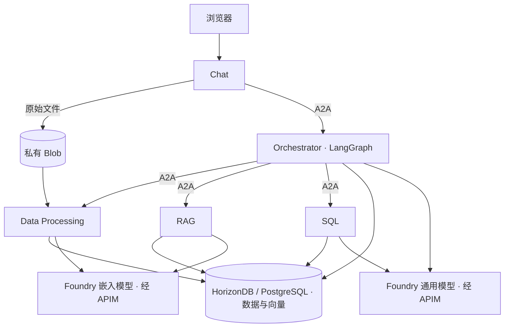

# 模块 6 — 多智能体业务场景

> 🌐 语言 / Language: [English](readme.md) | **中文**

[⬆ 返回研讨会主页](../README_CN.md)

> **建议时长：60 分钟**，接续 145 分钟的核心研讨会。
> 云端资源预配、镜像构建和数据摄取可能需要额外等待时间。

## 概述

上传消费者报告、客户评论和销售数据，由五个协作的 Agent 提供有据可依的业务分析。
每个 Agent 在独立的 ACA Sandbox 中运行，通过 **A2A** 通信；
**LangGraph** 在 Orchestrator 内协调任务，**OpenAI SDK** 通过已有 APIM 网关调用 Microsoft Foundry，
**Azure HorizonDB / PostgreSQL Flexible Server** 存储结构化数据和向量。

| Agent | 职责 |
|---|---|
| Chat | 浏览器界面、Session 管理和文件上传 |
| Orchestrator | 规划任务、协调工作 Agent、综合并审核答案 |
| Data Processing | 提取文件、写入结构化数据并生成嵌入 |
| RAG | 检索相关片段并提供来源引用 |
| SQL | 生成、验证并执行受限的只读查询 |



## 前提条件

- 完成 [Module-01](../module-01/README_CN.md) 和 [Module-04](../module-04/README_CN.md)。
  复用其资源组、区域、存储账户、ACR、Foundry/APIM、托管身份（UAMI）及已有 SandboxGroup，
  保留资源组的 `deploymentSN` 标签。
- 使用 Linux Bash（含 WSL）、带 Bicep 的 Azure CLI、独立的
  [`aca` CLI](https://aka.ms/aca-cli-install)、`jq`、`curl`、`openssl`、GNU `timeout` 和 `realpath`。
  部署路径已使用 ACA CLI `1.0.0-preview.5` 和 Bicep `0.48.1` 检查。
  不需要本地 Python 或 Docker。
- 操作人员需具备数据库/模型/APIM 子资源部署权限、存储 ARM 读取及容器部署权限、
  挂载 UAMI 和运行 ACR Tasks 的权限，以及已有组上的 **Container Apps SandboxGroup Data Owner**。
- UAMI 需具备模型访问、ACR 拉取和 **Storage Blob Data Contributor** 权限。
  所选数据库需完成提供程序注册且区域容量可用；HorizonDB 还需预览访问权限。

### 挂载已有私有 Blob（Bash 部署必需）

部署会在已有存储账户中创建私有 `data` 容器，
并**只读挂载到 Chat 和 Data Processing 的 `/kb-data`**；应用仍通过 Blob SDK 上传文件。
卷身份默认使用已有镜像拉取身份，必须已分配给 SandboxGroup，
并具备 **Storage Blob Data Reader** 或更高数据权限。

私有存储需先完成 Module-04 的 VNet/Private DNS 配置。部署会选择组中唯一的已有 VNet 连接，
并应用到全部五个沙箱；若有多个连接，通过 `CUSTOMER_VNET_CONNECTION_NAME` 指定已就绪的目标连接。

> [!CAUTION]
> 本模块用于研讨会，不是生产级多用户服务：
> - 任何能访问 Chat URL 的人都能访问所有 Session 及其数据，浏览器无需密钥；A2A 对等认证仍为必需。
> - 数据库默认防火墙允许**所有 IPv4 来源**（`0.0.0.0`–`255.255.255.255`）。
>   研讨会之外应限制规则或使用私有网络；新增窄范围规则不会删除已有宽范围规则。
> - 共享 UAMI 获得数据库管理员权限以完成研讨会设置；生产环境应使用最小权限 SQL 角色。
> - 未经授权不要上传机密数据。提取文本会发送到 Foundry；
>   默认嵌入 SKU `GlobalStandard` 可能跨 Azure 区域处理请求。

## 步骤 1 — 检查已有环境

从仓库根目录进入本模块，后续命令均在此目录的**同一个 Bash 会话**中运行。
不要启用 `set -x` 或 HTTP 调试日志。

```bash
cd agenthost/module-06
az account show -o none 2>/dev/null || az login
aca auth status >/dev/null 2>&1 || aca auth login
aca --version
az bicep version

export SUBSCRIPTION_ID="$(az account show --query id -o tsv | tr -d '\r\n')"
export RESOURCE_GROUP="${RESOURCE_GROUP:-rg-agenthost-workshop}"
export LOCATION="$(az group show --subscription "$SUBSCRIPTION_ID" -n "$RESOURCE_GROUP" --query location -o tsv | tr -d '\r\n')"
export DEPLOYMENT_SN="$(az group show --subscription "$SUBSCRIPTION_ID" -n "$RESOURCE_GROUP" --query tags.deploymentSN -o tsv | tr -d '\r\n')"
: "${DEPLOYMENT_SN:?Restore the resource group deploymentSN tag}"
export SANDBOX_GROUP_NAME="${SANDBOX_GROUP_NAME:-sandbox-group-agenthost-$DEPLOYMENT_SN}"
export ACA_OUTPUT="${ACA_OUTPUT:-$PWD/.local/aca-deployment.json}"

aca doctor --subscription "$SUBSCRIPTION_ID" --resource-group "$RESOURCE_GROUP" \
  --sandbox-group "$SANDBOX_GROUP_NAME" --region "$LOCATION"
```

确认订阅、资源组、区域和 SandboxGroup 均为预期值，并解决未通过的检查。
如需切换订阅，先通过 `az account set` 选择目标，再运行上面的命令块。
**不要再创建一个 SandboxGroup。**

## 步骤 2 — 一次性部署

默认数据库为 **HorizonDB**。如需 Azure PostgreSQL Flexible Server，
部署前设置 `DB_PROVIDER=postgresql`。两者均使用 PostgreSQL 17、`postgres` 数据库和 `vector`。

仅在已有资源与研讨会默认值不同时设置覆盖项：

| 变量 | 使用场景 |
|---|---|
| `DB_PROVIDER` | `horizondb`（默认）或 `postgresql` |
| `DB_LOCATION` | 仅覆盖数据库区域；默认使用共享区域 |
| `ACR_NAME`、`STORAGE_ACCOUNT_NAME`、`APIM_NAME` | Module-01 已有资源使用了自定义名称 |
| `IMAGE_TAG` | 镜像构建与 ACA 导入共同使用的标签，默认为 `latest` |
| `FOUNDRY_RESOURCE_NAME`、`FOUNDRY_PROJECT_NAME` | 已有 Foundry 账户/项目使用了自定义名称；项目默认为 `maf-agent-prj` |
| `LLM_MODEL` | 无法使用 Module-01 部署输出时，指定已部署的通用模型名称 |
| `CUSTOMER_VNET_CONNECTION_NAME` | 从多个已有 VNet 连接中选择 |
| `DB_FIREWALL_RULES_FILE` | 自定义数据库防火墙规则 |
| `ACA_COMMON` | 独立的自定义运行时 JSON；通常不设置，使用自动发现 |

```bash
bash deploy.sh --migrate
```

**该命令会创建计费资源。** 它依次完成以下阶段，完整部署后不要再逐项重复执行：

| 阶段 | 操作 |
|---|---|
| `storage` | 在已有存储账户中创建/复用私有 `data` |
| `models` | 部署 `text-embedding-3-small`，并为已有 APIM 增加对应路由 |
| `database` | 部署所选数据库并配置 UAMI Entra 认证 |
| `config` | 发现模型/存储设置并生成受保护的 Agent 配置 |
| `images` | 通过 ACR Tasks 远程构建并发布五个镜像 |
| `aca` | 创建五个沙箱、挂载存储、应用数据库结构、启动 Agent 并检查连通性 |

`--migrate` 在来宾中初始化研讨会专用数据库，不要指向生产数据库。
Agent 通过 Entra 认证连接数据库，不使用资源预配所需的管理员密码。
已有通用模型及共享基础设施保持复用。

生成的配置、密码、对等密钥和资源清单保存在 `.local` 下。
保持文件私有、被 Git 忽略，并保留以供清理。不要手动修改生成配置；
自定义设置应写入另一份 `ACA_COMMON` JSON，值使用字符串。
脚本不会自动加载 `.env`。WSL 中应将凭据保存在 Linux 文件系统，或限制 Windows ACL。

命令应以五个 Agent 全部显示 `ready` 结束。它会检查健康端点、经过认证的 Agent Card，
以及 Chat → Orchestrator → 数据库请求；上传和模型回答仍需通过后续步骤验证。

**如果部署失败：** 停止操作，保留错误、密码和清单。脚本不会自动回滚或续跑，
也不会覆盖已有数据库/ACA 清单及 Agent 配置。
按 [CLI 部署参考](agent-src/docs/cli-deployment_CN.md)和 `bash deploy.sh --help` 有针对性地重试阶段；
更换 ACA 输出路径会创建**新部署**，不是重启原部署。

## 步骤 3 — 连接 Session

```bash
jq -r '.agents.chat.url' "$ACA_OUTPUT"
```

1. 打开打印的 URL。
2. 选择已有 **Session**，或在 **New session** 输入 `Summer launch` 并点击 **Create**。
3. 点击 **Connect** 后再上传文件或提问。

Session 是持久化的上传数据工作区，不是登录身份。所配置数据库中的所有 Session
均对研讨会用户可见，但查询和来源限定在当前 Session。切换 Session 后需重新连接。
**Clear local conversation** 只清除浏览器历史，不删除已存数据。
Enter 发送问题，Shift+Enter 换行。

## 步骤 4 — 上传并处理示例数据

使用 [sample-data](sample-data/) 中已准备好的 PDF/CSV 分片，
不要使用 `agent-src/sample-data` 下的旧合成数据。部署不会自动导入数据。
[清单](sample-data/manifest.json)记录原始文件及覆盖范围。

选择一个或多个文件，点击 **Upload and process**，浏览器会**逐个上传并处理**。
先使用少量文件：

| 顺序 | 上传文件 | 预期结果 |
|---|---|---|
| 1 | [Capgemini 首个 PDF 分片](sample-data/01_capgemini_consumer_trends_2025-pages-000001-000020.pdf)和 [Ryder 首个 PDF 分片](sample-data/02_ryder_ecommerce_consumer_study_2025-pages-000001-000020.pdf) | 提取文本并存储可检索向量 |
| 2 | [客户评论首个 CSV 分片](sample-data/03_customer_reviews-rows-000001-002000.csv) | 存储有类型的行，并为有用评论文本生成嵌入 |
| 3 | [财务 CSV：全部 700 行](sample-data/04_financial_sample-rows-000001-000700.csv) | 存储有类型的行；数值财务数据不生成嵌入 |

等待各文件的处理报告，检查数量、警告和 **Show sources**。
嵌入自动触发，无需单独执行向量化命令。队列运行时保持页面打开。
出错时队列暂停，点击 **Retry last request** 继续当前文件/运行，不重复已完成文件。
刷新页面会丢失本地队列。摄取失败没有持久化嵌入断点，重试可能再次产生嵌入费用。

- 按需追加其他分片。完整评论源包含 **41,711 行、21 个分片**；
  每个 CSV 分片是独立数据集/表，全量统计需汇总所有相关分片。
- 不要在同一 Session 同时上传原件和分片。去重仅在单个文件内进行，不跨分片；
  接受的行数与嵌入数量是不同指标。
- 每文件默认限制为 **20 MB**、**50,000 行**和 **100,000 个嵌入分块**。
  大文件摄取可能用到默认 **7,200 秒**的摄取期限，需预留模型配额和费用。
- 使用文本 PDF，不支持 OCR。PDF 引用页码从各分片重新计数：
  `原页码 = manifest.start + 引用页码 - 1`。
- 仅上传有权使用的来源。结论只覆盖已处理分片，不一定覆盖完整来源或具有市场代表性。

## 步骤 5 — 提问并核对证据

在同一 Session 的相关文件处理完成后，逐个提问。模型自动选择路由，无需手动选择模式。

| 模式 | 问题 | 检查内容 |
|---|---|---|
| DIRECT | Write three taglines for a repairable speaker. | 通用模型回答，不检索或执行 SQL |
| RAG | According to the uploaded reports, what matters to consumers? | 相关片段、文件名、页码和引用 |
| SQL | Which country generated the highest total profit? Show a bar chart and data table. | 只读 SQL，汇总结果与财务 CSV 一致 |
| HYBRID | Combine consumer trends and sales performance and recommend the best launch market. | 同时使用定性和定量证据，区分建议与事实 |

展开证据面板查看来源和 SQL。图表必须基于经过验证的数据；片段数量不能替代评论行数。
整体评论概览可能仅使用五个片段，**不是全数据集摘要**；情感分布等全量计数应使用 SQL。

再询问一个上传资料未涉及的话题，答案应说明证据不足。
选择第二个 Session 并检查 **Show sources**，不应出现第一个 Session 的文件。
仅健康检查通过不足以完成研讨会验证，还应确认上传和四种查询模式均正常。

## 步骤 6 — 清理资源

自动挂起**默认禁用**，因为 HTTP/A2A 请求不会唤醒使用手动激活端口的已挂起工作 Agent。
五个 Agent 即使空闲也会产生计算费用。练习间隙如需挂起，再次使用前应显式恢复所有工作 Agent。
挂起的沙箱仍有存储费用，数据库等 Azure 服务另行计费。

完成后先预览清理计划，核对目标，再执行：

```bash
bash cleanup.sh
bash cleanup.sh --execute
```

提示时输入 **`delete module-06`**。

> [!WARNING]
> 清理会销毁 Module-06 数据库、Blob 和 Sandbox 数据，包括可归属的快照。
> 请先将有价值的状态备份到**删除范围之外**。

脚本根据 `.local` 保存的**所有部署尝试**的清单，删除 Module-06 沙箱、导入磁盘、可归属快照、
已记录的 Blob 卷和 `data` 容器、带标签的数据库/参数组，以及有基线记录的 embedding/APIM 新增项。
共享资源组、SandboxGroup、Module-04 沙箱、UAMI/RBAC、VNet、ACR/镜像、
Foundry 账户/项目、通用模型、基础 APIM 和存储账户均保留。

所有权记录缺失或删除失败会阻止完整清理，并保留恢复文件。外部/自定义清单需单独检查。
保留的镜像/快照及 Azure 保留策略可能继续产生存储费用。
不要为仅清理本模块而删除共享资源组。

## 参考资料

- [开发者 README](agent-src/readme_CN.md)：本地开发、API 和测试。
- [运行时配置](agent-src/.env.example)和 [CLI 部署](agent-src/docs/cli-deployment_CN.md)：高级配置及分阶段操作。
- [架构](agent-src/docs/architecture_CN.md)、[编排](agent-src/docs/orchestration_CN.md)
  和[数据处理](agent-src/docs/data-processing_CN.md)：实现细节。
- [安全与清理](agent-src/docs/security_CN.md)和[实现报告](agent-src/docs/implementation-report_CN.md)：
  限制及已记录的验证证据。

本研讨会不提供生产级多用户认证/RLS、OCR、中断工作流的持久化恢复或自动数据保留清理。
已记录的本地/模拟测试不能代表真实 Azure 验收，请通过步骤 4–5 验证自己的部署。

[⬆ 返回研讨会主页](../README_CN.md)
