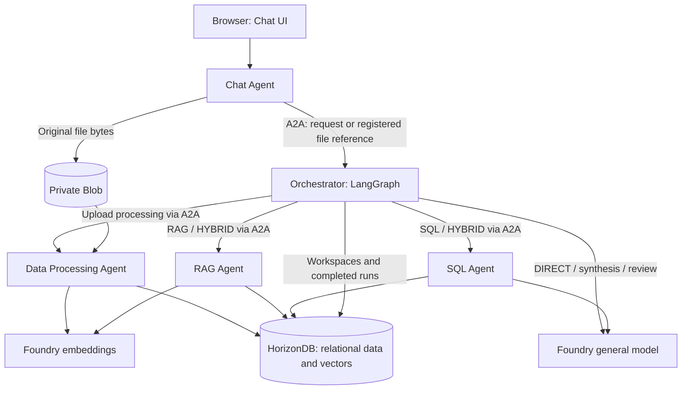

# 模块 6 — 多智能体业务场景

> 🌐 语言 / Language: [English](readme.md) | **中文**

[⬆ 返回研讨会主页](../README_CN.md)

## 概述

本模块以 **Product Launch Studio（产品发布工作室）** 为示例，实践多智能体业务场景，将上传的消费者报告、评论和销售数据转化为有据可依的产品发布建议。
五个独立 Agent 通过 **A2A** 协作；**LangGraph** 在 Orchestrator 内规划和协调任务；
**OpenAI SDK** 调用 Microsoft Foundry 的 Responses 和 Embeddings 端点。
本模块不使用 LangChain 或 Microsoft Agent Framework。

> [!IMPORTANT]
> **研讨会主路径：** 使用 Bash/Bicep 部署 HorizonDB，通过 ACR Tasks 在云端构建五个镜像，
> 再使用 Bash 和独立的 `aca` CLI 部署并启动五个 ACA Sandbox。
> 复用 Module-01 的资源组、区域、ACR、模型网关和镜像拉取身份，以及 Module-04 已有的 SandboxGroup。
> 不要重新创建这些共享资源。

本文是整合后的模块操作指南，合并了架构、部署、数据处理和演示说明。
源码级 README 和专题操作指南保留为详细参考。
`agent-src/docs` 下的八份 Markdown 指南均有中文版，顶部提供语言切换链接。
该应用面向单操作人员研讨会，不是生产级多租户服务。

## 学习目标

- 观察 Agent 边界、经过认证的发现、路由和并行协作。
- 无需本地 Docker 镜像构建或 Python 部署 SDK，部署并启动五个隔离运行时。
- 上传文档和表格，观察提取、关系型存储和选择性向量化。
- 在 Chat UI 中运行 DIRECT、RAG、SQL 和 HYBRID 问题，并检查证据。
- 区分进程就绪、云依赖访问和业务流程真正执行成功。

### 架构与 Agent 职责

| Agent | 职责 | 调用 |
|---|---|---|
| Chat | FastAPI UI/API、工作区操作、上传验证和私有 Blob 原始文件存储 | 通过 A2A 调用 Orchestrator；Blob 适配器 |
| Orchestrator | 工作区授权、LangGraph 规划、并行工作 Agent、综合、审核和运行持久化 | 通过 A2A 调用 Processing/RAG/SQL；通用模型；HorizonDB |
| Data Processing | 提取文件、推断表格类型、分块有用文本、生成嵌入并提交数据 | Blob、嵌入模型、HorizonDB |
| RAG | 工作区过滤的余弦检索，返回来源、分数和最多五个匹配项 | 嵌入模型、HorizonDB |
| SQL | 感知数据库结构的 SQL 生成、AST 验证和受限只读执行 | 通用模型、HorizonDB |



Chat 不直接调用工作 Agent、模型或数据库仓储；工作 Agent 之间互不调用。
每个服务发布经过认证的 Agent Card，并拥有独立镜像、进程和沙箱。
调用者在发送消息前验证配置的对等服务的角色、技能、协议和精确端点。
上传文本是不可信证据，不是指令。共享适配器避免重复实现模型/存储代码。
UI 的样式和交互模式沿用 Module-03，其原始实现保持不变。

---

## 前提条件

> [!CAUTION]
> 以下命令均从 **`agenthost/module-06/`** 运行，除非命令显式通过子 shell 进入其他目录。
> 步骤 1–4 保持在同一个 Bash 会话中。不要启用 shell 跟踪（`set -x`）或 Azure/ACA HTTP 调试日志，
> 因为配置包含凭据。

1. 完成 [Module-01](../module-01/README_CN.md) 和 [Module-04](../module-04/README_CN.md)。
   除非显式指定资源名称，否则资源组必须保留 `deploymentSN` 标签。
2. 使用 Linux Bash、带 Bicep 的 Azure CLI、独立的 `aca` CLI、`jq`、`curl`、`openssl` 和 GNU `timeout`。
   部署路径已使用 ACA CLI `1.0.0-preview.5` 和 Bicep `0.48.1` 检查；
   较旧 Bicep 类型目录可能提示缺少 HorizonDB 预览类型。
3. 操作人员身份需要 HorizonDB 部署权限、运行 ACR Tasks 的权限，以及已有组上的
   **Container Apps SandboxGroup Data Owner**。镜像拉取身份需要 ACR 拉取权限。
   所选区域必须具备 HorizonDB 预览访问权限、提供程序注册和容量。
4. 提供实际 Foundry 通用模型和嵌入模型部署名称。通用模型复用 Module-01 的 APIM 路由，
   嵌入模型单独配置，不要假设 APIM 已暴露嵌入接口。
5. 提供 **私有 Blob 容器 `data`**、端点，以及具备适当模型访问权限和 Storage Blob Data Contributor 的来宾运行时身份。
   如果存储仅允许私有访问，先完成 Module-04 的 VNet/Private DNS 配置，并通过
   `CUSTOMER_VNET_CONNECTION_NAME` 选择已有连接。
6. 单独验证来宾身份：宿主机 `az login` 或 ACR 拉取 UAMI **不会**为来宾应用调用提供认证。
   本文使用受保护的 `AZURE_TENANT_ID`、`AZURE_CLIENT_ID`、`AZURE_CLIENT_SECRET` 配置最小权限服务主体；
   也可以使用经过批准并验证可用的来宾托管身份。
7. 使用随附的合成文件进行可重复演示。云端路径不要求本地 Python 和 Docker；
   只有本地开发替代路径需要 Python 3.11+ 和 PostgreSQL/vector。

### 安装并检查 CLI

通过官方安装程序补齐缺失工具。执行前请检查 ACA 安装脚本：

```bash
curl -fsSL https://aka.ms/aca-cli-install | sh
aca --version
az bicep version
az account show -o none 2>/dev/null || az login
aca auth status >/dev/null 2>&1 || aca auth login
```

同一安装路径也用于沙箱和容器内部由 Agent 驱动的自行安装。
这里的 CLI 是 **`aca`**，不是 `az containerapp sandbox`，也不同于 ACA Dynamic Sessions。
在步骤 1 中结合已有组上下文运行 `aca doctor`，解决检查失败后再部署。
部署脚本不会安装工具，也不会静默代为登录。

### 配置默认值

**显式参数 > 非空环境变量 > 默认值。** 部署脚本不会自动加载 `.env`。
资源名称沿用 Modules 01/04，不会生成新后缀。

| 环境变量 | 默认值 / 行为 |
|---|---|
| `SUBSCRIPTION_ID`, `RESOURCE_GROUP`, `LOCATION` | 当前 Azure CLI 账户；`rg-agenthost-workshop`；现有资源组区域，通常为 `eastus2` |
| `DEPLOYMENT_SN` | 资源组的 `deploymentSN` 标签 |
| `ACR_NAME`, `ACR_LOGIN_SERVER` | `acragenthost<SN>`；查询其实际登录服务器 |
| `SANDBOX_GROUP_NAME` | `sandbox-group-agenthost-<SN>` |
| `IDENTITY_NAME`, `REGISTRY_IDENTITY` | `id-agenthost-<SN>`；查询其 ARM ID 用于镜像拉取 |
| `IMAGE_TAG`, `AUTO_SUSPEND_MINS` | `latest`、`15`；构建和部署使用相同标签 |
| `SANDBOX_CPU`, `SANDBOX_MEMORY` | 每个 Agent 为 `1000m`、`2048Mi` |
| `HORIZONDB_CLUSTER_NAME`, `HORIZONDB_USERNAME`, `HORIZONDB_VCORES` | `hdb-agenthost-<SN>`、`studioadmin`、`2` |
| `HORIZONDB_PASSWORD`, `HORIZONDB_PASSWORD_FILE` | 无默认密钥；环境变量密码或 `agent-src/.local/horizondb-password`；显式 `--password-file` 优先 |
| `HORIZONDB_FIREWALL_RULES_FILE` | 可选 JSON 规则；否则为 `0.0.0.0`–`255.255.255.255` |
| `HORIZONDB_OUTPUT`, `ACA_CONFIG`, `ACA_OUTPUT` | `agent-src/.local` 下的文件：`horizondb-deployment.json`、`aca-config.json`、`aca-deployment.json` |
| `HEALTH_TIMEOUT_SECONDS`, `OPERATION_TIMEOUT_SECONDS` | `180`、`900` 秒 |
| `CUSTOMER_VNET_CONNECTION_NAME` | 未设置；只能选择组中已有的 VNet 连接 |

脚本内部的默认文件路径以 `agent-src` 为基准；显式指定的相对路径以当前目录为基准。
来宾配置来自受保护的五角色 `ACA_CONFIG`，不是宿主机的任意环境变量。
`--apply` 和 `--migrate` 必须显式传入。

---

## 步骤 1 — 选择已有 Azure 环境

从仓库根目录进入本模块一次：

```bash
cd agenthost/module-06
```

继续前先选定目标订阅。以下命令只读取共享资源，不会创建它们：

```bash
export SUBSCRIPTION_ID="${SUBSCRIPTION_ID:-$(az account show --query id -o tsv)}"
export RESOURCE_GROUP="${RESOURCE_GROUP:-rg-agenthost-workshop}"
export LOCATION="${LOCATION:-$(az group show --subscription "$SUBSCRIPTION_ID" -n "$RESOURCE_GROUP" --query location -o tsv)}"
export DEPLOYMENT_SN="${DEPLOYMENT_SN:-$(az group show --subscription "$SUBSCRIPTION_ID" -n "$RESOURCE_GROUP" --query tags.deploymentSN -o tsv)}"
: "${SUBSCRIPTION_ID:?Select an Azure subscription}"
: "${LOCATION:?Existing RG location is required}"
: "${DEPLOYMENT_SN:?Set DEPLOYMENT_SN or restore the RG deploymentSN tag}"
export SANDBOX_GROUP_NAME="${SANDBOX_GROUP_NAME:-sandbox-group-agenthost-$DEPLOYMENT_SN}"
export IMAGE_TAG="${IMAGE_TAG:-latest}"
aca doctor --subscription "$SUBSCRIPTION_ID" --resource-group "$RESOURCE_GROUP" \
  --group "$SANDBOX_GROUP_NAME" --region "$LOCATION"
umask 077
mkdir -p agent-src/.local
export HORIZONDB_PASSWORD_FILE="${HORIZONDB_PASSWORD_FILE:-agent-src/.local/horizondb-password}"
export HORIZONDB_OUTPUT="${HORIZONDB_OUTPUT:-agent-src/.local/horizondb-deployment.json}"
export ACA_CONFIG="${ACA_CONFIG:-agent-src/.local/aca-config.json}"
export ACA_OUTPUT="${ACA_OUTPUT:-agent-src/.local/aca-deployment.json}"
```

确认 `aca doctor` 报告的订阅、资源组、区域和组，不要再创建一个 SandboxGroup。
如果覆盖文件位置，请确保路径位于 Git 和镜像构建上下文之外，并创建其父目录。

## 步骤 2 — 部署 HorizonDB

> [!WARNING]
> 研讨会模板向 **`0.0.0.0`–`255.255.255.255`** 开放公网端点。
> 所有 IPv4 来源均可尝试数据库连接；仍必须使用 TLS 和强认证。
> 研讨会之外应限制防火墙范围或使用私有网络。
> 增量 ARM 部署**不会**删除已有防火墙规则：添加窄范围规则或 `[]`，
> 不会移除之前部署的 `workshop-public` 规则。

只准备一次密码。已有文件会复用；如果设置了 `HORIZONDB_PASSWORD`，将该值保存到受保护文件，
确保部署和运行时配置使用相同凭据：

```bash
if [[ -n "${HORIZONDB_PASSWORD:-}" ]]; then
  printf '%s' "$HORIZONDB_PASSWORD" > "$HORIZONDB_PASSWORD_FILE"
elif [[ ! -f "$HORIZONDB_PASSWORD_FILE" ]]; then
  openssl rand -base64 36 > "$HORIZONDB_PASSWORD_FILE"
fi
chmod 600 "$HORIZONDB_PASSWORD_FILE"
bash agent-src/deploy/deploy-horizondb.sh --password-file "$HORIZONDB_PASSWORD_FILE"
# After reviewing validation, network access and cost:
bash agent-src/deploy/deploy-horizondb.sh --password-file "$HORIZONDB_PASSWORD_FILE" --apply
```

不带 `--apply` 时只执行 ARM 验证；带该参数时，Bicep 创建 PostgreSQL 17 HorizonDB 集群、
允许 `vector` 的参数组和池防火墙规则。默认配置为两个 vCore、一个副本和 `BestEffort` 可用区放置策略，
使用已有的 **`postgres` 数据库**。
固定 API 版本为 `2026-05-01-preview`，公网访问由池防火墙规则控制。
密码通过临时受保护文件作为安全参数传递，不会直接出现在 CLI 参数中。

预期结果：`HORIZONDB_OUTPUT` 指定的非敏感资源清单包含端点、端口、数据库、用户名和 TLS 模式。
这还不是数据库连接测试；步骤 4 会在来宾中应用并检查应用结构。
不要迁移生产数据库，也不要在这些步骤之间更换密码。

## 步骤 3 — 构建镜像并准备 Agent 配置

### 在已有 ACR 中远程构建

```bash
bash agent-src/deploy/build-images.sh
```

该命令提交五个计费的 **`az acr build` ACR Tasks 快速构建**，使用 `IMAGE_TAG` 发布
`studio-chat`、`studio-orchestrator`、`studio-data-processing`、`studio-rag` 和 `studio-sql`。
不使用本地 Docker。部署前必须完成所有镜像构建；ACA 脚本只导入已有镜像。
如果复用标签为 `workshop` 的旧镜像，请统一设置 `IMAGE_TAG=workshop`。

### 配置模型、Blob 和运行时身份

使用安全编辑器创建 **`agent-src/.local/aca-common.json`**，结构如下。
将所有占位符替换为实际部署配置，绝不要将凭据粘贴到命令参数中。
所有环境变量值都必须是字符串。

```json
{
  "BLOB_BACKEND": "azure",
  "AZURE_STORAGE_ACCOUNT_URL": "https://<existing-storage-account>.blob.core.windows.net",
  "AZURE_STORAGE_CONTAINER": "data",
  "AGENT_APIM_ENDPOINT": "https://<existing-apim-host>",
  "FOUNDRY_EMBEDDING_BASE_URL": "https://<embedding-resource>.openai.azure.com/openai/v1/",
  "LLM_MODEL": "<deployed-general-model-name>",
  "EMBEDDING_MODEL": "<deployed-embedding-model-name>",
  "EMBEDDING_DIMENSIONS": "1536",
  "AZURE_TENANT_ID": "<tenant-id>",
  "AZURE_CLIENT_ID": "<runtime-application-client-id>",
  "AZURE_CLIENT_SECRET": "<runtime-application-secret>"
}
```

`1536` 必须与所配置的嵌入部署及数据库向量维度一致。
通用模型使用直连路由时，以 `FOUNDRY_OPENAI_BASE_URL` 替代 `AGENT_APIM_ENDPOINT`。
根据实际端点检查 `LLM_TOKEN_SCOPE` 和 `EMBEDDING_TOKEN_SCOPE`；
默认值及所有运行时限制见[配置参考](agent-src/.env.example)。
使用托管身份时，省略全部三个服务主体字段，并验证来宾可以获取令牌。
不要只为消除认证错误而授予过大的权限。

只生成一次独立的浏览器和对等密钥，然后合并通用设置与数据库输出：

```bash
chmod 600 agent-src/.local/aca-common.json
[[ -f agent-src/.local/studio-key ]] || openssl rand -hex 32 > agent-src/.local/studio-key
[[ -f agent-src/.local/a2a-key ]] || openssl rand -hex 32 > agent-src/.local/a2a-key
jq -n \
  --slurpfile common agent-src/.local/aca-common.json \
  --slurpfile db "$HORIZONDB_OUTPUT" \
  --rawfile password "$HORIZONDB_PASSWORD_FILE" \
  --rawfile browser agent-src/.local/studio-key \
  --rawfile peer agent-src/.local/a2a-key '
  ($common[0] +
   ($db[0] | with_entries(select(.key | startswith("HORIZONDB_")))) +
   {HORIZONDB_PASSWORD:($password|sub("\r?\n$";"")),
    STUDIO_API_KEY:($browser|sub("\r?\n$";"")),
    A2A_API_KEY:($peer|sub("\r?\n$";""))}) as $env |
  ["chat","orchestrator","data-processing","rag","sql"] |
  map({key:.,value:$env}) | from_entries
' > "$ACA_CONFIG"
chmod 600 "$ACA_CONFIG" agent-src/.local/studio-key agent-src/.local/a2a-key
```

保持这些文件私有并被 Git 忽略。部署脚本会发现五个 URL 并覆盖相应 A2A 设置，无需猜测入口地址。
它先创建受保护的来宾目录，再上传配置，设置 `0600` 权限和所有权，最后原子重命名。
A2A 密钥用于服务间通信，绝不要输入浏览器。

## 步骤 4 — 部署、启动并检查五个 Agent

```bash
bash agent-src/deploy/deploy-aca.sh
# First deployment into the dedicated workshop database:
bash agent-src/deploy/deploy-aca.sh --migrate --apply
```

不带 `--apply` 时只做本地配置/清单验证；带该参数时，脚本执行以下流程：

1. 解析并验证已有组、区域、ACR 和镜像拉取身份。
2. 导入五个磁盘镜像，生成带唯一部署/角色标签的五份清单。
3. 验证并应用清单，暴露 8080 端口，获取 HTTPS URL。
4. 下发五角色配置；期间每个来宾均在启动门控后等待。
5. 使用 `--migrate` 时，一次性应用含 `vector` 的 [001_initial.sql](agent-src/migrations/001_initial.sql)，
   并从四个需要数据库的来宾检查 `workspaces` 和向量类型可用性。
6. 以 UID 10001 启动各 Agent 的 Uvicorn 进程，无需单独终端或手动启动 Agent。
7. 等待五个 `/health` 端点和经过认证的 Agent Card，然后执行只读的
   Chat → A2A → Orchestrator → 数据库请求。
8. 打印状态表，并在 `ACA_OUTPUT` 保存精确资源 ID/URL。

清单模式是 CI/CD 和可重复部署的推荐路径。手工实验时的顺序为
`aca sandbox init` → `aca sandbox validate --file sandbox.yaml` → `aca sandbox apply --file sandbox.yaml`；
本脚本已自动生成清单，无需另外初始化。
宿主机不需要 Python 或 Sandbox SDK；迁移使用 Agent 镜像内部已有的 Python。

```text
AGENT             STATUS       URL
chat              ready        https://<chat-ingress>
orchestrator      ready        https://<orchestrator-ingress>
data-processing   ready        https://<processing-ingress>
rag               ready        https://<rag-ingress>
sql               ready        https://<sql-ingress>
Inventory: .../.local/aca-deployment.json
```

> [!IMPORTANT]
> 端口使用 `--anonymous`：任何持有 URL 的人都可访问 HTTPS 端点，但仍须通过应用的浏览器/对等 bearer 认证。
> 研讨会允许出站流量；生产环境应采用默认拒绝出站并显式配置允许列表。
> **Ready 不等于完整验收：** 继续上传文件和提问，验证 Blob、嵌入和生成能力。

健康检查默认共享 180 秒期限，每个 ACA 操作最多等待 900 秒，来宾配置门控最多等待 3600 秒。
任何失败均返回非零退出码并保留已知 ID/阶段，不执行自动回滚。已有资源清单文件会被拒绝覆盖。
**换一个输出路径重新运行 `--apply` 会创建另一组部署，不是在原地重启。**

## 步骤 5 — 打开 Chat UI 并创建工作区

```bash
jq -r '.agents.chat.url' "$ACA_OUTPUT"
```

1. 打开打印的 Chat URL。
2. 通过安全流程读取受保护的 `agent-src/.local/studio-key` 文件中的值，
   将其输入 **Workshop key**，点击 **Connect**。
3. 在 **New workspace** 输入 `Summer launch`，点击 **Create**，然后在 **Workspace** 中选中它。
4. 以下每次上传和提问都保持选择该工作区。

浏览器只需要研讨会密钥，不需要数据库/模型凭据或对等密钥。
**Clear local conversation** 只清除浏览器显示历史，不删除已存数据或完成的运行记录。

## 步骤 6 — 上传、处理并向量化示例数据

使用 **[agent-src/sample-data](agent-src/sample-data/README.md)** 中的文件，而非模块级的另一套样本，
以确保后面的预期答案可重复。
逐个选择文件并点击 **Upload and process**，等待处理完成后再上传下一个。
处理和向量化自动触发，没有单独的嵌入命令或 UI 按钮。

| 顺序 | 文件 | 预期行为 |
|---|---|---|
| 1 | [consumer-trends.md](agent-src/sample-data/consumer-trends.md) | 提取文本、分块、生成嵌入并存储文档向量 |
| 2 | [03_customer_reviews.csv](agent-src/sample-data/03_customer_reviews.csv) | 存储有类型的关系型行，并为有用评论文本生成与来源行关联的嵌入 |
| 3 | [04_financial_sample.csv](agent-src/sample-data/04_financial_sample.csv) | 存储有类型的关系型行；数值财务数据产生 **零个嵌入** |

观察进度面板、数量、跳过记录和警告；点击 **Show sources** 检查存储的来源。
Chat 保存私有原始文件，通过 A2A 传递已登记引用。
Data Processing 重新验证引用/校验和，提取内容，并原子提交关系型/向量数据。
摄取失败会回滚行/向量并将文档标记为失败，但原始 Blob 对象可能保留。

文本默认按 400 个 token 分块，重叠 60 个 token；空白、过短和重复文本会跳过并计数。
评论向量保留行关联。摄取和查询必须使用同一个嵌入部署/维度。
支持 PDF、DOCX、TXT、MD、CSV、XLSX 和 JSON。扫描/加密 PDF 会明确失败，不支持 OCR。
XLSX 支持一个有数据的工作表，公式使用缓存值；JSON 对象数组转为表，其他 JSON 转为可检索文本。
没有迁移计划时，不要在研讨会中途更改嵌入维度。

> [!NOTE]
> 随附样本为虚构数据，不是市场研究。可选的发布者 PDF 请按[样本说明](agent-src/sample-data/README.md)操作，
> 确认使用权限并使用文本 PDF。
> 不要提交下载的报告，也不要未经授权上传客户机密数据。
> 提取的文本会发送给所配置的 Foundry 嵌入部署。

## 步骤 7 — 运行 Chat 查询场景并检查证据

在消息框逐个输入下列问题，点击 **Send**（或按 Enter），等待完成并展开答案证据面板。
UI 不提供手动路由选择器，模型根据问题的数据需求选择经过结构验证的计划。

| 模式 | 问题 | 检查内容 |
|---|---|---|
| DIRECT | Write three taglines for a repairable speaker. | 通用模型回答；不检索工作区或执行 SQL |
| RAG | According to the uploaded reports, what matters to consumers? | 查询嵌入和最多五个工作区过滤的余弦匹配；文件名、可用的章节/页码、分数及引用 |
| SQL | Which country generated the highest total profit? | 生成并验证的只读 SQL 及实际结果行；合成样本中 **France 4000、Germany 3300** |
| HYBRID | Combine consumer trends and sales performance and recommend the best launch market. | RAG 和 SQL 并行工作，结合定性/定量证据，并明确标注建议 |

Orchestrator 汇总工作 Agent 结果，生成答案，然后审核**实际草稿**的证据、计算和引用。
最多允许修订一次；第二次审核仍不通过时会阻止输出无依据答案。
SQL 只允许获准的 SELECT 查询，并施加工作区谓词、行数限制、只读事务和超时。
最终答案区分证据、计算事实、解读、建议和局限。

进度来自真实图/摄取节点。Chat/上传 API 返回 HTTP 202 和运行 ID，浏览器每秒轮询一次。
这是进度轮询，不是模型 token 流式输出。完成的运行持久化到 HorizonDB，临时 A2A 任务状态受内存上限约束。

### 额外验收检查

1. 询问样本中不存在的话题，并明确要求依据已上传报告。应提示证据不足，而非编造来源。
2. 创建并选中第二个工作区，再使用 **Show sources**，第一个工作区的文件不应出现在这里。
3. 在可丢弃的测试部署中停止/挂起 SQL 工作 Agent，然后重新提问 HYBRID。
   应出现明确的部分成功/错误结果，不得编造 SQL 结果。下一个场景前恢复该 Agent。
4. 在受控测试中重启一个 Agent 进程。来源、数据集和完成的运行记录应仍保留；
   中断的工作流不会自动恢复，不要将进程重启视为工作流恢复。

四种模式和上传检查全部通过后，才能确认真实云端研讨会通过验收。

## 步骤 8 — 安全运维与清理

空闲自动挂起默认 15 分钟。应用不会自动唤醒工作 Agent，使用前请恢复已挂起的 Agent，
并避免在活动工作流中挂起。
针对性操作应使用精确资源清单，而不是名称相似的共享资源：

```bash
SQL_SANDBOX_ID="$(jq -er '.agents.sql.sandbox_id' "$ACA_OUTPUT")"
aca_context=(
  --subscription "$(jq -er '.subscription' "$ACA_OUTPUT")"
  --resource-group "$(jq -er '.resource_group' "$ACA_OUTPUT")"
  --group "$(jq -er '.sandbox_group' "$ACA_OUTPUT")"
  --region "$(jq -er '.region' "$ACA_OUTPUT")"
)
aca sandbox get --id "$SQL_SANDBOX_ID" "${aca_context[@]}"
# Only for the deliberate failure test in a disposable deployment:
aca sandbox stop --id "$SQL_SANDBOX_ID" "${aca_context[@]}"
# Repeat HYBRID in Chat and inspect the result before running resume:
aca sandbox resume --id "$SQL_SANDBOX_ID" "${aca_context[@]}"
```

挂起的 Sandbox 仍产生存储费用，但不产生计算费用；HorizonDB 和其他服务单独计费。
诊断时使用带资源清单上下文的 `aca sandbox exec --id ... -c "..."` 执行单条命令，
或 `aca sandbox shell --id ...` 打开交互会话。不能使用 SSH。不要将凭据文件打印到日志中。

| 现象 | 检查项 |
|---|---|
| ARM 验证/部署失败 | HorizonDB 预览权限、提供程序、区域容量、权限和 Bicep 类型支持 |
| 数据库/结构失败 | DNS、出站、防火墙、TLS、密码、vector 允许列表和迁移；仅 `/health` 不足以判断 |
| Blob 上传失败 | 来宾身份、Blob RBAC、私有端点/DNS 和所选 VNet 连接 |
| APIM 404 / 嵌入失败 | 精确 OpenAI v1 路由、部署名称、令牌作用域和维度 |
| A2A 401 / 卡片无效 | 匹配的独立对等密钥、预期角色/技能/协议和精确公布 URL；不要禁用检查 |
| PEER_UNAVAILABLE | Sandbox 状态、端口暴露和网络可达性；显式恢复已挂起的工作 Agent |
| 摄取/检索失败或证据薄弱 | 文本 PDF、工作表数量、上传/分块限制和证据质量；不要只为强行生成答案而降低阈值 |
| ACR 构建失败 | ACR Tasks 权限/容量和云端构建器访问依赖的能力；绝不禁用 TLS 验证 |

失败后保留资源清单，重试前按记录的 ID、名称、部署标签定位资源。
**删除前**为值得保留的状态创建快照。只删除该部署的五个 Sandbox，然后删除其导入磁盘；
不要删除共享的 Module-04 SandboxGroup 或 Module-01 资源组。
分别检查 HorizonDB、Blob、快照和磁盘保留策略。没有自动数据保留/删除 API。
数据库/Blob 清理请遵循[安全与清理指南](agent-src/docs/security_CN.md)，不要执行模型生成的删除查询或删除共享容器。
另见 [CLI 失败处理](agent-src/docs/cli-deployment_CN.md#失败重试与清理)。

---

## 可选 — 在本地运行五个 Agent

开发时可用该路径替代步骤 2–4，但仍需要真实 Foundry 模型部署。
要求 Python 3.11+ 和本地 PostgreSQL/vector 数据库；Docker 仅用于可选的本地数据库，不用于镜像构建。
从模块根目录运行：

```bash
python -m venv agent-src/.venv
source agent-src/.venv/bin/activate
python -m pip install -e "./agent-src[dev]"
cp -n agent-src/.env.example agent-src/.env
```

编辑 `agent-src/.env`：替换数据库/浏览器/对等密钥，配置模型端点/部署，
使用本地 Blob 存储和本地数据库设置。不要提交该文件。

```bash
(cd agent-src && docker compose up -d db)
(cd agent-src && python -m shared.database)
```

在模块根目录打开五个终端，每个终端激活同一虚拟环境，各运行一条命令：

| Agent | 命令 |
|---|---|
| Chat | `(cd agent-src && A2A_PUBLIC_URL=http://127.0.0.1:8080 uvicorn chat_agent.app:create_app --factory --host 127.0.0.1 --port 8080)` |
| Orchestrator | `(cd agent-src && A2A_PUBLIC_URL=http://127.0.0.1:8081 uvicorn orchestrator_agent.app:create_app --factory --host 127.0.0.1 --port 8081)` |
| Data Processing | `(cd agent-src && A2A_PUBLIC_URL=http://127.0.0.1:8082 uvicorn data_processing_agent.app:create_app --factory --host 127.0.0.1 --port 8082)` |
| RAG | `(cd agent-src && A2A_PUBLIC_URL=http://127.0.0.1:8083 uvicorn rag_agent.app:create_app --factory --host 127.0.0.1 --port 8083)` |
| SQL | `(cd agent-src && A2A_PUBLIC_URL=http://127.0.0.1:8084 uvicorn sql_agent.app:create_app --factory --host 127.0.0.1 --port 8084)` |

使用 `.env.example` 中匹配的对等 URL。打开 `http://127.0.0.1:8080`，
使用本地 `.env` 的研讨会密钥，按步骤 5–7 操作。只有本地开发共享原始文件目录。
分词器首次使用会下载 cl100k_base，离线会话前请准备缓存。
Windows PowerShell 设置以及可选的 AKS/SDK/容器路径仍见
[源码 README](agent-src/readme_CN.md) 和[部署参考](agent-src/docs/sandbox-deployment_CN.md)。

## 本模块涉及的文件

| 文件 / 目录 | 用途 |
|---|---|
| [readme.md](readme.md)、[readme_CN.md](readme_CN.md) | 整合后的英文/中文研讨会入口 |
| [agent-src/readme_CN.md](agent-src/readme_CN.md) | 开发设置、完整 API/配置参考和测试命令 |
| [chat_agent](agent-src/chat_agent/README_CN.md) | Chat API/UI 实现、入口和 Dockerfile |
| [orchestrator_agent](agent-src/orchestrator_agent/README_CN.md) | A2A 门面、LangGraph 工作流、综合/审核 |
| [data_processing_agent](agent-src/data_processing_agent/README_CN.md) | 提取、分类、关系型存储和向量化 |
| [rag_agent](agent-src/rag_agent/README_CN.md)、[sql_agent](agent-src/sql_agent/README_CN.md) | 证据检索和精确结构化查询 |
| [shared](agent-src/shared/) | 配置、契约、A2A 传输、数据库/Blob/模型适配器、SQL 安全 |
| [001_initial.sql](agent-src/migrations/001_initial.sql) | 工作区、文档、分块、数据集、评论、运行和预留洞察；上传会添加 `ds_<document UUID>` 表 |
| [deploy-horizondb.sh](agent-src/deploy/deploy-horizondb.sh)、[horizondb.bicep](agent-src/deploy/horizondb.bicep) | HorizonDB 验证/部署 |
| [build-images.sh](agent-src/deploy/build-images.sh)、[build-images.ps1](agent-src/deploy/build-images.ps1) | 五个远程 ACR 镜像构建 |
| [deploy-aca.sh](agent-src/deploy/deploy-aca.sh)、[aca-config.jq](agent-src/deploy/aca-config.jq) | 五个 Sandbox 编排和配置验证 |
| [aca_sandboxes.py](agent-src/deploy/aca_sandboxes.py)、[render_sandboxes.py](agent-src/deploy/render_sandboxes.py) | 可选 Python SDK 部署 / AKS Sandbox 渲染器；不属于 Bash 主路径 |
| [.env.example](agent-src/.env.example)、[compose.yaml](agent-src/compose.yaml)、[compose.agents.yaml](agent-src/compose.agents.yaml) | 运行时配置、本地数据库、使用 ACR 镜像的可选五容器拓扑 |
| [tests](agent-src/tests/)、[sample-data](agent-src/sample-data/README.md) | 回归测试和原创合成演示输入 |
| [模块级 sample-data](sample-data/) | 另一套已有来源集合，不是合成验收数据集 |
| [prompt](prompt/) | 原始研讨会需求/设计输入，不是可执行部署指南 |
| [架构](agent-src/docs/architecture_CN.md)、[编排](agent-src/docs/orchestration_CN.md)、[数据处理](agent-src/docs/data-processing_CN.md) | 详细实现参考 |
| [CLI 部署](agent-src/docs/cli-deployment_CN.md)、[沙箱部署](agent-src/docs/sandbox-deployment_CN.md)、[演示指南](agent-src/docs/workshop-guide_CN.md)、[安全](agent-src/docs/security_CN.md) | 保留为参考的专题操作指南 |
| [实现报告](agent-src/docs/implementation-report_CN.md) | 已记录的验证证据和待完成的云端验收边界 |

## 验证状态与限制

此前记录的验收包括使用本地 PostgreSQL/vector 的 80 项 Python 测试、独立进程 A2A 流程和浏览器检查。
Bash/PowerShell 部署测试使用云端替身，Bicep/CLI 清单验证是离线检查。
**实际 ACR 构建、HorizonDB 部署及真实五个 Sandbox 的模型/Blob/业务验收仍未验证。**
本文不表示这些资源已经部署。

当前只有一个 Orchestrator 调度器，没有持久化的运行中工作流恢复、OCR、生产级 RLS 或多用户身份、
自动保留清理，且仅支持基础 Markdown 渲染。
生产中的大型/不可信文档应使用隔离且持久化的工作进程。

[⬆ 返回研讨会主页](../README_CN.md)
