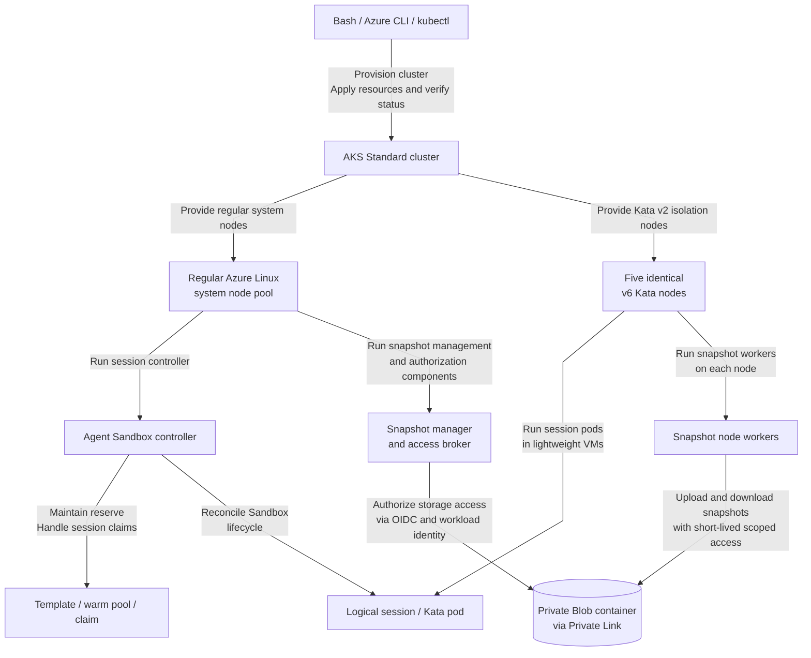
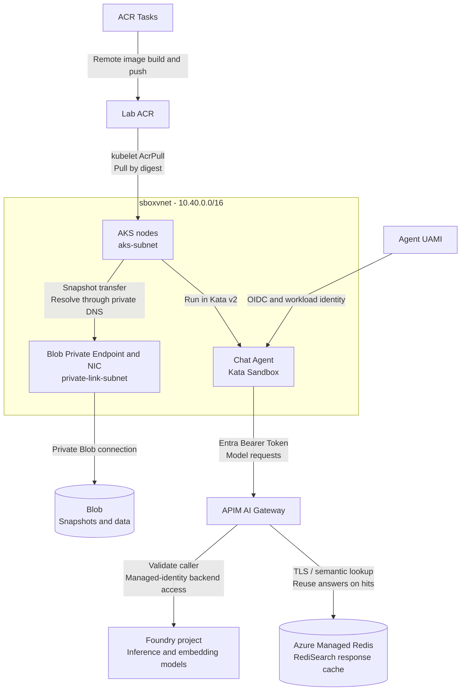

# AKS Agent Sandbox and AI Gateway Response Cache Lab

> Language / 语言: **English** | [中文](README_CN.md)

Validate two complementary capabilities: manage isolated sessions, warm pools and process-state snapshot restore with Agent Sandbox on AKS; use Azure API Management (APIM) as an AI Gateway (AIGW), backed by Azure Managed Redis (AMR) for a semantic response cache, and verify answer reuse and provenance.

**Sandbox snapshots restore process state; AMR caches reuse model responses. They are different mechanisms and cannot replace each other.**

The lab uses **Pod sandboxing with Kata VM isolation v2**, not the ACI/serverless pivot of the reference articles. AKS Automatic is not supported by these previews. Allow approximately 90–120 minutes.

This README covers environment setup, supplementary technical notes, diagnostics and retirement. **Refer to the [Demo Guide](demo.md) for validation, demos and demo-resource release steps.**

## 1. Business scenarios

| Scenario | Why Agent Sandbox fits | What still belongs to your application |
| --- | --- | --- |
| AI coding assistants | Run generated code and tests in an isolated execution environment rather than inside the assistant process. | Authenticate users, authorize tools, limit execution time and egress, and collect results. |
| Interactive notebooks and development sessions | Give each session a stateful, individually managed execution environment. | Persist important files, enforce tenant boundaries, and manage idle shutdown. |
| Agent tools with expensive initialization | Keep ready environments in a warm pool to reduce allocation latency. | Budget reserve capacity and cap active claims; pool replicas do not cap total sessions. |
| Pause/resume of initialized sessions | Snapshot runtime state and resume process memory without repeating initialization. | Validate external connections, credentials, leases, and application correctness after restore. |
| Repeated or similar AI questions in the same context | APIM AI Gateway queries the AMR semantic response cache and reuses matching answers without another chat-model call. | Validate context partitioning, distance threshold, TTL and provenance; assess false matches and embedding/cache-query costs. |

- VM isolation is one defense layer, **not permission to execute arbitrary hostile code without additional controls**.
- Use trusted digest-pinned images, scoped RBAC, network policies/egress controls, identity separation, admission controls, and monitoring in a real system.

- This teaching lab does not accept or execute user-supplied code.
- The session runs the chat Agent in [agent-src](agent-src/), calling Foundry models through APIM;
- its `/work` endpoint records a synthetic task for snapshot verification.
- An optional separate chat Sandbox uses the same application.
- Both use images built in this lab's ACR and pinned by digest.

## 2. Features, AKS extensions and AI Gateway responsibilities

Agent Sandbox and Pod Snapshot are AKS extensions; APIM and AMR are separate Azure services, not installed by those extensions.

| Component | Responsibility | Not its responsibility |
| --- | --- | --- |
| AKS Pod sandboxing / Kata v2 | Runs a sandboxed pod in a lightweight VM; uses `kata-vm-isolation-v2` with handler `kata-v2`. | Installing either extension does not enable this runtime. |
| Agent Sandbox extension (`Microsoft.AgentSandbox`, **1.0.7+**) | Installs controllers and declarative session/warm-pool APIs. | It does not provide an LLM, automatic idle shutdown, or application authorization. |
| Pod Snapshot extension (`Microsoft.PodSnapshot`, **0.1.1+**) | Captures runtime state, stores it in Blob Storage, authorizes restore, validates compatibility, stages state and restores it into a new pod. | It is not a distributed application backup, PV backup, or transparent repair for external sessions. |
| APIM AI Gateway | Validates caller identity, applies semantic cache lookup/store policies and identifies model-generated versus cached answers. | It does not manage Sandbox lifecycle or restore process state. |
| Azure Managed Redis (AMR) | Serves as APIM's external semantic response cache with RediSearch queries; Foundry supplies embeddings. | It is not an Agent-local cache, chat-history store or Pod snapshot store. |

**Agent Sandbox APIs:**

- `Sandbox` (`agents.x-k8s.io/v1beta1`): manages one stateful sandbox environment.
- `SandboxTemplate` (`extensions.agents.x-k8s.io/v1beta1`): defines the template used to create sandbox environments.
- `SandboxWarmPool` (`extensions.agents.x-k8s.io/v1beta1`): maintains reserved sandbox environments; the pool replenishes after an available Sandbox is claimed.
- `SandboxClaim` (`extensions.agents.x-k8s.io/v1beta1`): claims and takes ownership of an available Sandbox. Deleting the claim deletes its owned resources; the used environment is not returned to the pool.

**Pod Snapshot APIs** (`podsnapshot.aks.azure.com/v1alpha1`):

- `PodSnapshotStorageConfig`: cluster-scoped storage configuration that selects Blob storage.
- `PodSnapshotPolicy`: namespaced policy that selects eligible pods and defines capture behavior.
- `PodSnapshotManualTrigger`: manual trigger that requests a capture.
- `PodSnapshot`: record that identifies the snapshot and its readiness.

Trigger completion and snapshot readiness are separate checks.

> [!tip]
> - Each extension installation supports only **one runtime** per cluster (Kata v2 or ACI).
> - The Agent Sandbox and Pod Snapshot extensions are independently usable and can be installed in either order. The snapshot manager detects the Sandbox API without a restart.

## 3. Lab architecture and objectives

### Runtime and snapshots



### Networking, images and AI services



The default infrastructure region is **`eastus2`**. Foundry and AMR have independently configurable regions, both defaulting to **`westus3`**.

Network address plan:

| Network / subnet | Address range | Purpose |
| --- | --- | --- |
| `sboxvnet` | `10.40.0.0/16` | Lab VNet |
| `default` | `10.40.0.0/24` | Reserved subnet |
| `aks-subnet` | `10.40.16.0/20` | System and Kata nodes; Azure CNI Overlay |
| `private-link-subnet` | `10.40.1.0/24` | Blob Private Endpoint; Azure creates its named NIC |
| Pod CIDR | `10.42.0.0/16` | Overlay Pod addresses, outside the node subnet |
| Service CIDR | `10.41.0.0/16` | Kubernetes Service addresses; DNS is `10.41.0.10` |

<details>
<summary>Expand for additional details</summary>

- [infra/main.bicep](infra/main.bicep) creates or updates `sboxvnet-aks-subnet-nsg-${location}` and associates it with `aks-subnet`.
- In `eastus2`, this is the existing `sboxvnet-aks-subnet-nsg-eastus2`, not a differently named replacement.
- Every main-template deployment declares `allow_http`: priority **1000**, inbound Allow, protocol `*`, any source address/source port, any destination address, and destination ports **80 and 8080**.
- A first deployment creates the NSG and rule;
- redeployment maintains the rule without a separate template or manual portal operation.
- The NSG's custom rules are now managed by Bicep;
- declare any additional custom rules in the template rather than relying on manual changes surviving redeployment.
- This broad allowance is for the lab;
- restrict sources for production.
- It does not create a public route to private nodes or Overlay Pods, or override other NSGs and Kubernetes network policies;
- external access still requires an appropriate Service or ingress.

- Deployment creates and links the `privatelink.blob.core.windows.net` private DNS zone, and disables storage public network access, anonymous access and shared-key authentication.
- The separate containers are `pod-snapshots` and `data`.
- `data` is reserved for optional chat persistence and is not mounted into Pods by default.

- The snapshot session runs the image's chat application with a random **in-memory session UUID**, an initialization timestamp, and an in-memory completed-task list.
- These restore markers are kept separate from optional persisted chat history, so a cold process cannot recover them from a file.
- The session disables chat persistence and mounts no persistent volume.
- Its readiness probe checks `/ready` after Agent initialization;
- there is no artificial startup delay.

</details>

## 4. Prerequisites, compatibility and cost

- Tools: Linux/WSL Bash, Azure CLI **2.86.0+**, Bicep, kubectl, envsubst, Python 3 / PyYAML.
- Runtime: Kubernetes **1.35+**, supported Azure Linux images and a Kata v2 region.
- `KataVMIsolationV2Preview` must be `Registered` before Kata node creation.
- Default quota: **7 D4as_v6 nodes / 28 vCPUs**; restore requires the same VM SKU.

<details>
<summary>Permissions, regions, quota and compatibility</summary>

- An Azure subscription and permission to register providers and preview features, create AKS/VNet/Private Endpoint/private DNS/storage/managed identities/extensions/Foundry/APIM/ACR/AMR, and assign Azure roles.
  - Contributor alone cannot create role assignments;
  - use an appropriately scoped RBAC administrator/Owner assignment.
  - The operator also needs ACR Tasks execution, image-digest read and AMR access-key read permissions for APIM configuration.
- Scripts use your active `az login` subscription.
- Azure CLI **2.86.0+** with Bicep (required for managed Gateway API and application routing), `kubectl`, Bash, GNU `envsubst` (gettext), Python 3, and PyYAML.
  - ACR Tasks builds the images;
  - no local Docker is needed.
- Run scripts in Linux/WSL Bash, not PowerShell.
  - Both Linux Azure CLI and Windows Azure CLI invoked from WSL are supported;
  - Bash, Python and `kubectl` remain Linux tools.
  - Scripts use the Bicep compiler managed by the selected CLI.
- Kubernetes **1.35+**, Azure Linux image **202610.30.1+**, and a region that has **AKS release 1025** and the required node image.
  - Check both the [AKS release tracker](https://releases.aks.azure.com/AKSRelease) and [Azure Linux image tracker](https://releases.aks.azure.com/AzureLinux).
  - No region is assumed to be available.
- The subscription's **`KataVMIsolationV2Preview` feature must be `Registered` before creating Kata nodes**.
  - Provisioning registers it, waits for completion and then refreshes `Microsoft.ContainerService`.
  - `KataVmIsolation` is still the correct node-pool runtime name for both v1/v2;
  - it does not by itself guarantee v2.
  - See the [official v2 prerequisites and registration steps](https://learn.microsoft.com/en-us/azure/aks/use-pod-sandboxing?pivots=kata-vm-isolation-v2-preview#use-kata-vm-isolation-v2-preview).
- Quota/capacity for seven `Standard_D4as_v6` nodes by default (**28 vCPUs**, two system and five Kata nodes), plus AKS/networking resources.
  - Restore requires the **exact source VM SKU**.
  - Kata v2 supports the v6 Das, Dads, Dals, Dalds, Eas, Eads, Fals, Fas and Fams families described in the official prerequisites;
  - it does not support arbitrary v6 SKUs.
- A workstation with network access to the Kubernetes API.
  - The lab configures no API server IP allowlist, so no workstation public egress IP is required;
  - valid Kubernetes credentials and RBAC authorization are still required.
  - Run from a controlled workstation.
- Nodes still need public egress to ACR, managed extension dependencies, Entra ID, APIM and Foundry.
  - Blob uses a Private Endpoint inside the VNet.
  - The Kubernetes API is a public endpoint without source-IP restrictions;
  - this is not an entirely private cluster.
- Default regions do not guarantee preview runtime, `BasicV2` APIM, AMR SKU or model SKU/quota availability;
  - verify each before deployment.
  - `LOCATION=eastus2` controls AKS/VNet, storage, ACR, identities and APIM.
  - `FOUNDRY_LOCATION=westus3` controls the Foundry account/project and its model deployments;
  - `AMR_LOCATION=westus3` controls Azure Managed Redis.
  - These settings are independent.
  - Cross-region gateway calls can add latency and network transfer costs.
  - The default model is `gpt-5.4-mini`, version `2026-03-17`, `GlobalStandard` capacity `50`, matching agenthost defaults;
  - adjust to an actually available deployment.
- Deployment also creates `text-embedding-3-small` (version `1`, Global Standard / `GlobalStandard` capacity `30`) and `Balanced_B0` Azure Managed Redis in `AMR_LOCATION`.
  - Verify embedding region/quota and AMR SKU availability;
  - RediSearch is enabled at creation and cannot be added later.

</details>

**Charges begin at provisioning; warm capacity, APIM and AMR can incur costs while idle.**

<details>
<summary>Cost breakdown</summary>

**Costs begin at provisioning:**
- Four VMs, managed OS disks, outbound load balancer/public IP and traffic, plus snapshot Blob capacity and operations.
- Warm-pool sessions consume capacity even while idle, and each claimed session can increase demand.
- The AKS Free control-plane tier does not make the worker nodes free.
- Snapshots can occupy several GB because guest memory—not just application data—is captured.
- Additional charges include Private Endpoint, ACR storage/builds, the `BasicV2` APIM instance, AMR, chat-state Blob storage and Foundry inference/embeddings.
  - APIM and AMR can incur charges even without requests;
  - cache hits still require vector lookups and embedding calls, and model capacity requires subscription quota.
  - Use the [Azure pricing calculator](https://azure.microsoft.com/pricing/calculator/) to estimate costs and delete the lab promptly.

</details>

- Preview features have no SLA; snapshots are not distributed-application or persistent-volume backups.

<details>
<summary>Preview limitations</summary>

**Preview boundaries:**
- There is no preview SLA.
- Up to 32 GiB Kata guest memory is validated; restore includes RuntimeClass's 32 MiB memory overhead.
- No restore through Deployments, ReplicaSets or Jobs; use raw Pods or Sandbox workflows.
- Native sidecars, ephemeral containers and incomplete init containers are unsupported.
- To snapshot an already-restored pod, omit container limits; this lab deliberately captures a cold-start pod only.
- Keep source/restore image, container names, commands, arguments and resource sizing compatible, with `enableServiceLinks: false`.
- Cross-region/architecture/runtime restore is not established by this lab.
- A single snapshot cannot be cloned into multiple independent Sandboxes or a snapshot-backed warm pool in this preview.

</details>

## 5. How to use this Lab

1. In Linux/WSL Bash, create a local directory for the lab files and enter it:

   ```bash
   mkdir mylab
   cd mylab
   ```

2. Clone the repository with sparse checkout, checking out only this lab directory:

   ```bash
   git clone --depth 1 --filter=blob:none --sparse https://github.com/oxcp/ainotes/
   cd ainotes
   git sparse-checkout set --no-cone '/aks-agent-sandbox/'
   cd aks-agent-sandbox
   ```

   This checks out the lab's documentation, scripts, infrastructure templates and Agent source without checking out other workshop directories. Run subsequent commands from `aks-agent-sandbox` unless stated otherwise.

3. Follow the deployment section below to prepare tools, configure `.env`, provision resources and install extensions; then follow the [Demo Guide](demo.md) to validate standalone sessions, warm-pool claims and snapshot restore, and [this README's cache demo](#72-amr-as-the-ai-gateway-response-cache) to validate the AMR response cache.
4. After the demo, release Sandbox demo resources as described in the [Demo Guide](demo.md). When retiring the entire lab environment, follow [Clean up all paid resources](#10-clean-up-all-paid-resources). Releasing sessions does not stop all Azure charges.

## 6. Deployment
### 6.1 Prepare the workstation

Confirm the Azure CLI and Bicep versions; upgrade when necessary.

Sign in to Azure from Linux Bash:

```bash
az login --device-code
az account list --query '[].{name:name,isDefault:isDefault}' -o table
az account set --subscription '<your-subscription-name>'
export AZURE_BICEP_USE_BINARY_FROM_PATH=false
```

Start in this directory in Linux Bash. Install missing workstation tools using your platform's package manager:

```bash
sudo apt-get update
sudo apt-get install -y gettext-base python3-pip
python3 -m pip install 'PyYAML>=6,<7'
```

<details>
<summary>Version checks and Bicep upgrade</summary>

```bash
type -a az
az --version
az version
az bicep upgrade
az bicep version
kubectl version --client
```

</details>

### 6.2 Set environment variables

Copy `.env.example` to `.env` to configure the environment variables for your setup:

```bash
cp .env.example .env
```

**Before provisioning infrastructure, edit `.env`:**
- Provisioning requires an unused resource group. Choose a new `RESOURCE_GROUP`; do not reuse a group that already contains other resources.
- `LOCATION` defaults to `eastus2`.
- `FOUNDRY_LOCATION` and `AMR_LOCATION` each independently default to `westus3`; verify regional availability and model/version/capacity.
- Node counts, VM size, namespace, reserve size, image repository/tag and waits are configurable; Bicep defines the VNet name and section 3 address plan.

Load the environment variables:

```bash
set -a
source <(sed 's/\r$//' .env)
set +a
```

### 6.3 Provision infrastructure

Read [infra/main.bicep](infra/main.bicep), then run:

```bash
az bicep build --file infra/main.bicep --stdout >/dev/null
bash scripts/01-provision.sh
```

- Use a **new dedicated resource group**; provision, reconcile AKS, build the image and verify Kata v2.
- Install extensions separately. Inspect failures instead of provisioning over an existing group.
- **AKS rebuild deletes all cluster workloads/extensions; it is not a normal retry.**

<details>
<summary>Deployment internals, identities, runtime diagnostics and AKS rebuild</summary>

- The script requires a **new dedicated resource group**.
- It registers `KataVMIsolationV2Preview` and waits for `Registered`, refreshes providers, installs/updates `k8s-extension`, submits Bicep with `--no-wait`, then monitors deployment completion.
- It runs `az aks update --yes --no-wait` without an interactive confirmation and monitors reconciliation before loading outputs, retrieving credentials, building and publishing the image with ACR Tasks and verifying runtime support.
- Extensions remain a separate stage after runtime verification succeeds.

- Long-running steps show detailed progress: steps 3/4 refresh timestamps, elapsed time, ARM resource states (including the nested AI Gateway deployment) and AKS/node-pool states every 30 seconds plus query time.
- Step 3 includes each resource's ARM type and refreshes the table in place in a supported interactive terminal, then prints the full final table and resumes normal scrolling.
- Small terminals may truncate the live view;
- redirected output and `TERM=dumb` retain append-only logs.
- Step 5 streams ACR build/push logs and reports digest lookup;
- step 6 reports capability checks and Ready node counts, bounded by `TIMEOUT`.
- These are actual states, not estimated percentages.
- Failed operations or status queries stop the script;
- interrupting monitoring does not cancel an already submitted Azure operation.

- Before each `az acr build`, [scripts/build-image.sh](scripts/build-image.sh) copies [agent-src/app/.env.example](agent-src/app/.env.example) to `agent-src/app/.env`, replacing `<API_BASE_URL>` with the deployed `APIM_GATEWAY_URL` (for example, `https://apim-sbox-7dr23opwlepye.azure-api.net/foundry`).
- This overwrites any existing app `.env`;
- keep custom defaults in the template.
- The Dockerfile's `COPY app/ ./app/` includes the generated file.
- Include no secrets: these values become image contents, while Kubernetes environment variables still take precedence.
- The generated file is Git-ignored.
- A missing template, missing placeholder or empty gateway URL stops the build.

- Bicep provisions the section 3 VNet, subnets, Blob Private Endpoint/NIC/private DNS and an AKS **Standard cluster type** (not Automatic; `Base` SKU, `Free` tier).
- Two system nodes and five `workloadRuntime: KataVmIsolation` Kata nodes use `sboxvnet/aks-subnet` with Azure CNI Overlay by default.
- The Kata pool's cluster autoscaler is disabled;
- node capacity is changed manually.
- It also creates a Foundry account/project/inference and embedding models, `BasicV2` APIM AI Gateway, AMR with RediSearch and Standard ACR, and enables Blob CSI.

- The AKS cluster and node pool use the stable `2026-08-01` REST API, whose node-pool schema explicitly lists `KataVmIsolation`, matching the Azure CLI documentation.
- Actual deployment acceptance and Kata v2 availability still require cloud verification.
- The verification script accepts `KataVmIsolation` or `KataMshvVmIsolation` as returned names but still requires the `kata-vm-isolation-v2` RuntimeClass, handler `kata-v2`, and genuine v2 node labels.
- APIM external cache's `resourceId` is an absolute ARM HTTPS URL, not a bare `/subscriptions/...` resource ID;
- the template constructs it using the current cloud's Resource Manager endpoint.

**Gateway API is enabled when AKS is created**, following the [managed CRD installation](https://learn.microsoft.com/en-us/azure/aks/managed-gateway-api#create-a-new-aks-cluster-with-managed-gateway-api-crds-installed) and [application routing implementation](https://learn.microsoft.com/en-us/azure/aks/app-routing-gateway-api?pivots=azure-cli#enable-during-cluster-creation) documentation:

- `ingressProfile.gatewayAPI.installation: Standard` installs AKS-managed standard-channel Gateway API CRDs.
- `ingressProfile.webAppRouting.gatewayAPIImplementations.appRoutingIstio.mode: Enabled` enables the ingress-only Istio implementation and the `approuting-istio` GatewayClass.
  - It does **not** enable the full Istio service mesh, sidecar injection or legacy NGINX ingress.
- Existing standalone and per-Claim Services are unchanged.
  - Enabling the implementation does not automatically create an application `Gateway` or `HTTPRoute`;
  - those routing resources must be configured separately.

After deployment and connecting to the cluster, verify:

```bash
az aks show \
  -g "$RESOURCE_GROUP" \
  -n "$CLUSTER_NAME" \
  --query ingressProfile \
  -o json
kubectl get crd gateways.gateway.networking.k8s.io httproutes.gateway.networking.k8s.io
kubectl get gatewayclass approuting-istio
kubectl -n aks-istio-system get pods
```

- The `approuting-istio` GatewayClass should be Accepted and its `istiod` Pods Ready.
- Do not install experimental or self-managed Gateway API CRDs over the managed installation.
- Application routing's Gateway API implementation cannot be enabled alongside the full Istio service mesh add-on.

- **Session routing:** [manifests/gateway.yaml](manifests/gateway.yaml) defines the shared Gateway; [manifests/session.yaml](manifests/session.yaml) defines the standalone Sandbox, Service and HTTPRoute.
- Demo startup installs the Gateway before session resources.
- Each Service has an independent `PathPrefix /<Sandbox name>` route, stripped by `URLRewrite` before forwarding.
- Service port 80 targets container port 8080.
- Claim routes reuse the session manifest's parent references and first rewrite rule without modifying the standalone route.

- Keep the Gateway, HTTPRoutes and backend Services in the same namespace;
- do not apply raw manifests containing unresolved `${NAMESPACE}`.
- Manual routes need distinct names and non-overlapping prefixes, using the shared Gateway rather than another LoadBalancer.
- Legacy shared-route rules and manual routes without owner references are not cascaded by Claim deletion;
- remove them separately after their backends are no longer used.

- Browser APIs preserve the current path prefix.
- Older images can still request root-level APIs;
- Gateway-only edits do not fix them.
- Rebuild the image and recreate sessions after saving needed state.
- Existing warm/claimed Pods do not update automatically.
- Refer to the [Demo Guide](demo.md) for validation and section 9 for route diagnostics.

Identity responsibilities:
- Control-plane UAMI: Network Contributor on the lab VNet, assigned before AKS creation.
- Kubelet identity: AcrPull on ACR and Storage Blob Data Contributor on the `data` container, for image pulls and future optional Blob CSI mounts. No mount is performed by default.
- Agent UAMI: federates a dedicated ServiceAccount to call APIM.
  - The Agent does not register with or call a Foundry project directly.
  - APIM validates the JWT signature, lifetime, tenant issuer and this UAMI's `oid`, **without validating the caller token's audience**, then uses its own managed identity for Foundry.
  - No APIM subscription key or model key is used.
  - Omitting audience validation allows valid tokens acquired by this specific UAMI for other resources to pass caller validation;
  - reassess this boundary for production.
- APIM system identity: Foundry User and Cognitive Services OpenAI User on the Foundry account, for project inference and the embeddings backend respectively.
  - AMR uses TLS 1.2, port `10000` and access keys;
  - APIM currently cannot connect to AMR with Entra authentication.
  - Bicep dynamically reads the key into an APIM secret named value, never `.env`, Pods or deployment outputs.
  - Update that named value when rotating AMR keys.
- Snapshot broker UAMI: retains Storage Blob Data Contributor on the dedicated storage account for snapshot authorization; the application does not receive snapshot restore permission.

Snapshot broker federation:

```text
system:serviceaccount:pod-snapshot-system:pod-snapshot-broker
audience: api://AzureADTokenExchange
```

- Agent federation is `system:serviceaccount:<NAMESPACE>:<SERVICE_ACCOUNT>`, also with audience `api://AzureADTokenExchange`;
- the default is `agent-lab:agent-sa`.
- After deployment, do not change only `.env` without updating federation.

- **Day-0 choices:** the public Kubernetes API has no source-IP allowlist but still requires credentials and RBAC authorization.
- Blob uses private connectivity, ACR/APIM/Foundry/AMR use authenticated public endpoints, and pools are manually sized.
- AMR uses `NoCluster`, high availability and `VolatileLRU`;
- the current `BasicV2` APIM has no outbound VNet integration, so simply making AMR private-only would break connectivity.
- Local Kubernetes credentials are enabled for this short-lived administrator-led lab, not as a production identity design.
- There is no Automatic/autoscaling.
- The demo exposes the session's ClusterIP Service through a shared public HTTP Gateway;
- the optional separate chat Sandbox requires a Service/HTTPRoute before access through its path on the shared Gateway.
- Production still needs TLS, user/tenant authorization, network controls, monitoring and reliability/cost design.

Verify:

```bash
az aks show -g "$RESOURCE_GROUP" -n "$CLUSTER_NAME" \
  --query '{state:provisioningState,version:kubernetesVersion,oidc:oidcIssuerProfile.issuerUrl}' -o yaml
bash scripts/02-verify-runtime.sh
kubectl get runtimeclass kata-vm-isolation-v2 -o jsonpath='{.handler}{"\n"}'
az aks show -g "$RESOURCE_GROUP" -n "$CLUSTER_NAME" \
  --query '{network:networkProfile,systemSubnet:agentPoolProfiles[0].vnetSubnetId}' -o yaml
cat .lab/image.json
```

- Expected: cluster `Succeeded`, Kubernetes 1.35+, **handler `kata-v2`**, matching pool/node counts (at least two), supported node image and Ready nodes with the actual Kata v2 capability label.
- An old runtime named `kata-vm-isolation` is not sufficient.
- Never add the capability label manually or modify managed runtime internals.

- If only `kata-vm-isolation` with handler `kata` exists, the pool does not meet this lab's v2 requirements.
- Follow the feature-registration steps above, wait for `Registered`, refresh `Microsoft.ContainerService` and confirm regional availability.
- For a pre-v2 pool, create a replacement pool in the same cluster using a different name, the same VM SKU and subnet, then reconcile with `az aks update -g "$RESOURCE_GROUP" -n "$CLUSTER_NAME" --yes`.
- Update `.env`'s `NODEPOOL_NAME` and rerun runtime verification.
- Existing Foundry/APIM/ACR resources and the built image need not be recreated.
- Do not manually add v2 labels, create a RuntimeClass or install extensions to bypass the check.
- Replacement nodes temporarily add VM costs;
- do not delete an old pool while it still hosts workloads.

- If infrastructure deployment and AKS reconciliation succeeded but the wrapper stopped before building the image, resume the remaining steps below from the lab directory.
- Do not rerun provisioning against the existing group.
- The check stops if AKS is not `Succeeded`;
- inspect its current operation before continuing.

```bash
(
  set -euo pipefail
  source scripts/common.sh
  cluster_state="$(az aks show -g "$RESOURCE_GROUP" -n "$CLUSTER_NAME" \
    --query provisioningState -o tsv)"
  [[ "$cluster_state" == Succeeded ]] ||
    die "AKS is not Succeeded; inspect its current operation before continuing."
  load_outputs
  connect
  bash "$ROOT/scripts/build-image.sh"
  bash "$ROOT/scripts/02-verify-runtime.sh"
)
```

- If provisioning fails after group creation, charges may already accrue.
- Inspect `az deployment group show -g "$RESOURCE_GROUP" -n agent-sandbox-lab` and its operation errors.
- When infrastructure succeeded but image building failed, fix the cause and run only `bash scripts/build-image.sh`, then `bash scripts/02-verify-runtime.sh`;
- do not repeat provisioning.
- Other infrastructure errors require the explicit cleanup procedure and a new group;
- the wrapper does not adopt existing groups.
- Partially created/unreachable clusters may require the manual recovery under cleanup.

#### Rebuild only AKS and its Kata pool

- If you deliberately want to recreate the cluster, use [scripts/rebuild-aks.sh](scripts/rebuild-aks.sh) from the lab directory.
- **This deletes the configured AKS cluster, its AKS-managed node resource group, all Kubernetes workloads/extensions and in-memory sessions.** Save anything needed first.
- It does not delete the lab resource group or purge Foundry/APIM, and preserves ACR/images, AMR, Blob data, the VNet and lab UAMIs.
- Preserved snapshot Blobs do not guarantee old sessions can be restored into the new cluster.

```bash
bash scripts/rebuild-aks.sh --confirm-cluster aks-agent-sandbox-lab
```

- Replace the confirmation name with the exact `CLUSTER_NAME` from `.env`.
- The script verifies the dedicated-group tag, original deployment's cluster ID, retained identities/subnet/region and configuration.
- Before deletion it registers `KataVMIsolationV2Preview` if needed, waits for `Registered`, refreshes providers and checks the existing kubelet RBAC template.
- It waits for cluster and node-resource-group deletion, then recreates the same-named AKS and configured Kata pool with Azure Linux, managed OS disks and the original Azure CNI Overlay network.
- Cluster creation also passes `--enable-gateway-api` and `--enable-app-routing-istio`, matching Bicep's managed CRDs and ingress-only application routing configuration.
- It prints real Azure state and elapsed progress, uses the default `~/.kube/config`, and repairs both UAMI federations to the new OIDC issuer plus the new kubelet's ACR/Blob permissions.
- Shared output loading queries the live kubelet client ID instead of trusting the original deployment's now-stale value.

- It preserves the built image record but removes obsolete local session markers.
- It waits up to `TIMEOUT` for genuine v2 runtime capability before strict verification;
- **rebuilding does not guarantee backend preview availability**.
- Errors stop execution, and a failed v2 check leaves the new cluster intact rather than deleting it again.
- Azure operations already submitted continue if monitoring is interrupted.
- An absent cluster can be recreated using the retained original lab resources;
- rerunning while a cluster exists deletes that cluster again.
- Do not rerun solely to repeat verification.

- After success, reinstall extensions with `bash scripts/03-install-extensions.sh`, then refer to the [Demo Guide](demo.md) to deploy and validate new workloads.
- Required permissions include AKS deletion/creation, feature/provider registration, UAMI federation updates and role-assignment creation.
- Nodes incur charges while the cluster exists.

- Failed AKS creation, pool creation or reconciliation now prints resource-scoped Azure Activity Log errors and correlation IDs for the operation window;
- reading these diagnostics requires activity-log permissions.
- A missing/delayed log or a diagnostic-query failure never makes the operation successful.
- For `VMExtensionError_OutboundConnFail` / exit code 50, test DNS and HTTPS to the required endpoints **from the failed node**, not your workstation.
- The generic AKS error can mention `aka.ms` while the node CSE log identifies a failed `mcr.microsoft.com/v2/` check.
- If connectivity has recovered, retry reconciliation with `az aks update -g "$RESOURCE_GROUP" -n "$CLUSTER_NAME" --yes` before considering another rebuild.
- Do not rerun `rebuild-aks.sh` just to retry: it deletes an existing cluster again.
- See the [official outbound failure troubleshooting guide](https://learn.microsoft.com/en-us/troubleshoot/azure/azure-kubernetes/create-upgrade-delete/error-code-outboundconnfailvmextensionerror).

</details>

### 6.4 Install and verify both extensions

```bash
bash scripts/03-install-extensions.sh
az k8s-extension list -g "$RESOURCE_GROUP" --cluster-name "$CLUSTER_NAME" \
  --cluster-type managedClusters \
  --query '[].{name:name,state:provisioningState,version:currentVersion}' -o table
kubectl -n pod-snapshot-system get pods -o wide
```

- Expected: Agent Sandbox **1.0.7+**, Pod Snapshot **0.1.1+**, both `Succeeded`;
- controller, manager and broker rollouts succeed.
- Node-worker desired and Ready counts must equal the Kata node count: a DaemonSet can report rollout success with **zero eligible nodes**.
- The script checks nonzero coverage.
- The service selects extension versions;
- automatic minor upgrades are left at the service default.
- An installed older version is a failure, not success.

<details>
<summary>Installation progress and storage authorization</summary>

- Step 2 installs Agent Sandbox first, then Pod Snapshot, announcing each submission and polling its Azure state and Kubernetes components every 30 seconds plus query time.
- Each extension's progress refreshes in place in a supported interactive terminal, retaining its full final status before continuing.
- Small terminals may truncate the live view;
- redirected output and `TERM=dumb` retain append-only logs.
- Installation can take tens of minutes;
- an empty component list means those components are not deployed yet, not success.
- Installation monitoring is not bounded by the Kubernetes rollout `TIMEOUT`;
- failures or query errors stop the script with diagnostics.
- Interrupting local monitoring does not cancel Azure installation, so check both extensions before resubmitting.

- The snapshot extension receives the broker account/client/tenant settings and a Kata-pool node selector.
- Storage role propagation can take several minutes;
- inspect broker logs rather than granting account keys or bypassing authorization.
- Do not install upstream controllers on top of the managed extensions.

</details>

## 7. Validation and demo entry point

### 7.1 Sandbox lifecycle, warm pools and snapshot restore

**After environment setup, Kata v2 runtime verification and successful installation of both AKS extensions, refer to the [Demo Guide](demo.md) for validation.**

- The demo requires this lab's management portal to be running. From this directory in a Linux/WSL terminal where kubectl already works, run the commands below (optionally use `--port` to specify the listening port):

```bash
python sandbox_portal.py --namespace "$NAMESPACE"
# To select another context or local port:
python sandbox_portal.py --namespace "$NAMESPACE" --context "<kubectl-context>" --port 8090
```

- Open `http://127.0.0.1:8090/`, keep the terminal running and refer to the [Demo Guide](demo.md) to continue.

<details>
<summary>Management portal runtime settings</summary>

- Open `http://127.0.0.1:8090/`, keep the terminal running, then refer to the [Demo Guide](demo.md) to continue.
- Ctrl+C stops only the local portal, not cluster resources.
- The server binds to loopback, pins its startup context, preserves `KUBECONFIG` and does not read `.env` or refresh Azure credentials.
- `--gateway` and `--pool` default to `sandbox-gateway` and `agent-pool`.
- If the shared Gateway does not yet exist at startup, reload the management page after the demo creates it to update the address.

</details>

- To retain infrastructure and AKS extensions for another demo, refer to the release steps in the [Demo Guide](demo.md).
- Use the paid-resource cleanup in section 10 only when retiring the entire lab environment.

### 7.2 AMR as the AI Gateway response cache

This demo verifies model-response reuse, not process snapshot restore. Use `agent-session` with its existing Service/HTTPRoute and **access the Sandbox through the shared Gateway**:

```bash
# Skip startup if agent-session is already running.
bash scripts/04-start-session.sh
SANDBX="agent-session"
GATEWAY_IP="$(kubectl -n "$NAMESPACE" get gateway sandbox-gateway \
  -o jsonpath='{.status.addresses[0].value}')"
: "${GATEWAY_IP:?Wait for the Gateway address, then retry}"
SANDBOX_URL="http://$GATEWAY_IP/$SANDBX"
echo "Sandbox access URL: $SANDBOX_URL/"
curl --fail-with-body --max-time 5 "$SANDBOX_URL/health"
```

1. Open the printed `http://<gateway_ip>/<sandbox name>/` in a browser and inspect answer provenance during normal chat. Consecutive turns change history, so repeated questions are not guaranteed to hit.
2. Follow the [independent requests with identical context](#85-amr-as-the-ai-gateway-semantic-response-cache-and-provenance): without an existing entry, the first request is `generated`; after storage completes, repeating it within the TTL should return `amr-cache-hit`. Existing entries can make the first request a hit.
3. Use the provenance header and APIM trace to confirm a hit skips the chat model, not just lower latency. Defaults are a distance threshold of `0.05` and TTL of `300s`; similar wording matches only within the threshold, and hits still incur embedding/AMR-query costs.

If `agent-session` was created only for this cache demo, release it afterward with `bash scripts/04-delete-session.sh`; do not delete a session still used by other demos.

## 8. Supplementary technical notes

These notes cover configuration, permissions, capacity and failure boundaries not expanded in the demo; they are not a second demo sequence.

### 8.1 Configuration, permissions and access boundaries

- **Gateway has no TLS/user authentication; restrict sources and keep the management port local.**
- Do not run capture, restore, wake or cleanup concurrently; inspect retained resources after failures.

<details>
<summary>Configuration, automated claiming and access permissions</summary>

- Session startup, warm-pool creation, capture and CLI restore load `.env`.
  - Claiming, reserve scaling and demo-resource deletion use the prepared kubeconfig and exported `NAMESPACE`, without loading `.env` or calling Azure CLI.
  - The default namespace is `agent-lab`;
  - deletion defaults to `TIMEOUT=10m` per command.
  - Confirm the context and namespace first;
  - authentication plugins can still refresh credentials.
- Automated claiming can use `bash scripts/05-claim-sandbox.sh <count> --route` to skip keypress confirmation.
  - Otherwise an interactive terminal is required;
  - failed noninteractive confirmation retains Claims without creating network resources.
  - Rerunning creates a new batch rather than resuming a failed batch.
  - Detailed names, UIDs, routes and timings are recorded in `.lab/claim.log`.
- Claim submission, reserve/readiness polling and network creation have no script-level timeout;
  - insufficient capacity can wait indefinitely.
  - Ctrl+C returns 130 and retains created resources.
  - List creation is not transactional;
  - failures may leave partial Claims, Services or HTTPRoutes.
  - Inspect the batch before retrying.
- Claim `Total` excludes Service/HTTPRoute setup and keypress waits.
  - `Between batches` is already included in Readiness/Total, not an extra duration to add.
  - Standalone submission includes network resources in the session manifest, so it is not the same measurement scope as claiming.
- Claim Services select `agents.x-k8s.io/claim-uid=<Claim UID>`.
  - Services/HTTPRoutes belong to the Claim;
  - blocking owner references require appropriate permissions.
  - Each route has one rule;
  - Gateway API's 16-rule limit applies to one HTTPRoute, not the number of Services on a Gateway.
- The management portal is a local operator tool, not a multi-user authentication service.
  - Auto-wake requires workload/network mutation, snapshot-scoped RBAC management and controller impersonation permissions.
  - Ordinary Kubernetes requests time out after 45 seconds;
  - shutdown/deletion/readiness allow 10 minutes per stage.
  - One wake runs per process, without a cross-process lock.
  - Do not run capture, restore, wake or cleanup concurrently.
- **The Agent Gateway exposes public HTTP without TLS or user authentication.** Restrict it to controlled labs and trusted sources;
  - do not expose the local management port.
  - Visitors to one Sandbox share its chat state.
  - Health probes reach the Gateway from the Python server, and the browser must also reach it.
  - Neither HTTP 200 nor Kubernetes Ready guarantees successful model calls.
- Restart the management portal after Python backend changes;
  - new snapshot mappings need no restart.
  - Lists use cached conditions and snapshots are local records.
  - Diagnose access failures using section 9 instead of treating list status as live connectivity proof.

</details>

### 8.2 Capacity adjustment

Initial warm-pool creation requires at least 50 reserves. After creation, adjust reserve capacity separately:

```bash
bash scripts/05-scale-warm-pool.sh 150
bash scripts/05-scale-warm-pool.sh 0
```

- The script changes only `agent-pool.spec.replicas`, accepting integers from 0 to 2147483647.
- Reconciliation is asynchronous;
- shrinking removes only unclaimed reserves.
- A zero target preserves claimed sessions and is not pool deletion.
- Rerunning creation resets the reserve target.
- Changing reserve capacity neither scales AKS nodes nor enables autoscaling.

For insufficient node resources, lower the reserve or manually add nodes:

```bash
az aks nodepool scale \
  -g "$RESOURCE_GROUP" \
  --cluster-name "$CLUSTER_NAME" \
  --name "$NODEPOOL_NAME" \
  --node-count 8
```

Five default Kata nodes do not guarantee room for 100 Ready reserves plus existing claims. Account for allocatable CPU/memory, RuntimeClass overhead, Azure quota and cost.

### 8.3 Snapshot records, restore authorization and cleanup boundaries

- Snapshot records, Blob state data and local UID mappings are distinct objects.
- Recapturing restored Pods requires no limits; default workloads are ineligible.
- Snapshot/authorization errors do not fall back to cold-start; deletion waits for finalizers.

<details>
<summary>Snapshot mappings, recapture, restore permissions and CLI</summary>

- Capture takes a Sandbox name, not a Pod name.
  - It resolves one Pod by controlling-owner name/UID and rechecks identity before mutation.
  - Each capture uses an independent UID selector, policy and trigger, requiring Sandbox/Pod reads, Pod patch and policy/trigger creation permissions.
  - Triggered and snapshot Ready are waited separately;
  - capture records are retained under `.lab/captures/<capture-name>/`.
- `.lab/snapshot-mapping` is a JSON array with `context`, `namespace`, `sandbox`, `sandbox_uid` and `snapshot`.
  - It is atomically updated only after snapshot readiness.
  - A newer capture replaces the same context/namespace/Sandbox-name mapping, but old snapshots remain.
  - A mapping is not live existence/readiness proof;
  - unrelated same-name resources with different UIDs do not inherit it.
- Only `agent-session` capture additionally saves `.lab/before.json`, `.lab/session-source.json` and `.lab/snapshot-name`;
  - an existing standalone marker blocks another capture.
  - Current restore uses the mapping, not these legacy records.
  - Other Sandbox captures do not require `/state`.
- [Recapturing restored Pods](https://learn.microsoft.com/en-us/azure/aks/pod-snapshot-cluster-extension?pivots=sandbox-kata#limitations) requires no limits on actual containers, init containers or the Pod itself.
  - Default `session.yaml` limits are retained on restore, making those workloads ineligible.
  - Plan compatible sizing in advance, rather than removing restore markers or changing live limits to bypass checks.
  - A new mapping does not update an existing Sandbox's `restore-from`.
- Restore intent belongs in `spec.podTemplate.metadata`: label `podsnapshot.aks.azure.com/restore: "true"` and annotation `podsnapshot.aks.azure.com/restore-from: <snapshot>`.
  - Labels do not grant permission;
  - the controller creating the Pod needs the custom `restore` verb on that snapshot.
  - The impersonated `SelfSubjectAccessReview` uses `--validate=false` to avoid client-side CRD-list requirements, but server-side `status.allowed` must still pass.
- Invalid mappings, unavailable snapshots or denied authorization fail explicitly, never as silent cold-start fallback.
  - A restored Sandbox with a missing mapping also retains its immutable restore intent.
  - An unrelated same-name Service/HTTPRoute blocks replacement instead of being overwritten.
- Restored resources are detached from their original Claim.
  - Their Service/HTTPRoute belong to the new Sandbox and select `restore-sandbox=<Sandbox name>`.
  - The demo explicitly releases these Sandboxes;
  - Claim/warm-pool deletion does not select them.
  - `portal-restore-<name>` Roles/RoleBindings, capture policies/triggers and local capture records may remain for separate inspection.
- Snapshot cleanup targets all snapshots in the confirmed namespace, not just current mappings.
  - Restore consumers, scheduled policies or incomplete triggers block cleanup.
  - Failed deletion can remove some snapshots while retaining mappings for inspection.
  - Keep controllers, storage configuration and Blob permissions available;
  - never remove finalizers.
- Snapshots may contain secrets from process memory; protect Blob and restore RBAC. Important business data and external connections still need application persistence and recovery validation.

**CLI restore (supplementary interface, not a replacement for the demo's portal flow):**

```bash
bash scripts/07-restore.sh "<sandbox-name>"
```

- This loads `.env`, pins the context and invokes `sandbox_portal.py --restore`, sharing the portal's restore core without starting HTTP serving.
- The mapping must match name and UID, and the source Sandbox must still exist;
- a capture directory alone cannot restore a deleted resource.
- **Even a Running source is explicitly deleted and recreated with the same name; save needed state first.**
- Default Gateway/pool are `sandbox-gateway`/`agent-pool`, overridable through direct Python invocation.

- CLI success means Sandbox/Pod readiness and network-resource creation, not `/health`, HTTPRoute acceptance or matching memory state.
- Validate state using the demo and diagnose access with section 9.
- Inspect resources after partial replacement failures before retrying.

</details>

### 8.4 Run the chat Agent

- The demo already serves chat; a separate `reflection-agent` and Blob persistence are optional.
- Memory-only is the default; the persistence switch does not mount Blob automatically.

<details>
<summary>Optional chat Sandbox and Blob persistence</summary>

The demo session already serves the chat portal. To run an optional separate chat Sandbox after provisioning and installing the extensions:

```bash
bash scripts/08-start-agent.sh
```

This optional script creates only the `reflection-agent` Sandbox and Service, not an HTTPRoute. Before accessing it, use [session.yaml](manifests/session.yaml) as a reference to configure a separate HTTPRoute on the shared `sandbox-gateway`: match `/reflection-agent`, strip the prefix and forward to the same-name Service. For cache validation alone, use the already-routed `agent-session` in section 7.2 instead; this optional session is unnecessary.

Once the route is ready, open `http://<gateway_ip>/reflection-agent/` or test through the Gateway:

```bash
GATEWAY_IP="$(kubectl -n "$NAMESPACE" get gateway sandbox-gateway \
  -o jsonpath='{.status.addresses[0].value}')"
: "${GATEWAY_IP:?Wait for the Gateway address, then retry}"
curl --fail-with-body "http://$GATEWAY_IP/reflection-agent/ready"
curl --fail-with-body "http://$GATEWAY_IP/reflection-agent/reflect" \
  -H 'Content-Type: application/json' \
  -d '{"query":"Explain how this agent uses the AI gateway."}'
```

- This Sandbox runs the chat Agent in the ACR image and calls the model only through APIM.
- There is no Foundry catalog registration, project SDK, `FOUNDRY_PROJECT_ENDPOINT` or `FOUNDRY_AGENT_NAME` runtime configuration.
- Startup builds the APIM client;
- token acquisition and model inference are verified by an actual chat request, not `/ready`.
- `AGENT_APIM_ENDPOINT` is required and has no direct-project fallback.
- The lab's APIM backend can still use Foundry models;
- its infrastructure is unchanged.
- By default, the Agent neither mounts Blob nor creates chat-history PVs/PVCs.
- Chat history stays in process memory and is lost when the Pod is recreated or the process restarts.
- It does not use the snapshot test's `app=agent-session` label and is excluded from that policy.
- Demo restore markers are separate from optional persisted chat history;
- file history cannot prove process-state restoration.

The new `.env` setting is `CHAT_PERSISTENCE_ENABLED=false`:
- `false` (default): do not read or write chat-history files; use memory only.
- `true`: attempt to read/save history on the volume mounted at `STATE_MOUNT_PATH` (default `/app/app/data`).
  - **The switch does not mount Blob automatically.** If no mount is detected, only log an error without writing to the local container directory.
  - Read, write and temporary-file cleanup failures also only log errors without interrupting chat.
- For future Blob persistence, the retained `manifests/agent-storage.yaml` can manually configure a Blob CSI PV/PVC for `data` (the PVC name remains `agent-state`).
  - Also add the corresponding `volumes`, `volumeMounts` at `/app/app/data` and `fsGroup: 1000` to the chat Pod.
  - Enabling the switch alone does none of this;
  - the current startup script does not apply that storage template.
- After changing `.env`, recreate the chat Sandbox to load the new environment variables.
  - Mount detection proves only that the path is a mount point, not the Azure container name;
  - CSI configuration determines the actual Blob source.

- `Ready` proves initialization only;
- an actual chat request is required to verify inference.
- Initialization, authentication and model errors still report failure, never simulated successful answers.
- If persistence fails, the turn stays in memory and can be lost on restart;
- successful chat does not prove successful saving.
- The chat portal has no multi-user authentication: restrict Gateway access as described in section 8.1; do not access a Sandbox using port forwarding.

</details>

### 8.5 AMR as the AI Gateway semantic response cache and provenance

- APIM uses AMR semantic caching; the response header identifies provenance, not latency alone.
- Defaults: distance threshold `0.05`, TTL `300s`; isolate different histories/instructions.

<details>
<summary>Semantic cache policy, provenance and diagnostic requests</summary>

- APIM uses [`llm-semantic-cache-lookup`](https://learn.microsoft.com/azure/api-management/llm-semantic-cache-lookup-policy) / [`llm-semantic-cache-store`](https://learn.microsoft.com/azure/api-management/llm-semantic-cache-store-policy), supporting the existing Responses API and Chat Completions API.
- The embeddings backend uses the new deployment and APIM's **system-assigned identity**.
- AMR is APIM's default external cache, not an Agent-local cache.

New settings in `.env.example`:

```bash
EMBEDDING_MODEL=text-embedding-3-small
EMBEDDING_MODEL_VERSION=1
EMBEDDING_CAPACITY=30
SEMANTIC_CACHE_THRESHOLD=0.05
SEMANTIC_CACHE_TTL=300
```

- Start at **`0.05`**: this is APIM's distance threshold, where **lower requires closer semantic matches**, not “5% similarity.” Tune with paraphrases and differences in numbers, negation and entities;
  - do not copy thresholds from other vector libraries.
  - Microsoft warns that values above `0.2` can mismatch.
  - Default TTL is **300 seconds**;
  - hits do not extend it.
- Validate the caller JWT before lookup.
  - Partition by tenant/Agent UAMI, API/operation, embedding deployment/version and a **SHA-256 of the complete request with only the current question removed**, preserving history, system instructions, model and inference options.
  - Match only within identical-context partitions;
  - different histories or instructions never share entries.
  - The policy still embeds the conversation, so long histories may mask differences in the current question and require separate evaluation.
  - At most 12 messages are processed.
  - A shared UAMI is not an end-user identity;
  - production multi-user scenarios also need trusted user/tenant isolation.
- Cache only non-streaming text inference requests;
  - skip `tools`, `previous_response_id` and current multimodal inputs.
  - Store only successful `200` responses.
  - When the cache is unavailable, APIM's best-effort behavior calls the model;
  - a post-lookup limit of **60 calls/minute per Agent UAMI** protects the backend.
  - Semantic answer reuse is unsuitable for high-risk, sensitive or real-time questions.
- Outbound overrides `X-AI-Gateway-Response-Source`: `amr-cache-hit` means **an AMR hit reused the answer without calling the chat model**;
  - `generated` means this request called the model.
  - Hits move from lookup to outbound, whereas misses/bypasses mark the model call in subsequent inbound processing.
  - Error responses do not carry a success-source marker.
- The Agent reads this header in an httpx response hook for both MAF and direct SDK paths.
  - Request-local traces prevent concurrent requests mixing provenance.
  - `/reflect` JSON and history gain `response_source`;
  - the portal prefixes each answer with “Newly generated by AI” or “Reused from cache (AMR / AI Gateway),” alongside Chinese labels.
  - Missing/invalid headers are logged and show “Source unknown”;
  - legacy history also shows unknown instead of guessing.
  - Labels never enter the model's conversation context.

**`set-variable` is not cache storage:** it only holds helper values in `context.Variables` for the current APIM request. It neither connects to AMR nor stores answers.

| Variable | Purpose |
| --- | --- |
| `cache-eligible` | Determines whether semantic caching is allowed, controlling lookup/store execution. |
| `cache-partition` | Computes a SHA-256 of context such as history, instructions and model options, supplied to lookup's `vary-by` to isolate different contexts. |
| `model-request-required` | Starts as `false` before lookup and becomes `true` after a miss or bypass. Outbound uses it to distinguish cache reuse from model calls and avoid storing hits again. It is a request-path marker, not an AMR field. |

- The actual AMR operations are `llm-semantic-cache-lookup` (call the embeddings backend and query AMR) and `llm-semantic-cache-store` (save eligible answers and associated semantic cache data).
- APIM's **External cache** configuration supplies the AMR connection, with a TLS connection string referencing a secret named value;
- `set-variable` does not select the cache.
- Removing these variables would not select another cache, but would remove the current eligibility, partitioning or provenance logic.

- **After deployment:** inspect the portal label and `/reflect`'s `response_source`.
- Appending chat turns changes history, so even identical questions might not hit.
- The following sends independent requests with identical context from the Pod without changing chat history.
- The second identical question should hit;
- the third paraphrase depends on actual vector distance:

```bash
CHAT_POD="$(kubectl -n "$NAMESPACE" get pods -l app=agent-session \
  -o jsonpath='{.items[0].metadata.name}')"
kubectl -n "$NAMESPACE" exec -i "$CHAT_POD" -- python - <<'PY'
import json
import os
import time
import urllib.request
from azure.identity import DefaultAzureCredential

credential = DefaultAzureCredential()
endpoint = os.environ["AGENT_APIM_ENDPOINT"].rstrip("/") + "/openai/v1/responses"
prompts = [
    "Explain Azure CNI Overlay briefly.",
    "Explain Azure CNI Overlay briefly.",
    "Briefly describe Azure CNI Overlay.",
]
for prompt in prompts:
    token = credential.get_token("https://ai.azure.com/.default").token
    request = urllib.request.Request(
        endpoint,
        data=json.dumps({
            "model": os.environ["LLM_MODEL"],
            "input": [{"role": "user", "content": prompt}],
            "instructions": "You are a concise, helpful assistant. Keep answers brief.",
            "stream": False,
        }).encode(),
        headers={"Authorization": "Bearer " + token, "Content-Type": "application/json"},
    )
    with urllib.request.urlopen(request, timeout=60) as response:
        print(response.status, response.headers.get("X-AI-Gateway-Response-Source"), prompt)
    time.sleep(2)
credential.close()
PY
```

- Also use APIM trace to confirm the second request takes semantic lookup/outbound without calling the chat model;
- latency alone is not proof.
- If it remains `generated`, check AMR connectivity/TLS/keys, RediSearch, embeddings backend/RBAC and partition differences, then retry after asynchronous cache storage completes.
- Existing environments require infrastructure updates with the new Bicep, an image rebuild through `bash scripts/build-image.sh` and recreation of the chat Sandbox;
- the provisioning wrapper still requires a new group.
- Editing `.env` alone does not update an already-deployed cache policy.

</details>

## 9. Troubleshooting

| Symptom | Check and action |
| --- | --- |
| Provisioning fails / unsupported Kubernetes version or VM size | Check regional release trackers, `az aks get-versions -l "$LOCATION" -o table`, v6 SKU availability and quota. Do not downgrade runtime requirements to make the walkthrough pass. |
| API connection timeout / Forbidden | Verify active Azure account, workstation network connectivity, `~/.kube/config`, and Kubernetes permissions. Run `kubectl config current-context` and confirm it selects the configured lab cluster. |
| Ready nodes but session Pending | Inspect `kubectl -n "$NAMESPACE" describe pod <pod>` and the RuntimeClass handler/capability label. Replace an old pool with a distinct compatible pool after regional rollout; never forge capability labels. |
| Broker cannot access Blob / CSI mount fails | Check Approved Private Endpoint connections, private DNS linkage to `sboxvnet`, Blob DNS resolving to a private `10.40.1.0/24` address inside nodes, identity and RBAC propagation. For the broker, inspect `kubectl -n pod-snapshot-system logs deployment/pod-snapshot-broker`; CSI uses the kubelet identity, not the Agent UAMI. Do not reopen public storage or enable shared keys as a workaround. |
| ACR build failure / ImagePullBackOff | Check ACR Tasks permissions, build logs, `.lab/image.json` digest and kubelet AcrPull assignments; allow RBAC propagation. Retry only `scripts/build-image.sh`, not a public Python image replacement. |
| Chat Agent initialization failure / APIM 401 or backend 403 | Check ServiceAccount annotations, Pod workload-identity label, federation namespace/name, APIM issuer/oid, token signature/lifetime, Agent/gateway Foundry roles and model deployment name. Inspect `kubectl -n "$NAMESPACE" logs -l app=reflection-agent --tail=100`; do not bypass failures with static keys or simulated answers. |
| Triggered but snapshot not Ready | Inspect trigger and snapshot YAML and node-worker logs. Wait for storage upload; do not remove the source or storage early. |
| Restore denied | Inspect controller's namespaced Role/RoleBinding and snapshot resource name. Do not grant the verb to ReplicaSet/Job controllers or disable admission guards. |
| Restore pod gated or compatibility rejected | Keep image digest/container names/commands/args/sizing unchanged, verify exact VM SKU and node-worker coverage. Never inject runtime-private paths or annotations. |
| State comparison fails | Treat restore as failed; preserve events/logs and before/after JSON. Pod Ready or `AKSPodRestored` alone is not success. |
| Cleanup stuck | Inspect finalizers, extension health, captures/restores in flight and storage authorization. Keep controllers and identity access alive; do not strip finalizers. |

Useful diagnostics:

```bash
kubectl -n "$NAMESPACE" get events --sort-by=.lastTimestamp
kubectl -n "$NAMESPACE" get podsnapshotmanualtriggers,podsnapshots,podsnapshotpolicies -o yaml
kubectl -n agent-sandbox-system logs deployment/agent-sandbox-controller --tail=100
kubectl -n pod-snapshot-system logs deployment/pod-snapshot-manager --tail=100
```

### Managed Gateway API and Application routing diagnostics

- [scripts/01-provision.sh](scripts/01-provision.sh) configures both features during AKS creation through [infra/main.bicep](infra/main.bicep):
  - `ingressProfile.gatewayAPI.installation: 'Standard'`: installs and manages Standard-channel Gateway API CRDs.
  - `ingressProfile.webAppRouting.gatewayAPIImplementations.appRoutingIstio.mode: 'Enabled'`: enables the ingress-only Istio implementation and provides the `approuting-istio` GatewayClass.
- This is equivalent to `--enable-gateway-api --enable-app-routing-istio` in the official cluster-creation command. Their absence from the script's subsequent `az aks update` does not mean enablement is missing.
- This implementation is neither legacy NGINX nor the full Istio service mesh.
- [scripts/04-start-session.sh](scripts/04-start-session.sh) creates the application's Gateway, Service and HTTPRoute; installed cluster components do not imply that application routes exist.

Use these read-only commands to confirm the actual cluster state; template configuration alone does not prove successful installation:

```bash
az aks show -g "$RESOURCE_GROUP" -n "$CLUSTER_NAME" \
  --query ingressProfile -o yaml
kubectl get crd gateways.gateway.networking.k8s.io \
  httproutes.gateway.networking.k8s.io
kubectl get gatewayclass approuting-istio -o yaml
kubectl -n aks-istio-system get pods
```

- Expect `Standard` / `Enabled` respectively, both CRDs present, GatewayClass `Accepted` set to `True`, and the `istiod` Pod Ready.
- If components are missing or not ready, inspect AKS deployment status and controller Pod events/logs before checking the application services and routes below.
- Official guidance: [Managed Gateway API installation](https://learn.microsoft.com/en-us/azure/aks/managed-gateway-api) and [Application routing Gateway API implementation](https://learn.microsoft.com/en-us/azure/aks/app-routing-gateway-api?pivots=azure-cli).

### Service and route diagnostics

These checks inspect resources already created by the demo; they do not create sessions. Use the actual Sandbox name and its corresponding Pod:

```bash
SANDBX="<sandbox-name>"
POD="<actual-pod-name>"
kubectl -n "$NAMESPACE" describe sandbox "$SANDBX"
kubectl -n "$NAMESPACE" describe pod "$POD"
kubectl -n "$NAMESPACE" logs "$POD" -c agent --tail=100
kubectl -n "$NAMESPACE" get service "$SANDBX" -o yaml
kubectl -n "$NAMESPACE" get endpointslices \
  -l "kubernetes.io/service-name=$SANDBX" -o yaml
kubectl -n "$NAMESPACE" get httproute "$SANDBX" -o yaml
GATEWAY_IP="$(kubectl -n "$NAMESPACE" get gateway sandbox-gateway -o jsonpath='{.status.addresses[0].value}')"
curl --fail-with-body --max-time 5 "http://$GATEWAY_IP/$SANDBX/health"
```

- Check HTTPRoute `Accepted` and `ResolvedRefs` are both `True`, the Gateway has an address and is Programmed, the Service selector matches Pod labels, and EndpointSlice backends are Ready.
- If Gateway probing fails, access `http://127.0.0.1:8080/health` and `/ready` inside the Pod to distinguish application failures from routing failures.
- Ready alone does not prove model availability.

## 10. Clean up all paid resources

**This section retires the entire lab environment.** For releasing sessions, claims, warm pools and snapshots for another demo, refer to the [Demo Guide](demo.md), not the resource-group cleanup below.

- This lab is **new dedicated group only**, not an existing/shared-cluster tutorial.
- The command below deletes **everything in the configured resource group**, including snapshot/chat Blobs, VNet/Private Endpoint/NIC/DNS, Foundry project/model, APIM, ACR/images and UAMIs.
- It also **permanently purges the lab's Foundry and APIM resources, including their data and configuration; recovery is impossible**.
- Preserve anything you need first, and do not add unrelated resources to that group.

```bash
# Replace with the exact RESOURCE_GROUP value from .env:
bash scripts/cleanup.sh --confirm-resource-group rg-aks-agent-sandbox-lab
az group exists --name "$RESOURCE_GROUP"
```

- Final `az group exists` must return `false`; stop on errors and never remove snapshot finalizers.

<details>
<summary>Cleanup ordering, purge permissions and exceptional recovery</summary>

- Expected final output is `false`.
- The script requires the explicit matching group name and lab ownership tag.
- It waits for in-flight captures, removes warm pools, claims/templates and Sandbox/pod consumers, then removes triggers and **waits for all snapshot finalizers** before deleting the namespace/storage config.
- It deletes all projects under each lab Foundry account and waits for their removal before deleting the account, handling both `project` and `account/project` names returned by Azure.
- It permanently purges the confirmed group's `foundry-sbox-*` accounts and `apim-sbox-*` services and verifies completion within `TIMEOUT` before deleting the resource group and local session state.
- Errors stop cleanup.
- Subscription-level purge permissions are required for Foundry and APIM;
- resource-group-only Contributor is insufficient.
- For APIM, these include `Microsoft.ApiManagement/deletedservices/read` and `Microsoft.ApiManagement/locations/deletedservices/delete`;
- Foundry requires `Microsoft.CognitiveServices/locations/resourceGroups/deletedAccounts/delete`.
- Azure name release may take a short time after purge.

Cleanup preserves `~/.kube/config`, including other clusters' entries and the now-stale lab context; it does not delete or edit that file after deleting the resource group.

- Deleting AKS also removes its Agent Sandbox and Pod Snapshot extensions;
- a new cluster still requires installing those extensions.
- The workstation's Azure CLI `k8s-extension` plugin is separate and remains installed.
- Skipping explicit extension deletion does not preserve extensions after cluster deletion.

- The lab creates no cron policy.
- If you add scheduled policies, **stop scheduling and wait for active captures before using cleanup**.
- If you have other namespaces depending on these extensions or storage configs, do not use this group-deletion script.

- If a command fails, cleanup stops.
- Repair the underlying failure and rerun.
- If infrastructure provisioning failed before a reachable cluster existed, inspect the dedicated group's resources and deployment errors.
- After confirming there are no live snapshots/consumers requiring finalizer cleanup and no unrelated resources, delete that dedicated group directly:

```bash
# Exceptional partial-provisioning recovery ONLY; not the normal cleanup path:
az resource list -g "$RESOURCE_GROUP" -o table
az group delete --name "$RESOURCE_GROUP" --yes
az group exists --name "$RESOURCE_GROUP"
```

- This exceptional group-deletion path does not purge Foundry or APIM;
- if reusing names, follow the manual purge instructions for [Foundry](https://learn.microsoft.com/en-us/azure/ai-services/recover-purge-resources) and [APIM](https://learn.microsoft.com/en-us/azure/api-management/soft-delete).
- Do not use this recovery path to bypass failed snapshot cleanup on a working cluster.
- If you keep the group/cluster instead, nodes, disks, networking and Blob storage can continue incurring charges.
- Azure provider/preview-feature registrations and locally installed CLI tools/extensions are subscription/workstation setup and are not unregistered/uninstalled by lab cleanup.

</details>

## 11. Repository contents and offline checks

| Path | Purpose |
| --- | --- |
| `demo.md` | Reference for validation, demo and demo-resource release steps. |
| `.env.example` | Configurable lab settings; copy to ignored `.env`. |
| `infra/main.bicep`, `infra/ai.bicep`, `infra/kubelet-rbac.bicep` | VNet/Private Link, AKS, storage, Foundry/APIM/ACR, identities/federation and role assignments. |
| `agent-src/` | Chat Agent, web portal, Dockerfile and dependencies; includes answer provenance, optional persistence and a fixed non-root UID. |
| `scripts/01-*.sh` through `08-*.sh` | Provision, verify, install, start, warm, capture, restore and separate chat Agent. |
| `scripts/build-image.sh` | Remote ACR Tasks build/push and immutable digest recording; independently retryable after a failed build. |
| `scripts/07-delete-snapshots.sh` | Confirmed namespace-only snapshot deletion and scoped local mapping cleanup; preserves workloads and Azure resources. |
| `scripts/cleanup.sh` | Ordered workload/snapshot cleanup, permanent Foundry/APIM purge and dedicated group deletion; no separate cluster-extension uninstall. |
| `manifests/` | Snapshot/chat workloads, Blob CSI, ServiceAccount, policies, claims and restore RBAC. |

## References

1. [Agent Sandbox cluster extension — Kata pivot](https://learn.microsoft.com/en-us/azure/aks/agent-sandbox-cluster-extension?pivots=sandbox-kata).
2. [Pod Snapshot cluster extension — Kata pivot](https://learn.microsoft.com/en-us/azure/aks/pod-snapshot-cluster-extension?pivots=sandbox-kata).
3. [Pod sandboxing](https://learn.microsoft.com/en-us/azure/aks/use-pod-sandboxing) and [considerations](https://learn.microsoft.com/en-us/azure/aks/considerations-pod-sandboxing).
4. [AKS release tracker](https://releases.aks.azure.com/AKSRelease) and [Azure Linux image tracker](https://releases.aks.azure.com/AzureLinux).
5. [Upstream Kubernetes Agent Sandbox](https://github.com/kubernetes-sigs/agent-sandbox). Managed extension APIs/version behavior take precedence for this lab.
