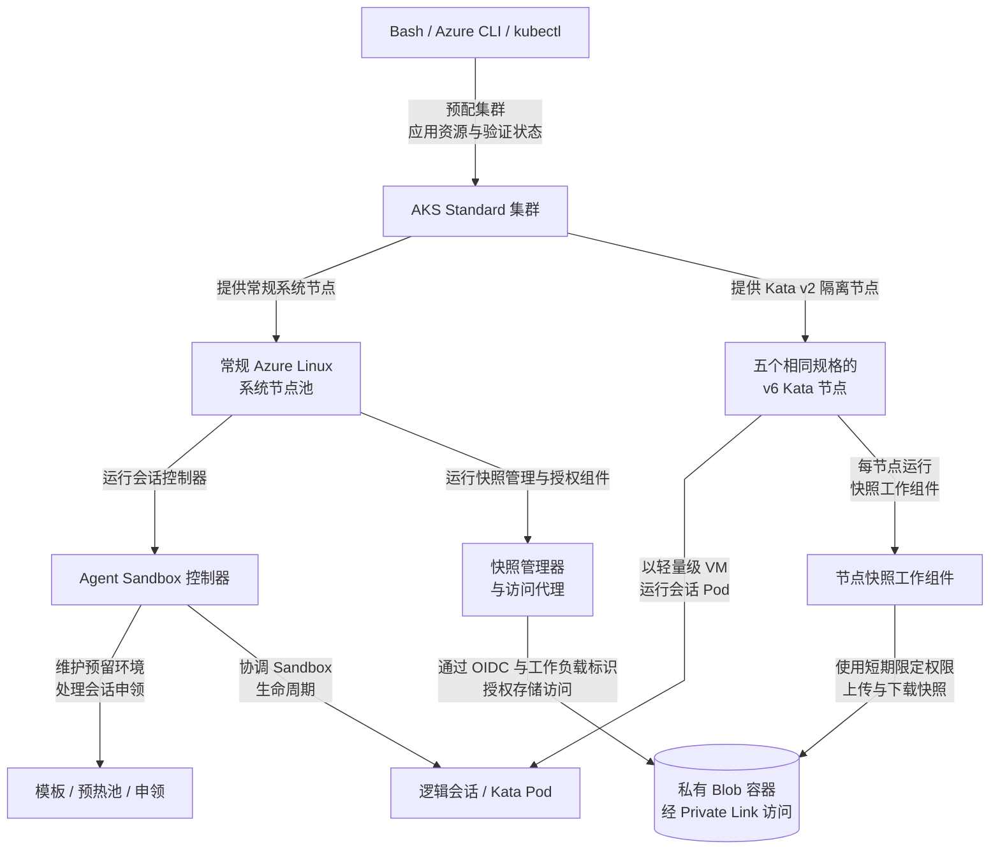
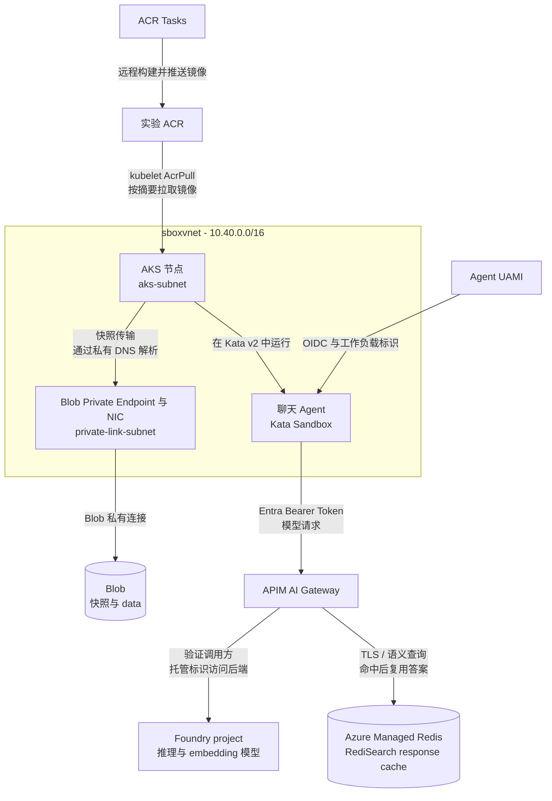

# AKS Agent Sandbox 与 AI Gateway 响应缓存动手实验

> Language / 语言: [English](README.md) | **中文**

本实验验证两条互补能力：在 AKS 上使用 Agent Sandbox 管理隔离会话、预热池和进程状态快照恢复；使用 Azure API Management（APIM）作为 AI Gateway（AIGW），以 Azure Managed Redis（AMR）提供语义 response cache，验证答案复用与来源标识。

**Sandbox 快照恢复的是进程状态；AMR 缓存复用的是模型响应。两者不是同一种缓存，也不能相互替代。**

本实验使用 **Pod 沙盒化与 Kata VM 隔离 v2**，而不是参考文章中的 ACI/无服务器方案。这些预览功能不支持 AKS Automatic。预计需要 90–120 分钟。

本 README 负责环境搭建、补充技术说明、诊断及环境退役；**验证、演示和演示资源释放步骤请参考 [演示说明](demo_CN.md)**。

## 1. 业务场景

| 场景 | Agent Sandbox 的适用原因 | 仍需应用负责的事项 |
| --- | --- | --- |
| AI 编码助手 | 在隔离的执行环境中运行生成的代码和测试，而非在助手进程内部执行。 | 对用户进行身份验证、授权工具调用、限制执行时间和出站访问，并收集结果。 |
| 交互式笔记本与开发会话 | 为每个会话提供有状态、可单独管理的执行环境。 | 持久化重要文件、实施租户隔离，并管理空闲关闭。 |
| 初始化成本高的智能体工具 | 在预热池中保留就绪环境，降低分配延迟。 | 为预留容量编制预算，并限制活跃申领数量；池副本数不限制会话总数。 |
| 已初始化会话的暂停与恢复 | 对运行时状态创建快照，恢复进程内存，无需重复初始化。 | 在恢复后验证外部连接、凭据、租约以及应用的正确性。 |
| 相同上下文中的重复或相近 AI 问题 | 由 APIM AI Gateway 查询 AMR 语义响应缓存，命中时复用答案，避免再次调用聊天模型。 | 验证上下文分区、距离阈值、TTL 和答案来源；评估误匹配风险及 embedding/缓存查询成本。 |

VM 隔离只是一层防御，**并不意味着可以在没有额外控制措施的情况下执行任意恶意代码**。实际系统应使用可信且固定摘要的镜像、限定作用域的 RBAC、网络策略/出站访问控制、身份隔离、准入控制和监控。

- 本教学实验不接收或执行用户提供的代码。
- 会话运行 [agent-src](agent-src/) 中的聊天 Agent，通过 APIM 调用 Foundry 模型；
- 其 `/work` 端点记录模拟任务，用于验证快照。
- 可选的独立聊天 Sandbox 使用同一应用。
- 两者都使用本实验 ACR 中构建并固定摘要的镜像。

## 2. 功能、AKS 扩展与 AI Gateway 职责

Agent Sandbox 与 Pod Snapshot 是 AKS 扩展；APIM 和 AMR 是独立的 Azure 服务，不随扩展安装。

| 组件 | 职责 | 不负责的事项 |
| --- | --- | --- |
| AKS Pod 沙盒化 / Kata v2 | 在轻量级 VM 中运行沙盒化 Pod；使用 `kata-vm-isolation-v2`，其处理程序为 `kata-v2`。 | 安装任一扩展都不会启用此运行时。 |
| Agent Sandbox 扩展（`Microsoft.AgentSandbox`，**1.0.7+**） | 安装控制器以及声明式会话/预热池 API。 | 不提供 LLM、自动空闲关闭或应用授权。 |
| Pod Snapshot 扩展（`Microsoft.PodSnapshot`，**0.1.1+**） | 捕获运行时状态并存储到 Blob Storage，授权恢复、验证兼容性、暂存状态，并将其恢复到新 Pod。 | 不是分布式应用备份、PV 备份，也不能透明修复外部会话。 |
| APIM AI Gateway | 验证调用方身份，执行语义缓存 lookup/store 策略，并标识答案来自模型还是缓存。 | 不负责 Sandbox 生命周期或进程状态恢复。 |
| Azure Managed Redis（AMR） | 作为 APIM 的外部语义响应缓存，提供 RediSearch 查询；embedding 由 Foundry 模型提供。 | 不是 Agent 本地缓存、聊天历史存储或 Pod 快照存储。 |

**Agent Sandbox API：**

- `Sandbox`（`agents.x-k8s.io/v1beta1`）：管理单个有状态的沙盒环境。
- `SandboxTemplate`（`extensions.agents.x-k8s.io/v1beta1`）：定义创建沙盒环境所用的模板。
- `SandboxWarmPool`（`extensions.agents.x-k8s.io/v1beta1`）：维护预留的沙盒环境；可用的 Sandbox 被申领接管后，池会补充预留环境。
- `SandboxClaim`（`extensions.agents.x-k8s.io/v1beta1`）：申领并接管一个可用的 Sandbox。删除申领会删除其拥有的资源；使用过的环境不会返回池中。

**Pod Snapshot API**（`podsnapshot.aks.azure.com/v1alpha1`）：

- `PodSnapshotStorageConfig`：集群作用域的存储配置，用于选择 Blob 存储。
- `PodSnapshotPolicy`：命名空间作用域的快照策略，用于选择符合条件的 Pod 并定义捕获行为。
- `PodSnapshotManualTrigger`：手动触发器，用于请求捕获快照。
- `PodSnapshot`：快照记录，用于记录快照标识及就绪状态。

触发器完成与快照就绪需要分别检查。

> [!tip]
> - 每个扩展安装在一个集群中仅支持**一种运行时** （Kata v2 | ACI）。
> - Agent Sandbox 和 Pod Snapshot 扩展可独立使用，安装顺序不限。快照管理器无需重启即可检测到 Sandbox API。

## 3. 实验架构与目标

### 运行架构



### 网络、镜像与 AI 服务说明



基础设施默认区域为 **`eastus2`**；Foundry 和 AMR 可分别单独设置区域，默认均为 **`westus3`**。

网络地址规划：

| 网络 / 子网 | 地址范围 | 用途 |
| --- | --- | --- |
| `sboxvnet` | `10.40.0.0/16` | 实验 VNet |
| `default` | `10.40.0.0/24` | 预留子网 |
| `aks-subnet` | `10.40.16.0/20` | 系统及 Kata 节点；Azure CNI Overlay |
| `private-link-subnet` | `10.40.1.0/24` | Blob Private Endpoint；Azure 自动创建命名 NIC |
| Pod CIDR | `10.42.0.0/16` | Overlay Pod 地址，不占用节点子网地址 |
| Service CIDR | `10.41.0.0/16` | Kubernetes Service 地址；DNS 为 `10.41.0.10` |

<details>
<summary>展开查看细节说明</summary>

- [infra/main.bicep](infra/main.bicep) 创建或更新 `sboxvnet-aks-subnet-nsg-${location}`，并将其绑定到 `aks-subnet`。
- 在 `eastus2` 中，这就是现有的 `sboxvnet-aks-subnet-nsg-eastus2`，不会换成另一个名称的 NSG。
- 每次部署主模板都会声明 `allow_http`：优先级 **1000**、入站 Allow、协议 `*`、任意源地址/源端口、任意目标地址，以及目标端口 **80 和 8080**。
- 首次部署创建 NSG 和规则，重新部署自动维护规则，无需单独模板或在门户手动添加。
- NSG 自定义规则现在由 Bicep 管理；
- 如需增加其他自定义规则，应一并写入模板，不要依赖手动修改在重新部署后仍被保留。
- 此宽泛放行仅用于实验，生产环境应限制来源。
- 它不会为私网节点或 Overlay Pod 创建公网路由，也不会覆盖其他 NSG 或 Kubernetes 网络策略；
- 外部访问仍需要合适的 Service 或 ingress。

- 部署会创建并关联 `privatelink.blob.core.windows.net` 私有 DNS 区域，关闭存储账户公共网络访问、匿名访问和共享密钥认证。
- 两个blob存储容器分别为 `pod-snapshots` 和 `data`，不混用。`data` 预留用于可选聊天持久化，默认不挂载到 Pod。
- 快照会话运行镜像中的聊天应用，使用随机的**内存会话 UUID**、初始化时间戳和内存中的已完成任务列表。
- 这些恢复标记与可选的持久化聊天历史分离，冷启动进程不能从文件恢复这些标记。
- 该会话关闭聊天持久化，不挂载持久卷。
- 就绪探针在 Agent 初始化后检查 `/ready`；不人为设置延迟启动。

</details>

## 4. 前置条件、兼容性与成本

- 工具：Linux/WSL Bash、Azure CLI **2.86.0+**、Bicep、kubectl、envsubst、Python 3 / PyYAML。
- 运行时：Kubernetes **1.35+**、受支持的 Azure Linux 镜像和 Kata v2 区域。
- 创建 Kata 节点前，`KataVMIsolationV2Preview` 必须为 `Registered`。
- 默认需要 **7 个 D4as_v6 节点 / 28 vCPU** 的配额；恢复使用相同 VM SKU。

<details>
<summary>展开权限、区域、配额与兼容性要求</summary>

- Azure 订阅，以及注册资源提供程序和预览功能、创建 AKS/VNet/Private Endpoint/私有 DNS/存储/托管标识/扩展/Foundry/APIM/ACR/AMR 和创建 Azure 角色分配的权限。
  - 仅有 Contributor 权限无法创建角色分配；
  - 请使用作用域适当的 RBAC 管理员/Owner 角色分配。
  - 操作人员还需运行 ACR Tasks、读取镜像摘要及为 APIM 配置读取 AMR 访问密钥的权限。
- 脚本使用当前 `az login` 登录的活动订阅。
- Azure CLI **2.86.0+**（含 Bicep，满足托管 Gateway API 和 application routing 的版本要求）、`kubectl`、Bash、GNU `envsubst`（gettext）、Python 3 和 PyYAML。
  - 镜像由 ACR Tasks 构建，不需要本地 Docker。
- 请在 Linux/WSL Bash 中运行脚本，不能在 PowerShell 中直接运行。
  - 支持 Linux Azure CLI，也支持从 WSL 调用 Windows Azure CLI；Bash、Python 和 `kubectl` 仍使用 Linux 工具。
  - 脚本使用所选 Azure CLI 管理的 Bicep 编译器。
- Kubernetes **1.35+**、Azure Linux 镜像 **202610.30.1+**，以及已发布 **AKS release 1025** 和所需节点镜像的区域。
  - 请同时检查 [AKS 发布跟踪器](https://releases.aks.azure.com/AKSRelease)和 [Azure Linux 镜像跟踪器](https://releases.aks.azure.com/AzureLinux)。
  - 不要假设任何区域一定可用。
- **创建 Kata 节点前，订阅的 `KataVMIsolationV2Preview` 功能必须为 `Registered`**。
  - 预配脚本会注册该功能、等待完成，再刷新 `Microsoft.ContainerService`。
  - v1/v2 的节点池运行时名称仍使用 `KataVmIsolation`，仅凭这个名称不能确认 v2 已启用。
  - 参见[官方 v2 前置条件与注册步骤](https://learn.microsoft.com/en-us/azure/aks/use-pod-sandboxing?pivots=kata-vm-isolation-v2-preview#use-kata-vm-isolation-v2-preview)。
- 默认需要七个 `Standard_D4as_v6` 节点的配额和容量（**28 个 vCPU**，两个系统节点和五个 Kata 节点），以及 AKS/网络资源。
  - 恢复要求使用**与源节点完全相同的 VM SKU**。
  - Kata v2 支持官方前置条件中列出的 v6 Das、Dads、Dals、Dalds、Eas、Eads、Fals、Fas 和 Fams 系列，并非支持任意 v6 SKU。
- 节点仍需公网出站访问 ACR、托管扩展依赖项、Entra ID、APIM 和 Foundry；
  - Blob 使用 VNet 内的 Private Endpoint。
  - Kubernetes API 是不限制来源 IP 的公共终结点，这不是全私有集群。
- 工作站需能访问 Kubernetes API。
  - 实验未设置 API 来源 IP 白名单，不要求配置工作站公网出口 IP；仍需有效 Kubernetes 凭据和 RBAC 授权。
  - 请使用受控工作站。
- 默认区域不保证预览运行时、`BasicV2` APIM、AMR SKU 或模型 SKU/配额可用；
  - 部署前分别核查。
  - `LOCATION=eastus2` 控制 AKS/VNet、存储、ACR、标识和 APIM；
  - `FOUNDRY_LOCATION=westus3` 控制 Foundry 账户/project 及其模型部署；
  - `AMR_LOCATION=westus3` 控制 Azure Managed Redis。
  - 三个设置互相独立。
  - 跨区域网关调用可能增加延迟和网络传输费用。
  - 默认模型为 `gpt-5.4-mini`，版本 `2026-03-17`，`GlobalStandard` 容量 `50`，与 agenthost 的默认设置一致；
  - 按实际可用部署调整。
- 另外部署 `text-embedding-3-small`（版本 `1`、Global Standard / `GlobalStandard` 容量 `30`）和位于 `AMR_LOCATION` 区域的 `Balanced_B0` Azure Managed Redis。
  - 需核查 embedding 的区域/配额及 AMR SKU 可用性；
  - RediSearch 在创建时启用，不能事后添加。

</details>

**预配即开始计费；预热容量、APIM 和 AMR 即使空闲也可能持续计费。**

<details>
<summary>展开费用项目</summary>

**从资源预配开始即产生费用：** 
- 四台 VM、托管 OS 磁盘、出站负载均衡器/公共 IP 和流量，以及快照 Blob 容量和操作。
- 预热池会话即使空闲也会占用容量，每个被申领的会话还可能增加需求。
- AKS Free 控制平面层级免费，免费不包含AKS集群的工作节点。
- 快照可能占用数 GB，因为捕获的是来宾内存，而不仅是应用数据。
- 还会产生 Private Endpoint、ACR 存储/构建、`BasicV2` APIM 实例、AMR、聊天状态 Blob 及 Foundry 推理/embedding 费用。
  - APIM 和 AMR 即使没有请求也可能持续计费；
  - 缓存命中仍需向量查询及 embedding 调用，模型容量还需订阅配额。
- 请用 [Azure 定价计算器](https://azure.microsoft.com/pricing/calculator/)估算成本，完成后及时清理。

</details>

- 预览功能无 SLA；快照不是分布式应用或持久卷备份。

<details>
<summary>展开预览功能限制</summary>

**预览功能边界：** 
- 预览期间不提供 SLA。
- 已验证的 Kata 来宾内存上限为 32 GiB；恢复包含 RuntimeClass 的 32 MiB 内存开销。
- 不支持通过 Deployment、ReplicaSet 或 Job 恢复；请使用原始 Pod 或 Sandbox 工作流。
- 不支持原生边车容器、临时容器以及尚未完成的初始化容器。
- 若要对已恢复的 Pod 再次创建快照，应省略容器资源上限；本实验特意只捕获冷启动 Pod。
- 保持源环境与恢复环境的镜像、容器名称、命令、参数和资源规格兼容，并设置 `enableServiceLinks: false`。
- 本实验未验证跨区域/架构/运行时恢复。
- 在此预览版本中，不能将单个快照克隆为多个独立 Sandbox，也不能用于基于快照的预热池。

</details>

## 5. 如何使用本 Lab

1. 在 Linux/WSL Bash 中创建用于存放实验文件的本地目录，然后进入该目录：

   ```bash
   mkdir mylab
   cd mylab
   ```

2. 使用稀疏签出克隆仓库，仅签出本实验目录：

   ```bash
   git clone --depth 1 --filter=blob:none --sparse https://github.com/oxcp/ainotes/
   cd ainotes
   git sparse-checkout set --no-cone '/aks-agent-sandbox/'
   cd aks-agent-sandbox
   ```

   这会检出本 Lab 的文档、脚本、基础设施模板及 Agent 源码，无需检出其他研讨会目录。后续命令均在 `aks-agent-sandbox` 目录执行，除非另有说明。

3. 按下方部署章节准备工具、配置 `.env`、预配资源并安装扩展；随后按照[演示说明](demo_CN.md)验证独立会话、预热池申领和快照恢复，按[本 README 的缓存演示](#72-amr-作为-ai-gateway-的-response-cache)验证 AMR 响应缓存。
4. 演示结束后，按照[演示说明](demo_CN.md)释放 Sandbox 演示资源；不再使用整个实验环境时，执行[清理所有付费资源](#10-清理所有付费资源)。释放会话不等于停止所有 Azure 计费。

## 6. 部署
### 6.1 准备工作站

确认 Azure CLI 和 Bicep 版本（必要时升级到最新版）。

在Linux Bash 中，登录`Azure`:
```bash
az login --device-code
az account list --query '[].{name:name,isDefault:isDefault}' -o table
az account set --subscription '<your-subscription-name>'
export AZURE_BICEP_USE_BINARY_FROM_PATH=false
```

在 Linux Bash 中进入本实验目录。使用平台的包管理器安装缺少的工作站工具：

```bash
sudo apt-get update
sudo apt-get install -y gettext-base python3-pip
python3 -m pip install 'PyYAML>=6,<7'
```

<details>
<summary>展开版本检查与 Bicep 升级命令</summary>

```bash
type -a az
az --version
az version
az bicep upgrade
az bicep version
kubectl version --client
```

</details>

### 6.2 设置环境变量

从 `.env.example` 中复制出 `.env`，用于配置当前适用的环境变量：

```bash
cp .env.example .env
```

**在运行基础设施配置前，编辑 `.env`：**
- 预配要求使用未占用的资源组，因此请选择新的 `RESOURCE_GROUP`,不要重复使用已包含其它资源的资源组
- 默认 `LOCATION=eastus2`
- `FOUNDRY_LOCATION` 和 `AMR_LOCATION` 分别独立默认使用 `westus3`；核查区域可用性及模型/版本/容量。
- 节点数量、VM 大小、命名空间、预留数量、镜像仓库/标签和等待时间可配置；VNet 名称与第 3 节的地址规划由 Bicep 定义。

让环境变量生效：
```bash
set -a
source <(sed 's/\r$//' .env)
set +a
```

### 6.3 预配基础设施

阅读 [infra/main.bicep](infra/main.bicep)，然后运行：

```bash
az bicep build --file infra/main.bicep --stdout >/dev/null
bash scripts/01-provision.sh
```

- 使用**新建的专用资源组**；依次预配基础设施、协调 AKS、构建镜像并验证 Kata v2。
- 扩展单独安装；失败后先检查状态，不重复预配已有资源组。
- **重建 AKS 会删除全部集群工作负载与扩展，不是普通重试。**

<details>
<summary>展开部署机制、身份配置、运行时诊断与 AKS 重建</summary>

- 脚本要求使用**新建的专用资源组**，自动注册并等待 `KataVMIsolationV2Preview` 为 `Registered`、刷新资源提供程序、安装/更新 `k8s-extension`，然后以 `--no-wait` 提交 Bicep 并监测部署完成。
- 通过 `az aks update --yes --no-wait` 无交互提交 AKS 协调，监测成功后再加载输出、获取凭据、通过 ACR Tasks 构建并发布镜像，最后验证运行时。
- AKS 扩展在独立阶段安装，运行时验证通过后才继续。

- 进度显示真实状态，不使用估算百分比：第 3/4 步约每 30 秒（另加查询耗时）更新时间戳、耗时、ARM 资源及 AKS/节点池状态，包括嵌套 AI Gateway 部署。
- 第 3 步显示资源的 ARM 类型，在支持的终端中原地刷新，结束后输出完整列表并恢复普通滚动。
- 终端较小时可能截断实时视图，重定向输出或 `TERM=dumb` 时使用追加日志。
- 第 5 步输出镜像构建/推送日志和摘要查询进度，第 6 步检查运行时和 Ready 节点数量，并受 `TIMEOUT` 限制。
- 操作或状态查询失败会停止脚本；
- 中断监测不会取消已提交的 Azure 操作。

- 每次 `az acr build` 前，[scripts/build-image.sh](scripts/build-image.sh) 会用 [agent-src/app/.env.example](agent-src/app/.env.example) 覆盖生成 `agent-src/app/.env`，并将 `<API_BASE_URL>` 替换为部署输出 `APIM_GATEWAY_URL`（例如 `https://apim-sbox-7dr23opwlepye.azure-api.net/foundry`）。
- Dockerfile 的 `COPY app/ ./app/` 会包含这个生成文件。
- 自定义默认值请写入模板，**不要加入密钥**：生成文件虽被 Git 忽略，但会打包进镜像；
- Kubernetes 注入的环境变量优先。
- 模板、占位符缺失或网关 URL 为空时会停止构建。

- Bicep 创建第 3 节的网络和 Blob 私有连接，以及 AKS **Standard 集群**（非 Automatic；`Base` SKU、`Free` 层级）。
- 默认两个系统节点和五个 `workloadRuntime: KataVmIsolation` 的 Kata 节点共用 `sboxvnet/aks-subnet`，使用 Azure CNI Overlay。
- Kata 节点池关闭 cluster autoscaler，节点容量手动调整。
- 另创建 Foundry 账户/project/推理与 embedding 模型、`BasicV2` APIM AI Gateway、启用 RediSearch 的 AMR、Standard ACR，并启用 Blob CSI。

- AKS 和节点池使用稳定版 `2026-08-01` REST API；
- 其 Schema 支持 `KataVmIsolation`。
- 实际部署是否接受该配置、Kata v2 是否可用，仍需云端验证。
- 验证接受 `KataVmIsolation` 或 `KataMshvVmIsolation`，同时要求 `kata-vm-isolation-v2` RuntimeClass、`kata-v2` handler 和真实的 v2 节点标签。
- APIM external cache 的 `resourceId` 使用当前云 Resource Manager 终结点构造的完整 ARM HTTPS URL，而非 `/subscriptions/...` 形式的裸资源 ID。

**创建 AKS 时即启用 Gateway API**，对应官方的[托管 CRD 安装](https://learn.microsoft.com/en-us/azure/aks/managed-gateway-api#create-a-new-aks-cluster-with-managed-gateway-api-crds-installed)及[application routing 实现](https://learn.microsoft.com/en-us/azure/aks/app-routing-gateway-api?pivots=azure-cli#enable-during-cluster-creation)说明：

- `ingressProfile.gatewayAPI.installation: Standard` 安装由 AKS 托管的 standard channel Gateway API CRD。
- `ingressProfile.webAppRouting.gatewayAPIImplementations.appRoutingIstio.mode: Enabled` 启用仅用于入口流量的 Istio 实现及 `approuting-istio` GatewayClass。
  - **不启用**完整 Istio service mesh、sidecar 注入或旧版 NGINX ingress。
- 现有独立会话和每个 Claim 的 Service 保持不变。启用实现不会自动创建应用的 `Gateway` 或 `HTTPRoute`；这些路由资源需要另外配置。

部署完成并连接集群后，可验证：

```bash
az aks show \
  -g "$RESOURCE_GROUP" \
  -n "$CLUSTER_NAME" \
  --query ingressProfile \
  -o json
kubectl get crd gateways.gateway.networking.k8s.io httproutes.gateway.networking.k8s.io
kubectl get gatewayclass approuting-istio
kubectl -n aks-istio-system get pods
```

- `approuting-istio` GatewayClass 应为 Accepted，相关 `istiod` Pod 应为 Ready。
- 不要在托管安装之上覆盖安装 experimental 或自行管理的 Gateway API CRD。
- Application routing 的 Gateway API 实现不能与完整 Istio service mesh add-on 同时启用。

- **会话路由说明：**[manifests/gateway.yaml](manifests/gateway.yaml) 定义共享 Gateway，[manifests/session.yaml](manifests/session.yaml) 定义独立 Sandbox、Service 和 HTTPRoute。
- 演示启动会话时先安装 Gateway，再应用会话资源。
- 每个 Service 使用独立的 `PathPrefix /<Sandbox 名称>` 路由，`URLRewrite` 在转发前移除前缀；
- Service 端口为 80，容器端口为 8080。
- Claim 路由复用会话清单的 parent references 和首条重写规则，不修改独立会话路由。

- Gateway、HTTPRoute 和后端 Service 应在同一 namespace；
- 不要直接应用含未替换 `${NAMESPACE}` 的原始清单。
- 每个手工路由应使用不重叠的前缀及独立名称，复用共享 Gateway 而非新建 LoadBalancer。
- 旧版本追加到共享路由的规则、没有 owner reference 的手工路由不会随 Claim 自动清理，应在其后端不再使用后单独移除。

- 浏览器 API 保留当前路径前缀。
- 旧镜像仍可能请求根路径 API；
- 修改 Gateway 清单不能修复旧应用，需重建镜像并在保存所需状态后重新创建会话。
- 现有预热/已申领 Pod 不会自动更新。
- 验证步骤请参考 [演示说明](demo_CN.md)，路由故障检查见第 9 节。

身份职责：

- 控制平面 UAMI：在创建 AKS 前，获得实验 VNet 上的 Network Contributor。
- kubelet 标识：在 ACR 上获得 AcrPull，在 `data` 容器上获得 Storage Blob Data Contributor；
  - 用于拉取镜像及后续可选 Blob CSI 挂载。
  - 默认不会执行挂载。
- Agent UAMI：通过专用 ServiceAccount 联合身份调用 APIM，Agent 不注册或直接调用 Foundry project；
  - APIM 验证 JWT 签名、有效期、租户 issuer 及该 UAMI 的 `oid`，**不校验 caller token 的 audience**，使用自己的托管标识访问 Foundry。
  - 没有 APIM 订阅密钥或模型密钥。
  - 不校验 audience 会允许该指定 UAMI 为其他资源获取的有效令牌通过 caller 校验；
  - 生产环境应重新评估这一边界。
- APIM 系统标识：在 Foundry 账户上获得 Foundry User 和 Cognitive Services OpenAI User，分别用于 project 推理及 embedding 后端。
  - AMR 使用 TLS 1.2、端口 `10000` 和访问密钥；
  - APIM 目前不支持以 Entra 标识连接 AMR。
  - Bicep 动态读取密钥写入 APIM 的 secret named value，不写入 `.env`、Pod 或部署输出。
  - 轮换 AMR 密钥时同步更新该 named value。
- 快照代理 UAMI：保留专用存储账户上的 Storage Blob Data Contributor，用于快照授权；不授予应用快照恢复权限。

快照代理联合身份：

```text
system:serviceaccount:pod-snapshot-system:pod-snapshot-broker
audience: api://AzureADTokenExchange
```

- Agent 联合身份为 `system:serviceaccount:<NAMESPACE>:<SERVICE_ACCOUNT>`，audience 同为 `api://AzureADTokenExchange`。
- 默认是 `agent-lab:agent-sa`；
- 部署后不要只在 `.env` 中修改它而不更新联合身份。

- **初始部署选择：** 公共 Kubernetes API 不配置来源 IP 白名单，但仍要求凭据及 RBAC 授权；
- Blob 使用私有连接，ACR/APIM/Foundry/AMR 使用需要认证的公共终结点，节点池手动设置容量。
- AMR 使用 `NoCluster`、高可用和 `VolatileLRU`；
- 当前 `BasicV2` APIM 未配置 VNet 出站集成，因此不能直接将 AMR 改为仅私有访问。
- 为短期管理员主导实验启用了本地 Kubernetes 凭据；
- 不是生产身份设计。
- 本实验不使用 Automatic/自动缩放。
- 演示通过共享的公网 HTTP Gateway 暴露会话的 ClusterIP Service；
- 可选的独立聊天 Sandbox 需先配置 Service/HTTPRoute，再通过共享 Gateway 的 Sandbox 路径访问。
- 生产部署仍需 TLS、用户/租户授权、网络控制、监控与可靠性/成本设计。

验证：

```bash
az aks show -g "$RESOURCE_GROUP" -n "$CLUSTER_NAME" \
  --query '{state:provisioningState,version:kubernetesVersion,oidc:oidcIssuerProfile.issuerUrl}' -o yaml
bash scripts/02-verify-runtime.sh
kubectl get runtimeclass kata-vm-isolation-v2 -o jsonpath='{.handler}{"\n"}'
az aks show -g "$RESOURCE_GROUP" -n "$CLUSTER_NAME" \
  --query '{network:networkProfile,systemSubnet:agentPoolProfiles[0].vnetSubnetId}' -o yaml
cat .lab/image.json
```

- 预期结果：集群为 `Succeeded`，Kubernetes 为 1.35+，**处理程序为 `kata-v2`**，节点池/节点数量匹配（至少两个），节点镜像受支持，节点为 Ready 且带有真实的 Kata v2 能力标签。
- 仅有名为 `kata-vm-isolation` 的旧运行时并不足够。
- 切勿手动添加能力标签或修改托管运行时内部配置。

- 如果只有 handler 为 `kata` 的 `kata-vm-isolation`，该节点池不满足本实验的 v2 要求。
- 请按上述步骤注册功能，等待 `Registered`、刷新 `Microsoft.ContainerService` 并确认区域可用性。
- 对于预览启用前创建的旧池，可在同一集群中新建不同名称、相同 VM SKU 和子网的替代池，再运行 `az aks update -g "$RESOURCE_GROUP" -n "$CLUSTER_NAME" --yes` 协调集群。
- 更新 `.env` 的 `NODEPOOL_NAME` 并重新验证运行时。
- 无需重建现有 Foundry/APIM/ACR 资源或镜像。
- 不要手动添加 v2 标签、创建 RuntimeClass 或安装扩展来绕过检查。
- 替代节点会临时增加 VM 费用；
- 旧池仍有工作负载时不要删除它。

- 若基础设施部署和 AKS 协调已成功，但包装脚本在构建镜像前退出，可在实验目录执行以下命令恢复后续步骤。
- 不要对已有资源组重新运行预配脚本。
- 检查发现 AKS 不为 `Succeeded` 时会停止；
- 请先检查当前操作再继续。

```bash
(
  set -euo pipefail
  source scripts/common.sh
  cluster_state="$(az aks show -g "$RESOURCE_GROUP" -n "$CLUSTER_NAME" \
    --query provisioningState -o tsv)"
  [[ "$cluster_state" == Succeeded ]] ||
    die "AKS is not Succeeded; inspect its current operation before continuing."
  load_outputs
  connect
  bash "$ROOT/scripts/build-image.sh"
  bash "$ROOT/scripts/02-verify-runtime.sh"
)
```

- 若预配在创建资源组后失败，可能已经开始计费。
- 请检查 `az deployment group show -g "$RESOURCE_GROUP" -n agent-sandbox-lab` 及其操作错误。
- 基础设施已成功但镜像构建失败时，修复后仅运行 `bash scripts/build-image.sh`，再运行 `bash scripts/02-verify-runtime.sh`；
- 不要重复预配。
- 其他基础设施错误需要按清理流程处理后使用新资源组重试；
- 包装脚本不会接管已有资源组。
- 部分创建或无法访问的集群可能需要清理章节中的手动恢复方法。

#### 仅重建 AKS 和 Kata 节点池

- 若明确希望重新创建集群，可在实验目录运行 [scripts/rebuild-aks.sh](scripts/rebuild-aks.sh)。
- **这会删除配置的 AKS 集群、其 AKS 托管的节点资源组、所有 Kubernetes 工作负载/扩展和内存会话。** 请先保存所需内容。
- 它不会删除实验资源组或 purge Foundry/APIM，会保留 ACR/镜像、AMR、Blob 数据、VNet 和实验 UAMI。
- 保留快照 Blob 并不保证旧会话可以恢复到新集群。

```bash
bash scripts/rebuild-aks.sh --confirm-cluster aks-agent-sandbox-lab
```

- 确认名称必须替换为 `.env` 中准确的 `CLUSTER_NAME`。
- 脚本会校验专用资源组标签、原始部署的集群 ID、保留的身份/子网/区域和配置。
- 删除前，若 `KataVMIsolationV2Preview` 未注册则先注册，等待 `Registered`、刷新资源提供程序，并检查现有 kubelet RBAC 模板。
- 等待集群和节点资源组删除完成后，使用 Azure Linux、托管 OS 磁盘及原 Azure CNI Overlay 网络，重建同名 AKS 和配置的 Kata 节点池。
- 创建集群时还传入 `--enable-gateway-api` 和 `--enable-app-routing-istio`，与 Bicep 的托管 CRD 及仅用于入口流量的 application routing 配置一致。
- 脚本显示真实 Azure 状态和等待耗时，使用默认 `~/.kube/config`，将两个 UAMI 的联合身份更新为新 OIDC issuer，并为新 kubelet 重新配置 ACR/Blob 权限。
- 共享输出加载逻辑会查询当前 kubelet client ID，不再沿用原始部署中已过期的值。

- 脚本保留已构建镜像的记录，但移除失效的本地会话标记。
- 在严格验证前，会最多等待 `TIMEOUT`，确认真实的 v2 运行时能力；
- **重建并不保证后端预览功能一定可用**。
- 错误会停止执行，v2 验证失败时会保留新集群，不会再次删除它。
- 中断监测不会取消已提交的 Azure 操作。
- 集群已不存在时，可使用保留的原始实验资源重新创建；
- 集群仍存在时重新运行，会再次删除该集群。
- 不要仅为重复验证而重跑。

- 成功后运行 `bash scripts/03-install-extensions.sh` 重新安装扩展，再参考 [演示说明](demo_CN.md) 部署并验证新工作负载。
- 所需权限包括 AKS 删除/创建、功能/资源提供程序注册、UAMI 联合身份更新和角色分配创建。
- 集群存在期间节点会持续计费。

- AKS 创建、节点池创建或协调失败时，现在会输出本次操作时间窗口内、限定到对应资源的 Azure Activity Log 错误和关联 ID；
- 读取诊断需要活动日志权限。
- 日志缺失/延迟或诊断查询失败，都不会将失败操作视为成功。
- 遇到 `VMExtensionError_OutboundConnFail` / 退出码 50 时，应**从失败节点**测试所需终结点的 DNS 和 HTTPS，而不是在工作站测试。
- AKS 的通用错误可能提到 `aka.ms`，节点 CSE 日志实际失败的检查则可能是 `mcr.microsoft.com/v2/`。
- 若连通性已恢复，先用 `az aks update -g "$RESOURCE_GROUP" -n "$CLUSTER_NAME" --yes` 重试协调，再考虑是否需要重建。
- 不要仅为重试而重跑 `rebuild-aks.sh`：它会再次删除已有集群。
- 参见[官方出站连接故障排查指南](https://learn.microsoft.com/en-us/troubleshoot/azure/azure-kubernetes/create-upgrade-delete/error-code-outboundconnfailvmextensionerror)。

</details>

### 6.4 安装并验证两个扩展

```bash
bash scripts/03-install-extensions.sh
az k8s-extension list -g "$RESOURCE_GROUP" --cluster-name "$CLUSTER_NAME" \
  --cluster-type managedClusters \
  --query '[].{name:name,state:provisioningState,version:currentVersion}' -o table
kubectl -n pod-snapshot-system get pods -o wide
```

- 预期结果：Agent Sandbox 为 **1.0.7+**、Pod Snapshot 为 **0.1.1+**，两者均为 `Succeeded`；
- 控制器、管理器和代理的滚动部署成功。
- 节点工作组件的期望数量和 Ready 数量必须等于 Kata 节点数量：DaemonSet 即使**没有符合条件的节点**，也可能报告滚动部署成功。
- 脚本会检查覆盖节点数非零。
- 扩展版本由服务选择；
- 自动次要版本升级保持服务默认设置。
- 安装了旧版本应视为失败，而不是成功。

<details>
<summary>展开安装进度与存储授权说明</summary>

- 第 2 步先安装 Agent Sandbox，再安装 Pod Snapshot，分别提示提交阶段，并每隔 30 秒加上查询耗时输出 Azure 状态和 Kubernetes 组件进度。
- 每个扩展的进度在支持的交互式终端中原地刷新，结束时保留完整最终状态，再继续后续步骤；
- 终端较小时可能截断实时视图，重定向输出及 `TERM=dumb` 则保留追加式日志。
- 安装可能需要数十分钟；
- 组件列表为空表示尚未部署到该阶段，并非安装成功。
- 安装监测不受 Kubernetes 滚动部署的 `TIMEOUT` 限制；
- 安装失败或查询出错时会停止脚本并输出诊断。
- 中断本地监测不会取消 Azure 安装，重新提交前请先查询两个扩展的状态。

快照扩展接收代理账户/客户端/租户配置以及 Kata 池的节点选择器。存储角色传播可能需要数分钟；请检查代理日志，不要授予账户密钥或绕过授权。不要在托管扩展之上再安装上游控制器。

</details>

## 7. 验证与演示入口

### 7.1 Sandbox 生命周期、预热池与快照恢复

**环境搭建完成、Kata v2 运行时验证通过，且两个 AKS 扩展安装成功后，请参考 [演示说明](demo_CN.md) 进行验证。**

- 演示文档需要启动本实验提供的管理门户。在 kubectl 已可用的 Linux/WSL 终端中，从本目录运行以下命令（可带 `--port` 参数指定监听端口）：

```bash
python sandbox_portal.py --namespace "$NAMESPACE"
# 如需指定其他 context 或本地端口：
python sandbox_portal.py --namespace "$NAMESPACE" --context "<kubectl-context>" --port 8090
```

- 打开 `http://127.0.0.1:8090/`，保持终端运行，再参考 [演示说明](demo_CN.md) 继续。

<details>
<summary>展开管理门户运行设置</summary>

- 打开 `http://127.0.0.1:8090/`，保持终端运行，再参考 [演示说明](demo_CN.md) 继续。
- Ctrl+C 只停止本地门户，不释放集群资源。
- 门户仅监听 loopback，固定启动时的 context，保留 `KUBECONFIG`，不读取 `.env` 或刷新 Azure 凭据；
- `--gateway`、`--pool` 默认分别为 `sandbox-gateway`、`agent-pool`。
- 若启动时共享 Gateway 尚未创建，在演示创建 Gateway 后重新加载管理页面以更新地址。

</details>

- 为下次演示保留基础设施和 AKS 扩展时，参考 [演示说明](demo_CN.md) 中的释放步骤；
- 只有不再保留整个实验环境时，才执行第 10 节的付费资源清理。

### 7.2 AMR 作为 AI Gateway 的 response cache

此演示验证模型响应复用，不验证进程快照恢复。使用已有 Service/HTTPRoute 的 `agent-session`，**通过共享 Gateway 访问 Sandbox**：

```bash
# 如果已有正在运行的 agent-session，可跳过启动命令。
bash scripts/04-start-session.sh
SANDBX="agent-session"
GATEWAY_IP="$(kubectl -n "$NAMESPACE" get gateway sandbox-gateway \
  -o jsonpath='{.status.addresses[0].value}')"
: "${GATEWAY_IP:?等待 Gateway 获得地址后重试}"
SANDBOX_URL="http://$GATEWAY_IP/$SANDBX"
echo "Sandbox access URL: $SANDBOX_URL/"
curl --fail-with-body --max-time 5 "$SANDBOX_URL/health"
```

1. 在浏览器打开输出的 `http://<gateway_ip>/<sandbox name>/`，正常聊天可观察答案来源提示。连续聊天会改变历史，不能保证重复问题命中。
2. 按[同上下文独立请求示例](#85-amr-作为-ai-gateway-的语义-response-cache-与答案来源)验证：无已有条目时首次为 `generated`，存储完成后在 TTL 内重复请求应为 `amr-cache-hit`；已有条目可能使首次直接命中。
3. 用来源 header 和 APIM trace 确认命中未调用聊天模型，不仅比较延迟。默认距离阈值 `0.05`、TTL `300s`；同义问法是否命中取决于距离，命中仍有 embedding/AMR 查询成本。

仅为本次缓存演示创建的 `agent-session`，验证结束后可用 `bash scripts/04-delete-session.sh` 释放；不要删除仍用于其他演示的会话。

## 8. 补充技术说明

以下内容补充演示文档未展开的配置、权限、容量和故障边界，不构成另一套演示步骤。

### 8.1 配置、权限与访问边界

- **Gateway 无 TLS/用户认证；仅允许可信来源，不公开本地管理端口。**
- 不并发执行捕获、恢复、唤醒或清理；失败后先检查保留资源。

<details>
<summary>配置、自动化申领与访问权限</summary>

- 会话启动、预热池创建、捕获和 CLI 恢复脚本加载 `.env`；
  - 申领、容量调整和演示资源删除脚本使用已准备的 kubeconfig 与已导出的 `NAMESPACE`，不加载 `.env` 或调用 Azure CLI。
  - 默认 namespace 为 `agent-lab`；
  - 删除脚本的 `TIMEOUT` 默认每条命令 `10m`。
  - 运行前确认 context 和 namespace，底层认证插件仍可能刷新凭据。
- 自动化申领可使用 `bash scripts/05-claim-sandbox.sh <count> --route` 跳过按键确认。
  - 不带该选项时需交互终端；
  - 非交互确认失败会保留 Claim，不创建网络资源。
  - 再次执行创建新批次，不续接失败批次；
  - 详细名称、UID、路由和耗时记录在 `.lab/claim.log`。
- Claim 提交、预留/就绪轮询和网络创建不设置脚本级超时；
  - 资源不足可能一直等待。
  - Ctrl+C 返回 130 并保留已创建资源。
  - List 创建不是事务，失败后可能留下部分 Claim、Service 或 HTTPRoute，应先按批次检查再重试。
- Claim 表中的 `Total` 不包含 Service/HTTPRoute 创建或按键等待；
  - `Between batches` 已包含在就绪/总时间内，不应再次相加。
  - 单会话提交包含会话清单中的网络资源，不能直接当作与 Claim 相同口径的业务启动时间。
- Claim 的 Service 以 `agents.x-k8s.io/claim-uid=<Claim UID>` 选择后端，Service/HTTPRoute 均归属于 Claim，设置阻塞式 owner reference 需要相应权限。
  - 每个路由只有一条规则，Gateway API 的 16 条规则限制是针对单个 HTTPRoute，不是整个 Gateway 的 Service 数量上限。
- 管理门户是本地操作者工具，不是多用户认证服务。
  - 自动唤醒需要工作负载/网络资源的修改权限、快照范围的 RBAC 管理权限和控制器身份模拟权限；
  - 普通 Kubernetes 请求超时 45 秒，停止/删除/就绪等待每阶段最长 10 分钟。
  - 每个进程只执行一个唤醒，不提供跨进程锁，不要并发执行捕获、恢复、唤醒或清理。
- **Agent Gateway 使用公网 HTTP，没有 TLS 或用户认证。**
  - 应限制为受控实验及可信来源；
  - 不要公开本地管理门户端口。
  - 同一 Sandbox 的访问者共享聊天状态。
  - 健康探测从 Python 服务访问 Gateway，浏览器也必须能访问该地址；
  - HTTP 200 或 Kubernetes Ready 均不保证模型调用成功。
- 修改 Python 后端后需重启管理门户；新增快照映射无需重启。列表使用缓存条件，快照列表只是本地记录；无法访问服务时按第 9 节诊断，不把列表状态当作实时连通性证明。

</details>

### 8.2 容量调整

初始预热池创建至少为 50；创建后可单独调整预留容量：

```bash
bash scripts/05-scale-warm-pool.sh 150
bash scripts/05-scale-warm-pool.sh 0
```

- 容量脚本仅修改 `agent-pool.spec.replicas`，接受 0 至 2147483647；
- 控制器异步调整，缩容只删除未申领预留环境。
- 目标为零会保留已申领会话，不等于删除整个池。
- 重新运行创建脚本会重置预留目标。
- 调整预留容量不会扩缩 AKS 节点或开启自动扩容。

节点资源不足时，可降低预留容量或手动增加节点：

```bash
az aks nodepool scale \
  -g "$RESOURCE_GROUP" \
  --cluster-name "$CLUSTER_NAME" \
  --name "$NODEPOOL_NAME" \
  --node-count 8
```

默认五个 Kata 节点不保证能容纳 100 个 Ready 预留 Pod 及已有申领；还需考虑可分配 CPU/内存、RuntimeClass 开销、Azure 配额和费用。

### 8.3 快照记录、恢复授权与清理边界

- 快照记录、Blob 状态数据和本地 UID 映射是三种不同对象。
- 已恢复 Pod 再次捕获要求无 limits；默认工作负载不满足。
- 快照或授权异常不回退冷启动；删除需等待 finalizer。

<details>
<summary>快照映射、再次捕获、恢复权限与 CLI 接口</summary>

- 捕获脚本输入 Sandbox 名称，不是 Pod 名称；
  - 通过控制 owner 的名称/UID 查找唯一 Pod，并在变更前重新校验身份。
  - 每次捕获使用独立的 UID 选择标签、策略和触发器，需要读取 Sandbox/Pod、patch Pod 及创建策略/触发器的权限。
  - `Triggered` 与快照 `Ready` 分别等待；
  - 捕获资料保存在 `.lab/captures/<capture-name>/`。
- `.lab/snapshot-mapping` 是 JSON 数组，字段为 `context`、`namespace`、`sandbox`、`sandbox_uid`、`snapshot`。
  - 只有快照 Ready 才原子更新；
  - 同一 context/namespace/Sandbox 名称的新捕获替换映射，但旧快照仍保留。
  - 映射不是快照的实时存在性或就绪证明，同名但不同 UID 的资源不继承映射。
- 仅捕获 `agent-session` 时额外保存 `.lab/before.json`、`.lab/session-source.json`、`.lab/snapshot-name`；
  - 已有独立会话标记会阻止重复捕获。
  - 当前恢复使用映射，不依赖这些旧记录；
  - 捕获其他 Sandbox 不要求 `/state`。
- [已恢复 Pod 的再次捕获限制](https://learn.microsoft.com/en-us/azure/aks/pod-snapshot-cluster-extension?pivots=sandbox-kata#limitations)：实际 Pod 的普通容器、init 容器及 Pod 级别都不能配置资源 limits。
  - 默认 `session.yaml` 有 limits，恢复时保留，因此不满足再次捕获条件。
  - 应提前规划兼容规格，不移除恢复标记或修改运行中的 limits 来绕过检查；
  - 新映射不会自动修改已有 Sandbox 的 `restore-from`。
- 恢复意图放在 `spec.podTemplate.metadata`，设置 `podsnapshot.aks.azure.com/restore: "true"` label 与 `podsnapshot.aks.azure.com/restore-from: <snapshot>` annotation。
  - 恢复标签不授予权限；
  - 创建 Pod 的控制器需要对应快照的自定义 `restore` 权限。
  - 身份模拟的 `SelfSubjectAccessReview` 使用 `--validate=false` 避免客户端 CRD 列表权限要求，服务端 `status.allowed` 仍必须通过。
- 映射错误、快照不可用或授权失败时明确停止，不静默冷启动；
  - 已恢复 Sandbox 丢失映射时也不会移除其不可变的恢复意图。
  - 同名且不属于当前资源的 Service/HTTPRoute 会阻止替换，避免覆盖其他资源。
- 已恢复资源脱离原 Claim；
  - 其 Service/HTTPRoute 归属于新 Sandbox，并以 `restore-sandbox=<Sandbox 名称>` 选择 Pod。
  - 演示释放步骤显式删除这些 Sandbox；
  - Claim/预热池删除不会选中它们。
  - `portal-restore-<name>` Role/RoleBinding、捕获策略/触发器及本地捕获资料仍可能保留，需要时单独检查。
- 快照删除范围为已确认 namespace 的全部快照，不仅是当前映射。
  - 恢复使用方、定时策略或未完成触发器会阻止清理；
  - 删除失败可能已移除部分快照，但保留映射供检查。
  - 保持控制器、存储配置和 Blob 权限可用，不移除 finalizer。
- 快照可能包含内存中的机密信息，应保护 Blob 及恢复 RBAC。重要业务数据和外部连接仍需要应用自己的持久化与恢复校验。

**CLI 恢复（补充接口，不替代演示中的门户流程）：**

```bash
bash scripts/07-restore.sh "<sandbox-name>"
```

- 该脚本加载 `.env`、固定 context，调用 `sandbox_portal.py --restore`，与门户复用恢复核心而不启动 HTTP 服务。
- 必须有匹配名称及 UID 的映射，源 Sandbox 必须仍然存在；
- 不能仅凭捕获目录恢复已删除资源。
- **即使源处于 Running，也会显式删除并同名重建，先保存所需状态。**
- 默认 Gateway/池为 `sandbox-gateway`/`agent-pool`，直接 Python 调用可覆盖。

- CLI 成功仅表示 Sandbox/Pod Ready 且网络资源创建成功，不检查 `/health` 或 HTTPRoute 接受，也不证明内存一致。
- 状态验证按演示文档进行，访问失败使用第 9 节诊断；
- 部分替换失败后检查资源再重试。

</details>

### 8.4 运行聊天 Agent

- 演示已有聊天会话；独立 `reflection-agent` 和 Blob 持久化是可选项。
- 默认只保留内存；开启持久化开关不会自动挂载 Blob。

<details>
<summary>可选聊天 Sandbox 与 Blob 持久化配置</summary>

演示会话已提供聊天门户。如需运行可选的独立聊天 Sandbox，完成预配和扩展安装后执行：

```bash
bash scripts/08-start-agent.sh
```

该可选脚本只创建 `reflection-agent` 的 Sandbox 和 Service，不创建 HTTPRoute。访问前需参考 [session.yaml](manifests/session.yaml)，配置指向共享 `sandbox-gateway` 的独立 HTTPRoute：前缀为 `/reflection-agent`，移除前缀后转发到同名 Service。仅验证缓存时，直接使用第 7.2 节已有路由的 `agent-session`，无需创建此可选会话。

路由就绪后，在浏览器访问 `http://<gateway_ip>/reflection-agent/`，或通过 Gateway 测试：

```bash
GATEWAY_IP="$(kubectl -n "$NAMESPACE" get gateway sandbox-gateway \
  -o jsonpath='{.status.addresses[0].value}')"
: "${GATEWAY_IP:?等待 Gateway 获得地址后重试}"
curl --fail-with-body "http://$GATEWAY_IP/reflection-agent/ready"
curl --fail-with-body "http://$GATEWAY_IP/reflection-agent/reflect" \
  -H 'Content-Type: application/json' \
  -d '{"query":"Explain how this agent uses the AI gateway."}'
```

- 此 Sandbox 直接运行 ACR 镜像中的聊天 Agent，仅通过 APIM 调用模型。
- 不再注册 Foundry catalog，不依赖 project SDK，也不再使用 `FOUNDRY_PROJECT_ENDPOINT` 或 `FOUNDRY_AGENT_NAME` 运行时配置。
- 启动时仅构建 APIM 客户端，令牌获取和模型推理需通过实际聊天请求验证，而不是 `/ready`。
- `AGENT_APIM_ENDPOINT` 为必填项，不再回退到 project 直连。
- 本实验的 APIM 后端仍可使用 Foundry 模型，其基础设施保持不变。
- 默认不挂载 Blob，也不创建聊天记录 PV/PVC；
- 聊天记录只留在进程内存中，Pod 重建或进程重启后丢失。
- 它不使用快照测试的 `app=agent-session` 标签，也不会被该快照策略捕获。
- 演示中的内存恢复标记与可选持久化的聊天历史分离，不能用文件历史证明进程状态恢复。

`.env` 中新增 `CHAT_PERSISTENCE_ENABLED=false`：
- `false`（默认）：不读取或写入聊天历史文件，仅使用内存。
- `true`：尝试从 `STATE_MOUNT_PATH`（默认 `/app/app/data`）的已挂载卷读取/保存历史；
  - **开关不自动挂载 Blob**。
  - 未检测到挂载时只记录错误日志，不写入容器本地目录；
  - 读取、写入或临时文件清理失败也只记日志，不中断聊天。
- 如需以后启用 Blob 持久化，保留的 `manifests/agent-storage.yaml` 可用于手动配置 `data` 容器的 Blob CSI PV/PVC（PVC 名称仍为 `agent-state`）；
  - 还需在聊天 Pod 中添加对应 `volumes`、`volumeMounts`（挂载到 `/app/app/data`）和 `fsGroup: 1000`。
  - 仅修改开关不会完成这些步骤，当前启动脚本不应用该存储模板。
- 修改 `.env` 后需重新创建聊天 Sandbox 以加载新环境变量。挂载检测只能证明路径是挂载点，不能识别 Azure 容器名称；实际 Blob 来源由 CSI 配置保证。

- `Ready` 只证明初始化完成；
- 必须发出一次实际聊天请求才能验证推理。
- 初始化、认证和模型错误仍会报告失败，不返回模拟成功答案。
- 持久化失败时，该轮记录仍留在内存，重启后可能丢失；
- 聊天成功不代表保存成功。
- 聊天门户没有面向多用户的身份验证：Gateway 访问应按第 8.1 节的边界限制，不使用端口转发访问 Sandbox。

</details>

### 8.5 AMR 作为 AI Gateway 的语义 response cache 与答案来源

- APIM 使用 AMR 语义缓存；答案来源由响应 header 标识，不能仅看延迟判断。
- 默认距离阈值 `0.05`、TTL `300s`；不同历史和指令分区隔离。

<details>
<summary>语义缓存策略、答案来源与诊断请求</summary>

- APIM 使用 [`llm-semantic-cache-lookup`](https://learn.microsoft.com/azure/api-management/llm-semantic-cache-lookup-policy) / [`llm-semantic-cache-store`](https://learn.microsoft.com/azure/api-management/llm-semantic-cache-store-policy)，支持现有 Responses API 和 Chat Completions API。
- embedding 后端使用新建部署，认证为 APIM **system-assigned identity**；
- AMR 配置为 APIM 的 default external cache，而不是 Agent 本地缓存。

`.env.example` 中新增：

```bash
EMBEDDING_MODEL=text-embedding-3-small
EMBEDDING_MODEL_VERSION=1
EMBEDDING_CAPACITY=30
SEMANTIC_CACHE_THRESHOLD=0.05
SEMANTIC_CACHE_TTL=300
```

- 推荐从 **`0.05`** 开始：这是 APIM 的距离阈值，**越小要求语义越接近**，不是“5% 相似度”。
  - 根据同义问法、数字/否定词/实体不同等测试集调整；
  - 不要直接套用其他向量库的阈值。
  - 官方提示超过 `0.2` 可能误匹配。
  - 默认 TTL 为 **300 秒**，缓存命中不会延长 TTL。
- 先验证调用方 JWT 再查缓存；
  - 以租户/Agent UAMI、API/操作、embedding 部署/版本及**去除当前问题后的完整请求 SHA-256** 分区，保留历史、系统指令、模型和推理参数。
  - 只在相同上下文分区内做语义近邻匹配；
  - 不同历史或指令不混用。
  - policy 仍基于对话生成 embedding，长历史可能掩盖当前问题的差异，需要单独评估。
  - 最多处理 12 条消息。
  - 共享 UAMI 并不是终端用户身份，生产多用户场景还必须增加可信的用户/租户隔离。
- 仅缓存非流式的文本推理请求；
  - 有 `tools`、`previous_response_id` 或当前多模态输入时跳过。
  - 仅保存成功的 `200` 响应；
  - 缓存不可用时按 APIM 的 best-effort 行为访问模型，并在 lookup 后以每个 Agent UAMI **60 次/分钟**限流保护后端。
  - 高风险、敏感或实时问题不适合语义答案复用。
- outbound 覆盖 `X-AI-Gateway-Response-Source`：`amr-cache-hit` 表示 **AMR 命中后直接复用答案，不再调用聊天模型**；
  - `generated` 表示本次调用了模型。
  - 命中从 lookup 转入 outbound，未命中/跳过则在后续 inbound 标记模型调用；
  - 错误响应不带成功来源标记。
- Agent 在 httpx 响应 hook 中读取该 header，兼容 MAF 和直接 SDK 调用；
  - 每个请求独立记录来源，避免并发串线。
  - `/reflect` JSON 和历史记录新增 `response_source`，聊天响应正文前显示“AI 新生成答案”或“通过 AI Gateway 缓存复用答案（AMR）”。
  - 同时提供英文提示 “Newly generated by AI” 或 “Reused from cache (AMR / AI Gateway)”。
  - 缺失/无效 header 时记录日志并显示“答案来源未知”；
  - 旧历史同样显示未知，不猜测来源。
  - 提示不会写入模型的历史上下文。

**`set-variable` 不是缓存存储：** 它只在本次 APIM 请求的 `context.Variables` 中保存辅助信息，不连接 AMR，也不保存回答。

| 变量 | 作用 |
| --- | --- |
| `cache-eligible` | 判断请求是否允许语义缓存，控制 lookup/store 的执行。 |
| `cache-partition` | 计算历史、指令及模型参数等上下文的 SHA-256，传给 lookup 的 `vary-by`，隔离不同上下文。 |
| `model-request-required` | lookup 前为 `false`，未命中或跳过 lookup 后设为 `true`；供 outbound 区分缓存复用与模型调用，并避免命中后再次写入缓存。它是本次请求的路径标记，不是 AMR 中的字段。 |

- 真正使用 AMR 的是 `llm-semantic-cache-lookup`（调用 embedding 后端，查询 AMR）和 `llm-semantic-cache-store`（保存符合条件的回答和关联语义缓存数据）。
- AMR 连接由 APIM 的 **External cache** 配置提供，TLS 连接串引用 secret named value；
- 不是由 `set-variable` 指定。
- 删除这些变量不会改用其他缓存，但会丢失当前的缓存资格、分区或来源判断逻辑。

- **部署后验证：** 正常聊天查看页面提示及 `/reflect` 的 `response_source`。
- 连续追加消息会改变历史，因此即使问题相同也不一定命中。
- 以下从 Pod 发出相同上下文的独立请求，不修改聊天历史；
- 第二次相同问题应命中，第三次同义问法是否命中取决于实际向量距离：

```bash
CHAT_POD="$(kubectl -n "$NAMESPACE" get pods -l app=agent-session \
  -o jsonpath='{.items[0].metadata.name}')"
kubectl -n "$NAMESPACE" exec -i "$CHAT_POD" -- python - <<'PY'
import json
import os
import time
import urllib.request
from azure.identity import DefaultAzureCredential

credential = DefaultAzureCredential()
endpoint = os.environ["AGENT_APIM_ENDPOINT"].rstrip("/") + "/openai/v1/responses"
prompts = [
    "Explain Azure CNI Overlay briefly.",
    "Explain Azure CNI Overlay briefly.",
    "Briefly describe Azure CNI Overlay.",
]
for prompt in prompts:
    token = credential.get_token("https://ai.azure.com/.default").token
    request = urllib.request.Request(
        endpoint,
        data=json.dumps({
            "model": os.environ["LLM_MODEL"],
            "input": [{"role": "user", "content": prompt}],
            "instructions": "You are a concise, helpful assistant. Keep answers brief.",
            "stream": False,
        }).encode(),
        headers={"Authorization": "Bearer " + token, "Content-Type": "application/json"},
    )
    with urllib.request.urlopen(request, timeout=60) as response:
        print(response.status, response.headers.get("X-AI-Gateway-Response-Source"), prompt)
    time.sleep(2)
credential.close()
PY
```

- 同时用 APIM trace 确认第二次走 semantic lookup/outbound 而未调用聊天模型；
- 不要仅凭延迟判断。
- 若仍为 `generated`，检查 AMR 连接/TLS/密钥、RediSearch、embedding 后端/RBAC 和分区差异，等待异步 cache store 完成后重试。
- 已有环境需按新 Bicep 更新基础设施，并通过 `bash scripts/build-image.sh` 重建镜像、重新创建聊天 Sandbox；
- 预配包装脚本仍只接受新资源组。
- 仅修改 `.env` 不会更新已经部署的缓存 policy。

</details>

## 9. 故障排查

| 现象 | 检查与处理 |
| --- | --- |
| 预配失败 / Kubernetes 版本或 VM 大小不受支持 | 检查区域发布跟踪器、`az aks get-versions -l "$LOCATION" -o table`、v6 SKU 可用性和配额。不要为了完成操作而降低运行时要求。 |
| API 连接超时 / Forbidden | 验证当前 Azure 账户、工作站网络连通性、`~/.kube/config` 和 Kubernetes 权限。运行 `kubectl config current-context`，确认选择的是配置的实验集群。 |
| 节点 Ready，但会话 Pending | 检查 `kubectl -n "$NAMESPACE" describe pod <pod>` 以及 RuntimeClass 处理程序/能力标签。在区域功能发布后，使用名称不同且兼容的新节点池替换旧池；切勿伪造能力标签。 |
| 快照代理无法访问 Blob / CSI 挂载失败 | 检查 Private Endpoint 连接是否 Approved、私有 DNS 区域是否关联 `sboxvnet`、节点内 Blob 域名是否解析为 `10.40.1.0/24` 私有地址、身份和 RBAC 传播。快照代理检查 `kubectl -n pod-snapshot-system logs deployment/pod-snapshot-broker`；CSI 使用 kubelet 标识而非 Agent UAMI。不要重新开放存储公网或启用共享密钥绕过错误。 |
| ACR 构建失败 / ImagePullBackOff | 检查 ACR Tasks 权限、构建日志、`.lab/image.json` 摘要和 kubelet 的 AcrPull 分配；等待 RBAC 传播。仅重试 `scripts/build-image.sh`，不要把镜像替换为公共 Python 镜像。 |
| 聊天 Agent 初始化失败 / APIM 401 或后端 403 | 检查 ServiceAccount 注解、Pod 的工作负载标识标签、联合身份 namespace/name、APIM issuer/oid、令牌签名与有效期、Agent/网关的 Foundry RBAC，以及模型部署名称。查看 `kubectl -n "$NAMESPACE" logs -l app=reflection-agent --tail=100`；不使用静态密钥或模拟答案绕过。 |
| 已 Triggered，但快照未 Ready | 检查触发器和快照 YAML 以及节点工作组件日志。等待存储上传完成；不要提前移除源环境或存储。 |
| 恢复被拒绝 | 检查控制器的命名空间级 Role/RoleBinding 和快照资源名称。不要向 ReplicaSet/Job 控制器授予该操作权限，也不要禁用准入保护。 |
| 恢复 Pod 被门控机制阻塞或兼容性检查被拒绝 | 保持镜像摘要/容器名称/命令/参数/资源规格不变，验证 VM SKU 完全一致以及节点工作组件覆盖情况。切勿注入运行时私有路径或注解。 |
| 状态比较失败 | 将恢复视为失败；保留事件/日志和恢复前后的 JSON。仅有 Pod Ready 或 `AKSPodRestored` 并不代表成功。 |
| 清理卡住 | 检查 finalizer、扩展健康状态、进行中的捕获/恢复以及存储授权。保持控制器和身份访问权限可用；不要移除 finalizer。 |

实用诊断命令：

```bash
kubectl -n "$NAMESPACE" get events --sort-by=.lastTimestamp
kubectl -n "$NAMESPACE" get podsnapshotmanualtriggers,podsnapshots,podsnapshotpolicies -o yaml
kubectl -n agent-sandbox-system logs deployment/agent-sandbox-controller --tail=100
kubectl -n pod-snapshot-system logs deployment/pod-snapshot-manager --tail=100
```

### Managed Gateway API 与 Application routing 诊断

- [scripts/01-provision.sh](scripts/01-provision.sh) 通过 [infra/main.bicep](infra/main.bicep) 在创建 AKS 时配置两项功能：
  - `ingressProfile.gatewayAPI.installation: 'Standard'`：安装并管理 Standard 通道的 Gateway API CRD。
  - `ingressProfile.webAppRouting.gatewayAPIImplementations.appRoutingIstio.mode: 'Enabled'`：启用入口专用的 Istio 实现，提供 `approuting-istio` GatewayClass。
- 这等价于官方创建命令中的 `--enable-gateway-api --enable-app-routing-istio`；脚本后续的 `az aks update` 没有这两个参数，不代表未配置启用。
- 此实现不是旧版 NGINX，也不是完整 Istio service mesh。
- 具体业务的 Gateway、Service 和 HTTPRoute 由 [scripts/04-start-session.sh](scripts/04-start-session.sh) 创建；集群组件已安装不代表业务路由已创建。

以下只读命令用于确认实际集群状态，不能仅凭模板配置判断安装成功：

```bash
az aks show -g "$RESOURCE_GROUP" -n "$CLUSTER_NAME" \
  --query ingressProfile -o yaml
kubectl get crd gateways.gateway.networking.k8s.io \
  httproutes.gateway.networking.k8s.io
kubectl get gatewayclass approuting-istio -o yaml
kubectl -n aks-istio-system get pods
```

- 预期配置分别为 `Standard` / `Enabled`，两个 CRD 存在，GatewayClass 的 `Accepted` 为 `True`，`istiod` Pod 为 Ready。
- 若组件缺失或未就绪，先检查 AKS 部署状态及控制器 Pod 的事件和日志，再检查下方业务服务与路由。
- 官方说明：[Managed Gateway API 安装](https://learn.microsoft.com/en-us/azure/aks/managed-gateway-api)及 [Application routing Gateway API 实现](https://learn.microsoft.com/en-us/azure/aks/app-routing-gateway-api?pivots=azure-cli)。

### 服务与路由诊断

以下仅检查演示已经创建的资源，不创建新会话。替换为实际 Sandbox 名称及其对应 Pod：

```bash
SANDBX="<sandbox-name>"
POD="<actual-pod-name>"
kubectl -n "$NAMESPACE" describe sandbox "$SANDBX"
kubectl -n "$NAMESPACE" describe pod "$POD"
kubectl -n "$NAMESPACE" logs "$POD" -c agent --tail=100
kubectl -n "$NAMESPACE" get service "$SANDBX" -o yaml
kubectl -n "$NAMESPACE" get endpointslices \
  -l "kubernetes.io/service-name=$SANDBX" -o yaml
kubectl -n "$NAMESPACE" get httproute "$SANDBX" -o yaml
GATEWAY_IP="$(kubectl -n "$NAMESPACE" get gateway sandbox-gateway -o jsonpath='{.status.addresses[0].value}')"
curl --fail-with-body --max-time 5 "http://$GATEWAY_IP/$SANDBX/health"
```

- 检查 HTTPRoute 的 `Accepted`、`ResolvedRefs` 均为 `True`，Gateway 有地址且已 Programmed，Service 的 selector 与 Pod 标签匹配且 EndpointSlice 有就绪后端。
- Gateway 探测失败时，可在 Pod 内访问 `http://127.0.0.1:8080/health`、`/ready` 区分应用故障与路由故障。
- 仅看 Ready 不足以证明模型可用。

## 10. 清理所有付费资源

**本节仅用于整个实验环境退役。**如果只是为下次演示释放会话、申领、预热池和快照，请参考 [演示说明](demo_CN.md)，不执行下面的资源组清理。

- 本实验**仅适用于新建的专用资源组**，不是面向已有/共享集群的教程。
- 以下命令会删除**配置的资源组中的全部内容**，包括 Blob 快照/聊天记录、VNet/Private Endpoint/NIC/DNS、Foundry project/模型、APIM、ACR/镜像和 UAMI。
- 还会**永久 purge 本实验的 Foundry 和 APIM 资源及其数据和配置，无法恢复**。
- 请先保存所需内容，不要向该资源组添加无关资源。

```bash
# Replace with the exact RESOURCE_GROUP value from .env:
bash scripts/cleanup.sh --confirm-resource-group rg-aks-agent-sandbox-lab
az group exists --name "$RESOURCE_GROUP"
```

- 最终 `az group exists` 应返回 `false`；失败时停止，不移除快照 finalizer。

<details>
<summary>展开清理顺序、purge 权限与异常恢复</summary>

- 预期最终输出为 `false`。
- 脚本要求显式提供匹配的资源组名称，且资源组须带有实验归属标签。
- 它会等待进行中的捕获，移除预热池、申领/模板和 Sandbox/Pod 使用方，再移除触发器并**等待所有快照 finalizer 完成**，之后删除命名空间/存储配置。
- 删除每个实验 Foundry 账户前，会先删除其下所有 project，并等待项目删除完成，兼容 Azure 返回的 `project` 和 `account/project` 两种名称格式。
- 脚本会永久 purge 已确认资源组中的 `foundry-sbox-*` 账户和 `apim-sbox-*` 服务，在 `TIMEOUT` 内验证完成后才删除资源组和本地会话状态；
- 任何错误都会停止清理。
- Foundry 和 APIM 均需要订阅级 purge 权限，仅有资源组级 Contributor 不够。
- APIM 需要 `Microsoft.ApiManagement/deletedservices/read` 和 `Microsoft.ApiManagement/locations/deletedservices/delete`；
- Foundry 需要 `Microsoft.CognitiveServices/locations/resourceGroups/deletedAccounts/delete`。
- Purge 后 Azure 名称释放可能存在短暂延迟。

清理会保留 `~/.kube/config`，包括其他集群的配置条目和已经失效的实验上下文；删除资源组后不会删除或修改该文件。

- 删除 AKS 也会删除其中的 Agent Sandbox 和 Pod Snapshot 扩展；
- 新建集群仍需安装这两个扩展。
- 工作站上的 Azure CLI `k8s-extension` 插件是另一回事，会保留安装。
- 不显式删除扩展，并不能在删除集群后保留这些集群扩展。

实验不创建 cron 策略。如果添加了定时策略，**使用清理脚本前应停止调度，并等待活跃捕获完成**。如果其他命名空间依赖这些扩展或存储配置，不要使用此资源组删除脚本。

- 任何命令失败，清理都会停止。
- 修复根本问题后重新运行。
- 若基础设施预配在集群可访问之前就已失败，请检查专用资源组中的资源和部署错误。
- 确认没有需要 finalizer 清理的活跃快照/使用方，也没有无关资源后，可直接删除该专用资源组：

```bash
# Exceptional partial-provisioning recovery ONLY; not the normal cleanup path:
az resource list -g "$RESOURCE_GROUP" -o table
az group delete --name "$RESOURCE_GROUP" --yes
az group exists --name "$RESOURCE_GROUP"
```

- 上述异常资源组删除流程不会 purge Foundry 或 APIM；
- 如需复用名称，请按 [Foundry](https://learn.microsoft.com/en-us/azure/ai-services/recover-purge-resources) 和 [APIM](https://learn.microsoft.com/en-us/azure/api-management/soft-delete) 的手动 purge 文档处理。
- 不要在正常工作的集群上使用此恢复路径绕过失败的快照清理。
- 若保留资源组/集群，节点、磁盘、网络和 Blob 存储可能继续产生费用。
- Azure 资源提供程序/预览功能注册和本地安装的 CLI 工具/扩展属于订阅/工作站设置，实验清理不会注销/卸载它们。

</details>

## 11. 仓库内容与离线检查

| 路径 | 用途 |
| --- | --- |
| `demo_CN.md` | 验证、演示及演示资源释放步骤的参考文档。 |
| `.env.example` | 可配置的实验设置；复制为 Git 忽略的 `.env`。 |
| `infra/main.bicep`、`infra/ai.bicep`、`infra/kubelet-rbac.bicep` | VNet/Private Link、AKS、存储、Foundry/APIM/ACR、标识/联合身份和角色分配。 |
| `agent-src/` | 聊天 Agent、网页门户、Dockerfile 和依赖；包含答案来源提示、可选持久化及固定非 root UID。 |
| `scripts/01-*.sh` 至 `08-*.sh` | 预配、验证、安装、启动、预热、捕获、恢复和独立聊天 Agent。 |
| `scripts/build-image.sh` | 远程 ACR Tasks 构建、推送并记录不可变摘要；构建失败时可独立重试。 |
| `scripts/07-delete-snapshots.sh` | 显式确认命名空间后，仅删除快照并清理对应本地映射；保留工作负载和 Azure 资源。 |
| `scripts/cleanup.sh` | 按顺序清理工作负载/快照、永久 purge Foundry/APIM，并删除专用资源组；不单独卸载集群扩展。 |
| `manifests/` | 快照测试与聊天工作负载、Blob CSI、ServiceAccount、策略、申领和恢复 RBAC。 |

## 参考资料

1. [Agent Sandbox 集群扩展 — Kata 方案](https://learn.microsoft.com/en-us/azure/aks/agent-sandbox-cluster-extension?pivots=sandbox-kata)。
2. [Pod Snapshot 集群扩展 — Kata 方案](https://learn.microsoft.com/en-us/azure/aks/pod-snapshot-cluster-extension?pivots=sandbox-kata)。
3. [Pod 沙盒化](https://learn.microsoft.com/en-us/azure/aks/use-pod-sandboxing)及[注意事项](https://learn.microsoft.com/en-us/azure/aks/considerations-pod-sandboxing)。
4. [AKS 发布跟踪器](https://releases.aks.azure.com/AKSRelease)和 [Azure Linux 镜像跟踪器](https://releases.aks.azure.com/AzureLinux)。
5. [上游 Kubernetes Agent Sandbox](https://github.com/kubernetes-sigs/agent-sandbox)。本实验以托管扩展的 API/版本行为为准。
