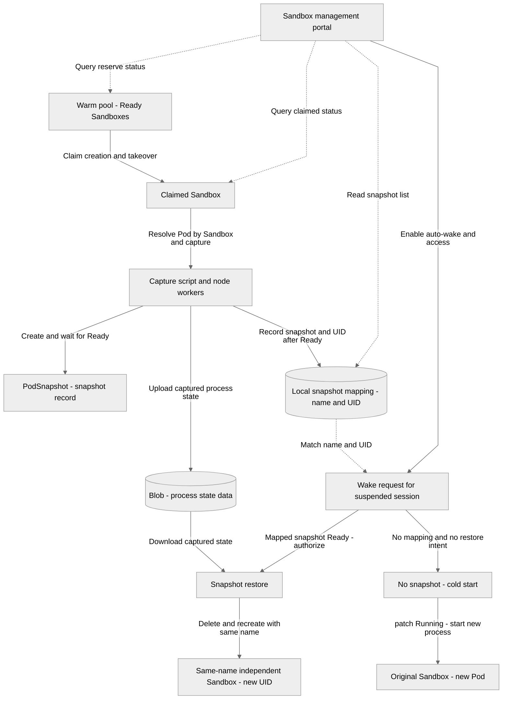
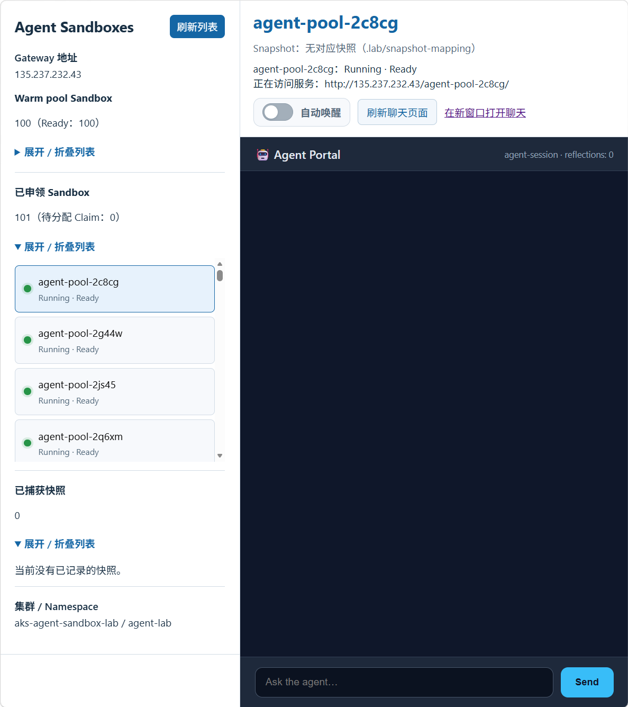
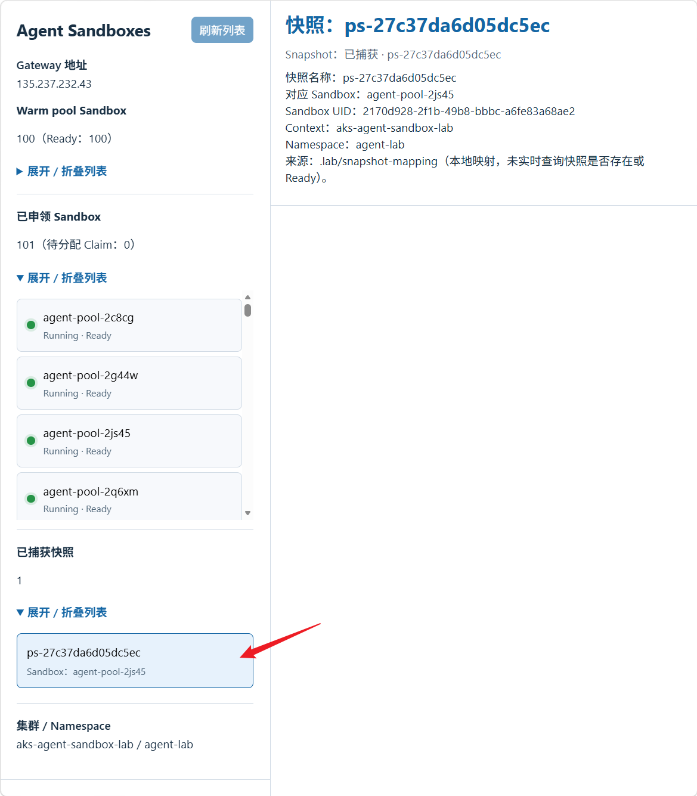

# AKS Agent Sandbox and Pod Snapshot Demo

> Language / 语言: **English** | [中文](demo_CN.md)

## Demo goals and preparation

This demo uses an online chatbot (Online Bot) that answers customer questions to demonstrate:

1. **Standard Sandbox startup**: validate application functionality, record cold-start timing and observe MicroVM kernel isolation.
2. **Warm Pool and Claim**: prepare runtime environments in advance and compare warm-pool claiming with cold-start wait times.
3. **Suspend and snapshot restore**: compare state loss without a snapshot with restoring chat state from a snapshot.

**Watch the demo video:**

https://github.com/user-attachments/assets/20d0cabd-4dbe-4b9b-94da-4935812416df


Before starting, complete the [lab environment setup](README.md), confirm cluster access, extensions, images and model services are available, and start the Sandbox management portal.

Run all commands from the `aks-agent-sandbox` directory. The following uses the default namespace; update it if `.env` specifies another value:

```bash
export NAMESPACE="agent-lab"
```

> [!note]
> **Operational notes**
>
> - Creating a warm pool consumes cluster capacity; check node capacity and costs first.
> - Suspend, delete and recreate operations affect application access. Operate only on Sandboxes used in this demo.
> - Chat persistence is disabled by default in this demo so you can observe whether memory state survives.
> - The timings below are examples from one run, not performance guarantees.

## 1. Run a Sandbox using the standard approach

### 1.1 Start one Sandbox and record cold-start timing

Create a standalone session through the standard Sandbox API to run the Online Bot:

```bash
bash scripts/04-start-session.sh
```

The script creates `agent-session`, waits for the Sandbox and Pod to become Ready, and prints a timing table. Example output:

```text
Session timing (submission includes Sandbox, Service and HTTPRoute; preparation and /work excluded):
+------------+---------------+-------------------+-----------------+
| Phase      | All Sandboxes | Average / Sandbox | Between batches |
+------------+---------------+-------------------+-----------------+
| Submission | 4.023s        | 4.023s            | -               |
| Readiness  | 40.250s       | 40.250s           | -               |
| Total      | 44.273s       | 44.273s           | -               |
+------------+---------------+-------------------+-----------------+
 ...
 ...
    NAME            READY   STATUS    RESTARTS   AGE   IP            NODE                               NOMINATED NODE   READINESS GATES
    agent-session   1/1     Running   0          53s   10.42.6.118   aks-katapool-99734980-vmss000008   <none>           <none>
    NAME            TYPE        CLUSTER-IP      EXTERNAL-IP   PORT(S)   AGE   SELECTOR
    agent-session   ClusterIP   10.41.158.220   <none>        80/TCP    53s   app=agent-session
    NAME              CLASS              ADDRESS          PROGRAMMED   AGE
    sandbox-gateway   approuting-istio   135.237.232.43   True         25h
    The session ID and completed task are in process memory, not a file or persistent volume.
    Once sandbox-gateway has an ADDRESS, open http://<GATEWAY-ADDRESS>/agent-session/ in your browser.
    Watch allocation with: kubectl -n agent-lab get gateway sandbox-gateway --watch
Ended: 2026-11-25 20:03:43 +0800
Total elapsed: 00:01:15 (75s)
Exit status: 0
```

| Metric | Meaning |
| --- | --- |
| Submission | Render and submit the Sandbox, Service and HTTPRoute |
| Readiness | Wait for the Sandbox and Pod to become Ready after submission |
| Total | Sum of the two phases above |

Once the Pod is `Running` with its container ready, the Gateway has an address and the HTTPRoute is accepted, open:

```text
http://<GATEWAY-ADDRESS>/agent-session/
```

Exchange a few questions and answers to understand the Online Bot's behavior.

### 1.2 Inspect kernels to demonstrate MicroVM isolation

Compare the kernel versions inside the Sandbox Pod and on its host Node.

**Set the target:**

```bash
export SANDBX="agent-session"
export POD="$SANDBX"
```

> This assumes the Pod and Sandbox have the same name, as in the demo environment. If their names differ, set `POD` to the actual Pod owned by that Sandbox.

**Inspect the Node kernel version:**

```bash
export NODE="$(kubectl -n "$NAMESPACE" describe pod "$POD" \
  | awk '/^Node:/ && $2 != "<none>" {split($2, a, "/"); print a[1]}')"

kubectl get node "$NODE" \
  -o 'custom-columns=NODE:.metadata.name,HOST_KERNEL:.status.nodeInfo.kernelVersion'
```

Example Node kernel output:

```text
NODE                               HOST_KERNEL
aks-katapool-99734980-vmss00000a   6.18.34.mshv3-1.azl3
```

**Inspect the Sandbox kernel version:**

```bash
kubectl -n "$NAMESPACE" exec "$POD" -- uname -r
```

Example kernel output from the Pod inside the Sandbox:

```text
6.18.52.mshv1-2.azl3
```

The kernel versions should differ in this demo environment:

| Object | Kernel version (example) |
| --- | --- |
| Node hosting the Sandbox | `6.18.34.mshv3-1.azl3` |
| Pod inside the Sandbox | `6.18.52.mshv1-2.azl3` |

This demonstrates that Kata MicroVMs use a separate guest kernel, rather than sharing the host kernel as ordinary containers do.

### 1.3 Release the standalone session

After validating application functionality and kernel isolation, delete the standalone Sandbox:

```bash
bash scripts/04-delete-session.sh
```

The script deletes the `agent-session` Sandbox, Service and HTTPRoute defined in `session.yaml`. Its owned Pod is deleted through Sandbox cascading deletion. **The shared Gateway is preserved** for the warm-pool demo. This operation loses the session's memory state.

## 2. Prepare and claim Sandboxes through a Warm Pool

Create reserves first, then claim them as application sessions to observe how preparing runtime environments in advance reduces the wait to acquire a Sandbox.

### 2.1 Create a warm pool with 100 Sandboxes

```bash
bash scripts/05-setup-warm-pool.sh 100
```

> The script currently requires an initial capacity of at least **50**, with 50 as the default when no argument is supplied. This demo explicitly creates 100 reserved Sandboxes. Use section 1 as the single-Sandbox cold-start reference.

Observe the warm-pool timing table and the reserves progressing from creation to Ready. Continue claiming only after the pool is ready.

Example warm-pool timing output:

```text
    +------------+---------------+-------------------+-----------------+
    | Phase      | All Sandboxes | Average / Sandbox | Between batches |
    +------------+---------------+-------------------+-----------------+
    | Submission | 3.209s        | 0.032s            | -               |
    | Readiness  | 67.065s       | 0.671s            | -               |
    | Total      | 70.273s       | 0.703s            | -               |
    +------------+---------------+-------------------+-----------------+
    Warm pool agent-pool is ready with 100 reserved sessions; no claim was created.
    Run bash scripts/05-claim-sandbox.sh 1 separately to claim a session.
Ended: 2026-11-25 20:59:56 +0800
Total elapsed: 00:01:20 (80s)
Exit status: 0
```

### 2.2 Claim one Sandbox

```bash
bash scripts/05-claim-sandbox.sh 1
```

If prompted with `Press any key to create Sandbox Services and HTTPRoutes (Ctrl+C to stop).`, press any key to continue. The script creates a Service and HTTPRoute for the claimed Sandbox, providing public access to its Online Bot.

Compare the time to claim a ready-made Sandbox with the cold-start timing in section 1. Example output:

```text
Submitted 1 claims; waiting for their Pods without a script timeout. Press Ctrl+C to stop; created resources are retained.
Claim round 1 Ready: 1/1 submitted Pods.
All requested Pods are Ready.
Claim timing (Services and HTTPRoutes excluded):
+------------+---------------+-------------------+-----------------+
| Phase      | All Sandboxes | Average / Sandbox | Between batches |
+------------+---------------+-------------------+-----------------+
| Submission | 1.611s        | 1.611s            | 0.000s          |
| Readiness  | 4.569s        | 4.569s            | 0.000s          |
| Total      | 6.180s        | 6.180s            | 0.000s          |
+------------+---------------+-------------------+-----------------+
Ready Pods: 1/1
Pod state counts:
  Ready: 1
```

- First inspect Claim submission, readiness wait and total time.
- Then inspect the separately measured Service and HTTPRoute creation time.
- If prompted to confirm route creation, continue as instructed; user confirmation time is excluded.
- The scripts measure different scopes. Claim total time is not the full service startup time including network resources.

> [!tip]
> - Claiming one Sandbox has much lower readiness and total times than standard startup in section 1.
> - The Sandbox does not start faster here; the warm pool already contains ready runtime environments.
> - Claiming changes management configuration without starting the application inside the Sandbox.

### 2.3 Claim 100 Sandboxes in a batch

```bash
bash scripts/05-claim-sandbox.sh 100
```

Example output:

```text
Requested claims: 100; available Ready reserve: 100
Claim batch: 1354e30f3a2648e7be3dd671903f0fcf
Detailed resource lists: .lab/claim.log
Claim round 1: submitting 100; Ready reserve: 100; remaining after submission: 0
Submission elapsed: 29.032s
Submitted 100 claims; waiting for their Pods without a script timeout. Press Ctrl+C to stop; created resources are retained.
Claim round 1 Ready: 100/100 submitted Pods.
All requested Pods are Ready.
Claim timing (Services and HTTPRoutes excluded):
+------------+---------------+-------------------+-----------------+
| Phase      | All Sandboxes | Average / Sandbox | Between batches |
+------------+---------------+-------------------+-----------------+
| Submission | 29.032s       | 0.290s            | 0.000s          |
| Readiness  | 5.783s        | 0.058s            | 0.000s          |
| Total      | 34.815s       | 0.348s            | 0.000s          |
+------------+---------------+-------------------+-----------------+
Ready Pods: 100/100
Pod state counts:
  Ready: 100
Press any key to create Sandbox Services and HTTPRoutes (Ctrl+C to stop).
```

Observe batch timing and warm-pool replenishment:

- After the previous one-Sandbox claim, the controller replenishes reserves. The Ready reserve count may not yet have returned to 100 when this step starts.
- The script claims in batches based on the currently available Ready reserves. When reserves are insufficient, later claims include replenishment wait time.
- **100 is the target reserve capacity, not the maximum total Sandbox count.** These two operations claim 101 application Sandboxes, while the warm pool continues maintaining its target reserves. Monitor cluster capacity and costs.

## 3. Sandbox management portal

The management portal is a helper developed for this demo, **not a management UI supplied by the AKS extensions**. It brings these operations onto one page:

- View the Warm Pool, claimed Sandboxes and captured snapshots.
- Check Sandbox state and service accessibility, and open the Online Bot chat UI.
- Initiate a cold-start wake without a snapshot or a snapshot restore according to the auto-wake setting.

### 3.1 Portal, session and snapshot relationships

Dotted arrows represent queries; solid arrows represent management actions or state-data transfers. "Wake" applies to stopped or suspended application Sandboxes.

<!-- mermaid-checked: no \n, no em-dash/en-dash, no {} in labels, subgraphs are id["label"], arrows are --&gt;|"label"|, all subgraphs closed by end, ids unique -->


- **Warm-pool claiming**: scripts and controllers perform claiming, not the management portal. The controller then replenishes reserves.
- **Snapshots and Blob**: PodSnapshot is a Kubernetes snapshot record. Node workers upload the actual process state to Blob. The portal reads local UID mappings, not Blob directly.
- **Cold-start wake**: retain the original Claim, Service and HTTPRoute and create a new Pod. Old memory state is lost when chat persistence is disabled, as it is by default.
- **Snapshot restore**: create an independent Sandbox with the same name but a new UID, then recreate its Service and HTTPRoute. Application state returns to capture time, not suspend time.
- **Failure boundaries**: invalid mappings, snapshots not Ready or denied authorization produce errors, never an automatic cold-start fallback.

### 3.2 Open the management portal

Open the management portal:



Inspect the three lists on the left:

| List | Services and routes | Right-side controls after selection |
| --- | --- | --- |
| Warm pool Sandbox | No dedicated Service or HTTPRoute is created during warm-up, so its service is usually inaccessible through the portal | Only "Refresh chat page" is shown |
| Claimed Sandbox | A dedicated Service and HTTPRoute are configured after claiming to expose the Agent service | "Auto-wake" and "Refresh chat page" are shown |
| Captured snapshots | Displays local snapshot mappings, not application service entry points | Snapshot details are shown; both controls above are hidden |

Select a claimed Ready Sandbox. After `/health` returns HTTP 200, the portal opens chat on the right. All three lists refresh together every **15 seconds**; click **Refresh lists** for a manual update.

> [!tip]
> **Distinguish the two refresh actions**
>
> - **Refresh lists**: updates the left-side lists and state without actively waking a Sandbox.
> - **Refresh chat page**: reloads the right-side page if chat is already open; otherwise, repeats access or wake processing.
>
> Select targets from the **claimed Sandbox** list for the suspend/wake steps below. Do not substitute a full browser-page reload for "Refresh chat page."

## 4. Suspend and resume without a snapshot: observe state loss

### 4.1 Prepare chat state and suspend

Select a claimed Sandbox that is **Ready, has no captured snapshot and has no restore intent**. Turn **Auto-wake** off and exchange several messages, for example:

- Tell me a story about Microsoft.
- Where is this company's headquarters?
- What are its main products and services?

Copy the selected Sandbox name and replace the placeholder:

```bash
export SANDBX="<paste-selected-sandbox-name>"

kubectl -n "$NAMESPACE" patch sandbox "$SANDBX" --type merge \
  -p '{"spec":{"operatingMode":"Suspended"}}'
```

Wait for suspension and the next list refresh, then observe:

1. The original Pod is removed, the Sandbox becomes suspended and its service is no longer accessible on the right.
2. With **Auto-wake** off, **Refresh chat page** only displays state; it does not resume the Sandbox.
3. A stopped application process cannot handle requests and wake itself. An external component must resume it.

### 4.2 Enable auto-wake and observe cold start

Turn **Auto-wake** on, then click **Refresh chat page**:

- The portal actively wakes the Sandbox. This is not an automatic capability provided by the Sandbox process or Gateway.
- With no corresponding snapshot and no restore intent, resumption cold-starts a new Pod.
- Previous in-memory chat state is lost with this demo's default configuration, where chat persistence is disabled.

Use another Sandbox in the next section to demonstrate restoring captured process state.

## 5. Restore from a snapshot: preserve chat state at capture time

### 5.1 Select another Sandbox and create chat history

Select another claimed Sandbox that is **Ready and has never been restored from a snapshot**. Turn **Auto-wake** off, exchange several messages and record its name:

```bash
export SANDBX="<paste-selected-sandbox-name>"
```

### 5.2 Capture a snapshot and inspect the mapping

```bash
bash scripts/06-capture.sh "$SANDBX"
```

The script resolves the Pod through its Sandbox and writes the relationship to `.lab/snapshot-mapping` only after the snapshot is Ready.

Wait for the portal's **captured snapshots** list to refresh:



1. Find the newly captured snapshot.
2. Select it to inspect the associated Sandbox name, UID and other details on the right.
3. The portal subsequently uses this mapping to select the snapshot for a stopped Sandbox.

> A snapshot preserves state at **capture time**, not the latest state at a later suspension. To simplify comparison, do not add more chat turns after capture.

### 5.3 Suspend the Sandbox

```bash
kubectl -n "$NAMESPACE" patch sandbox "$SANDBX" --type merge \
  -p '{"spec":{"operatingMode":"Suspended"}}'
```

Wait for suspension and the list-state update before proceeding.

### 5.4 Auto-wake through the portal

1. Reselect the Sandbox in the **claimed Sandbox** list, not the snapshot entry.
2. Turn **Auto-wake** on at the right.
3. Click **Refresh chat page**.

The current portal:

1. Pauses list refresh, validates the snapshot and configures the required restore authorization.
2. Deletes the old Claim, Sandbox and associated Pod, Service and HTTPRoute.
3. Creates a same-name Sandbox with snapshot restore configuration.
4. Labels the restored Pod with `restore-sandbox=<Sandbox-name>` and recreates its Service and HTTPRoute using that label as the backend selector.
5. Resumes list refresh and opens chat once the Sandbox is Ready and `/health` returns HTTP 200.

The restored resource is an **independent Sandbox, no longer owned by the original Claim**. It still appears in the claimed list and is marked as restored.

### 5.5 Verify the restored result

- Chat history should match **snapshot capture time**.
- To verify actual process-state restoration, compare `/state` values for `session_id`, `initialized_at` and task progress at capture time and after restore.
- Pod Ready, restore events or an open chat page alone cannot prove matching memory state.

Present the two outcomes side by side:

| Scenario | Wake method | Result with chat persistence disabled by default |
| --- | --- | --- |
| No snapshot and no restore intent | New Pod cold start | Previous in-memory chat state is lost |
| Corresponding snapshot exists | Current portal recreates the same-name Sandbox and restores the specified snapshot | Chat state returns to snapshot capture time |

> This section demonstrates the portal's current "delete and recreate with the same name" flow. It does not mean all snapshot restores require deleting the Sandbox. A suspended Sandbox with correctly configured restore intent can also resume using its existing restore configuration.

## Release demo resources

Release resources created during the demo to prepare for another run, **without deleting infrastructure created in step 01 or the AKS extensions installed in step 03**:

```bash
kubectl delete sandbox "$SANDBX" -n "$NAMESPACE"
bash scripts/07-delete-snapshots.sh --confirm-namespace "$NAMESPACE"
bash scripts/05-delete-claims.sh
bash scripts/05-delete-warm-pool.sh
bash scripts/04-delete-session.sh # If agent-session was not released in section 1
```

## Summary

| Capability | Value demonstrated |
| --- | --- |
| Agent Sandbox | Manages Sandbox lifecycle and reduces application wait time through warm pools and claims |
| Kata MicroVM | Provides a separate guest kernel and an isolation boundary different from ordinary shared-kernel containers |
| Pod Snapshot | Captures and restores process runtime state to preserve an Agent's in-memory session |

Combining the two AKS extensions with the Kata runtime makes AKS an important option for running AI Agents, particularly for enterprises with substantial Kubernetes assets that want Kubernetes to remain their main platform for modern workloads.
