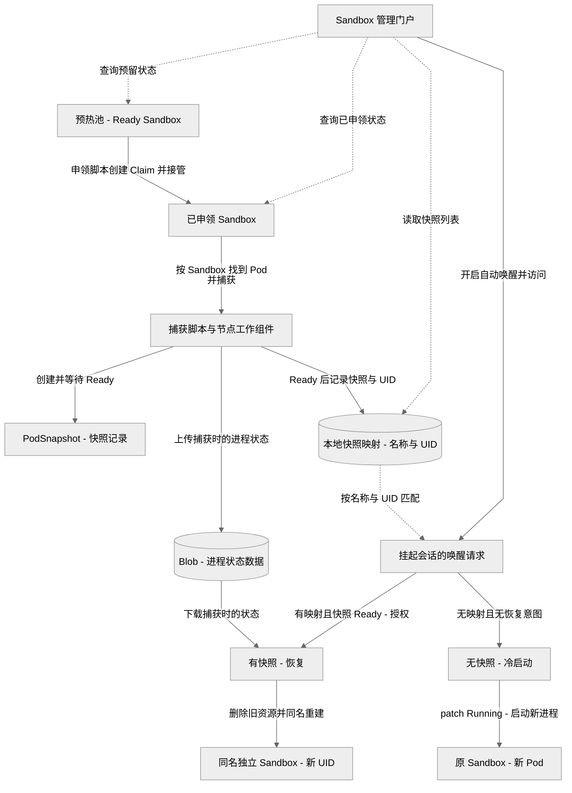
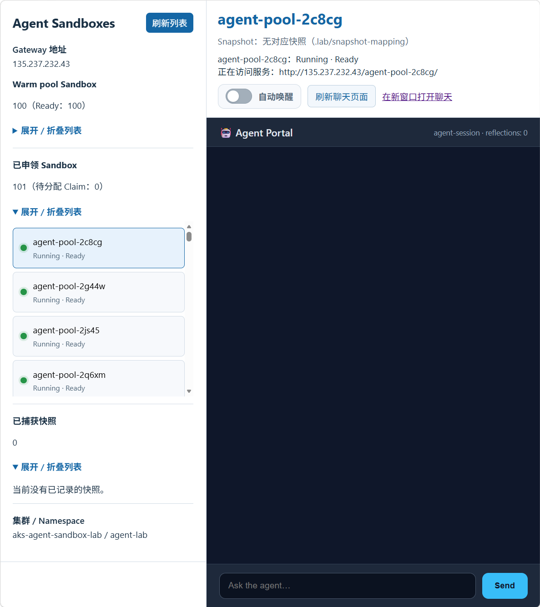
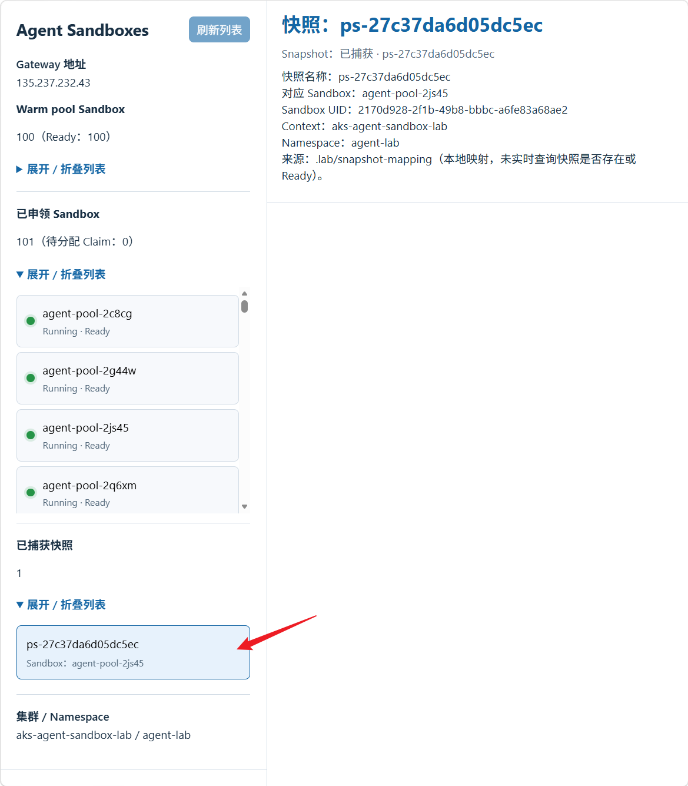

# AKS Agent Sandbox 与 Pod Snapshot 演示

> Language / 语言: [English](demo.md) | **中文**

## 演示目标与准备

本演示以一个回答客户问题的在线聊天机器人（Online Bot）为例，展示以下能力：

1. **标准 Sandbox 启动**：验证业务功能、记录冷启动耗时，并观察 MicroVM 内核隔离。
2. **Warm Pool 与 Claim**：预先准备运行环境，比较从预热池申领与冷启动的等待时间。
3. **挂起与快照恢复**：对比无快照时的状态丢失，以及通过快照恢复聊天状态。

**观看演示视频：**
https://github.com/user-attachments/assets/1d324e6d-0a8a-4062-88a8-98153e7bfce6


开始前，请确认已完成 [实验环境准备](README_CN.md)，集群访问、扩展、镜像和模型服务均可用，并已启动 Sandbox 管理门户。

所有命令均在 `aks-agent-sandbox` 目录执行。以下使用默认 namespace；如果 `.env` 中配置了其他值，请同步修改：

```bash
export NAMESPACE="agent-lab"
```

> [!note]
> **操作提示**
>
> - 创建预热池会占用集群容量，请提前确认节点容量和费用。
> - 挂起、删除和重建会影响业务访问；仅对本次演示的 Sandbox 操作。
> - 本演示默认关闭聊天持久化，以便观察内存状态是否保留。
> - 下文的耗时是一次运行示例，不是性能承诺。

## 1. 标准方式运行 Sandbox

### 1.1 启动单个 Sandbox，记录冷启动耗时

通过标准 Sandbox API 创建独立会话，运行 Online Bot：

```bash
bash scripts/04-start-session.sh
```

脚本创建 `agent-session`，等待 Sandbox 和 Pod Ready，并打印耗时表格。一次演示的输出如下：

```text
Session timing (submission includes Sandbox, Service and HTTPRoute; preparation and /work excluded):
+------------+---------------+-------------------+-----------------+
| Phase      | All Sandboxes | Average / Sandbox | Between batches |
+------------+---------------+-------------------+-----------------+
| Submission | 4.023s        | 4.023s            | -               |
| Readiness  | 40.250s       | 40.250s           | -               |
| Total      | 44.273s       | 44.273s           | -               |
+------------+---------------+-------------------+-----------------+
 ...
 ...
    NAME            READY   STATUS    RESTARTS   AGE   IP            NODE                               NOMINATED NODE   READINESS GATES
    agent-session   1/1     Running   0          53s   10.42.6.118   aks-katapool-99734980-vmss000008   <none>           <none>
    NAME            TYPE        CLUSTER-IP      EXTERNAL-IP   PORT(S)   AGE   SELECTOR
    agent-session   ClusterIP   10.41.158.220   <none>        80/TCP    53s   app=agent-session
    NAME              CLASS              ADDRESS          PROGRAMMED   AGE
    sandbox-gateway   approuting-istio   135.237.232.43   True         25h
    The session ID and completed task are in process memory, not a file or persistent volume.
    Once sandbox-gateway has an ADDRESS, open http://<GATEWAY-ADDRESS>/agent-session/ in your browser.
    Watch allocation with: kubectl -n agent-lab get gateway sandbox-gateway --watch
Ended: 2026-11-25 20:03:43 +0800
Total elapsed: 00:01:15 (75s)
Exit status: 0
```

| 统计项 | 含义 |
| --- | --- |
| Submission | 渲染并提交 Sandbox、Service 和 HTTPRoute |
| Readiness | 提交后等待 Sandbox 和 Pod Ready |
| Total | 上述两个阶段之和 |

确认 Pod 为 `Running` 且容器就绪，Gateway 有地址、HTTPRoute 已被接受后，在浏览器访问：

```text
http://<GATEWAY-ADDRESS>/agent-session/
```

完成几轮问答，了解演示中 Online Bot 的行为。

### 1.2 检查内核，展示 MicroVM 隔离

比较 Sandbox 中的 Pod 与所在 Node 的内核版本。

**设置目标：**

```bash
export SANDBX="agent-session"
export POD="$SANDBX"
```

> 此处按演示环境中 Pod 与 Sandbox 同名的情况设置 `POD`。如果实际名称不同，请将 `POD` 设置为该 Sandbox 对应的实际 Pod 名称。

**查看 Node 内核版本：**

```bash
export NODE="$(kubectl -n "$NAMESPACE" describe pod "$POD" \
  | awk '/^Node:/ && $2 != "<none>" {split($2, a, "/"); print a[1]}')"

kubectl get node "$NODE" \
  -o 'custom-columns=NODE:.metadata.name,HOST_KERNEL:.status.nodeInfo.kernelVersion'
```
查到的Node内核版本类似：
```text
NODE                               HOST_KERNEL
aks-katapool-99734980-vmss00000a   6.18.34.mshv3-1.azl3
```

**查看 Sandbox 内核版本：**

```bash
kubectl -n "$NAMESPACE" exec "$POD" -- uname -r
```
查到的Sandbox内部Pod内核版本类似：
```text
6.18.52.mshv1-2.azl3
```

在本演示环境中，两者的内核版本应不同:

| 对象 | 内核版本（示例） |
| --- | --- |
| Sandbox 所在 Node | `6.18.34.mshv3-1.azl3` |
| Sandbox 内部 Pod | `6.18.52.mshv1-2.azl3` |

这展示了 Kata MicroVM 使用独立客户机内核，而非像普通容器一样共享宿主机内核。

### 1.3 释放独立会话

完成业务功能与内核隔离验证后，删除用于验证的独立 Sandbox：

```bash
bash scripts/04-delete-session.sh
```

该脚本删除 `session.yaml` 中的 `agent-session` Sandbox、Service 和 HTTPRoute，其拥有的 Pod 随 Sandbox 级联删除；**保留共享 Gateway**，供后续预热池演示使用。此操作会丢失该会话的内存状态。

## 2. 通过 Warm Pool 预热并申领 Sandbox

本节先创建预留资源，再将其申领为业务会话，观察“提前准备运行环境”如何缩短业务获取 Sandbox 的等待时间。

### 2.1 创建包含 100 个 Sandbox 的预热池

```bash
bash scripts/05-setup-warm-pool.sh 100
```

> 当前脚本要求初始容量至少为 **50**，不传参数时默认使用 50。本演示显式创建 100 个预留 Sandbox；单个 Sandbox 的冷启动参考使用第 1 节的数据。

观察创建预热池的耗时表格，以及预留 Sandbox 从创建到 Ready 的过程。预热池就绪后，再继续申领。

创建预热池的耗时表格类似：
```text
    +------------+---------------+-------------------+-----------------+
    | Phase      | All Sandboxes | Average / Sandbox | Between batches |
    +------------+---------------+-------------------+-----------------+
    | Submission | 3.209s        | 0.032s            | -               |
    | Readiness  | 67.065s       | 0.671s            | -               |
    | Total      | 70.273s       | 0.703s            | -               |
    +------------+---------------+-------------------+-----------------+
    Warm pool agent-pool is ready with 100 reserved sessions; no claim was created.
    Run bash scripts/05-claim-sandbox.sh 1 separately to claim a session.
Ended: 2026-11-25 20:59:56 +0800
Total elapsed: 00:01:20 (80s)
Exit status: 0
```

### 2.2 申领 1 个 Sandbox

```bash
bash scripts/05-claim-sandbox.sh 1
```

如果提示：`Press any key to create Sandbox Services and HTTPRoutes (Ctrl+C to stop).`
请按任意键继续，脚本会为申领的 Sandbox 创建访问所需的 Service 和 HTTPRoute，便于从公网访问 Sandbox 中的 Online Bot 服务。

在输出结果中，查看时间表格，将申领现成 Sandbox 的耗时与第 1 节的冷启动耗时进行比较。得到的表格类似：
```text
Submitted 1 claims; waiting for their Pods without a script timeout. Press Ctrl+C to stop; created resources are retained.
Claim round 1 Ready: 1/1 submitted Pods.
All requested Pods are Ready.
Claim timing (Services and HTTPRoutes excluded):
+------------+---------------+-------------------+-----------------+
| Phase      | All Sandboxes | Average / Sandbox | Between batches |
+------------+---------------+-------------------+-----------------+
| Submission | 1.611s        | 1.611s            | 0.000s          |
| Readiness  | 4.569s        | 4.569s            | 0.000s          |
| Total      | 6.180s        | 6.180s            | 0.000s          |
+------------+---------------+-------------------+-----------------+
Ready Pods: 1/1
Pod state counts:
  Ready: 1
```
- 先看 Claim 提交、就绪等待及总耗时。
- 再看独立统计的 Service、HTTPRoute 创建耗时。
- 如脚本提示确认创建路由，按提示继续；等待用户确认的时间不计入统计。
- 注意两个脚本的计时口径不同，不应把 Claim 总耗时直接等同于包含网络资源的完整服务启动时间。

> [!tip]
> - 以上表格中，申领 1 个 Sandbox 的就绪时间和总共时间，远低于第 1 节中通过普通方式启动 Sandbox 的就绪时间和总时间
> - 并非这里的 Sandbox 启动更快，而是 warm pool 中已经准备好了运行状态就绪的 Sandbox
> - 从 warm pool 中申领 Sandbox，需要的只是相关的管理配置变更，不涉及 Sandbox 中的业务启动

### 2.3 批量申领 100 个 Sandbox

```bash
bash scripts/05-claim-sandbox.sh 100
```
得到输出结果：
```text
Requested claims: 100; available Ready reserve: 100
Claim batch: 1354e30f3a2648e7be3dd671903f0fcf
Detailed resource lists: .lab/claim.log
Claim round 1: submitting 100; Ready reserve: 100; remaining after submission: 0
Submission elapsed: 29.032s
Submitted 100 claims; waiting for their Pods without a script timeout. Press Ctrl+C to stop; created resources are retained.
Claim round 1 Ready: 100/100 submitted Pods.
All requested Pods are Ready.
Claim timing (Services and HTTPRoutes excluded):
+------------+---------------+-------------------+-----------------+
| Phase      | All Sandboxes | Average / Sandbox | Between batches |
+------------+---------------+-------------------+-----------------+
| Submission | 29.032s       | 0.290s            | 0.000s          |
| Readiness  | 5.783s        | 0.058s            | 0.000s          |
| Total      | 34.815s       | 0.348s            | 0.000s          |
+------------+---------------+-------------------+-----------------+
Ready Pods: 100/100
Pod state counts:
  Ready: 100
Press any key to create Sandbox Services and HTTPRoutes (Ctrl+C to stop).
```

观察批量申领的耗时及预热池补充情况：

- 上一步申领 1 个后，控制器会补充预留资源；开始本步时，Ready 预留数量可能尚未恢复到 100。
- 脚本按当前可用的 Ready 预留资源分批申领；不足时，后续申领会包含等待补充的时间。
- **100 是目标预留容量，不是 Sandbox 总数上限。** 两次操作共申领 101 个业务 Sandbox，预热池还会继续维持目标预留容量，请关注集群容量和费用。

## 3. Sandbox 管理门户

Sandbox 管理门户是为本演示开发的辅助工具，**不是 AKS 扩展自带的管理界面**。它将以下操作集中在一个页面：

- 查看 Warm Pool、已申领 Sandbox 和已捕获快照。
- 检查 Sandbox 状态与服务可访问性，打开 Online Bot 聊天界面。
- 根据自动唤醒设置，由门户发起无快照冷启动或有快照恢复。

### 3.1 管理门户、会话与快照的关系

虚线表示查询，实线表示管理动作或状态数据流转。图中的“唤醒”针对已停止或挂起的业务 Sandbox。

<!-- mermaid-checked: no \n, no em-dash/en-dash, no {} in labels, subgraphs are id["label"], arrows are --&gt;|"label"|, all subgraphs closed by end, ids unique -->


- **预热池申领**：申领由脚本和控制器执行，不由管理门户创建；控制器随后补充预留环境。
- **快照与 Blob**：PodSnapshot 是 Kubernetes 中的快照记录；实际进程状态由节点工作组件上传到 Blob。门户读取的是本地 UID 映射，不直接读取 Blob。
- **冷启动唤醒**：保留原 Claim、Service 和 HTTPRoute，创建新 Pod；默认关闭聊天持久化时，旧内存状态丢失。
- **快照恢复**：创建同名但新 UID 的独立 Sandbox，并重建 Service/HTTPRoute；业务状态回到捕获时，而不是挂起时。
- **失败边界**：映射失效、快照未 Ready 或授权失败会报错，不自动降级为冷启动。

### 3.2 进入管理门户

进入管理门户：


查看左侧三份列表：

| 列表 | 服务与路由 | 点击后的右侧操作 |
| --- | --- | --- |
| Warm pool Sandbox | 预热阶段不为其创建专属 Service 和 HTTPRoute，通常不能通过门户访问其服务 | 只显示“刷新聊天页面” |
| 已申领 Sandbox | 申领后配置专属 Service 和 HTTPRoute，用于提供 Agent 服务 | 显示“自动唤醒”和“刷新聊天页面” |
| 已捕获快照 | 展示本地快照映射，不是业务服务入口 | 显示快照详情，隐藏上述两个控件 |

点击已申领的 Ready Sandbox，门户检查 `/health` 返回 HTTP 200 后，在右侧打开聊天界面。三份列表每 **15 秒**统一自动刷新，也可点击**刷新列表**手动更新。

> [!tip]
> **区分两个刷新操作**
>
> - **刷新列表**：更新左侧列表及状态，不主动唤醒 Sandbox。
> - **刷新聊天页面**：聊天已打开时只重载右侧页面；未打开时，重新执行访问或唤醒流程。
>
> 后续的挂起与唤醒演示均从**已申领 Sandbox**列表选择目标，不使用浏览器的整页刷新代替“刷新聊天页面”。

## 4. 无快照时挂起与恢复：观察状态丢失

### 4.1 准备聊天状态并挂起

选择一个 **Ready、尚未捕获快照且未配置恢复意图**的已申领 Sandbox，确认**自动唤醒**关闭，再完成几轮会话。例如：
- 一个微软的故事
- 这家公司的总部在哪里？
- 主要的产品和服务？

复制所选 Sandbox 的名称，替换占位符：

```bash
export SANDBX="<粘贴选中的Sandbox名字>"

kubectl -n "$NAMESPACE" patch sandbox "$SANDBX" --type merge \
  -p '{"spec":{"operatingMode":"Suspended"}}'
```

等待挂起完成、列表刷新后，观察以下现象：

1. 原 Pod 被移除，Sandbox 进入挂起状态，右侧无法继续访问服务。
2. **自动唤醒**关闭时，点击**刷新聊天页面**只显示状态，不恢复 Sandbox。
3. 已停止的业务进程不能自行处理请求并唤醒自己，需要外部组件执行恢复。

### 4.2 开启自动唤醒，观察冷启动

打开**自动唤醒**，再点击**刷新聊天页面**：

- 门户主动执行唤醒操作；这不是 Sandbox 内部或 Gateway 自动提供的功能。
- 因为没有对应快照且没有恢复意图，此次恢复为新 Pod 的冷启动。
- 在本演示默认关闭聊天持久化的配置下，之前的内存聊天状态会丢失。

下一节使用另一个 Sandbox，展示快照如何恢复已捕获的进程状态。

## 5. 通过 Snapshot 恢复：保留捕获时的聊天状态

### 5.1 选择另一个 Sandbox，创建聊天记录

选择另一个 **Ready、尚未从快照恢复过**的已申领 Sandbox，关闭**自动唤醒**，完成几轮会话，然后记录其名称：

```bash
export SANDBX="<粘贴选中的Sandbox名字>"
```

### 5.2 捕获快照并检查映射

```bash
bash scripts/06-capture.sh "$SANDBX"
```

脚本通过 Sandbox 找到对应的 Pod，等待快照 Ready 后，将对应关系写入 `.lab/snapshot-mapping`。

等待门户左侧的**已捕获快照**列表刷新：


1. 找到新捕获的快照。
2. 点击快照，在右侧查看其对应的 Sandbox 名称、UID 等信息。
3. 门户后续根据此映射，为停止的 Sandbox 选择对应快照。

> 快照保留的是**捕获时**的状态，不是之后挂起时的最新状态。为便于比较，捕获后不要继续添加聊天记录。

### 5.3 挂起 Sandbox

```bash
kubectl -n "$NAMESPACE" patch sandbox "$SANDBX" --type merge \
  -p '{"spec":{"operatingMode":"Suspended"}}'
```

等待挂起完成及列表状态更新后，再执行下一步。

### 5.4 通过门户自动唤醒

1. 在**已申领 Sandbox**列表中重新选择该 Sandbox，而不是选择快照项。
2. 打开右侧的**自动唤醒**开关。
3. 点击**刷新聊天页面**。

当前门户会执行：

1. 暂停列表刷新，校验快照并配置必要的恢复授权。
2. 删除旧 Claim、Sandbox 及关联的 Pod、Service 和 HTTPRoute。
3. 创建同名、带快照恢复配置的新 Sandbox。
4. 为恢复的 Pod 配置 `restore-sandbox=<Sandbox名字>` 标签，以该标签选择后端并重新创建 Service、HTTPRoute。
5. 恢复列表刷新，待 Sandbox Ready 且 `/health` 返回 HTTP 200 后打开聊天。

恢复后的资源是**独立 Sandbox，不再属于原 Claim**，但仍在已申领列表中显示，并标注为已恢复。

### 5.5 验证恢复结果

- 聊天历史应与**快照捕获时**一致。
- 如需验证进程状态确实恢复，应比较捕获时与恢复后 `/state` 中的 `session_id`、`initialized_at` 及任务进度。
- 仅看到 Pod Ready、恢复事件或聊天页面打开，不能单独证明内存状态一致。

演示时可将两个结果并列说明：

| 场景 | 唤醒方式 | 默认关闭聊天持久化时的结果 |
| --- | --- | --- |
| 无快照、无恢复意图 | 新 Pod 冷启动 | 之前的内存聊天状态丢失 |
| 有对应快照 | 当前门户同名重建，并从指定快照恢复 | 聊天状态回到快照捕获时 |

> 本节展示的是门户当前的“删除并同名重建”流程，不代表所有快照恢复都必须删除 Sandbox。对已经配置正确恢复意图的挂起 Sandbox，恢复运行还可沿用其现有恢复配置。

## 释放演示资源
释放演示中创建的资源，以便下一次演示（前提：不清除 01 和 03 步创建的基础设施资源和 AKS 扩展安装）：
```bash
kubectl delete sandbox "$SANDBX" -n "$NAMESPACE"
bash scripts/07-delete-snapshots.sh --confirm-namespace "$NAMESPACE"
bash scripts/05-delete-claims.sh
bash scripts/05-delete-warm-pool.sh
bash scripts/04-delete-session.sh # 如果在第 1 节中，没有做 agent-session 的释放
```

## 总结

| 能力 | 本演示展示的价值 |
| --- | --- |
| Agent Sandbox | 管理 Sandbox 生命周期，通过预热池与申领机制缩短业务获取运行环境的等待时间 |
| Kata MicroVM | 提供独立客户机内核，形成不同于普通共享内核容器的隔离边界 |
| Pod Snapshot | 捕获并恢复进程运行时状态，帮助保留 Agent 的内存会话 |

两项 AKS 扩展与 Kata 运行时结合，使 AKS 成为运行 AI Agent 的一个重要选项，尤其适合已经拥有大量 Kubernetes 资产、希望继续以 Kubernetes 作为现代化工作负载主要运行平台的企业。
