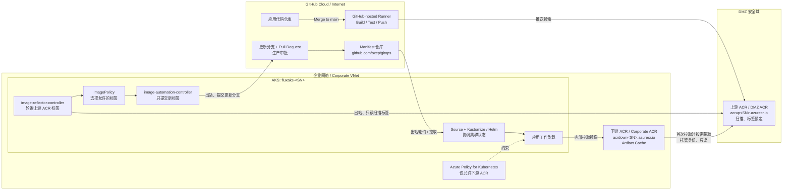

# AKS + Flux + ACR Artifact Cache：出站优先的容器镜像交付架构

## 1. 文档目的

本文描述一个面向企业受限网络环境的容器镜像交付方案：应用代码在 GitHub 上完成持续集成，镜像首先进入 DMZ 区域的上游 Azure Container Registry（ACR），企业网络中的下游 ACR 通过 Artifact Cache 按需获取镜像，AKS 使用 Flux GitOps 自动发现新标签、更新部署清单并完成发布。

方案重点满足以下原则：

- 企业网络不接收入站 Webhook 或来自 Internet/DMZ 的主动连接。
- GitHub CI 只负责构建、测试和推送镜像，不直接部署 AKS。
- AKS 只从企业侧下游 ACR 拉取运行镜像。
- Flux 采用轮询方式发现新镜像和同步 Git，不依赖入站事件。
- 生产环境的镜像标签变更需要通过独立分支和 Pull Request 审批。
- 镜像仓库地址保持为企业侧 ACR，仅自动更新镜像标签。

---

## 2. 业务场景

企业希望使用 GitHub 承载应用代码和 Kubernetes Manifest，同时使用 AKS 运行工作负载。由于企业网络执行严格的边界安全策略，不允许 GitHub、DMZ 或其他外部系统主动连接企业 VNet，因此传统的 Webhook 驱动部署、CI 直接访问 AKS API Server、AKS 直接从 Internet 拉取镜像等方式不符合要求。

本方案将容器供应链划分为三个安全域：

1. **GitHub Cloud / Internet 区域**
   - 存放应用代码仓库和 Manifest 仓库。
   - GitHub-hosted runner 执行构建和测试。
   - CI 将通过验证的镜像推送到 DMZ 上游 ACR。

2. **DMZ 区域**
   - 上游 ACR 作为来自 CI 的镜像接入点。
   - 在镜像进入企业运行环境前执行安全扫描、标签规范和不可变控制。
   - 允许企业侧组件以只读方式主动获取镜像或元数据。

3. **企业网络区域**
   - 部署 AKS、Flux Extension 和下游 ACR。
   - 下游 ACR 通过 Artifact Cache 从上游 ACR 按需缓存镜像。
   - AKS 仅从下游 ACR 拉取镜像。
   - Flux 通过出站访问轮询上游 ACR 和 GitHub Manifest 仓库。

---

## 3. 要解决的问题

### 3.1 网络边界限制

企业网络不允许来自 Internet 或 DMZ 的入站连接，因此不能依赖以下模式：

- GitHub Webhook 直接触发企业网络中的服务。
- GitHub Actions 直接访问企业 AKS API Server。
- 外部流水线直接对 AKS 执行 `kubectl apply` 或 Helm 部署。
- AKS 节点直接从外部或 DMZ 镜像仓库拉取运行镜像。

### 3.2 镜像安全与供应链隔离

需要将“镜像构建入口”和“生产运行镜像仓库”隔离，并保证：

- CI 推送的镜像先落入 DMZ 上游 ACR。
- 企业侧仅以只读方式获取已经发布的镜像。
- AKS 工作负载只能使用企业侧下游 ACR。
- 生产使用的标签可审计、不可覆盖，并能够关联 Git commit。

### 3.3 自动发现与部署新镜像

需要在不开放入站 Webhook 的情况下：

- 定期扫描上游 ACR 的新标签。
- 按版本策略选出允许部署的标签。
- 只修改 Manifest 中的镜像标签，不改变下游 ACR 地址。
- 将变更提交到 Git，继续由 Flux 的 Kustomize/Helm Controller 完成声明式部署。

### 3.4 避免镜像全量复制

不希望使用定时脚本将上游 ACR 全量同步到下游 ACR。下游 ACR 应在 AKS 第一次请求某个镜像时获取并缓存该镜像，后续拉取直接从企业侧缓存提供。

---

## 4. 实现方案概述

本方案组合使用以下机制：

1. GitHub Actions 构建、测试并将镜像推送到上游 ACR。
2. Microsoft Defender for Cloud 对上游 ACR 中的镜像执行漏洞评估；仓库使用不可变、可排序标签。
3. AKS 中的 `image-reflector-controller` 定期扫描上游 ACR 的标签。
4. `ImagePolicy` 根据 SemVer、数字或约定格式选择目标标签。
5. `image-automation-controller` 将新标签提交到 Manifest 仓库的更新分支。
6. 生产分支通过 GitHub Branch Protection 和 Pull Request 审批控制合并。
7. Flux Source、Kustomize 或 Helm Controller 读取合并后的声明状态并协调 AKS。
8. Manifest 中的镜像仓库始终指向下游 ACR，只由 Flux 更新标签。
9. AKS 第一次拉取新标签时，下游 ACR 的 Artifact Cache 使用托管身份从上游 ACR 获取镜像并保存到本地缓存。
10. 后续镜像拉取直接由下游 ACR 提供。
11. Azure Policy for Kubernetes 限制工作负载只能引用下游 ACR。

> **关键边界：** Flux Image Automation 负责发现标签和修改 Git，它不负责在两个 ACR 之间复制镜像；镜像内容的按需获取由 ACR Artifact Cache 完成。

---

## 5. 总体架构



### 5.1 网络方向

| 编号 | 发起方 | 目标 | 用途 | 方向与权限 |
| --- | --- | --- | --- | --- |
| N1 | GitHub-hosted runner | 上游 ACR | 推送构建镜像 | Internet → DMZ，写入 |
| N2 | 下游 ACR Artifact Cache | 上游 ACR | 首次请求时获取镜像 | 企业侧逻辑出站，只读 |
| N3 | Flux image-reflector | 上游 ACR | 获取仓库标签和 digest | 企业侧出站，只读 |
| N4 | Flux Source / Automation | GitHub Manifest 仓库 | 读取清单、提交更新分支 | 企业侧出站，读/受限写 |
| N5 | Flux Extension Agent | Azure 管理端点 | 扩展管理和状态上报 | 企业侧出站 |
| N6 | AKS 节点 | 下游 ACR | 拉取工作负载镜像 | 企业网络内部 |

企业网络不需要接收 GitHub Webhook、DMZ 回调或 CI 到 AKS 的入站连接。

---

## 6. 资源规划

所有 AKS 和 ACR 资源部署到以下位置：

| 项目 | 值 |
| --- | --- |
| 资源组 | `rg-acrcache` |
| Azure 区域 | `westus2` |
| 随机后缀 | `<SN>`，在一次部署中统一使用 |
| AKS 集群 | `fluxaks-<SN>` |
| GitHub Manifest 仓库 | `https://github.com/oxcp/gitops` |

### 6.1 ACR 命名修正

原始需求中的 `acr-up-<SN>` 和 `acr-down-<SN>` 包含连字符，不符合 ACR 名称只能使用字母和数字的规则。实际部署建议使用：

| 逻辑角色 | 原始逻辑名称 | 可部署资源名称 | Login Server |
| --- | --- | --- | --- |
| 上游 ACR / DMZ ACR | `acr-up-<SN>` | `acrup<SN>` | `acrup<SN>.azurecr.io` |
| 下游 ACR / Corporate ACR | `acr-down-<SN>` | `acrdown<SN>` | `acrdown<SN>.azurecr.io` |

ACR 名称还必须在 Azure 全局唯一，因此 `<SN>` 的生成过程需要执行可用性检查。

### 6.2 建议的辅助资源

| 资源 | 作用 |
| --- | --- |
| DMZ VNet/子网 | 承载 DMZ 私有终结点或受控访问路径 |
| Corporate VNet/AKS 子网 | 承载 AKS 节点及企业侧网络资源 |
| ACR Private Endpoint 与 Private DNS | 为 AKS 到下游 ACR 提供私有访问 |
| 用户分配托管身份：ACR Cache | 下游 ACR 对上游仓库执行只读缓存获取 |
| 用户分配托管身份：Flux | Flux image-reflector 使用 Workload Identity 读取上游 ACR |
| Azure Policy Assignment | 限制 AKS 工作负载只能使用下游 ACR |
| Defender for Cloud | 对上游 ACR 镜像执行漏洞评估和安全治理 |

---

## 7. 选用的 Azure 与 GitHub 服务

| 服务/组件 | 用途 | 选择原因 |
| --- | --- | --- |
| Azure Kubernetes Service | 运行企业容器工作负载 | 托管 Kubernetes，与 ACR、Azure Policy、Workload Identity 集成 |
| Azure Container Registry：上游 | 接收 GitHub CI 构建镜像 | 作为 DMZ 供应链入口，隔离 CI 与生产运行仓库 |
| Azure Container Registry：下游 | AKS 唯一允许使用的镜像仓库 | 位于企业侧，可通过 Private Endpoint 为 AKS 提供私有访问 |
| ACR Artifact Cache | 从上游 ACR 按需缓存镜像 | 第一次拉取获取镜像，后续本地提供，无需全量同步 |
| Flux v2 Extension | 基于 Git 声明状态协调 AKS | 通过轮询工作，不要求入站 Webhook |
| image-reflector-controller | 扫描上游 ACR 标签和 digest | 将镜像元数据反映为 `ImageRepository` / `ImagePolicy` 状态 |
| image-automation-controller | 更新 Manifest 仓库中的镜像标签 | 自动提交 Git 变更，同时保留审计记录 |
| GitHub Actions | 构建、测试和推送镜像 | CI 与部署解耦，不直接访问 AKS |
| GitHub Branch Protection / PR | 生产发布审批 | 防止自动化直接修改受保护生产分支 |
| Microsoft Entra Workload Identity | Flux 访问上游 ACR | 使用短期令牌，避免在集群保存 ACR 长期密码 |
| 用户分配托管身份 | ACR-to-ACR Cache 认证 | 下游 ACR 无需在 Key Vault 保存上游仓库密码 |
| Azure Policy for Kubernetes | 限制允许的镜像仓库 | 阻止工作负载绕过下游 ACR |
| Microsoft Defender for Cloud | 镜像漏洞评估 | 在镜像进入生产使用路径前提供安全信号 |

---

## 8. 镜像与 GitOps 数据流

### 8.1 CI 阶段

1. 开发人员将代码合并到应用仓库主分支。
2. GitHub-hosted runner 构建和测试容器镜像。
3. CI 使用 GitHub OIDC 联合身份登录 Azure，避免保存长期 Azure 密钥。
4. CI 将镜像推送到上游 ACR。
5. 镜像标签采用不可变、可排序格式，例如：

   ```text
   <branch>-<short-sha>-<timestamp>
   ```

6. 上游 ACR 禁止覆盖已发布标签，并由 Defender 执行安全评估。

### 8.2 镜像发现与 Git 更新

1. `ImageRepository` 指向上游 ACR，并设置 `provider: azure`。
2. `image-reflector-controller` 按固定间隔扫描标签。
3. `ImagePolicy` 过滤不符合发布规则的标签，并选出目标版本。
4. Manifest 中的镜像仓库固定为下游 ACR，例如：

   ```yaml
   image: acrdown<SN>.azurecr.io/myapp:<tag>
   ```

5. Flux 的 setter 标记只关联 `tag` 字段，避免把镜像仓库地址改回上游 ACR。
6. `image-automation-controller` 将标签变更提交到专用更新分支。
7. 对生产环境，由 GitHub 流程创建或维护 Pull Request，经审批后合并到生产分支。

> Flux Image Automation 可以向指定分支提交变更；Pull Request 的创建和审批应由 GitHub 分支策略、GitHub Actions 或人工流程完成，不应假定 Flux Controller 自身完成 PR 审批流程。

### 8.3 部署与镜像缓存

1. Flux Source Controller 轮询 Manifest 仓库。
2. Kustomize 或 Helm Controller 将合并后的声明状态协调到 AKS。
3. AKS 请求 `acrdown<SN>.azurecr.io/myapp:<tag>`。
4. 如果下游 ACR 尚未缓存该镜像，Artifact Cache 使用用户分配托管身份从上游 ACR 获取镜像。
5. 首次请求完成后，镜像保存在下游 ACR 缓存中。
6. 后续 AKS 节点直接从下游 ACR 获取镜像。

---

## 9. 身份与权限设计

建议为不同数据流使用独立身份，以符合最小权限原则。

| 调用方 | 目标 | 建议身份 | 最小权限 |
| --- | --- | --- | --- |
| GitHub Actions | 上游 ACR | GitHub OIDC + Entra 应用/托管身份 | 仅目标仓库的推送权限；非 ABAC 模式可使用 `AcrPush` |
| ACR Artifact Cache | 上游 ACR | 独立用户分配托管身份 | 上游目标 repository 范围的 `Container Registry Repository Reader` |
| Flux image-reflector | 上游 ACR | AKS Workload Identity | ABAC ACR 使用 `Container Registry Repository Reader`；非 ABAC 使用 `AcrPull` |
| AKS kubelet | 下游 ACR | AKS kubelet 托管身份 | 下游 ACR 拉取权限 |
| Flux Source Controller | GitHub Manifest 仓库 | GitHub Deploy Key 或受限 Token | 仓库读取权限 |
| Flux image-automation | GitHub Manifest 仓库 | 可写 Deploy Key 或受限 Token | 仅更新分支写入权限 |

ACR-to-ACR Artifact Cache 的当前官方方案要求：

- 上游 ACR 启用 RBAC + ABAC repository permissions 模式。
- Cache 使用用户分配托管身份访问上游 ACR。
- 身份在指定上游 repository 范围获得 `Container Registry Repository Reader`。
- Cache Rule 将上游 repository 映射到下游 repository。

---

## 10. Flux 资源设计

预计需要在 GitOps 仓库中定义以下资源：

| Flux 资源 | 用途 |
| --- | --- |
| `GitRepository` | 定义 Manifest Git 来源和写入认证引用 |
| `Kustomization` 或 `HelmRelease` | 将声明状态协调到 AKS |
| `ImageRepository` | 扫描上游 ACR 的指定 repository |
| `ImagePolicy` | 根据标签格式和版本规则选择目标标签 |
| `ImageUpdateAutomation` | 更新 Manifest 中的标签并提交到更新分支 |

AKS 的 `microsoft.flux` Extension 默认不启用以下两个 Controller，部署时必须显式开启：

```text
image-reflector-controller.enabled=true
image-automation-controller.enabled=true
```

如果使用 Workload Identity，`ImageRepository` 需要配置 `provider: azure`，并为 `flux-system` 命名空间中的 `image-reflector-controller` ServiceAccount 建立联合身份凭据。

---

## 11. 网络与安全控制

### 11.1 必须允许的出站访问

企业侧至少需要允许以下 HTTPS 出站访问：

- 上游 ACR 的 Registry/Data Endpoint。
- GitHub Manifest 仓库使用的 Git HTTPS 或 SSH Endpoint。
- Azure Resource Manager 和 Kubernetes Configuration 数据面端点。
- Microsoft Entra 登录端点。
- Microsoft Container Registry，用于下载 Flux Controller 镜像。

具体 FQDN 应根据企业防火墙策略、AKS 出站模式和部署区域形成正式白名单。

### 11.2 必须阻止或避免的路径

- GitHub-hosted runner 不得访问 AKS API Server。
- AKS 工作负载不得直接引用上游 ACR。
- 企业网络不部署面向 GitHub 的 Webhook Receiver。
- 下游 ACR Cache 身份不得获得上游写入权限。
- image-reflector 身份不得获得 ACR 推送或删除权限。
- image-automation 的 Git 凭据不得拥有仓库管理权限。

### 11.3 Azure Policy

建议在 AKS 上应用允许镜像仓库列表策略，仅允许：

```text
acrdown<SN>.azurecr.io/*
```

策略需要覆盖 Pod 以及由 Deployment、StatefulSet、DaemonSet、Job、CronJob 等控制器生成的容器，包括 init container 和 ephemeral container（如企业策略要求）。

---

## 12. 关键设计决策

### 12.1 使用 Artifact Cache，而非全量同步

Artifact Cache 是 pull-through cache。它不会提前复制上游的所有镜像；只有当下游首次请求某个标签或 digest 时才会获取并缓存。因此它适合“按实际部署需求引入镜像”的企业场景，但不等同于灾备复制或离线全量镜像同步。

### 12.2 image-reflector 扫描上游，AKS 拉取下游

Flux 根据上游 ACR 的标签决定版本，但 Manifest 中的 repository 地址固定为下游 ACR。这样可以同时实现：

- 自动发现上游新版本。
- AKS 不直接访问上游仓库。
- 由下游 ACR 在首次部署时按需填充缓存。

### 12.3 自动化只修改标签

Manifest 应将 image name 和 tag 分开管理，或使用 Flux 支持的 tag setter 标记。自动化只改变标签，不改变 registry/repository，避免生成引用上游 ACR 的生产清单。

### 12.4 生产通过更新分支和 PR

生产分支必须启用保护策略。image-automation 将变更推送到专用分支，PR 由 GitHub 自动化或人工创建并审批。只有合并后的生产分支才是 Flux 的部署来源。

### 12.5 不使用入站 Webhook

所有关键环节均使用轮询或平台托管操作：

- Flux 轮询 Git。
- image-reflector 轮询 ACR。
- Artifact Cache 在下游镜像被请求时拉取上游内容。

---

## 13. 前提条件与约束

- Azure CLI 需要满足 ACR-to-ACR Artifact Cache 官方文档要求；当前文档要求 Azure CLI `2.85.0` 或更高版本。
- AKS 必须使用托管身份，而不是旧式 Service Principal 模式。
- AKS 需要启用 OIDC Issuer 和 Workload Identity，才能采用推荐的 Flux 身份设计。
- 上游 ACR 需要启用 RBAC + ABAC repository permissions 模式，以使用 repository 范围的 Cache 读取权限。
- GitHub-hosted runner 必须能够访问上游 ACR。如果上游 ACR 完全关闭公网访问，则需要使用位于 DMZ 网络内的 self-hosted runner，或提供符合安全策略的专用访问路径。
- Manifest 仓库的写入凭据必须支持 image-automation 提交更新分支。
- Artifact Cache 首次拉取会产生额外延迟，部署超时和镜像预热策略需要在生产环境评估。
- Artifact Cache 不是两个 ACR 之间的持续全量复制，也不是跨区域灾备方案。
- ACR Cache Rule、相关 API 版本及区域可用性应在正式部署前于目标订阅和 `westus2` 验证。

---

## 14. 操作步骤

> 本节暂留空，后续可补充 Shell/Bicep、Flux YAML 和验证脚本。

### 14.1 准备部署变量与生成 `<SN>`

<!-- TODO -->

### 14.2 创建资源组和网络基础设施

<!-- TODO -->

### 14.3 创建上游与下游 ACR

<!-- TODO -->

### 14.4 创建托管身份并配置最小权限

<!-- TODO -->

### 14.5 配置 ACR-to-ACR Artifact Cache

<!-- TODO -->

### 14.6 创建 AKS 并集成下游 ACR

<!-- TODO -->

### 14.7 安装 Flux Extension 并启用 Image Controllers

<!-- TODO -->

### 14.8 配置 Flux GitRepository 与 GitHub 写入凭据

<!-- TODO -->

### 14.9 创建 ImageRepository、ImagePolicy 和 ImageUpdateAutomation

<!-- TODO -->

### 14.10 配置生产分支保护和 PR 流程

<!-- TODO -->

### 14.11 配置 Defender、标签锁定和 Azure Policy

<!-- TODO -->

### 14.12 执行端到端验证

<!-- TODO -->

---

## 15. 验收标准

部署完成后应满足以下条件：

- [ ] GitHub CI 可以将测试通过的镜像推送到上游 ACR。
- [ ] 上游 ACR 镜像使用不可变、可追溯标签。
- [ ] image-reflector 可以读取上游 ACR 标签，但不能推送或删除镜像。
- [ ] ImagePolicy 可以选出符合规则的目标标签。
- [ ] image-automation 只修改 Manifest 中的标签，并推送到指定更新分支。
- [ ] 生产标签更新必须经过 Pull Request 审批。
- [ ] Flux 可以读取合并后的 Manifest 并协调 AKS。
- [ ] Manifest 和运行中的 Pod 只引用下游 ACR。
- [ ] AKS 首次拉取新标签时，下游 ACR 可以从上游填充缓存。
- [ ] 后续拉取由下游 ACR 提供。
- [ ] GitHub 或 DMZ 不需要向企业网络发起入站连接。
- [ ] Azure Policy 能阻止引用未授权 Registry 的工作负载。

---

## 16. 参考文档

- [使用 Azure CLI 配置 ACR 到 ACR 的 Artifact Cache](https://learn.microsoft.com/en-us/azure/container-registry/artifact-cache-acr-to-acr-cli)
- [使用 Flux v2 部署应用并控制 Extension Controller](https://learn.microsoft.com/en-us/azure/azure-arc/kubernetes/tutorial-use-gitops-flux2)
- [Flux ImageRepository](https://fluxcd.io/flux/components/image/imagerepositories/)
- [Flux Image Automation Controllers](https://fluxcd.io/flux/components/image/)
- [Flux 自动更新镜像指南](https://fluxcd.io/flux/guides/image-update/)
