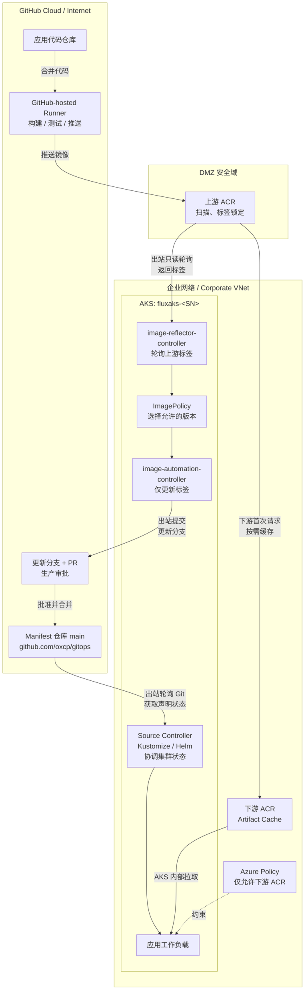

# AKS + Flux + ACR Artifact Cache：出站优先的容器镜像交付架构

## 1. 文档目的

本文描述一个面向企业受限网络环境的容器镜像交付方案：应用代码在 GitHub 上完成持续集成，镜像首先进入 DMZ 区域的上游 Azure Container Registry（ACR），企业网络中的下游 ACR 通过 Artifact Cache 按需获取镜像，AKS 使用 Flux GitOps 自动发现新标签、更新部署清单并完成发布。

方案重点满足以下原则：

- 企业网络不接收入站 Webhook 或来自 Internet/DMZ 的主动连接。
- GitHub CI 只负责构建、测试和推送镜像，不直接部署 AKS。
- AKS 只从企业侧下游 ACR 拉取运行镜像。
- Flux 采用轮询方式发现新镜像和同步 Git，不依赖入站事件。
- 生产环境的镜像标签变更需要通过独立分支和 Pull Request 审批。
- 镜像仓库地址保持为企业侧 ACR，仅自动更新镜像标签。

---

## 2. 业务场景

企业希望使用 GitHub 承载应用代码和 Kubernetes Manifest，同时使用 AKS 运行工作负载。由于企业网络执行严格的边界安全策略，不允许 GitHub、DMZ 或其他外部系统主动连接企业 VNet，因此传统的 Webhook 驱动部署、CI 直接访问 AKS API Server、AKS 直接从 Internet 拉取镜像等方式不符合要求。

本方案将容器供应链划分为三个安全域：

1. **GitHub Cloud / Internet 区域**
   - 存放应用代码仓库和 Manifest 仓库。
   - GitHub-hosted runner 执行构建和测试。
   - CI 将通过验证的镜像推送到 DMZ 上游 ACR。

2. **DMZ 区域**
   - 上游 ACR 作为来自 CI 的镜像接入点。
   - 在镜像进入企业运行环境前执行安全扫描、标签规范和不可变控制。
   - 允许企业侧组件以只读方式主动获取镜像或元数据。

3. **企业网络区域**
   - 部署 AKS、Flux Extension 和下游 ACR。
   - 下游 ACR 通过 Artifact Cache 从上游 ACR 按需缓存镜像。
   - AKS 仅从下游 ACR 拉取镜像。
   - Flux 通过出站访问轮询上游 ACR 和 GitHub Manifest 仓库。

---

## 3. 要解决的问题

### 3.1 网络边界限制

企业网络不允许来自 Internet 或 DMZ 的入站连接，因此不能依赖以下模式：

- GitHub Webhook 直接触发企业网络中的服务。
- GitHub Actions 直接访问企业 AKS API Server。
- 外部流水线直接对 AKS 执行 `kubectl apply` 或 Helm 部署。
- AKS 节点直接从外部或 DMZ 镜像仓库拉取运行镜像。

### 3.2 镜像安全与供应链隔离

需要将“镜像构建入口”和“生产运行镜像仓库”隔离，并保证：

- CI 推送的镜像先落入 DMZ 上游 ACR。
- 企业侧仅以只读方式获取已经发布的镜像。
- AKS 工作负载只能使用企业侧下游 ACR。
- 生产使用的标签可审计、不可覆盖，并能够关联 Git commit。

### 3.3 自动发现与部署新镜像

需要在不开放入站 Webhook 的情况下：

- 定期扫描上游 ACR 的新标签。
- 按版本策略选出允许部署的标签。
- 只修改 Manifest 中的镜像标签，不改变下游 ACR 地址。
- 将变更提交到 Git，继续由 Flux 的 Kustomize/Helm Controller 完成声明式部署。

### 3.4 避免镜像全量复制

不希望使用定时脚本将上游 ACR 全量同步到下游 ACR。下游 ACR 应在 AKS 第一次请求某个镜像时获取并缓存该镜像，后续拉取直接从企业侧缓存提供。

---

## 4. 实现方案概述

本方案组合使用以下机制：

1. GitHub Actions 构建、测试并将镜像推送到上游 ACR。
2. Microsoft Defender for Cloud 对上游 ACR 中的镜像执行漏洞评估；仓库使用不可变、可排序标签。
3. AKS 中的 `image-reflector-controller` 定期扫描上游 ACR 的标签。
4. `ImagePolicy` 根据 SemVer、数字或约定格式选择目标标签。
5. `image-automation-controller` 将新标签提交到 Manifest 仓库的更新分支。
6. 生产分支通过 GitHub Branch Protection 和 Pull Request 审批控制合并。
7. Flux Source、Kustomize 或 Helm Controller 读取合并后的声明状态并协调 AKS。
8. Manifest 中的镜像仓库始终指向下游 ACR，只由 Flux 更新标签。
9. AKS 第一次拉取新标签时，下游 ACR 的 Artifact Cache 使用托管身份从上游 ACR 获取镜像并保存到本地缓存。
10. 后续镜像拉取直接由下游 ACR 提供。
11. Azure Policy for Kubernetes 限制工作负载只能引用下游 ACR。

> **关键边界：** Flux Image Automation 负责发现标签和修改 Git，它不负责在两个 ACR 之间复制镜像；镜像内容的按需获取由 ACR Artifact Cache 完成。

---

## 5. 总体架构

保留 GitHub、DMZ 和企业网络的安全域分组，以纵向为主展示完整流程。**箭头表示镜像内容或声明状态的传递，不表示网络连接的发起方向**；实际网络方向见 5.1 节。



上游 ACR 为 `acrup<SN>.azurecr.io`，下游 ACR 为 `acrdown<SN>.azurecr.io`（部署时以实际 login server 为准）。下游缓存使用托管身份只读访问上游；Flux 只更新标签，不修改下游仓库地址，也不负责复制镜像。整个流程不需要入站 Webhook。

### 5.1 网络方向

| 编号 | 发起方 | 目标 | 用途 | 方向与权限 |
| --- | --- | --- | --- | --- |
| N1 | GitHub-hosted runner | 上游 ACR | 推送构建镜像 | Internet → DMZ，写入 |
| N2 | 下游 ACR Artifact Cache | 上游 ACR | 首次请求时获取镜像 | 企业侧逻辑出站，只读 |
| N3 | Flux image-reflector | 上游 ACR | 获取仓库标签和 digest | 企业侧出站，只读 |
| N4 | Flux Source / Automation | GitHub Manifest 仓库 | 读取清单、提交更新分支 | 企业侧出站，读/受限写 |
| N5 | Flux Extension Agent | Azure 管理端点 | 扩展管理和状态上报 | 企业侧出站 |
| N6 | AKS 节点 | 下游 ACR | 拉取工作负载镜像 | 企业网络内部 |

企业网络不需要接收 GitHub Webhook、DMZ 回调或 CI 到 AKS 的入站连接。

---

## 6. 资源规划

所有 AKS 和 ACR 资源部署到以下位置：

| 项目 | 值 |
| --- | --- |
| 资源组 | `rg-acrcache` |
| Azure 区域 | `westus2` |
| 随机后缀 | `<SN>`，在一次部署中统一使用 |
| AKS 集群 | `fluxaks-<SN>` |
| GitHub Manifest 仓库 | `https://github.com/oxcp/gitops` |

### 6.1 ACR 命名修正

原始需求中的 `acr-up-<SN>` 和 `acr-down-<SN>` 包含连字符，不符合 ACR 名称只能使用字母和数字的规则。实际部署建议使用：

| 逻辑角色 | 原始逻辑名称 | 可部署资源名称 | Login Server |
| --- | --- | --- | --- |
| 上游 ACR / DMZ ACR | `acr-up-<SN>` | `acrup<SN>` | `acrup<SN>.azurecr.io` |
| 下游 ACR / Corporate ACR | `acr-down-<SN>` | `acrdown<SN>` | `acrdown<SN>.azurecr.io` |

ACR 名称还必须在 Azure 全局唯一，因此 `<SN>` 的生成过程需要执行可用性检查。

### 6.2 建议的辅助资源

| 资源 | 作用 |
| --- | --- |
| DMZ VNet/子网 | 承载 DMZ 私有终结点或受控访问路径 |
| Corporate VNet/AKS 子网 | 承载 AKS 节点及企业侧网络资源 |
| ACR Private Endpoint 与 Private DNS | 为 AKS 到下游 ACR 提供私有访问 |
| 用户分配托管身份：ACR Cache | 下游 ACR 对上游仓库执行只读缓存获取 |
| 用户分配托管身份：Flux | Flux image-reflector 使用 Workload Identity 读取上游 ACR |
| Azure Policy Assignment | 限制 AKS 工作负载只能使用下游 ACR |
| Defender for Cloud | 对上游 ACR 镜像执行漏洞评估和安全治理 |

---

## 7. 选用的 Azure 与 GitHub 服务

| 服务/组件 | 用途 | 选择原因 |
| --- | --- | --- |
| Azure Kubernetes Service | 运行企业容器工作负载 | 托管 Kubernetes，与 ACR、Azure Policy、Workload Identity 集成 |
| Azure Container Registry：上游 | 接收 GitHub CI 构建镜像 | 作为 DMZ 供应链入口，隔离 CI 与生产运行仓库 |
| Azure Container Registry：下游 | AKS 唯一允许使用的镜像仓库 | 位于企业侧，可通过 Private Endpoint 为 AKS 提供私有访问 |
| ACR Artifact Cache | 从上游 ACR 按需缓存镜像 | 第一次拉取获取镜像，后续本地提供，无需全量同步 |
| Flux v2 Extension | 基于 Git 声明状态协调 AKS | 通过轮询工作，不要求入站 Webhook |
| image-reflector-controller | 扫描上游 ACR 标签和 digest | 将镜像元数据反映为 `ImageRepository` / `ImagePolicy` 状态 |
| image-automation-controller | 更新 Manifest 仓库中的镜像标签 | 自动提交 Git 变更，同时保留审计记录 |
| GitHub Actions | 构建、测试和推送镜像 | CI 与部署解耦，不直接访问 AKS |
| GitHub Branch Protection / PR | 生产发布审批 | 防止自动化直接修改受保护生产分支 |
| Microsoft Entra Workload Identity | Flux 访问上游 ACR | 使用短期令牌，避免在集群保存 ACR 长期密码 |
| 用户分配托管身份 | ACR-to-ACR Cache 认证 | 下游 ACR 无需在 Key Vault 保存上游仓库密码 |
| Azure Policy for Kubernetes | 限制允许的镜像仓库 | 阻止工作负载绕过下游 ACR |
| Microsoft Defender for Cloud | 镜像漏洞评估 | 在镜像进入生产使用路径前提供安全信号 |

---

## 8. 镜像与 GitOps 数据流

### 8.1 CI 阶段

1. 开发人员将代码合并到应用仓库主分支。
2. GitHub-hosted runner 构建和测试容器镜像。
3. CI 使用 GitHub OIDC 联合身份登录 Azure，避免保存长期 Azure 密钥。
4. CI 将镜像推送到上游 ACR。
5. 镜像标签采用不可变、可排序格式，例如：

   ```text
   <branch>-<short-sha>-<timestamp>
   ```

6. 上游 ACR 禁止覆盖已发布标签，并由 Defender 执行安全评估。

### 8.2 镜像发现与 Git 更新

1. `ImageRepository` 指向上游 ACR，并设置 `provider: azure`。
2. `image-reflector-controller` 按固定间隔扫描标签。
3. `ImagePolicy` 过滤不符合发布规则的标签，并选出目标版本。
4. Manifest 中的镜像仓库固定为下游 ACR，例如：

   ```yaml
   image: acrdown<SN>.azurecr.io/myapp:<tag>
   ```

5. Flux 的 setter 标记只关联 `tag` 字段，避免把镜像仓库地址改回上游 ACR。
6. `image-automation-controller` 将标签变更提交到专用更新分支。
7. 对生产环境，由 GitHub 流程创建或维护 Pull Request，经审批后合并到生产分支。

> Flux Image Automation 可以向指定分支提交变更；Pull Request 的创建和审批应由 GitHub 分支策略、GitHub Actions 或人工流程完成，不应假定 Flux Controller 自身完成 PR 审批流程。

### 8.3 部署与镜像缓存

1. Flux Source Controller 轮询 Manifest 仓库。
2. Kustomize 或 Helm Controller 将合并后的声明状态协调到 AKS。
3. AKS 请求 `acrdown<SN>.azurecr.io/myapp:<tag>`。
4. 如果下游 ACR 尚未缓存该镜像，Artifact Cache 使用用户分配托管身份从上游 ACR 获取镜像。
5. 首次请求完成后，镜像保存在下游 ACR 缓存中。
6. 后续 AKS 节点直接从下游 ACR 获取镜像。

---

## 9. 身份与权限设计

建议为不同数据流使用独立身份，以符合最小权限原则。

| 调用方 | 目标 | 建议身份 | 最小权限 |
| --- | --- | --- | --- |
| GitHub Actions | 上游 ACR | GitHub OIDC + Entra 应用/托管身份 | 仅目标仓库的推送权限；非 ABAC 模式可使用 `AcrPush` |
| ACR Artifact Cache | 上游 ACR | 独立用户分配托管身份 | 上游目标 repository 范围的 `Container Registry Repository Reader` |
| Flux image-reflector | 上游 ACR | AKS Workload Identity | ABAC ACR 使用 `Container Registry Repository Reader`；非 ABAC 使用 `AcrPull` |
| AKS kubelet | 下游 ACR | AKS kubelet 托管身份 | 下游 ACR 拉取权限 |
| Flux Source Controller | GitHub Manifest 仓库 | GitHub Deploy Key 或受限 Token | 仓库读取权限 |
| Flux image-automation | GitHub Manifest 仓库 | 可写 Deploy Key 或受限 Token | 仅更新分支写入权限 |

ACR-to-ACR Artifact Cache 的当前官方方案要求：

- 上游 ACR 启用 RBAC + ABAC repository permissions 模式。
- Cache 使用用户分配托管身份访问上游 ACR。
- 身份在指定上游 repository 范围获得 `Container Registry Repository Reader`。
- Cache Rule 将上游 repository 映射到下游 repository。

---

## 10. Flux 资源设计

预计需要在 GitOps 仓库中定义以下资源：

| Flux 资源 | 用途 |
| --- | --- |
| `GitRepository` | 定义 Manifest Git 来源和写入认证引用 |
| `Kustomization` 或 `HelmRelease` | 将声明状态协调到 AKS |
| `ImageRepository` | 扫描上游 ACR 的指定 repository |
| `ImagePolicy` | 根据标签格式和版本规则选择目标标签 |
| `ImageUpdateAutomation` | 更新 Manifest 中的标签并提交到更新分支 |

AKS 的 `microsoft.flux` Extension 默认不启用以下两个 Controller，部署时必须显式开启：

```text
image-reflector-controller.enabled=true
image-automation-controller.enabled=true
```

如果使用 Workload Identity，`ImageRepository` 需要配置 `provider: azure`，并为 `flux-system` 命名空间中的 `image-reflector-controller` ServiceAccount 建立联合身份凭据。

---

## 11. 网络与安全控制

### 11.1 必须允许的出站访问

企业侧至少需要允许以下 HTTPS 出站访问：

- 上游 ACR 的 Registry/Data Endpoint。
- GitHub Manifest 仓库使用的 Git HTTPS 或 SSH Endpoint。
- Azure Resource Manager 和 Kubernetes Configuration 数据面端点。
- Microsoft Entra 登录端点。
- Microsoft Container Registry，用于下载 Flux Controller 镜像。

具体 FQDN 应根据企业防火墙策略、AKS 出站模式和部署区域形成正式白名单。

### 11.2 必须阻止或避免的路径

- GitHub-hosted runner 不得访问 AKS API Server。
- AKS 工作负载不得直接引用上游 ACR。
- 企业网络不部署面向 GitHub 的 Webhook Receiver。
- 下游 ACR Cache 身份不得获得上游写入权限。
- image-reflector 身份不得获得 ACR 推送或删除权限。
- image-automation 的 Git 凭据不得拥有仓库管理权限。

### 11.3 Azure Policy

建议在 AKS 上应用允许镜像仓库列表策略，仅允许：

```text
acrdown<SN>.azurecr.io/*
```

策略需要覆盖 Pod 以及由 Deployment、StatefulSet、DaemonSet、Job、CronJob 等控制器生成的容器，包括 init container 和 ephemeral container（如企业策略要求）。

---

## 12. 关键设计决策

### 12.1 使用 Artifact Cache，而非全量同步

Artifact Cache 是 pull-through cache。它不会提前复制上游的所有镜像；只有当下游首次请求某个标签或 digest 时才会获取并缓存。因此它适合“按实际部署需求引入镜像”的企业场景，但不等同于灾备复制或离线全量镜像同步。

### 12.2 image-reflector 扫描上游，AKS 拉取下游

Flux 根据上游 ACR 的标签决定版本，但 Manifest 中的 repository 地址固定为下游 ACR。这样可以同时实现：

- 自动发现上游新版本。
- AKS 不直接访问上游仓库。
- 由下游 ACR 在首次部署时按需填充缓存。

### 12.3 自动化只修改标签

Manifest 应将 image name 和 tag 分开管理，或使用 Flux 支持的 tag setter 标记。自动化只改变标签，不改变 registry/repository，避免生成引用上游 ACR 的生产清单。

### 12.4 生产通过更新分支和 PR

生产分支必须启用保护策略。image-automation 将变更推送到专用分支，PR 由 GitHub 自动化或人工创建并审批。只有合并后的生产分支才是 Flux 的部署来源。

### 12.5 不使用入站 Webhook

所有关键环节均使用轮询或平台托管操作：

- Flux 轮询 Git。
- image-reflector 轮询 ACR。
- Artifact Cache 在下游镜像被请求时拉取上游内容。

---

## 13. 前提条件与约束

- Azure CLI 需要满足 ACR-to-ACR Artifact Cache 官方文档要求；当前文档要求 Azure CLI `2.85.0` 或更高版本。
- AKS 必须使用托管身份，而不是旧式 Service Principal 模式。
- AKS 需要启用 OIDC Issuer 和 Workload Identity，才能采用推荐的 Flux 身份设计。
- 上游 ACR 需要启用 RBAC + ABAC repository permissions 模式，以使用 repository 范围的 Cache 读取权限。
- GitHub-hosted runner 必须能够访问上游 ACR。如果上游 ACR 完全关闭公网访问，则需要使用位于 DMZ 网络内的 self-hosted runner，或提供符合安全策略的专用访问路径。
- Manifest 仓库的写入凭据必须支持 image-automation 提交更新分支。
- Artifact Cache 首次拉取会产生额外延迟，部署超时和镜像预热策略需要在生产环境评估。
- Artifact Cache 不是两个 ACR 之间的持续全量复制，也不是跨区域灾备方案。
- ACR Cache Rule、相关 API 版本及区域可用性应在正式部署前于目标订阅和 `westus2` 验证。

---

## 14. 操作步骤

以下命令使用 **PowerShell 7.4+**，在本目录中按顺序执行。使用 [Deploy.ps1](./Deploy.ps1) 的 `Render` / `Infrastructure` 阶段生成清单和创建实验资源，再手动配置分支审批及 Flux；这样可在首次同步前把自动化写入目标改成更新分支，而不是直接写 `main`。

> [!IMPORTANT]
> - 当前脚本是**功能验证基线**：创建公网可达的 ACR 和默认网络 AKS，使用 kubelet identity 为 Flux 读取上游认证。它**不会**创建企业 DMZ/VNet、Private Endpoint、Workload Identity 联合凭据、Defender 或 Azure Policy，也不会自动配置 GitHub CI。
> - 因此，跑通本节不等于完成第 11 节的生产网络与安全要求。受限网络环境必须先完成 14.2 的网络适配；需要独立 Flux 身份时，按 14.4 的生产路径替换认证，不能将实验 kubelet 身份方案视作隔离的 Workload Identity。
> - 脚本会创建收费资源和角色分配。使用有资源创建、角色分配权限的实验订阅；不要在已有同名资源上盲目重复运行。每条命令成功后再继续。

### 14.1 准备部署变量与生成 `<SN>`

准备 Azure CLI `2.85.0+`、PowerShell、Git、GitHub CLI 和 `kubectl`。确认 Azure 与 GitHub 已登录；未登录时分别执行 `az login`、`gh auth login`。安装缺少的 CLI 扩展后，验证命令能正常加载：

```powershell
$ErrorActionPreference = 'Stop'
$PSNativeCommandUseErrorActionPreference = $true
$SubscriptionId = '<你的 Azure 订阅 GUID>'
az account set --subscription $SubscriptionId
az account show --query '{subscription:id,tenant:tenantId}' -o table
az version
gh auth status
az extension add --name k8s-extension --upgrade
az extension add --name k8s-configuration --upgrade
az k8s-extension create --help
az k8s-configuration flux create --help

.\Deploy.ps1 -Phase Render -SubscriptionId $SubscriptionId
$s = Get-Content .\generated\environment.json -Raw | ConvertFrom-Json
$ClusterDir = Join-Path $PWD "generated\manifests\$($s.gitOpsPath)"
$s | Format-List
kubectl kustomize $ClusterDir
```

`Render` 不调用 Azure、GitHub 或 Kubernetes API；自动生成并保存 8 位 `<SN>`，后续阶段复用同一 `generated\environment.json`。不要删除状态文件后继续操作原环境。若 ACR 名称已被其他订阅占用，应在创建任何资源前，用新的 `-SN` 和独立 `-OutputDirectory` 重新生成；后续命令也须使用该输出目录。

若 CLI 扩展导入时报 `rpds.rpds` 错误，先按 [Repair-AzureCli.ps1](./Repair-AzureCli.ps1) 的参数和提示修复；使用隔离扩展目录时，在当前终端设置 `$env:AZURE_EXTENSION_DIR` 为其实际路径，并重新执行两个 `--help` 检查。

### 14.2 创建资源组和网络基础设施

先检查 `rg-acrcache` 是否已有无关资源，以及资源名是否可用：

```powershell
az group exists --name $s.resourceGroup
az acr check-name --name $s.upstreamAcr -o table
az acr check-name --name $s.downstreamAcr -o table
```

若资源组已存在，先人工确认归属；`nameAvailable` 为 `false` 时停止，不要覆盖已有环境。

- **公网功能实验**：下一节的 `Infrastructure` 阶段创建资源组和默认 AKS 网络；不额外创建 DMZ 或企业 VNet。实验只能验证 GitOps 与缓存机制，不能验证网络隔离。
- **企业受限网络**：不要直接执行脚本的默认基础设施阶段。先在批准的网络中创建 DMZ 与企业子网，为 AKS 配置企业子网及受控出站；为下游 Premium ACR 创建 `registry` Private Endpoint，将 `privatelink.azurecr.io` Private DNS 区域链接到 AKS 所在 VNet。从管理终端和 AKS 验证 Registry/Data Endpoint 的 DNS、路由与 HTTPS 可达后，再关闭下游公网入口。上游必须保留 CI 与缓存服务可达的受控路径；Private Endpoint 本身不会自动解决 ACR-to-ACR 服务访问。

企业路径需将这些网络参数落实到经审查的基础设施模板中，再继续后面的同等配置。网络配置参考 [ACR Private Link](https://learn.microsoft.com/en-us/azure/container-registry/container-registry-private-link) 和 [AKS 出站网络要求](https://learn.microsoft.com/en-us/azure/aks/outbound-rules-control-egress)。

### 14.3 创建上游与下游 ACR

公网实验执行一次基础设施阶段。它会连续创建资源组、上游 Standard ACR（ABAC）、下游 Premium ACR（RBAC）、缓存托管身份、双节点 AKS、角色分配及缓存规则，并向上游导入演示标签 `1.0.0`：

```powershell
.\Deploy.ps1 -Phase Infrastructure -SubscriptionId $SubscriptionId
$s = Get-Content .\generated\environment.json -Raw | ConvertFrom-Json
az acr show --name $s.upstreamAcr `
    --query '{loginServer:loginServer,permissions:roleAssignmentMode,admin:adminUserEnabled}' -o table
az acr show --name $s.downstreamAcr `
    --query '{loginServer:loginServer,permissions:roleAssignmentMode,admin:adminUserEnabled}' -o table
```

后续始终使用状态文件里的实际 `loginServer`，不要仅用资源名拼接域名。两个 ACR 的 admin account 均应为禁用状态。默认导入公开 podinfo 镜像只用于验证交付链路，**不等于运行了业务 CI 或安全扫描**。

若阶段中途失败，先查看已创建资源和错误，修复权限、配额或区域支持问题后再恢复；不要删除状态文件来绕过失败。

### 14.4 创建托管身份并配置最小权限

检查基础设施阶段已经创建的身份和授权：

```powershell
$UpId = az acr show --name $s.upstreamAcr --query id -o tsv
$DownId = az acr show --name $s.downstreamAcr --query id -o tsv
$CachePrincipal = az identity show --resource-group $s.resourceGroup `
    --name $s.cacheIdentity --query principalId -o tsv
$KubeletPrincipal = az aks show --resource-group $s.resourceGroup `
    --name $s.aks --query identityProfile.kubeletidentity.objectId -o tsv
az role assignment list --scope $UpId --all `
    --query '[].{principal:principalId,role:roleDefinitionName,condition:condition}' -o json
az role assignment list --scope $DownId --all `
    --query '[].{principal:principalId,role:roleDefinitionName}' -o table
```

确认：

1. `$CachePrincipal` 在上游有 `Container Registry Repository Reader`，ABAC 条件仅允许 `$s.imageRepository`。
2. 实验中的 `$KubeletPrincipal` 在上游有相同的受限只读角色，用于 Flux 扫描；在下游有 `AcrPull`，用于工作负载拉取。二者均不需要上游写入权限。权限传播可能需要数分钟。
3. 操作人员执行演示导入/验证所需的数据权限，与上述运行身份分开配置；ABAC 模式不能仅依靠旧的 `AcrPush` / `AcrPull` 角色访问上游数据。

**生产身份隔离路径**：按 [Flux Azure 身份集成](https://fluxcd.io/flux/integrations/azure/) 创建独立 Flux UAMI，启用 AKS OIDC Issuer 与 Workload Identity，将 issuer、`system:serviceaccount:flux-system:image-reflector-controller` 和 `api://AzureADTokenExchange` 建立联合信任，并配置 Controller 的 ServiceAccount 注解及 Pod 标签。仅授权该 UAMI 读取目标上游 repository，移除 kubelet 的上游读取授权；同时使用所部署扩展版本支持的持久化配置方式，避免手工修改的 Controller 被扩展升级覆盖。此路径不能继续使用下一节实验配置中的 `useKubeletIdentity=true`。

### 14.5 配置 ACR-to-ACR Artifact Cache

基础设施阶段已使用 `az acr cache create --identity <缓存 UAMI 资源 ID>` 创建规则。检查映射和身份：

```powershell
az acr cache show --registry $s.downstreamAcr --name "upstream-$($s.sn)" -o json
az acr repository show --name $s.upstreamAcr `
    --image "$($s.imageRepository):1.0.0" --query digest -o tsv
```

规则的 `sourceRepository` 应是 `$s.upstreamLoginServer/$s.imageRepository`，`targetRepository` 是同名下游 repository，身份应为缓存 UAMI。此时**不要主动拉取下游测试标签**；保留首次 AKS 拉取触发缓存的验证机会。没有下游缓存内容是正常现象，不表示规则失败。

### 14.6 创建 AKS 并集成下游 ACR

AKS 已由基础设施阶段创建，并通过 `--attach-acr` 授予 kubelet 下游拉取权限。使用独立 kubeconfig，避免误操作其他集群：

```powershell
$env:KUBECONFIG = Join-Path $PWD "generated\$($s.aks).kubeconfig"
az aks get-credentials --resource-group $s.resourceGroup --name $s.aks `
    --file $env:KUBECONFIG --overwrite-existing
kubectl config current-context
kubectl get nodes
```

确认当前上下文为本次 `$s.aks`，两个节点均为 `Ready`。如果选择第 14.4 节的生产身份路径，还应检查 AKS 的 `oidcIssuerProfile.issuerUrl` 和 `securityProfile.workloadIdentity.enabled`；默认脚本未启用这两项。

### 14.7 安装 Flux Extension 并启用 Image Controllers

以下是公网实验的 kubelet identity 配置。新集群执行 `create`；已有 `flux` 扩展应先检查现有配置，再使用 `az k8s-extension update` 合并所需设置，不要安装第二套 Flux 或运行 `flux bootstrap` 覆盖扩展：

```powershell
az k8s-extension create --resource-group $s.resourceGroup `
    --cluster-name $s.aks --cluster-type managedClusters `
    --name flux --extension-type microsoft.flux --config `
    image-reflector-controller.enabled=true `
    image-automation-controller.enabled=true useKubeletIdentity=true

foreach ($controller in @('source-controller', 'kustomize-controller',
    'image-reflector-controller', 'image-automation-controller')) {
    kubectl -n flux-system wait --for=create "deployment/$controller" --timeout=300s
    kubectl -n flux-system rollout status "deployment/$controller" --timeout=300s
}
kubectl get crd imagerepositories.image.toolkit.fluxcd.io `
    imagepolicies.image.toolkit.fluxcd.io imageupdateautomations.image.toolkit.fluxcd.io `
    -o 'jsonpath={range .items[*]}{.metadata.name}{": "}{range .spec.versions[*]}{.name}{"(served="}{.served}{") "}{end}{"\n"}{end}'
```

清单使用 `image.toolkit.fluxcd.io/v1`。确认三个 CRD 均提供并服务 `v1`；若扩展版本不兼容，先升级到兼容版本，再发布清单，不要仅根据 CRD 存在就继续。

### 14.8 配置 Flux GitRepository 与 GitHub 写入凭据

脚本默认指向 `https://github.com/oxcp/gitops` 的 `main` 分支，需要该仓库的授权。没有权限时先 Fork，并将**生成清单**中的 Git URL、后文克隆/PR 命令、Flux 配置 URL 和验证脚本中的目标仓库统一替换；不要尝试向无权限仓库推送。

为自动化账号创建仅限 Manifest 仓库的 fine-grained PAT，授予 `Contents: Read and write`，配置组织审批及有效期；账号不得绕过 `main` 分支保护。PR 由人工创建，因此该 PAT 不需要仓库管理权限。公开仓库也需要写凭据才能自动提交。

凭据只经标准输入传给 Kubernetes，不写入磁盘、Git 或命令行参数：

```powershell
$GitHubUser = '<有仓库写权限的 GitHub 用户名>'
$GitToken = Read-Host 'Flux GitHub PAT' -MaskInput
try {
    @{
        apiVersion = 'v1'
        kind = 'Secret'
        metadata = @{ name = $s.gitSecret; namespace = 'flux-system' }
        type = 'Opaque'
        stringData = @{ username = $GitHubUser; password = $GitToken }
    } | ConvertTo-Json -Depth 5 -Compress | kubectl apply -f - -o name
}
finally {
    Remove-Variable GitToken -ErrorAction SilentlyContinue
}
```

`automation/gitrepository.yaml` 已引用同命名空间中的 `$s.gitSecret`；稍后 Azure Flux 配置也引用它。不要提交 Secret YAML，且不要用 `kubectl get secret -o yaml` 将凭据输出到日志。

### 14.9 创建 ImageRepository、ImagePolicy 和 ImageUpdateAutomation

`Render` 已生成完整资源，目录为：

```text
generated/manifests/clusters/acrcache-<SN>/
├── kustomization.yaml
├── automation/
│   ├── kustomization.yaml
│   ├── gitrepository.yaml
│   └── images.yaml
└── apps/
    ├── kustomization.yaml
    ├── namespace.yaml
    ├── deployment.yaml
    └── service.yaml
```

发布前检查 `automation/images.yaml`：

| 配置 | 预期 |
| --- | --- |
| `ImageRepository.spec.image` | 上游实际 login server 加 `$s.imageRepository` |
| `ImageRepository.spec.provider` | `azure`，使用上一节配置的实验 kubelet 身份或生产独立身份 |
| `ImagePolicy.spec.policy.semver.range` | `>=1.0.0 <2.0.0`，本实验使用 `1.0.0` / `1.0.1` |
| `ImageUpdateAutomation.spec.sourceRef.name` | `$s.writer`，对应带写凭据的 GitRepository |
| `git.checkout.ref.branch` | `main` |
| `update.path` | `./clusters/acrcache-<SN>/apps`，不改其他应用 |

`apps/kustomization.yaml` 必须保留以下模式；将占位符替换为本次实际值：

```yaml
images:
  - name: podinfo
    newName: acrdown<SN>.azurecr.io/demo/podinfo
    newTag: '1.0.0' # {"$imagepolicy": "flux-system:podinfo-<SN>:tag"}
```

只在 `newTag` 放 `:tag` setter，**不要**给 `newName` 添加 `:name` setter。第 8.1 节的 `main-<sha>-<timestamp>` 不符合本实验 SemVer 规则；使用该格式时应先按 [Flux 标签过滤示例](https://fluxcd.io/flux/guides/image-update/#imagepolicy-examples) 调整 `filterTags` 和排序策略，不能混用。

此时不要直接 `kubectl apply` 应用清单；先完成下一节的分支配置和首次发布，由 Flux 从 Git 同步。

### 14.10 配置生产分支保护和 PR 流程

1. 在 Manifest 仓库的 **Settings → Rules → Rulesets**（或 Branch protection rules）保护 `main`：要求 Pull Request、至少一位审核者、团队要求的状态检查，禁止 force push；不要为 Flux 写入账号配置绕过权限。
2. 编辑生成的 `automation/images.yaml`，**仅将 `spec.git.push.branch`** 改为 `flux-images-<SN>`；`git.checkout.ref.branch` 和两个 Git 来源仍读 `main`：

   ```yaml
   git:
     checkout:
       ref:
         branch: main
     # 保留原有 commit 配置
     push:
       branch: flux-images-<SN>
   ```

3. 使用独立设置分支发布本次集群目录。以下命令假设默认仓库且本地目标目录尚不存在：

   ```powershell
   $SetupBranch = "setup-acrcache-$($s.sn)"
   $UpdateBranch = "flux-images-$($s.sn)"
   gh repo clone oxcp/gitops .\gitops-checkout
   git -C .\gitops-checkout switch -c $SetupBranch origin/main
   $Target = Join-Path $PWD "gitops-checkout\$($s.gitOpsPath)"
   if (Test-Path $Target) { throw "目标已存在，请先审查：$Target" }
   New-Item -ItemType Directory -Force (Split-Path $Target) | Out-Null
   Copy-Item $ClusterDir $Target -Recurse
   kubectl kustomize $Target
   git -C .\gitops-checkout add -- $s.gitOpsPath
   git -C .\gitops-checkout diff --cached
   git -C .\gitops-checkout commit -m "Add ACR cache GitOps environment"
   git -C .\gitops-checkout push -u origin $SetupBranch
   gh pr create --repo oxcp/gitops --base main --head $SetupBranch `
       --title 'Add ACR cache GitOps environment' `
       --body 'Review registry addresses, tag-only setters and the image update branch.'
   ```

4. 等审核者批准并合并设置 PR 后，再创建 Flux 同步配置。不要运行 `Deploy.ps1 -Phase Infrastructure` 重新生成清单覆盖刚才的分支修改，也不要混用另一套 `-Phase GitOps` 初始化流程：

   ```powershell
   az k8s-configuration flux create --resource-group $s.resourceGroup `
       --cluster-name $s.aks --cluster-type managedClusters `
       --name $s.configuration --namespace flux-system --scope cluster `
       --url $s.gitUrl --branch main --local-auth-ref $s.gitSecret `
       --sync-interval 1m --kustomization name=demo `
           "path=./$($s.gitOpsPath)" prune=true sync_interval=1m timeout=5m
   kubectl -n flux-system get gitrepositories,kustomizations
   kubectl -n flux-system get imagerepositories,imagepolicies,imageupdateautomations
   kubectl -n $s.namespace wait --for=create deployment/podinfo --timeout=600s
   kubectl -n $s.namespace rollout status deployment/podinfo --timeout=600s
   ```

`prune=true` 会删除从该 Git 路径移除的受管资源；不要把无关应用放入本例命名空间。后续 Flux 会自动创建/更新 `$UpdateBranch`，**不会自动创建或批准 PR**；新标签的 PR 操作见 14.12。

### 14.11 配置 Defender、标签锁定和 Azure Policy

这些控制未包含在部署脚本中，需单独完成：

1. **Defender**：在 Azure 门户 **Microsoft Defender for Cloud → Environment settings → 目标订阅 → Defender plans** 中按组织要求启用容器镜像漏洞评估能力（会产生费用），确认上游 ACR 纳入覆盖范围。等待目标 digest 的评估结果；在 CI 或发布审批中配置严重漏洞阻断。仅开启 Defender **不会自动阻止** Flux 选择未通过扫描的标签。
2. **标签锁定**：审核通过后，锁定每个已发布标签，禁止覆盖和删除，但保留读取权限：

   ```powershell
   az acr repository update --name $s.upstreamAcr `
       --image "$($s.imageRepository):1.0.0" --write-enabled false --delete-enabled false
   az acr repository show --name $s.upstreamAcr `
       --image "$($s.imageRepository):1.0.0" --query changeableAttributes -o json
   ```

   后续标签也要逐一执行；生产 CI 应在镜像验证通过后锁定对应标签/digest，不要对同一发布标签使用覆盖推送。

3. **Azure Policy**：执行 `az aks enable-addons --resource-group $s.resourceGroup --name $s.aks --addons azure-policy`。在 Azure Policy 的 **Definitions** 中选择 **Kubernetes cluster containers should only use allowed images**，将作用域限定到本 AKS 或其专用资源组。先用 `Audit` 检查影响，镜像正则设置为仅匹配实际下游 login server 的 `^<转义后的下游域名>/.*$`，例如 `^acrdown12345678\.azurecr\.io/.*$`；再改为 `Deny`。按组织要求排除系统命名空间，**不要排除本例应用命名空间**。不要阻断 Flux、Azure Policy 等系统组件的必要镜像。
4. 等策略同步后，检查 `kubectl get constrainttemplates` 和 Policy 合规结果；使用下面的服务端 dry-run 请求测试。将 `<SN>` 替换为本次值：

   ```powershell
   kubectl -n $s.namespace run denied-registry-check `
       --image=mcr.microsoft.com/oss/nginx/nginx:1.25.5 `
       --restart=Never --dry-run=server -o yaml
   ```

   **预期是明确的策略拒绝错误**（本命令预期非零退出）；若返回 Pod YAML，说明准入控制未生效，不能判定通过。dry-run 不会创建 Pod。内置策略对 init/ephemeral container 的覆盖应按当前定义核验，不足时补充企业自定义策略。

### 14.12 执行端到端验证

先确认首次部署的 `1.0.0` 已就绪。然后只向**上游**发布一个尚未使用的新标签；本例用同一 podinfo 镜像的新标签验证交付机制，不代表业务功能变更：

```powershell
$ExpectedTag = '1.0.1'
az acr repository show-tags --name $s.downstreamAcr `
    --repository $s.imageRepository -o table
az acr import --name $s.upstreamAcr --source ghcr.io/stefanprodan/podinfo:6.9.2 `
    --image "$($s.imageRepository):$ExpectedTag"
az acr repository update --name $s.upstreamAcr `
    --image "$($s.imageRepository):$ExpectedTag" --write-enabled false --delete-enabled false
kubectl -n flux-system get imagepolicy $s.imagePolicy -o yaml
kubectl -n flux-system get imageupdateautomation $s.imagePolicy -o yaml
```

发布前的下游标签列表不应含 `1.0.1`；若已存在，选择下一个未使用的 `1.x.y` 标签，不要删除已有缓存来伪造首次拉取。等待轮询完成，确认 ImagePolicy 的 `.status.latestRef.tag` 为新标签、ImageUpdateAutomation 有 `.status.lastPushCommit`，然后创建发布 PR：

```powershell
gh pr create --repo oxcp/gitops --base main --head $UpdateBranch `
    --title "Update podinfo to $ExpectedTag" `
    --body 'Review the tag-only change, upstream scan result and downstream registry address.'
```

已有同分支 PR 时直接查看并更新它，不重复创建。审核差异必须仅修改本次应用的 `newTag`，`newName` 仍是下游地址。**在合并前**，检查 Deployment 仍运行 `1.0.0`；审核者确认安全评估通过后再批准并合并，等待 Flux 从 `main` 协调新版本。

```powershell
.\Verify.ps1 -ExpectedTag $ExpectedTag
kubectl -n $s.namespace get pods -o wide
kubectl -n $s.namespace port-forward service/podinfo 9898:9898
```

打开 <http://localhost:9898>，结束后按 `Ctrl+C`。`Verify.ps1` 检查目标 ImagePolicy、Deployment 镜像和 rollout、自动提交里的实际标签，以及上/下游 manifest digest 一致；它使用独立 kubeconfig，默认只针对 `oxcp/gitops`。单纯 Pod 健康或 digest 相同不足以证明完整链路，因此还要保留**下游新标签原先不存在、只发布上游、合并前不部署、合并后下游出现新标签**的证据。

生产验收还应将这里的手工 `az acr import` 替换为真实 GitHub CI 的 OIDC 登录、构建/测试、推送和扫描结果，并结合网络日志证明没有 GitHub/DMZ 到企业网络的入站连接。实验环境未配置企业私网或独立 Flux Workload Identity 时，不应勾选这些对应的验收项。

排障按顺序检查：`ImageRepository` 的认证/扫描状态 → `ImagePolicy` 标签范围 → `ImageUpdateAutomation` 写入分支和凭据 → PR 是否合并 → GitRepository/Kustomization 的 revision 与 Ready 条件 → Pod 事件中的下游拉取错误。默认不发布公网应用入口，也无需部署 Webhook Receiver。

---

## 15. 验收标准

部署完成后应满足以下条件：

- [ ] GitHub CI 可以将测试通过的镜像推送到上游 ACR。
- [ ] 上游 ACR 镜像使用不可变、可追溯标签。
- [ ] image-reflector 可以读取上游 ACR 标签，但不能推送或删除镜像。
- [ ] ImagePolicy 可以选出符合规则的目标标签。
- [ ] image-automation 只修改 Manifest 中的标签，并推送到指定更新分支。
- [ ] 生产标签更新必须经过 Pull Request 审批。
- [ ] Flux 可以读取合并后的 Manifest 并协调 AKS。
- [ ] Manifest 和运行中的 Pod 只引用下游 ACR。
- [ ] AKS 首次拉取新标签时，下游 ACR 可以从上游填充缓存。
- [ ] 后续拉取由下游 ACR 提供。
- [ ] GitHub 或 DMZ 不需要向企业网络发起入站连接。
- [ ] Azure Policy 能阻止引用未授权 Registry 的工作负载。

---

## 16. 参考文档

- [使用 Azure CLI 配置 ACR 到 ACR 的 Artifact Cache](https://learn.microsoft.com/en-us/azure/container-registry/artifact-cache-acr-to-acr-cli)
- [使用 Flux v2 部署应用并控制 Extension Controller](https://learn.microsoft.com/en-us/azure/azure-arc/kubernetes/tutorial-use-gitops-flux2)
- [Flux ImageRepository](https://fluxcd.io/flux/components/image/imagerepositories/)
- [Flux Image Automation Controllers](https://fluxcd.io/flux/components/image/)
- [Flux 自动更新镜像指南](https://fluxcd.io/flux/guides/image-update/)
- [Flux 与 Azure 身份集成](https://fluxcd.io/flux/integrations/azure/)
- [ACR Private Link](https://learn.microsoft.com/en-us/azure/container-registry/container-registry-private-link)
- [AKS 出站网络要求](https://learn.microsoft.com/en-us/azure/aks/outbound-rules-control-egress)
- [锁定 ACR 镜像标签与 manifest](https://learn.microsoft.com/en-us/azure/container-registry/container-registry-image-lock)
- [在 AKS 上使用 Azure Policy](https://learn.microsoft.com/en-us/azure/aks/use-azure-policy)
