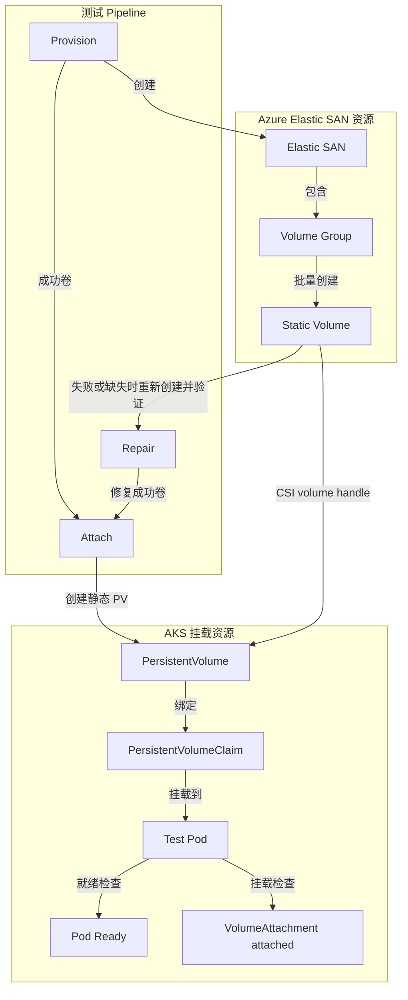

# AKS + Azure Elastic SAN：12 万级 AI Agent 基础设施规模测试报告

**报告日期：** 2026-10-15  
**测试周期：** 2026-09-25 至 2026-10-15

## 1. 核心结论

**AKS + Azure Elastic SAN 已完成 12 万级 Pod 与持久化卷的规模验证，为采用“每个 Agent 独立 Pod、独立持久化卷”架构的大规模 AI Agent 平台提供了基础设施容量依据。**

| 核心指标 | 测试结论 |
|---|---|
| 最大验证规模 | **120,000 个 Pod + 持久化卷，对应 120,000 个 Agent 部署槽位** |
| 单节点部署密度 | **150 个挂载持久卷的 Pod / 用户节点** |
| 单个 Elastic SAN 卷容量 | **20,000 个卷** |
| 120K 规模的计算资源 | **1 个 AKS 集群，800 台用户节点，另配 6 台系统节点** |
| 120K 规模的存储容量方案 | **6 个 Elastic SAN，每个承载 20,000 卷** |
| Azure 订阅需求 | **1 个订阅，提前完成 Elastic SAN 配额提升** |
| 卷配置速度限制 | **订阅级 3,400 卷/小时、10 卷/秒，两项同时生效** |

该方案通过独立 Pod 和持久化卷承载每个 Agent，可将计算调度与持久化存储统一纳入 Kubernetes 管理，并按批次扩展至十万级部署规模。

本次验证覆盖基础设施部署、卷配置、失败修复及挂载就绪。生产环境的 Agent 密度和持续运行指标，应结合实际业务的 CPU、内存、存储 I/O 与可用性目标完成验收。

## 2. 资源需求与容量设计

### 2.1 120K 规模资源方案

| 资源 | 数量与配置 | 容量设计 |
|---|---|---|
| AKS 集群 | 1 个 | 统一承载 Agent Pod |
| 用户节点 | 800 台，采用下列 48 CPU 规格 | `800 × 150 = 120,000` 个 Pod 槽位 |
| 系统节点 | 6 台 Standard_D16ds_v6 | 承载 AKS 系统组件 |
| AKS 节点总数 | **806 台** | 用户节点与系统节点分别规划 |
| Azure Elastic SAN | 6 个 | `6 × 20,000 = 120,000` 个卷 |
| Azure 订阅 | 1 个 | 需具备相应计算资源及 Elastic SAN 配额 |

以上为目标规模的满配容量方案。生产部署需另行预留节点维护、故障迁移、存储增长与扩容所需的余量。测试区域内共记录 7 个 Elastic SAN；目标卷容量按上述 6 个 SAN 满配方案规划。

### 2.2 AKS 节点规格与数量

| 节点用途 | SKU | 每节点 CPU | 节点数 |
|---|---|---:|---:|
| 用户负载 | Standard_D48ds_v4 | 48 | 100 |
| 用户负载 | Standard_D48d_v4 | 48 | 100 |
| 用户负载 | Standard_D48s_v3 | 48 | 200 |
| 用户负载 | Standard_D48_v3 | 48 | 200 |
| 用户负载 | Standard_D48_v4 | 48 | 200 |
| AKS 系统 | Standard_D16ds_v6 | 16 | 6 |
| **合计** | **800 台用户节点 + 6 台系统节点** | — | **806** |

测试采用每用户节点 150 Pod 的部署密度；业务应用的资源请求、系统组件开销和运维余量应纳入生产节点容量设计。

## 3. 部署限制与速度规划

### 3.1 必须遵守的容量与速率限制

| 项目 | 限制或部署条件 | 规划要求 |
|---|---|---|
| 单个 Elastic SAN 卷数 | 20,000 个 | 按卷数量分布至多个 SAN |
| 每订阅 Elastic SAN 配额 | 本次配额提升至 10 个，默认配额为 5 个 | 120K 方案需要至少 6 个 SAN，上线前完成配额申请 |
| 卷配置小时速率 | **3,400 卷/小时，订阅级** | 多个 SAN 共享订阅级速率预算 |
| 卷配置秒级速率 | **10 卷/秒，订阅级** | 与小时限制同时实施限流 |
| 用户节点 Pod 密度 | 本次验证为 150 Pod/节点 | 使用相应节点规格，并保留生产运维余量 |
| 失败修复 | 删除、重建及复查均需纳入部署流程 | 为重试操作预留时间及控制面写操作预算 |

上述速率用于**卷配置控制面**。卷的数据面 IOPS、读写带宽及 Agent 业务性能，应按应用负载单独规划。

### 3.2 实测部署效率

| 部署环节 | 本次观测结果 | 容量规划含义 |
|---|---|---|
| 完整增量卷配置，含 repair | 万卷及以上、修复完成的批次平均配置速率约 **34.76–39.87 卷/分钟** | 部署窗口应包含首次配置与失败修复；120K 采用可恢复的整体时间估算 |
| Pod 挂载并 Ready | 60K 及以后、选中批次全部 Ready 的轮次约 **39.02–65.23 Pod/分钟** | 按实际挂载批量估算启动窗口 |
| 110K 轮大批量挂载 | **37,492 个 Pod** 在 **574.73 分钟**内 Ready，平均 **65.23 Pod/分钟** | 验证了单轮数万 Pod 的挂载就绪处理能力 |
| 120K 轮新增批次挂载 | **10,000 个 Pod** 在 **256.27 分钟**内 Ready，平均 **39.02 Pod/分钟** | 最新一轮选中批次全部 Ready，pending=0 |

这些观测值用于同类部署的时间预算。实际部署窗口还需覆盖批次间等待、资源准备和验收检查。

### 3.3 按速率预算估算的卷配置时间

按 3,400 卷/小时折算，新增卷的理想平均时间预算如下，**均为估算值**：

| 新增卷数 | 速率预算折算时间 |
|---|---:|
| 10,000 | 约 2.94 小时，即 176.47 分钟 |
| 20,000 | 约 5.88 小时，即 352.94 分钟 |
| 从零创建 120,000 | 约 35.29 小时，即 2,117.65 分钟 |

实际排期应在此基础上增加修复、Pod 挂载和运维余量，并同时满足秒级限流。本次测试从已有 40,000 卷开始逐轮扩容，累计新增卷目标为 80,000。

## 4. 测试场景与方法

### 4.1 Agent 部署模型

采用 **Per Agent Per Pod** 模式：

- 每个 Agent 运行于独立的 AKS Pod。
- 每个 Pod 挂载一个 Azure Elastic SAN 持久化卷。
- 通过分批配置、失败修复、挂载和就绪检查逐步扩大部署规模。

测试重点是验证最大部署规模、资源需求、配置速度，以及大规模增量部署的阶段耗时。

### 4.2 增量扩展路径

**每轮测试均在前一轮已完成规模的基础上增量叠加。`target_total_volumes` 表示本轮结束时的累计目标规模。**

扩展路径为：

**40K → 42K → 45K → 60K → 70K → 90K → 100K → 110K → 120K。**

例如，从 100K 扩展到 110K 时，本轮新增卷目标为 10,000；该轮实际执行挂载并 Ready 的 Pod 为 37,492，包含本轮新增卷以外的处理对象。卷配置和 Pod 挂载分别按各自的实际处理量统计效率。

### 4.3 测试执行步骤/阶段

- **Provision（资源创建）**：统计现有 Elastic SAN 卷，并按目标规模增量创建 Elastic SAN、Volume Group 和静态 Volume。创建过程采用批处理、限流和自动重试，同时记录耗时与成功率。

- **Repair（失败修复）**：识别创建失败或缺失的 Volume，删除失败资源后使用相同名称重新创建。最多执行四轮修复，并记录每轮修复结果。

- **Attach（挂载验证）**：为创建成功且尚未挂载的 Volume 创建 Kubernetes PV、PVC 和测试 Pod。通过检查 Pod Ready 状态和 VolumeAttachment 的 `attached=true` 状态，验证静态卷挂载链路。

<!-- mermaid-checked: no \n, no em-dash/en-dash, no {} in labels, subgraphs are id["label"], arrows are -->

## 5. 分轮测试结果

### 5.1 执行顺序与增量规模

| 轮次 | 本轮前已有卷数 | 本轮新增卷目标 | 累计目标卷数 | 本轮挂载选中数 | 实际 Ready 数 |
|---|---:|---:|---:|---:|---:|
| 42K | 40,000 | 2,000 | 42,000 | 首次 1,982；后续 21 | 1,979 + 18 = **1,997** |
| 45K | 42,000 | 3,000 | 45,000 | 3,003 | **2,990** |
| 60K | 45,000 | 15,000 | 60,000 | 15,000 | **15,000** |
| 70K | 60,000 | 10,000 | 70,000 | 10,000 | **10,000** |
| 90K | 70,000 | 20,000 | 90,000 | 20,000 | **19,946** |
| 100K | 90,000 | 10,000 | 100,000 | 10,000 | **10,000** |
| 110K | 100,000 | 10,000 | 110,000 | 37,492 | **37,492** |
| 120K | 110,000 | 10,000 | 120,000 | 10,000 | **10,000** |

### 5.2 各阶段耗时

| 轮次 | Provision 原始耗时 | 分钟 | Repair 原始耗时 | 分钟 | Attach 原始耗时 | 分钟 |
|---|---|---:|---|---:|---|---:|
| 42K | 18m 40s | 18.67 | 6m 1s | 6.02 | 4h 7m 18s | 247.30 |
| 45K | 1h 21m 27s | 81.45 | 6m 51s | 6.85 | 4h 46m 48s | 286.80 |
| 60K | 6h 25m 29s | 385.48 | 16m 52s | 16.87 | 4h 20m 28s | 260.47 |
| 70K | 4h 0m 33s | 240.55 | 17m 9s | 17.15 | 3h 7m 9s | 187.15 |
| 90K | 7h 56m 56s | 476.93 | 24m 39s | 24.65 | 8h 17m 46s | 497.77 |
| 100K | 4h 6m 47s | 246.78 | 32m 54s | 32.90 | 3h 45m 23s | 225.38 |
| 110K | 3h 18m 58s | 198.97 | 1h 10m 51s | 70.85 | 9h 34m 44s | 574.73 |
| 120K | 3h 19m 38s | 199.63 | 56m 14s | 56.23 | 4h 16m 16s | 256.27 |

### 5.3 卷配置结果与平均每分钟速率

单位：**卷/分钟**，表示平均每分钟处理或成功配置的卷数。首次配置成功速率按首次配置成功数计算；卷配置完成速率同时计入 provision 与失败修复的阶段耗时。

| 轮次 | 新增卷目标 | 首次成功 / 失败 | 首次成功率 | 首次配置成功速率（分钟） | repair 结果 | 卷配置完成速率（含失败修复）（分钟） |
|---|---:|---|---:|---:|---|---:|
| 42K | 2,000 | 1,982 / 18 | 99.10% | **106.18** | 后续 18 个全部修复 | **81.03** |
| 45K | 3,000 | 2,965 / 35 | 98.83% | **36.40** | 35 个全部修复 | **33.98** |
| 60K | 15,000 | 14,746 / 254 | 98.31% | **38.25** | 254 个全部修复 | **37.28** |
| 70K | 10,000 | 9,770 / 230 | 97.70% | **40.62** | 230 个全部修复 | **38.80** |
| 90K | 20,000 | 19,572 / 428 | 97.86% | **41.04** | 428 个全部修复 | **39.87** |
| 100K | 10,000 | 9,403 / 597 | 94.03% | **38.10** | 597 个全部修复 | **35.75** |
| 110K | 10,000 | 9,151 / 849 | 91.51% | **45.99** | 849 个经两轮全部修复 | **37.06** |
| 120K | 10,000 | 8,627 / 1,373 | 86.27% | **43.21** | 1,373 个全部修复 | **34.76** |

120K 的卷配置完成速率采用可恢复的整体时间估算：按首次配置成功速率反推 provision 时间为 `10,000 ÷ 43.21 ≈ 231.43` 分钟，加上从首次 plan 到最终确认完成的 repair 估算时间 56.23 分钟，总计约 287.66 分钟，因此 `10,000 ÷ 287.66 ≈ 34.76` 卷/分钟。该值不是使用 5.2 中 provision 阶段实测耗时计算的。

**部署观察：** 42K 至 120K 轮的首次配置失败对象均通过后续 repair 完成修复或最终确认完成。110K、120K 轮首次配置分别有 849、1,373 个失败对象，表明大规模部署需要将修复流程和时间预算纳入标准交付路径。

42K 为短时小批量，其平均速率高于其他批次；持续部署按订阅级小时与秒级速率预算规划。

### 5.4 Pod 挂载就绪结果与平均每分钟速率

| 轮次 | 实际 Ready 数 | 阶段耗时（分钟） | 平均挂载就绪速率（Pod/分钟） | 批次结果 |
|---|---:|---:|---:|---|
| 42K | 1,997 | 247.30 | **8.08（估算）** | 分两次执行，仍有 3 个 pending |
| 45K | 2,990 | 286.80 | **10.43** | 选中 3,003 个，13 个 pending，等待超时 |
| 60K | 15,000 | 260.47 | **57.59** | 选中批次全部 Ready |
| 70K | 10,000 | 187.15 | **53.43** | 选中批次全部 Ready |
| 90K | 19,946 | 497.77 | **40.07** | 选中 20,000 个，42 个 pending，另有 12 个状态待确认 |
| 100K | 10,000 | 225.38 | **44.37** | 选中批次全部 Ready |
| 110K | 37,492 | 574.73 | **65.23** | 选中批次全部 Ready |
| 120K | 10,000 | 256.27 | **39.02** | 选中批次全部 Ready |

42K 的平均挂载就绪速率按两次 Ready 数合计 1,997 计算，并假设 247.30 分钟覆盖两次执行。各轮挂载量按实际处理批次独立统计。

## 6. 生产部署建议

**容量按目标规模设计，部署按速率预算推进，验收按全量终态与业务指标执行。**

| 规划领域 | 建议 |
|---|---|
| 资源与配额 | 提前落实节点 SKU、计算资源配额、SAN 数量及订阅配额；800 台用户节点和 6 个 SAN 之外另留运维余量 |
| 分批上线 | 按“卷配置 → 失败修复 → Pod 挂载就绪”的批次流程推进，分别监控各阶段完成率 |
| 限流与重试 | 在订阅级统一管理 3,400 卷/小时与 10 卷/秒限制，协调并发部署和 repair 操作 |
| 时间预算 | 将修复、挂载、批次间等待和验收检查计入上线窗口；万卷以上批次优先参考第 3.2 节的实测效率 |
| 运行验收 | 对集群全量 Pod Ready、PV/PVC、卷映射进行核对，并结合真实 Agent 负载验证持续运行、I/O 与故障恢复 |
| 版本管理 | 固定镜像版本或摘要，确保测试与生产环境一致 |

## 附录 A：测试参数

**镜像A='ghcr.io/openclaw/openclaw:latest'**

| 参数 | 42K | 45K | 60K | 70K | 90K | 100K | 110K | 120K |
|---|---|---|---|---|---|---|---|---|
| `target_total_volumes` | 42,000 | 45,000 | 60,000 | 70,000 | 90,000 | 100,000 | 110,000 | 120,000 |
| `max_volume_writes_per_hour` | 3,000 | 3,000 | 3,000 | 3,000 | 3,000 | 3,000 | 3,400 | 3,400 |
| `max_volume_writes_per_burst` | 20 | 20 | 20 | 20 | 20 | 20 | 20 | 20 |
| `burst_window_seconds` | 1.1 | 1.1 | 1.1 | 1.1 | 1.1 | 1.1 | 1.1 | 1.1 |
| `pods_per_node` | 150 | 150 | 150 | 150 | 150 | 150 | 150 | 150 |
| `pod_image` | 镜像A | 镜像A | 镜像A | 镜像A | 镜像A | 镜像A | 镜像A | 镜像A |
| `pod_cpu_request` | 300m | 300m | 300m | 300m | 300m | 300m | 300m | 300m |
| `pod_memory_request` | 32Mi | 32Mi | 32Mi | 32Mi | 32Mi | 32Mi | 32Mi | 32Mi |

镜像 A：`ghcr.io/openclaw/openclaw:latest`。

上述突发参数为测试客户端配置。生产限流统一遵守订阅级 10 卷/秒及 3,400 卷/小时限制。

## 附录 B：计时与计算口径

### B.1 平均每分钟速率计算

正文统一采用阶段执行耗时，先按秒计算，再换算为分钟并保留两位小数。

| 指标 | 计算方式 |
|---|---|
| 首次配置成功速率（卷/分钟） | 首次配置成功卷数 ÷ provision 阶段分钟数 |
| 卷配置完成速率（含失败修复，卷/分钟） | 最终修复完成的新增独立卷数 ÷（provision + repair）阶段分钟数 |
| 平均挂载就绪速率（Pod/分钟） | 对应批次实际 Ready 数 ÷ attach + ready 阶段分钟数 |
