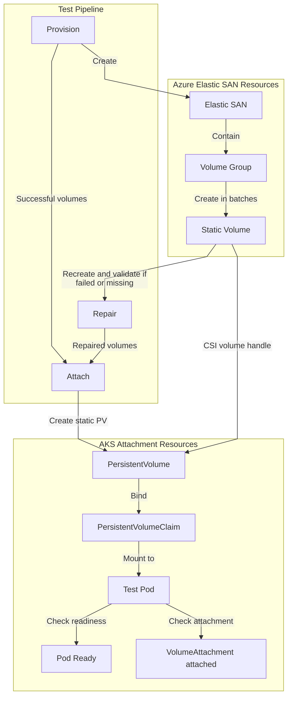

# AKS + Azure Elastic SAN: 120K-Scale AI Agent Infrastructure Test Report

**Report date:** 2026-10-15  
**Test period:** 2026-09-25 to 2026-10-15

## 1. Key Findings

**AKS + Azure Elastic SAN has completed scale validation for 120K Pods with persistent volumes, providing an infrastructure capacity baseline for large-scale AI Agent platforms that use a dedicated Pod and persistent volume for each Agent.**

| Key Metric | Test Finding |
|---|---|
| Largest validated scale | **120,000 Pods with persistent volumes, providing 120,000 Agent deployment slots** |
| Per-node deployment density | **150 Pods with persistent volumes per user node** |
| Volume capacity per Elastic SAN | **20,000 volumes** |
| Compute resources for 120K scale | **1 AKS cluster with 800 user nodes, plus 6 system nodes** |
| Storage capacity plan for 120K scale | **6 Elastic SANs, each hosting 20,000 volumes** |
| Azure subscription requirement | **1 subscription, with the Elastic SAN quota increase completed in advance** |
| Volume provisioning rate limits | **3,400 volumes/hour and 10 volumes/second at subscription level; both limits apply simultaneously** |

By assigning each Agent a dedicated Pod and persistent volume, this architecture brings compute scheduling and persistent storage under Kubernetes management and supports batch-based expansion to 120K deployment slots.

The validation covers infrastructure deployment, volume provisioning, failure repair, and attachment readiness. Production Agent density and sustained-operation targets should be validated against actual application CPU, memory, storage I/O, and availability requirements.

## 2. Resource Requirements and Capacity Design

### 2.1 Resource Plan for 120K Scale

| Resource | Quantity and Configuration | Capacity Design |
|---|---|---|
| AKS cluster | 1 | Hosts the Agent Pods |
| User nodes | 800, using the 48-CPU SKUs listed below | `800 * 150 = 120,000` Pod slots |
| System nodes | 6 Standard_D16ds_v6 nodes | Host AKS system components |
| Total AKS nodes | **806** | User and system node capacity planned separately |
| Azure Elastic SAN | 6 | `6 * 20,000 = 120,000` volumes |
| Azure subscription | 1 | Requires sufficient compute and Elastic SAN quotas |

This plan uses the full configured capacity to reach the target scale. Production deployments should allocate additional headroom for node maintenance, failover, storage growth, and expansion. The test region contained 7 Elastic SANs; the target volume capacity is planned using the fully populated 6-SAN design above.

### 2.2 AKS Node SKUs and Counts

| Node Role | SKU | CPUs per Node | Node Count |
|---|---|---:|---:|
| User workloads | Standard_D48ds_v4 | 48 | 100 |
| User workloads | Standard_D48d_v4 | 48 | 100 |
| User workloads | Standard_D48s_v3 | 48 | 200 |
| User workloads | Standard_D48_v3 | 48 | 200 |
| User workloads | Standard_D48_v4 | 48 | 200 |
| AKS system | Standard_D16ds_v6 | 16 | 6 |
| **Total** | **800 user nodes + 6 system nodes** | - | **806** |

The test used a deployment density of 150 Pods per user node. Production node capacity planning should account for application resource requests, system component overhead, and operational headroom.

## 3. Deployment Limits and Rate Planning

### 3.1 Required Capacity and Rate Constraints

| Item | Limit or Deployment Condition | Planning Requirement |
|---|---|---|
| Volumes per Elastic SAN | 20,000 | Distribute volumes across multiple SANs |
| Elastic SAN quota per subscription | Increased to 10 for this test; default quota is 5 | The 120K plan requires at least 6 SANs; complete the quota request before deployment |
| Hourly volume provisioning rate | **3,400 volumes/hour, subscription-wide** | Multiple SANs share the subscription-level rate budget |
| Per-second volume provisioning rate | **10 volumes/second, subscription-wide** | Enforce this limit together with the hourly limit |
| User node Pod density | 150 Pods/node validated in this test | Use the corresponding node SKUs and reserve production operational headroom |
| Failure repair | Include deletion, recreation, and revalidation in the deployment workflow | Reserve time and a control-plane write-operation budget for retries |

These rate limits apply to the **volume provisioning control plane**. Plan volume data-plane IOPS, read/write bandwidth, and Agent application performance separately based on workload requirements.

### 3.2 Measured Deployment Rates

| Deployment Activity | Observed Result | Capacity Planning Implication |
|---|---|---|
| Complete incremental volume provisioning, including repair | Approximately **35.75-39.87 volumes/minute** for batches of at least 10,000 volumes with completed repair | Include both initial provisioning and failure repair in the deployment window |
| Pod attachment and readiness | Approximately **39.02-65.23 Pods/minute** in rounds from 60K onward where the entire selected batch reached Ready | Estimate the startup window using the actual attachment batch size |
| Large attachment batch in the 110K round | **37,492 Pods** reached Ready in **574.73 minutes**, averaging **65.23 Pods/minute** | Validated attachment and readiness processing for tens of thousands of Pods in a single round |
| Incremental attachment batch in the 120K round | **10,000 Pods** reached Ready in **256.27 minutes**, averaging **39.02 Pods/minute** | The entire selected batch in the latest round reached Ready, with pending=0 |

Use these observations to budget time for comparable deployments. The overall deployment window should also cover inter-batch waiting, resource preparation, and acceptance checks.

### 3.3 Estimated Volume Provisioning Time Based on the Rate Budget

At 3,400 volumes/hour, the idealized average time budgets for new volumes are as follows. **All values below are estimates.**

| New Volumes | Time Based on the Rate Budget |
|---|---:|
| 10,000 | Approximately 2.94 hours, or 176.47 minutes |
| 20,000 | Approximately 5.88 hours, or 352.94 minutes |
| 120,000 created from scratch | Approximately 35.29 hours, or 2,117.65 minutes |

Add time for repair, Pod attachment, and operational headroom when scheduling deployments, while also observing the per-second limit. This test expanded incrementally from 40,000 existing volumes, with a cumulative target of 80,000 new volumes.

## 4. Test Scenario and Methodology

### 4.1 Agent Deployment Model

The test uses a **Per Agent Per Pod** model:

- Each Agent runs in a dedicated AKS Pod.
- Each Pod mounts an Azure Elastic SAN persistent volume.
- Deployment scale increases progressively through batch provisioning, failure repair, attachment, and readiness checks.

The test focuses on validating the largest deployment scale, resource requirements, provisioning rates, and stage durations for large-scale incremental deployments.

### 4.2 Incremental Scaling Path

**Each test round adds incrementally to the scale completed in the preceding round. `target_total_volumes` is the cumulative target at the end of the current round.**

The scaling path is:

**40K -> 42K -> 45K -> 60K -> 70K -> 90K -> 100K -> 110K -> 120K.**

For example, expanding from 100K to 110K targets 10,000 new volumes. In that round, 37,492 Pods were attached and reached Ready, including processing beyond the newly added volumes. Volume provisioning and Pod attachment rates are calculated separately using their respective processing counts.

### 4.3 Test Execution Steps and Stages

- **Provision**: Counts existing Elastic SAN volumes and incrementally creates Elastic SANs, volume groups, and static volumes to reach the target scale. Provisioning uses batching, rate limiting, and automatic retries while recording duration and success rate.

- **Repair**: Identifies failed or missing volumes, deletes failed resources, and recreates them with the same names. It performs up to four repair rounds and records the result of each round.

- **Attach**: Creates Kubernetes PVs, PVCs, and test Pods for successful volumes that are not currently attached. It validates the static volume attachment path by checking Pod Ready status and confirming `VolumeAttachment.status.attached=true`.

<!-- mermaid-checked: no \n, no em-dash/en-dash, no {} in labels, subgraphs are id["label"], arrows are -->

## 5. Results by Test Round

### 5.1 Execution Order and Incremental Scale

| Round | Existing Volumes Before Round | New Volume Target | Cumulative Volume Target | Selected for Attachment in This Round | Actual Ready Count |
|---|---:|---:|---:|---:|---:|
| 42K | 40,000 | 2,000 | 42,000 | Initial: 1,982; subsequent: 21 | 1,979 + 18 = **1,997** |
| 45K | 42,000 | 3,000 | 45,000 | 3,003 | **2,990** |
| 60K | 45,000 | 15,000 | 60,000 | 15,000 | **15,000** |
| 70K | 60,000 | 10,000 | 70,000 | 10,000 | **10,000** |
| 90K | 70,000 | 20,000 | 90,000 | 20,000 | **19,946** |
| 100K | 90,000 | 10,000 | 100,000 | 10,000 | **10,000** |
| 110K | 100,000 | 10,000 | 110,000 | 37,492 | **37,492** |
| 120K | 110,000 | 10,000 | 120,000 | 10,000 | **10,000** |

### 5.2 Stage Durations

| Round | Provision Original Duration | Minutes | Repair Original Duration | Minutes | Attach Original Duration | Minutes |
|---|---|---:|---|---:|---|---:|
| 42K | 18m 40s | 18.67 | 6m 1s | 6.02 | 4h 7m 18s | 247.30 |
| 45K | 1h 21m 27s | 81.45 | 6m 51s | 6.85 | 4h 46m 48s | 286.80 |
| 60K | 6h 25m 29s | 385.48 | 16m 52s | 16.87 | 4h 20m 28s | 260.47 |
| 70K | 4h 0m 33s | 240.55 | 17m 9s | 17.15 | 3h 7m 9s | 187.15 |
| 90K | 7h 56m 56s | 476.93 | 24m 39s | 24.65 | 8h 17m 46s | 497.77 |
| 100K | 4h 6m 47s | 246.78 | 32m 54s | 32.90 | 3h 45m 23s | 225.38 |
| 110K | 3h 18m 58s | 198.97 | 1h 10m 51s | 70.85 | 9h 34m 44s | 574.73 |
| 120K | 3h 19m 38s | 199.63 | **Not recorded** | - | 4h 16m 16s | 256.27 |

Each stage is measured by its individual execution duration; some rounds span multiple runs or days. The repair duration for the 120K round remains to be provided.

### 5.3 Volume Provisioning Results and Average Per-Minute Rates

Unit: **volumes/minute**, representing the average number of volumes processed or successfully provisioned per minute. The initial successful provisioning rate uses the initial success count; the provisioning completion rate includes both provisioning and failure-repair stage durations.

| Round | New Volume Target | Initial Successes / Failures | Initial Success Percentage | Initial Successful Provisioning Rate (Minutes) | Repair Result | Provisioning Completion Rate (Including Failure Repair) (Minutes) |
|---|---:|---|---:|---:|---|---:|
| 42K | 2,000 | 1,982 / 18 | 99.10% | **106.18** | All 18 subsequently repaired | **81.03** |
| 45K | 3,000 | 2,965 / 35 | 98.83% | **36.40** | All 35 repaired | **33.98** |
| 60K | 15,000 | 14,746 / 254 | 98.31% | **38.25** | All 254 repaired | **37.28** |
| 70K | 10,000 | 9,770 / 230 | 97.70% | **40.62** | All 230 repaired | **38.80** |
| 90K | 20,000 | 19,572 / 428 | 97.86% | **41.04** | All 428 repaired | **39.87** |
| 100K | 10,000 | 9,403 / 597 | 94.03% | **38.10** | All 597 repaired | **35.75** |
| 110K | 10,000 | 9,151 / 849 | 91.51% | **45.99** | All 849 repaired over two repair rounds | **37.06** |
| 120K | 10,000 | 8,627 / 1,373 | 86.27% | **43.21** | **Repair report and duration not recorded** | **Not calculable** |

**Deployment observation:** Initial provisioning failures in rounds from 42K through 110K were resolved through subsequent repair. The 110K and 120K rounds had 849 and 1,373 initial failures, respectively, highlighting the need to include repair workflows and time budgets in standard large-scale deployment procedures. In the subsequent attachment batch of the 120K round, all 10,000 Pods reached Ready.

The 42K round was a short, small batch with a higher average rate than the other batches. Plan sustained deployment using the subscription-level hourly and per-second rate budgets.

### 5.4 Pod Attachment Readiness Results and Average Per-Minute Rates

| Round | Actual Ready Count | Stage Duration (Minutes) | Average Attachment Readiness Rate (Pods/Minute) | Batch Result |
|---|---:|---:|---:|---|
| 42K | 1,997 | 247.30 | **8.08 (estimated)** | Executed in two runs; 3 Pods still pending |
| 45K | 2,990 | 286.80 | **10.43** | 3,003 selected; 13 pending; readiness wait timed out |
| 60K | 15,000 | 260.47 | **57.59** | Entire selected batch reached Ready |
| 70K | 10,000 | 187.15 | **53.43** | Entire selected batch reached Ready |
| 90K | 19,946 | 497.77 | **40.07** | 20,000 selected; 42 pending; status of another 12 remains to be confirmed |
| 100K | 10,000 | 225.38 | **44.37** | Entire selected batch reached Ready |
| 110K | 37,492 | 574.73 | **65.23** | Entire selected batch reached Ready |
| 120K | 10,000 | 256.27 | **39.02** | Entire selected batch reached Ready |

The average attachment readiness rate for 42K uses the combined Ready count of 1,997 across both runs and assumes that 247.30 minutes covers both executions. Attachment counts are tracked independently for the batch processed in each round.

## 6. Production Deployment Recommendations

**Design capacity for the target scale, deploy within the rate budget, and validate completion against cluster-wide final status and application metrics.**

| Planning Area | Recommendation |
|---|---|
| Resources and quotas | Confirm node SKUs, compute quotas, SAN counts, and subscription quotas in advance; reserve operational headroom beyond 800 user nodes and 6 SANs |
| Phased rollout | Use a batch workflow of volume provisioning -> failure repair -> Pod attachment readiness, monitoring completion at each stage |
| Rate limiting and retries | Centrally enforce the subscription-level limits of 3,400 volumes/hour and 10 volumes/second, coordinating concurrent deployments and repair operations |
| Time budget | Include repair, attachment, inter-batch waiting, and acceptance checks in the deployment window; for batches of at least ten thousand volumes, prioritize the measured rates in Section 3.2 |
| Operational acceptance | Verify cluster-wide Pod Ready status, PV/PVCs, and volume mappings; validate sustained operation, I/O, and failure recovery under actual Agent workloads |
| Version management | Pin image versions or digests to keep test and production environments consistent |

## Appendix A: Test Parameters

**Image A='ghcr.io/openclaw/openclaw:latest'**

| Parameter | 42K | 45K | 60K | 70K | 90K | 100K | 110K | 120K |
|---|---|---|---|---|---|---|---|---|
| `target_total_volumes` | 42,000 | 45,000 | 60,000 | 70,000 | 90,000 | 100,000 | 110,000 | 120,000 |
| `max_volume_writes_per_hour` | 3,000 | 3,000 | 3,000 | 3,000 | 3,000 | 3,000 | 3,400 | 3,400 |
| `max_volume_writes_per_burst` | 20 | 20 | 20 | 20 | 20 | 20 | 20 | 20 |
| `burst_window_seconds` | 1.1 | 1.1 | 1.1 | 1.1 | 1.1 | 1.1 | 1.1 | 1.1 |
| `pods_per_node` | 150 | 150 | 150 | 150 | 150 | 150 | 150 | 150 |
| `pod_image` | Image A | Image A | Image A | Image A | Image A | Image A | Image A | Image A |
| `pod_cpu_request` | 300m | 300m | 300m | 300m | 300m | 300m | 300m | 300m |
| `pod_memory_request` | 32Mi | 32Mi | 32Mi | 32Mi | 32Mi | 32Mi | 32Mi | 32Mi |

Image A: `ghcr.io/openclaw/openclaw:latest`. Image configurations for the 45K, 60K, and 70K rounds were not recorded.

The burst parameters above are test-client settings. Production rate limiting must enforce the subscription-level limits of 10 volumes/second and 3,400 volumes/hour.

## Appendix B: Timing and Calculation Definitions

### B.1 Average Per-Minute Rate Calculations

The main report uses stage execution durations. Calculations use seconds before conversion to minutes, with results rounded to two decimal places.

| Metric | Calculation |
|---|---|
| Initial successful provisioning rate (volumes/minute) | Initially successful volume count / provisioning stage duration in minutes |
| Incremental target processing rate (including failures, volumes/minute) | New volume target for the round / provisioning stage duration in minutes, including initially failed objects |
| Provisioning completion rate (including failure repair, volumes/minute) | New unique volumes successfully provisioned after repair / combined provisioning and repair stage durations in minutes |
| Average attachment readiness rate (Pods/minute) | Actual Ready count for the batch / attach + ready stage duration in minutes |

### B.2 Internal Script Processing Durations

Internal script timings provide supplementary information for processing-efficiency analysis and are presented separately from the stage execution durations used in the main report. Each entry below shows original seconds -> minutes.

| Round | Provision | Repair | Attach + Ready |
|---|---|---|---|
| 42K | 915.428 s -> 15.26 | 134.557 s -> 2.24 | Not recorded |
| 45K | 4586.765 s -> 76.45 | 179.835 s -> 3.00 | Not recorded |
| 60K | 22830.439 s -> 380.51 | 775.449 s -> 12.92 | 14470.605 s -> 241.18 |
| 70K | 14013.451 s -> 233.56 | 877.860 s -> 14.63 | 9865.825 s -> 164.43 |
| 90K | 28074.531 s -> 467.91 | 1300.812 s -> 21.68 | Not recorded |
| 100K | 14153.773 s -> 235.90 | 1824.075 s -> 30.40 | 11064.007 s -> 184.40 |
| 110K | Not recorded | 4005.464 s -> 66.76 | 30800.872 s -> 513.35 |
| 120K | 10773.166 s -> 179.55 | Not recorded | 11474.038 s -> 191.23 |
